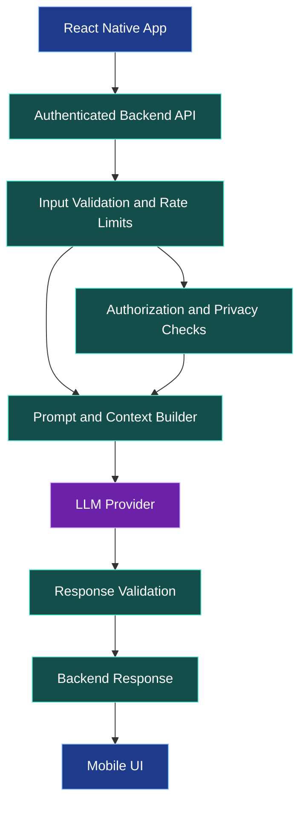
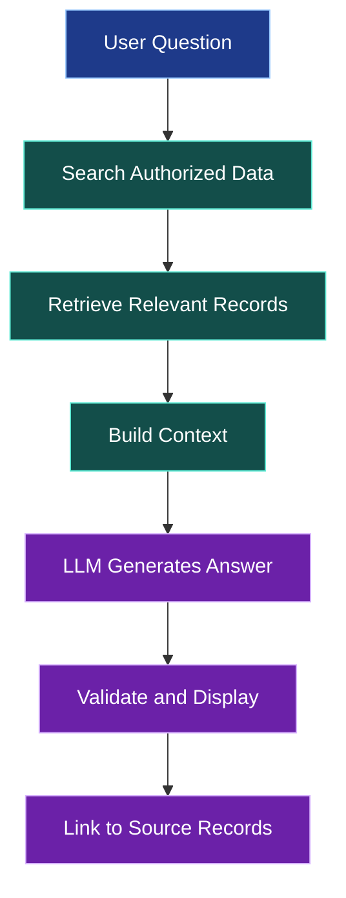

# 🤖 Integrating LLMs into Mobile Applications

[⬅️ Back to Learning Modules](../README.md) · 

> **AI Developer – App Development | Phase 4 · Topic 13**

Learn how to integrate Large Language Models (LLMs) into mobile applications, design reliable AI features, build backend-mediated inference, and handle responses, errors, costs, and privacy.

---

## 🎯 Learning Objectives

By the end of this topic, you will be able to:

- Explain what an LLM does and how a mobile app uses it.
- Identify suitable AI use cases for mobile applications.
- Design a secure architecture for AI integration.
- Send prompts and receive structured responses through a backend.
- Display loading, success, and error states.
- Use structured output and validate model responses.
- Control latency, token usage, and API costs.
- Apply privacy, safety, and responsible-AI practices.

## 1. 🧠 What Is an LLM?

A Large Language Model is an AI model trained to process and generate language. Depending on the model, it may also support image understanding, tool use, structured output, or other capabilities.

Mobile applications can use LLMs to provide:

- Conversational assistants.
- Personalized explanations and recommendations.
- Summaries of long documents.
- Natural-language search.
- Writing and translation assistance.
- Product descriptions and support responses.
- Structured extraction from user-provided text.

An LLM does not automatically know your application's private data, guarantee factual correctness, or enforce business permissions. These responsibilities must be addressed through application architecture and backend logic.

## 2. 🏗️ AI Mobile Application Architecture

A production application should normally route requests through a backend controlled by the application owner.



The backend is responsible for:

- Protecting provider credentials.
- Authenticating users and enforcing permissions.
- Validating inputs and limiting request sizes.
- Applying rate limits and spending controls.
- Selecting the appropriate model.
- Constructing prompts and adding authorized context.
- Validating the returned result.
- Recording safe operational metrics.

For a prototype, a direct client-to-provider connection may seem simpler, but embedding a private provider API key in a distributed mobile app exposes that key to extraction and abuse.

## 3. 🧩 Choose an AI Use Case

Before selecting a model, define the task.

| Use case | Input | Expected output |
|---|---|---|
| Product assistant | Question and authorized catalog data | Helpful product guidance |
| Writing assistant | User's draft | Suggested revision |
| Document summarizer | Uploaded document text | Concise summary |
| Natural-language search | Search phrase | Search filters or results |
| Support assistant | Question and approved help content | Grounded answer |
| Form assistant | User's description | Draft form fields for review |

A narrow, clearly defined task is easier to evaluate than a general-purpose assistant that is expected to do everything.

## 4. 🔐 Build a Backend AI Endpoint

The following example uses Node.js, Express, and a provider SDK behind the server. It uses the OpenAI JavaScript SDK as one concrete example; the same architecture applies to other LLM providers.

Install dependencies in the backend project:

```bash
npm install express openai dotenv
npm install -D typescript tsx @types/node @types/express
```

Set private environment variables on the server:

```dotenv
OPENAI_API_KEY=your_private_server_key
OPENAI_MODEL=your_supported_model_name
```

Do not commit `.env` to Git. Use your hosting platform's secret manager in production.

Create `src/aiRoutes.ts`:

```tsx
import { Router } from "express";
import OpenAI from "openai";

const router = Router();

const apiKey = process.env.OPENAI_API_KEY;
const model = process.env.OPENAI_MODEL;

if (!apiKey || !model) {
  throw new Error("AI provider configuration is missing.");
}

const client = new OpenAI({ apiKey });

router.post("/chat", async (req, res) => {
  const message = req.body?.message;

  if (
    typeof message !== "string" ||
    !message.trim() ||
    message.length > 4000
  ) {
    return res.status(400).json({
      error: "Provide a message between 1 and 4000 characters.",
    });
  }

  try {
    const response = await client.responses.create({
      model,
      instructions:
        "You are a helpful mobile-app assistant. Be clear, concise, and honest about uncertainty.",
      input: message.trim(),
    });

    return res.json({
      answer: response.output_text,
    });
  } catch {
    // Avoid returning provider credentials or internal errors.
    return res.status(502).json({
      error: "The AI service is temporarily unavailable.",
    });
  }
});

export default router;
```

Mount the route in your Express application:

```tsx
import express from "express";
import aiRoutes from "./aiRoutes";

const app = express();

app.use(express.json({ limit: "32kb" }));
app.use("/api/ai", aiRoutes);

app.listen(3000, "0.0.0.0", () => {
  console.log("Backend started on port 3000");
});
```

This is a teaching example, not a complete production service. Add authentication, per-user rate limits, request timeouts, spending controls, provider-compatible model configuration, monitoring, and appropriate content safeguards. Install and use the provider SDK version supported by your backend environment.

## 5. 📲 Call the AI Backend from React Native

Create `src/services/aiService.ts`:

```tsx
type AIReply = {
  answer: string;
};

const API_URL = process.env.EXPO_PUBLIC_API_URL;

export async function askAssistant(
  message: string
): Promise<string> {
  if (!API_URL) {
    throw new Error("AI service URL is not configured.");
  }

  const response = await fetch(`${API_URL}/ai/chat`, {
    method: "POST",
    headers: {
      "Content-Type": "application/json",
      Accept: "application/json",
    },
    body: JSON.stringify({ message }),
  });

  if (!response.ok) {
    throw new Error("Unable to get an AI response.");
  }

  const data: AIReply = await response.json();

  if (typeof data.answer !== "string") {
    throw new Error("The AI service returned an invalid response.");
  }

  return data.answer;
}
```

This client is intentionally simple. If the endpoint is protected, attach the user's access token using the authentication service from Topic 11. Validate the response at runtime if it will be used for important application behavior.

## 6. 💬 Create an AI Assistant Screen

Create `app/assistant.tsx`:

```tsx
import { useState } from "react";
import {
  ActivityIndicator,
  Button,
  ScrollView,
  Text,
  TextInput,
  View,
} from "react-native";
import { askAssistant } from "../src/services/aiService";

export default function AssistantScreen() {
  const [message, setMessage] = useState("");
  const [answer, setAnswer] = useState("");
  const [error, setError] = useState("");
  const [loading, setLoading] = useState(false);

  async function sendMessage() {
    const prompt = message.trim();

    if (!prompt || loading) return;

    setLoading(true);
    setError("");
    setAnswer("");

    try {
      const result = await askAssistant(prompt);
      setAnswer(result);
    } catch {
      setError("Couldn't reach the assistant. Please try again.");
    } finally {
      setLoading(false);
    }
  }

  return (
    <ScrollView contentContainerStyle={{ padding: 24, gap: 16 }}>
      <Text style={{ fontSize: 26, fontWeight: "700" }}>
        AI Assistant
      </Text>

      <TextInput
        value={message}
        onChangeText={setMessage}
        placeholder="Ask a question..."
        multiline
        maxLength={4000}
        accessibilityLabel="Message to AI assistant"
        style={{
          minHeight: 110,
          borderWidth: 1,
          borderColor: "#CBD5E1",
          borderRadius: 12,
          padding: 14,
          textAlignVertical: "top",
        }}
      />

      <Button
        title={loading ? "Thinking..." : "Ask Assistant"}
        onPress={sendMessage}
        disabled={loading || !message.trim()}
      />

      {loading ? <ActivityIndicator /> : null}
      {error ? <Text accessibilityRole="alert">{error}</Text> : null}

      {answer ? (
        <View
          style={{
            padding: 16,
            backgroundColor: "#F1F5F9",
            borderRadius: 12,
          }}
        >
          <Text style={{ fontWeight: "700", marginBottom: 8 }}>
            Assistant Response
          </Text>
          <Text>{answer}</Text>
        </View>
      ) : null}
    </ScrollView>
  );
}
```

This screen makes one request at a time. Topic 14 will extend this pattern with message history, streaming, and voice input.

## 7. 🧱 Structured AI Output

Natural-language text is useful for conversation, but many application features require a predictable data structure.

For example, a product recommendation might need:

```json
{
  "summary": "A lightweight option for warm weather.",
  "productIds": ["p101", "p205"],
  "confidence": "medium"
}
```

Treat this as an illustrative response schema, not an instruction to trust whatever the model generates.

A robust implementation should:

1. Define a schema for the expected response.
2. Ask the model for structured output when supported.
3. Validate the response on the backend.
4. Verify every product ID against the authorized catalog.
5. Handle missing, invalid, or unexpected values.
6. Let the user review suggestions before taking consequential actions.

Never let a model invent a price, grant permissions, or establish that an order has been placed.

## 8. 🧠 Ground Responses in Your Application Data

An LLM may generate plausible but incorrect details. To answer questions about a specific product catalog, policy, or help center, provide relevant, authorized source data.

A retrieval-based flow may look like this:



This pattern is often called retrieval-augmented generation (RAG). The model can use retrieved content to produce a more relevant answer, but retrieval alone does not guarantee correctness.

Important safeguards:

- Filter data by the user's authorization before adding it to the prompt.
- Treat retrieved documents as untrusted content.
- Do not obey instructions found inside arbitrary retrieved documents.
- Provide source references when useful.
- Say when the information is unavailable instead of inventing an answer.

## 9. ⚡ Cost, Latency, and Reliability

LLM requests can be slower and more expensive than ordinary database queries.

- Set input-length limits.
- Choose a model appropriate for the task.
- Keep prompts concise.
- Limit output tokens where supported.
- Cache only responses that are safe to reuse.
- Avoid sending the same request repeatedly.
- Provide cancellation or a way to leave long-running tasks.
- Track latency, failure rates, and usage.
- Apply per-user quotas and provider spending limits.
- Use retries selectively and avoid retrying a non-idempotent operation blindly.

## 10. 🔏 Privacy and Responsible AI

- Explain how user prompts and uploaded files are processed.
- Send only data needed for the task.
- Avoid putting credentials, private records, or unnecessary personal data into prompts.
- Follow your provider's applicable data-handling and retention terms.
- Protect logs and remove sensitive content where possible.
- Clearly distinguish AI-generated content from verified facts.
- Provide human review for consequential recommendations.
- Evaluate responses for bias, unsafe advice, and prompt injection.
- Give users a way to report incorrect or harmful outputs.

## 11. 🌍 Real-World Scenario: AI Boutique Assistant

A customer asks, “What should I wear to an outdoor summer event?”

The application can retrieve products currently in stock, send only relevant product details to the backend AI service, and return suggestions linked to real catalog records.

The AI should not claim that a product is in stock based solely on model-generated text. Inventory availability must come from the authoritative backend.

### ⭐ Key Takeaways

- Integrate LLMs through a backend that protects credentials and enforces access.
- Define the task before selecting the model.
- Validate model output before using it in application logic.
- Ground answers in authorized data when accuracy matters.
- Treat latency, cost, privacy, and evaluation as core product requirements.