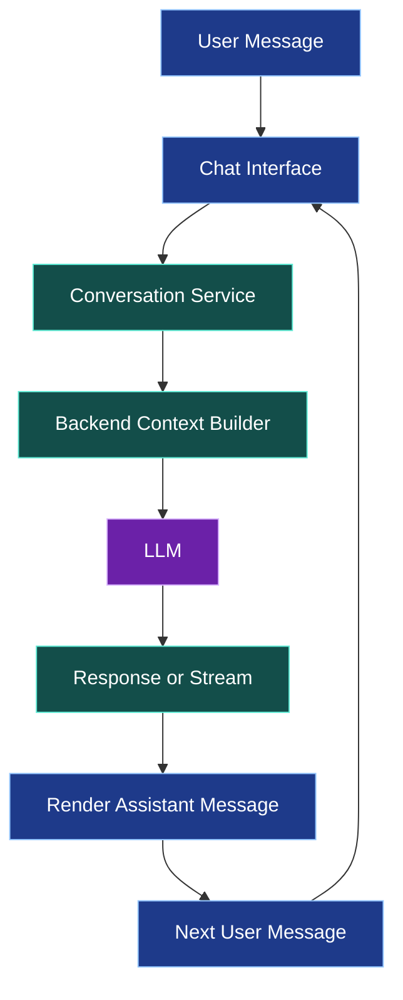
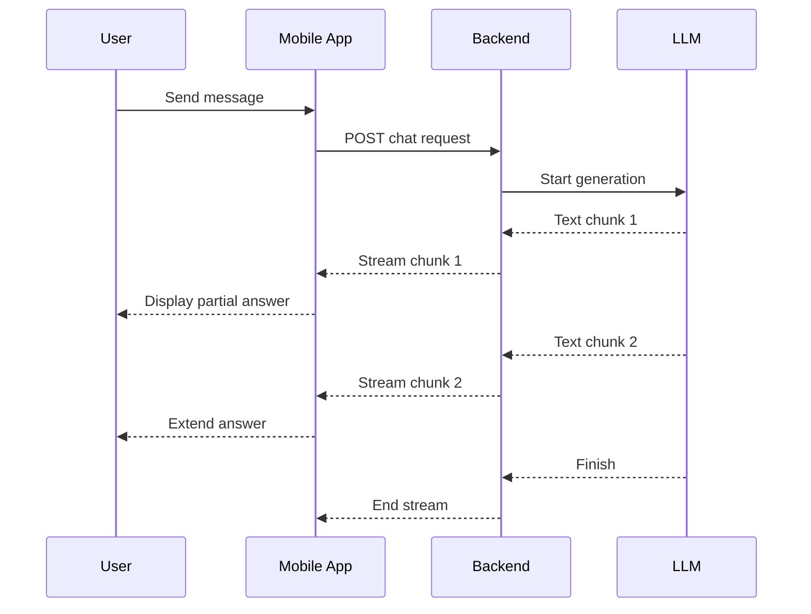
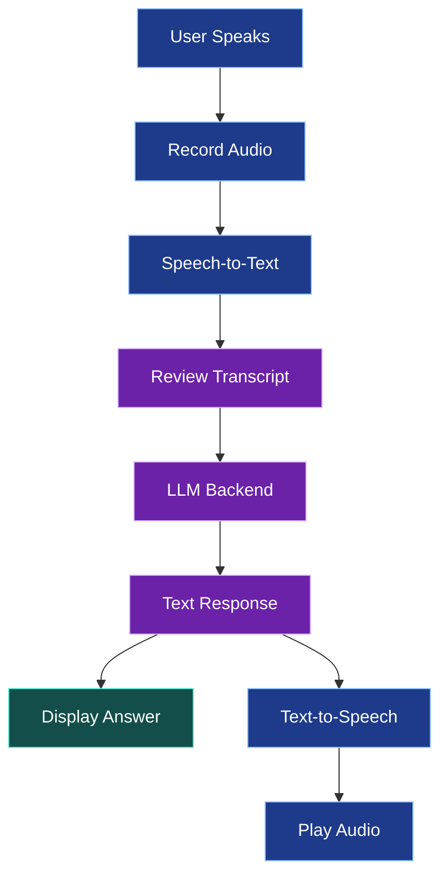

# 💬 AI Chatbots, Streaming Responses, and Voice Assistants

[⬅️ Previous](13-integrating-llms-into-mobile-applications.md) ·

> **AI Developer – App Development | Phase 4 · Topic 14**

Learn how to build conversational mobile interfaces, stream AI-generated text as it arrives, maintain conversation history, and add speech input and audio output.

---

## 🎯 Learning Objectives

By the end of this topic, you will be able to:

- Design a chatbot interface with messages and conversation state.
- Manage conversation history and loading states.
- Explain streaming responses and server-sent events.
- Implement a basic streaming client and backend.
- Integrate speech-to-text and text-to-speech services.
- Handle microphone permissions and audio playback.
- Protect conversational data and manage context length.

## 1. 🗣️ What Is a Mobile AI Chatbot?

A chatbot provides a conversational interface to an AI model or a backend service. Unlike a one-question assistant, a chatbot typically maintains a sequence of user and assistant messages.

Common use cases:

- Customer support.
- Learning and tutoring.
- Product recommendations.
- Voice-driven assistants.
- Writing and brainstorming.
- Natural-language navigation or search.



The chat UI handles presentation, while the backend manages model access, conversation context, authorization, and usage controls.

## 2. 🧱 Define a Message Model

A message should have a stable ID, a role, and content.

```tsx
export type ChatMessage = {
  id: string;
  role: "user" | "assistant";
  content: string;
  createdAt: number;
};
```

For applications that support tools, errors, or multimodal content, the model may need additional fields such as message status, attachments, or structured content blocks.

Do not assume all model responses are plain text. Some provider APIs return multiple content types or tool-call records.

## 3. 📱 Build a Chat Interface

The following screen demonstrates a simple non-streaming chat interface. It calls the `askAssistant()` service created in Topic 13.

```tsx
import { useState } from "react";
import {
  ActivityIndicator,
  FlatList,
  Pressable,
  Text,
  TextInput,
  View,
} from "react-native";
import { askAssistant } from "../src/services/aiService";

type Message = {
  id: string;
  role: "user" | "assistant";
  content: string;
};

export default function ChatScreen() {
  const [messages, setMessages] = useState<Message[]>([]);
  const [input, setInput] = useState("");
  const [loading, setLoading] = useState(false);

  async function sendMessage() {
    const content = input.trim();

    if (!content || loading) return;

    const userMessage: Message = {
      id: `${Date.now()}-user`,
      role: "user",
      content,
    };

    setMessages((previous) => [...previous, userMessage]);
    setInput("");
    setLoading(true);

    try {
      const reply = await askAssistant(content);

      setMessages((previous) => [
        ...previous,
        {
          id: `${Date.now()}-assistant`,
          role: "assistant",
          content: reply,
        },
      ]);
    } catch {
      setMessages((previous) => [
        ...previous,
        {
          id: `${Date.now()}-error`,
          role: "assistant",
          content: "I couldn't complete that request. Please try again.",
        },
      ]);
    } finally {
      setLoading(false);
    }
  }

  return (
    <View style={{ flex: 1, padding: 16, gap: 12 }}>
      <FlatList
        data={messages}
        keyExtractor={(item) => item.id}
        contentContainerStyle={{ gap: 12, paddingVertical: 12 }}
        renderItem={({ item }) => (
          <View
            style={{
              alignSelf: item.role === "user" ? "flex-end" : "flex-start",
              maxWidth: "88%",
              padding: 12,
              borderRadius: 14,
              backgroundColor:
                item.role === "user" ? "#DBEAFE" : "#F1F5F9",
            }}
          >
            <Text>{item.content}</Text>
          </View>
        )}
      />

      {loading ? <ActivityIndicator /> : null}

      <View style={{ flexDirection: "row", gap: 8 }}>
        <TextInput
          value={input}
          onChangeText={setInput}
          placeholder="Type your message..."
          multiline
          maxLength={4000}
          accessibilityLabel="Chat message"
          style={{
            flex: 1,
            minHeight: 48,
            maxHeight: 120,
            borderWidth: 1,
            borderColor: "#CBD5E1",
            borderRadius: 12,
            padding: 12,
          }}
        />

        <Pressable
          accessibilityRole="button"
          accessibilityLabel="Send message"
          disabled={loading || !input.trim()}
          onPress={sendMessage}
          style={{
            backgroundColor: "#2563EB",
            opacity: loading || !input.trim() ? 0.5 : 1,
            borderRadius: 12,
            padding: 14,
            justifyContent: "center",
          }}
        >
          <Text style={{ color: "#FFFFFF", fontWeight: "700" }}>
            Send
          </Text>
        </Pressable>
      </View>
    </View>
  );
}
```

This example stores conversation messages only in component state and sends only the latest message to the backend. A multi-turn assistant must explicitly send or retrieve the relevant prior conversation history.

## 4. 🧠 Conversation Context

An LLM does not necessarily remember earlier messages between separate API calls. The application or provider must manage conversation context.

A typical request includes:

- System or developer instructions.
- Relevant prior messages.
- The latest user message.
- Retrieved documents or application context when needed.

As the conversation grows, input tokens and latency can increase. Keep only relevant history, summarize older turns when appropriate, and enforce token and message-size limits.

Never include conversation history belonging to another user. If history is stored server-side, authorize access to each conversation.

## 5. ⚡ What Is Streaming?

Without streaming, the client waits for the entire response before displaying it.

With streaming, the backend forwards response chunks as they arrive, allowing the UI to update incrementally.



Benefits include:

- Faster perceived response time.
- Better feedback for long answers.
- The ability to stop a response early.
- A more natural conversational experience.

Streaming also requires handling partial data, disconnections, cancellation, and incomplete responses.

## 6. 🌊 Stream from the Backend

One common approach is Server-Sent Events (SSE). The backend returns a stream of events over an HTTP response.

The following is framework-level pseudocode for an SSE endpoint; adapt it to your model provider's actual streaming API and event format.

```tsx
// Illustrative Express route outline.
app.post("/api/ai/chat/stream", async (req, res) => {
  res.setHeader("Content-Type", "text/event-stream");
  res.setHeader("Cache-Control", "no-cache");
  res.setHeader("Connection", "keep-alive");

  try {
    // 1. Authenticate and authorize the caller.
    // 2. Validate the request and apply rate limits.
    // 3. Open the provider's streaming response.
    // 4. For each safe text delta, write:
    //    res.write(`data: ${JSON.stringify({ text: delta })}\n\n`);
    // 5. End the stream after a completion event.
  } catch {
    // Emit a safe error event if the connection remains writable.
  } finally {
    res.end();
  }
});
```

A real implementation must close the upstream model stream when the client disconnects, avoid sending internal errors, handle backpressure, and define a clear event protocol. Do not treat the illustrative comments as a complete streaming implementation.

## 7. 📥 Read an SSE Stream in React Native

The browser `EventSource` API does not provide a universal way to send arbitrary POST bodies and headers, and native React Native support differs by environment. A common approach is to use `fetch()` with a streaming response body where supported, or a maintained SSE client compatible with the target platform.

The following parser demonstrates the core idea for environments that expose a Web Streams-compatible response body:

```tsx
type StreamEvent = {
  text?: string;
  done?: boolean;
  error?: string;
};

export async function streamAssistantReply(
  url: string,
  message: string,
  onText: (chunk: string) => void,
  signal?: AbortSignal
) {
  const response = await fetch(url, {
    method: "POST",
    headers: {
      "Content-Type": "application/json",
      Accept: "text/event-stream",
    },
    body: JSON.stringify({ message }),
    signal,
  });

  if (!response.ok || !response.body) {
    throw new Error("Streaming request failed.");
  }

  const reader = response.body.getReader();
  const decoder = new TextDecoder();
  let buffer = "";

  try {
    while (true) {
      const { done, value } = await reader.read();

      if (done) break;

      buffer += decoder.decode(value, { stream: true });

      const events = buffer.split("\n\n");
      buffer = events.pop() ?? "";

      for (const eventText of events) {
        const dataLines = eventText
          .split("\n")
          .filter((line) => line.startsWith("data:"))
          .map((line) => line.slice(5).trimStart());

        if (dataLines.length === 0) continue;

        const data = dataLines.join("\n");
        const event = JSON.parse(data) as StreamEvent;

        if (event.error) {
          throw new Error("The assistant stream returned an error.");
        }

        if (event.text) {
          onText(event.text);
        }
      }
    }
  } finally {
    reader.releaseLock();
  }
}
```

This is a simplified parser. A production SSE client should correctly handle end-of-stream buffered data, CRLF line endings, multiline events, comments, event IDs, heartbeat events, and the provider's event protocol. Some React Native environments do not expose streaming `fetch()` response bodies consistently; verify your Expo SDK and runtime or use a compatible maintained library.

## 8. 🎙️ Add Speech-to-Text

Speech-to-text converts recorded speech into text that can be sent to the chatbot.

A typical workflow:

1. Explain why microphone access is needed.
2. Request microphone permission.
3. Record audio.
4. Upload audio to a speech-recognition service.
5. Receive the transcript.
6. Let the user review or edit it.
7. Submit the approved text to the AI assistant.

Use a speech recognition API or an appropriate on-device speech-recognition solution. Do not assume that every device has the same native speech-recognition capabilities.

Before uploading audio, tell users how it will be processed. Minimize retention and avoid recording continuously without a clear, user-controlled purpose.

## 9. 🔊 Add Text-to-Speech

Text-to-speech (TTS) converts generated text into spoken audio.

A basic Expo example uses `expo-speech`:

```bash
npx expo install expo-speech
```

```tsx
import { Button, View } from "react-native";
import * as Speech from "expo-speech";

export default function SpeakReply() {
  function speak() {
    Speech.speak(
      "Hello! I can help you explore products and answer questions.",
      {
        language: "en-US",
        rate: 0.95,
      }
    );
  }

  function stop() {
    Speech.stop();
  }

  return (
    <View style={{ padding: 24, gap: 12 }}>
      <Button title="Speak Reply" onPress={speak} />
      <Button title="Stop Speech" onPress={stop} />
    </View>
  );
}
```

This uses device speech synthesis rather than a generative voice service. Cloud TTS can provide different voices or higher-quality output but requires a backend service, network access, and additional privacy and cost considerations.

For longer responses, provide pause, resume, and stop controls where supported. Avoid speaking sensitive content unexpectedly.

## 10. 🧩 Voice Assistant Architecture



A reliable voice assistant should support text input when microphone access is denied, show the transcript before sending when appropriate, and provide clear recording and playback controls.

## 11. 🔐 Privacy and Reliability

- Keep provider API keys on the backend.
- Authenticate access to stored conversations.
- Set maximum message sizes and context limits.
- Handle stream cancellation and network loss.
- Do not assume every stream ends with a complete answer.
- Protect transcripts and audio files as potentially sensitive data.
- Give users control over recording, playback, and deletion.
- Do not execute instructions or tools merely because they appear in a transcript.
- Evaluate the assistant for unsafe responses and prompt injection.

## 12. 🌍 Real-World Scenario: Voice Shopping Assistant

A customer asks, “Find a blue dress under ₹3,000.”

The application transcribes the request, asks the backend to interpret the intent, retrieves matching products, and streams a short explanation. The actual price and availability come from the catalog API, not from the language model.

### ⭐ Key Takeaways

- A chatbot requires conversation state and a defined context strategy.
- Streaming reduces perceived waiting time but requires careful error handling.
- Speech-to-text and text-to-speech are separate capabilities.
- Users should remain in control of recording and playback.
- The backend should protect credentials, conversation data, and tool access.

