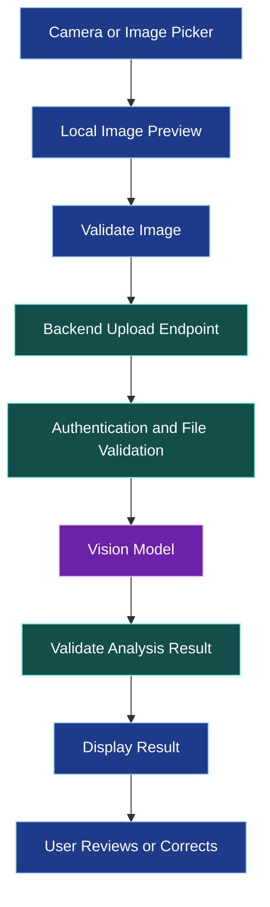
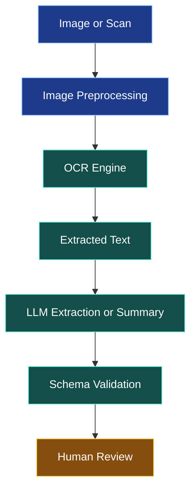
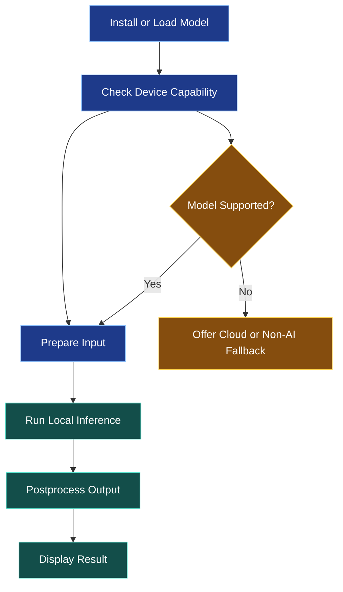

# 🖼️ AI Vision, Image Understanding, and On-Device AI

[⬅️ Previous](14-ai-chatbots-streaming-responses-and-voice-assistants.md) ·

> **AI Developer – App Development | Phase 4 · Topic 15**

Learn how mobile applications can analyze images, extract visual information, classify content, and run selected AI tasks directly on a device.

---

## 🎯 Learning Objectives

By the end of this topic, you will be able to:

- Explain computer vision and multimodal AI.
- Capture and select images using Expo APIs.
- Send image data to a backend for AI analysis.
- Design an image-understanding workflow.
- Understand OCR, classification, detection, and visual question answering.
- Compare cloud inference with on-device AI.
- Handle image uploads securely and efficiently.
- Evaluate accuracy, latency, privacy, and device constraints.

## 1. 👁️ What Is AI Vision?

Computer vision enables software to analyze and interpret visual information. Modern multimodal models can combine image understanding with language, allowing users to ask questions about an image.

| Capability | Description | Example |
|---|---|---|
| Image classification | Assign a category to an image | Identify a product category |
| Object detection | Locate objects in an image | Find a bottle or a garment |
| OCR | Extract text from images | Read a printed label |
| Image captioning | Generate a description | Describe an outfit |
| Visual question answering | Answer a question about an image | Identify visible colors |
| Image similarity | Compare visual representations | Find visually similar products |
| Segmentation | Identify regions or pixels belonging to objects | Isolate a product from its background |

These tasks require different models and evaluation methods. A general-purpose multimodal LLM may be suitable for descriptive questions, while specialized vision models can be better for detection, OCR, segmentation, or real-time processing.

## 2. 🏗️ AI Vision Architecture



A robust design separates image acquisition, file validation, inference, and presentation. This makes it easier to change providers or add an on-device model later.

## 3. 📸 Capture or Select an Image

Topic 12 introduced Expo ImagePicker and Camera. Reuse those components rather than implementing separate image acquisition logic for every AI feature.

A typical image workflow is:

1. Capture a photo or choose an existing image.
2. Preview the image.
3. Allow the user to retake or replace it.
4. Check file size and supported formats.
5. Submit it for analysis only after user confirmation.
6. Display the returned result.

The image URI is usually a local reference. It is not a public URL and cannot automatically be fetched by a remote model service.

## 4. 🔎 Send an Image to a Backend

For a common approach, use a multipart upload. Install the backend dependencies in your Node.js project:

```bash
npm install express multer
npm install -D @types/express @types/multer
```

Illustrative Express endpoint:

```tsx
import express from "express";
import multer from "multer";

const app = express();

const upload = multer({
  storage: multer.memoryStorage(),
  limits: {
    fileSize: 5 * 1024 * 1024,
    files: 1,
  },
});

app.post(
  "/api/vision/analyze",
  // Add authentication and authorization middleware here.
  upload.single("image"),
  async (req, res) => {
    const file = req.file;

    if (!file) {
      return res.status(400).json({
        error: "An image file is required.",
      });
    }

    // In production, inspect actual file content and decode the
    // image using a suitable library. Do not trust MIME type alone.
    // Then call the configured vision provider from the server.

    return res.status(501).json({
      error: "Connect this route to your vision provider.",
    });
  }
);
```

This is a route scaffold, not a working vision endpoint. It deliberately returns `501` until a provider is connected. A production implementation must verify file signatures and decoding, enforce authentication, handle resource limits, remove temporary files where applicable, and send the validated image to an authorized inference service.

Do not expose provider credentials in the mobile app.

## 5. 📲 Upload an Image from React Native

The following example uses `FormData` to upload a selected image to your backend.

```tsx
type VisionResult = {
  description: string;
};

const API_URL = process.env.EXPO_PUBLIC_API_URL;

export async function analyzeImage(
  imageUri: string
): Promise<VisionResult> {
  if (!API_URL) {
    throw new Error("API URL is not configured.");
  }

  const formData = new FormData();

  formData.append(
    "image",
    {
      uri: imageUri,
      name: "selected-image.jpg",
      type: "image/jpeg",
    } as unknown as Blob
  );

  const response = await fetch(`${API_URL}/vision/analyze`, {
    method: "POST",
    body: formData,
    headers: {
      Accept: "application/json",
    },
  });

  if (!response.ok) {
    throw new Error("Image analysis failed.");
  }

  const result: VisionResult = await response.json();

  if (typeof result.description !== "string") {
    throw new Error("Invalid analysis response.");
  }

  return result;
}
```

For React Native, multipart file objects are runtime-specific, so verify compatibility with the Expo SDK and platform you target. Do not manually set the multipart `Content-Type` header in this example; the runtime needs to supply the boundary.

The filename and MIME type shown are illustrative. Derive them from the actual selected asset, or normalize the image format before upload.

## 6. 🧠 Multimodal Model Integration

A multimodal model can process image content alongside text instructions. For example, a backend may send an image with a question such as:

> Describe the visible garment and identify its dominant colors. Do not infer a brand, price, or material unless the image provides sufficient evidence.

A model response might contain:

```json
{
  "description": "A dark blue, long-sleeved garment.",
  "dominantColors": ["dark blue"],
  "visibleFeatures": ["long sleeves"],
  "uncertainties": ["Material cannot be reliably determined from the image."]
}
```

This is an illustrative output, not a guarantee of what any particular model will return.

For structured application use:

1. Define an explicit response schema.
2. Use the provider's structured-output features when available.
3. Validate every field on the backend.
4. Reject or safely handle invalid values.
5. Display uncertainty where visual evidence is insufficient.
6. Let the user correct results before they become important records.

A model can mistake colors, misread labels, or infer details that are not visible. Treat the result as a suggestion unless it has been verified.

## 7. 🧾 OCR and Document Understanding

Optical character recognition extracts text from images and scanned documents.

Common workflows include:

- Reading a receipt.
- Extracting product labels.
- Processing an invoice.
- Reading text from a form.
- Translating text from a sign.

A robust pipeline may combine OCR with an LLM:



For invoices or receipts, never assume that a model-extracted total is correct. Validate fields against business rules and provide a review step before saving financial information.

## 8. 📱 Cloud AI vs On-Device AI

Cloud and on-device inference each have advantages and tradeoffs.

| Factor | Cloud inference | On-device inference |
|---|---|---|
| Model capacity | Can use large hosted models | Limited by model size and device capability |
| Network | Usually required | Can work offline after installation |
| Latency | Includes network round trips | Can be fast, depending on hardware and model |
| Privacy | Data leaves the device | Inputs can remain local |
| Cost | Provider usage fees may apply | Device compute, battery, and model distribution costs |
| Updates | Centralized model updates | Model updates may require app or asset updates |
| Device compatibility | Broad client compatibility | Depends on OS, hardware, memory, and runtime support |

A hybrid design is often practical: use lightweight on-device processing for simple tasks and cloud inference for complex tasks when the user consents and connectivity is available.

## 9. ⚙️ On-Device AI Workflow

Running a model locally can reduce network dependence, but it introduces device-specific constraints.



Possible technologies include Core ML on Apple platforms, TensorFlow Lite or LiteRT-based approaches on supported Android environments, and compatible cross-platform runtimes.

Before choosing a runtime, verify that it supports your Expo architecture, native build configuration, model format, and target devices. Some solutions require a development build or custom native code rather than Expo Go.

## 10. 🔐 Image Privacy and Security

- Ask permission before accessing the camera or photo library.
- Upload only the selected image required for the task.
- Avoid including location metadata unless needed.
- Enforce upload size and content limits.
- Validate file contents on the server.
- Store images only as long as necessary.
- Secure image URLs and authorization checks.
- Avoid sending sensitive images to a provider without appropriate disclosure and consent.
- Treat OCR text and image contents as untrusted input.
- Evaluate model performance on representative images.

## 11. 🌍 Real-World Scenario: AI Boutique Catalog Builder

A manager photographs a garment. The app suggests a short description, dominant colors, and visible features. The manager reviews the suggestions, enters a price, and submits the product to the backend.

The AI should not invent a price, confirm inventory, or publish a product automatically. Those are separate business operations that require trusted data and explicit authorization.

### ⭐ Key Takeaways

- AI vision includes classification, OCR, detection, captioning, and visual question answering.
- Local image URIs need an explicit upload or inference path.
- Cloud models and on-device models have different privacy and performance tradeoffs.
- AI-generated visual descriptions can be wrong and should be validated.
- Device compatibility, permissions, and privacy are part of the architecture.

