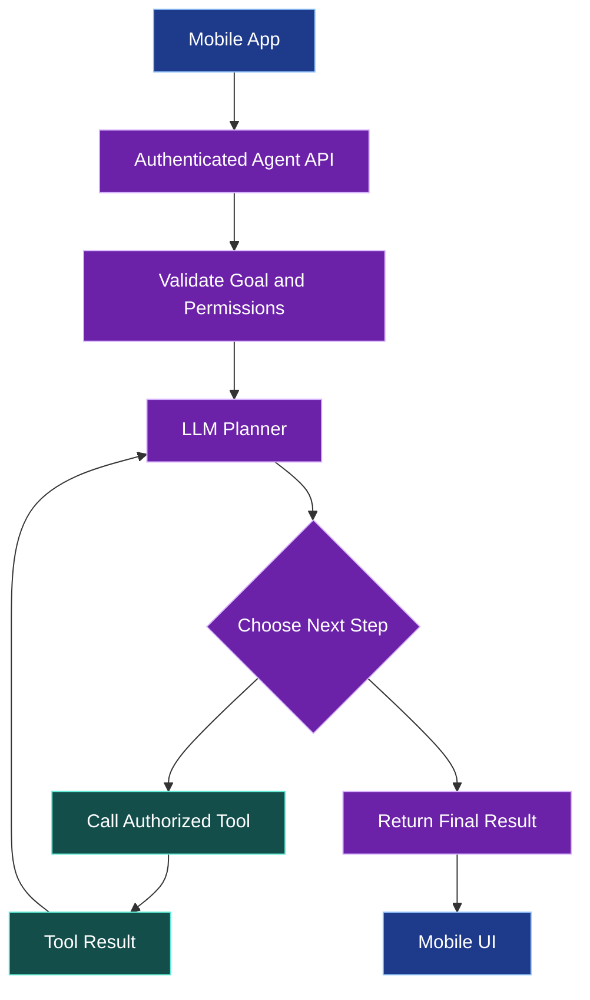
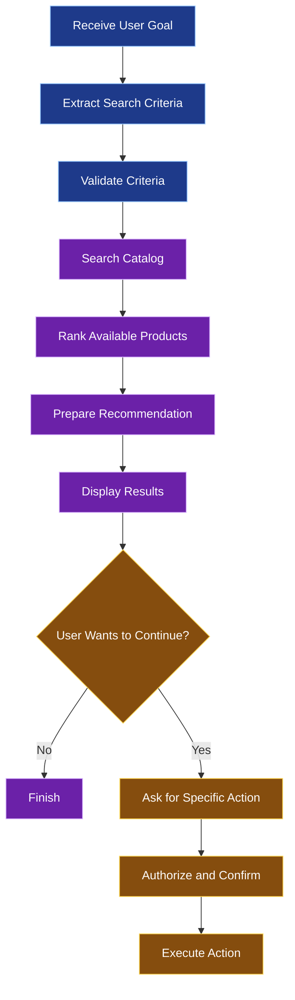
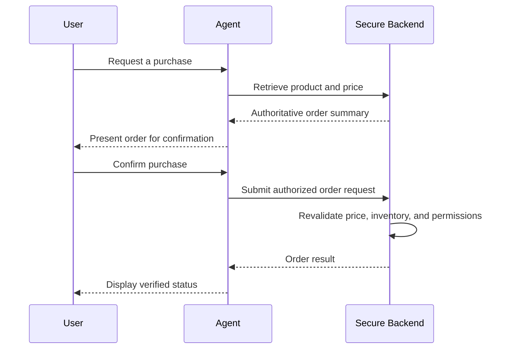

# 🧠 AI Agents and Intelligent Mobile Workflows

[⬅️ Previous](15-ai-vision-image-understanding-and-on-device-ai.md) ·

> **AI Developer – App Development | Phase 4 · Topic 16**

Learn how to build AI agents that interpret goals, choose tools, execute multi-step tasks, maintain workflow state, and coordinate with backend services while keeping important actions secure and under user control.

---

## 🎯 Learning Objectives

By the end of this topic, you will be able to:

- Explain the difference between an LLM, an AI assistant, and an AI agent.
- Design multi-step AI workflows for mobile applications.
- Define tools with explicit input and output schemas.
- Implement a backend tool-execution loop.
- Manage workflow state and recover from failures.
- Apply authorization, confirmation, and spending limits.
- Evaluate agent reliability and prevent unsafe tool execution.
- Build a practical AI shopping assistant workflow.

## 1. 🤖 What Is an AI Agent?

An AI agent is a system that uses a model and supporting software to work toward a goal. Depending on its design, it may interpret a request, choose from available tools, observe the results, and decide what to do next.

For example, a mobile shopping assistant may:

1. Interpret “Find a blue dress under ₹3,000.”
2. Extract the color and price constraint.
3. Search the authorized product catalog.
4. Rank suitable products.
5. Explain the results.
6. Ask whether the user wants to save a product.

The model helps interpret and plan. The application's tools retrieve authoritative data and perform controlled operations.

### LLM vs assistant vs agent

| Concept | Responsibility |
|---|---|
| LLM | Generates or interprets content |
| AI assistant | Provides an AI-powered user experience |
| AI agent | Coordinates reasoning, tools, and actions toward a goal |
| Workflow engine | Controls execution steps, retries, and state |
| Tool | Performs a defined operation, such as searching products |

Not every AI feature needs an agent. A simple prompt-and-response endpoint is often more predictable, faster, and cheaper than an agentic workflow.

## 2. 🏗️ Agent Architecture

A mobile application should usually interact with the agent through a backend.



The backend controls which tools exist, which users can call them, and which operations require confirmation. The model must not be given unrestricted access to a database, shell, filesystem, payment system, or arbitrary network destination.

## 3. 🧭 Define a Bounded Workflow

A useful agent starts with a clear task and a limited set of operations.

Example: “Find a product and prepare a recommendation.”



This is safer than giving an agent a vague goal such as “manage my shopping account” and allowing it to perform any operation it considers useful.

## 4. 🧰 Design Tools with Explicit Contracts

A tool should have a narrow purpose and predictable behavior.

For example:

```tsx
type ProductSearchInput = {
  query: string;
  color?: string;
  maxPrice?: number;
};

type ProductSummary = {
  id: string;
  name: string;
  price: number;
  color: string;
};

async function searchProducts(
  input: ProductSearchInput,
  userId: string
): Promise<ProductSummary[]> {
  // Query the authoritative catalog.
  // Apply access rules and validate filters.
  // Return only fields the caller may see.
  return [];
}
```

The empty array is a placeholder for the actual database or service implementation. In production, the backend must validate the search parameters, enforce access controls, and return real catalog records.

A well-designed tool has:

- A clear name and description.
- Typed inputs.
- Input validation.
- Explicit output fields.
- A defined permission model.
- Bounded execution time and result size.
- Clear errors.
- Audit logging appropriate to the operation.

## 5. 🧠 Tool Calling Is Not the Same as Tool Execution

An LLM may return a request to call a tool. The backend must decide whether the call is allowed and then execute it.

The correct flow is:

1. Send the user goal and available tool definitions to the model.
2. Receive a model response.
3. Detect whether it contains a tool call.
4. Validate the requested tool name and arguments.
5. Check user identity, permissions, and business rules.
6. Execute the tool in trusted application code.
7. Return the result to the model if another step is needed.
8. Stop when a final answer is produced or a limit is reached.

Never execute arbitrary function names or code simply because the model returned them.

## 6. 🔄 Implement a Bounded Agent Loop

The following is framework-independent TypeScript pseudocode. It illustrates the control flow, not a complete provider-specific implementation.

```tsx
type ToolCall = {
  name: string;
  arguments: unknown;
};

type AgentResult = {
  finalAnswer?: string;
  toolCall?: ToolCall;
};

const MAX_STEPS = 5;

async function runAgent(
  initialGoal: string,
  userId: string
): Promise<string> {
  let state: unknown = {
    goal: initialGoal,
    history: [],
  };

  for (let step = 0; step < MAX_STEPS; step++) {
    // Provider-specific function:
    // ask the model to continue from the current state.
    const result: AgentResult = await planNextStep(state);

    if (result.finalAnswer) {
      return result.finalAnswer;
    }

    if (!result.toolCall) {
      throw new Error("The agent returned no valid next step.");
    }

    // Use an explicit allowlist, never dynamic evaluation.
    const toolResult = await executeAuthorizedTool(
      result.toolCall,
      userId
    );

    state = appendToolResult(state, result.toolCall, toolResult);
  }

  return "I reached the workflow step limit. Please refine the request.";
}

// These functions represent application-specific implementations.
declare function planNextStep(state: unknown): Promise<AgentResult>;
declare function executeAuthorizedTool(
  call: ToolCall,
  userId: string
): Promise<unknown>;
declare function appendToolResult(
  state: unknown,
  call: ToolCall,
  result: unknown
): unknown;
```

The loop has a step limit to prevent uncontrolled execution. A production workflow also needs per-tool timeouts, cancellation, schema validation, cost limits, idempotency for repeated actions, and explicit handling of provider errors.

The `userId` must come from a verified server-side authentication context—not from an untrusted field in the mobile request.

## 7. 🛒 Build a Product-Recommendation Agent

A bounded product agent can use a small set of read-only tools:

| Tool | Responsibility | Risk |
|---|---|---|
| `search_products` | Retrieve matching products | Low when access is restricted |
| `get_product_details` | Retrieve authoritative product information | Low when access is restricted |
| `check_availability` | Read current inventory availability | Low to moderate |
| `add_to_favorites` | Modify a user's saved list | State-changing |
| `create_order` | Submit an order | High impact |

Begin with read-only tools. Introduce state-changing tools only after permissions, validation, confirmation, and failure recovery have been designed.

A good agent might return:

- The search criteria it interpreted.
- A list of real catalog records.
- A short explanation of why each record matched.
- A link to each product.
- A request for confirmation before a state-changing action.

It should not invent product IDs, prices, or availability.

## 8. 🛑 Human Approval for Important Actions

Some operations should require explicit user approval.

Examples:

- Placing an order.
- Sending a message to another person.
- Deleting a record.
- Booking an appointment.
- Changing account permissions.
- Making a payment.



The backend must revalidate the operation at execution time. A user confirming a proposed action does not mean the inventory, price, or authorization remains unchanged.

For high-impact actions, confirmation should be bound to the actual operation and its important parameters. Use server-side idempotency to avoid duplicate orders if a request is retried.

## 9. 🧠 Manage Workflow State

Long-running agent workflows may need to preserve state between steps.

A workflow record might include:

```tsx
type WorkflowStatus =
  | "pending"
  | "running"
  | "awaiting_confirmation"
  | "completed"
  | "failed"
  | "cancelled";

type WorkflowRecord = {
  id: string;
  ownerUserId: string;
  status: WorkflowStatus;
  currentStep: number;
  createdAt: string;
  updatedAt: string;
};
```

The backend should persist workflow state when recovery, auditability, or user resumption is required.

Useful practices:

- Assign every workflow a unique ID.
- Check that the current user owns the workflow.
- Save completed steps where appropriate.
- Record retry attempts and safe error details.
- Resume only from validated states.
- Expire abandoned workflows.
- Support cancellation where feasible.
- Do not persist unnecessary sensitive prompt content.

## 10. 🧱 Reliability and Failure Recovery

An agent can fail because of model errors, network loss, invalid tool arguments, unavailable services, or conflicting data.

A robust system should:

- Limit the number of model and tool calls.
- Apply timeouts and bounded retries.
- Validate tool inputs and outputs.
- Distinguish retryable from permanent failures.
- Avoid repeating non-idempotent actions.
- Track progress and show it to the user.
- Stop when confidence or available evidence is insufficient.
- Provide a safe fallback or request clarification.

Do not let the model endlessly repeat the same failed tool call. Detect repeated failures and terminate or escalate the workflow.

## 11. 🔐 Prompt Injection and Tool Security

Agent tools can create new security risks because model output may influence actions.

Treat user prompts, uploaded files, retrieved documents, and tool output as untrusted data.

Important protections:

- Use an explicit tool allowlist.
- Enforce permissions in trusted backend code.
- Validate all tool arguments.
- Limit data returned by tools.
- Keep secrets outside model context.
- Separate instructions from untrusted retrieved content.
- Prevent arbitrary shell execution and unrestricted outbound network requests.
- Require approval for consequential operations.
- Test malicious instructions embedded in documents and messages.

A model's refusal or its stated intention to follow instructions is not a security boundary. The backend must enforce every important restriction.

## 12. 📊 Evaluate Agent Quality

Evaluate both the final answer and the operations performed to reach it.

| Metric | What it measures |
|---|---|
| Task success rate | How often the intended task is completed correctly |
| Tool accuracy | Whether the correct tools and arguments are selected |
| Unauthorized-action rate | Whether restricted actions are attempted or executed |
| Completion time | How long a workflow takes |
| Cost per task | Model and tool usage cost |
| Recovery rate | How often interrupted tasks resume successfully |
| User correction rate | How often users need to correct the output |

Test common cases, edge cases, permission boundaries, timeouts, duplicate requests, and prompt-injection attempts. Use synthetic or appropriately anonymized test data.

## 13. 🌍 Real-World Scenario: Intelligent Boutique Assistant

A user asks: “Find a blue dress under ₹3,000, save my favorite, and help me prepare an order.”

A safe workflow:

1. Interpret the color and price constraints.
2. Search the catalog through a read-only tool.
3. Retrieve current prices and availability from the backend.
4. Present actual matching products.
5. Save a favorite only after authorization and any required confirmation.
6. Prepare the order summary.
7. Ask the user to confirm.
8. Revalidate inventory, price, and permissions on the server.
9. Submit the order and display the verified result.

This approach combines LLM flexibility with deterministic backend operations and user control.

## 14. ⚠️ Common Mistakes

| Mistake | Better approach |
|---|---|
| Giving the agent unrestricted access | Provide narrow, allowlisted tools |
| Trusting generated prices or IDs | Retrieve authoritative records |
| Allowing unlimited tool calls | Set step, time, and cost limits |
| Executing every model-requested action | Validate, authorize, and confirm as needed |
| Retrying order creation blindly | Use idempotency and check operation status |
| Treating model reasoning as a security guarantee | Enforce permissions in backend code |
| Losing state after an interruption | Persist important workflow state |
| Evaluating only the final response | Test tool selection, permissions, and recovery |

### ⭐ Key Takeaways

- AI agents combine model decisions with controlled tool execution.
- A bounded workflow is easier to test and secure than an unrestricted agent.
- Tools should have explicit contracts, permissions, and failure behavior.
- Important actions require backend validation and often user confirmation.
- Reliability, cost controls, state management, and security are essential for production agents.
