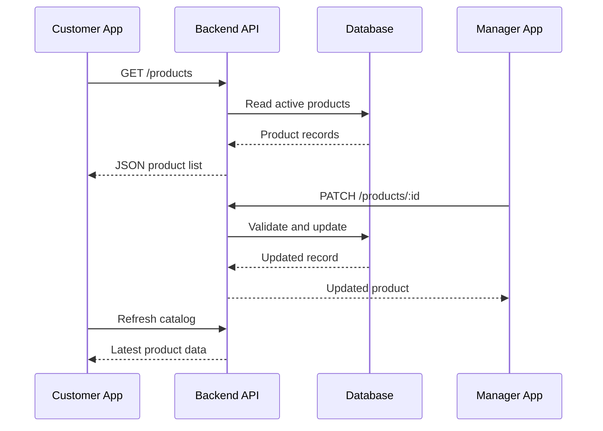

# 🔌 REST APIs and Backend Integration

[⬅️ Back to Learning Modules](../README.md) · 

> **AI Developer – App Development | Phase 3 · Topic 09**

Learn how mobile applications communicate with backend services, retrieve and submit data, handle network failures, and organize API integration into reusable TypeScript services.

---

## 🎯 Learning Objectives

By the end of this topic, you will be able to:

- Explain how REST APIs connect mobile apps to backend systems.
- Understand HTTP methods, status codes, headers, and JSON.
- Make GET, POST, PUT, PATCH, and DELETE requests.
- Organize API calls into reusable service modules.
- Manage loading, success, empty, and error states.
- Validate API responses and handle network failures.
- Connect a React Native frontend to a Node.js and Express backend.
- Apply basic security and performance best practices.

## 1. 🌐 What Is a REST API?

A REST API exposes resources through URLs and standard HTTP methods. A mobile application sends requests to the backend, and the backend processes them and returns a response.

For example, a boutique shopping app may request products, create an order, or retrieve a customer's profile.


The mobile app is the client. The backend owns important business rules, authorization decisions, and access to the database.

**Important:** hiding a button in the mobile interface is not security. The backend must independently check whether the current user can perform an operation.

## 2. 📬 HTTP Methods and Status Codes

HTTP methods describe the action a client wants to perform.

| Method | Purpose | Example |
|---|---|---|
| `GET` | Retrieve a resource | List products |
| `POST` | Create a resource or submit an operation | Create an order |
| `PUT` | Replace a resource representation | Replace a profile |
| `PATCH` | Partially update a resource | Change a display name |
| `DELETE` | Delete a resource | Remove a saved address |

Common status codes:

| Status | Meaning |
|---|---|
| `200 OK` | Request succeeded |
| `201 Created` | Resource created |
| `204 No Content` | Request succeeded without a response body |
| `400 Bad Request` | Invalid request |
| `401 Unauthorized` | Authentication is missing or invalid |
| `403 Forbidden` | The caller lacks permission |
| `404 Not Found` | Resource not found |
| `409 Conflict` | Request conflicts with current resource state |
| `422 Unprocessable Content` | Request content failed validation, where used by the API |
| `429 Too Many Requests` | Rate limit exceeded |
| `500 Internal Server Error` | Unexpected server failure |
| `503 Service Unavailable` | Service temporarily unavailable |

A successful HTTP response does not always contain JSON. For example, a `204` response should not be parsed with `response.json()`.

## 3. 🧪 Make Your First API Request

JavaScript's `fetch()` API sends HTTP requests.

```tsx
type Product = {
  id: number;
  title: string;
  price: number;
};

export async function fetchProducts(): Promise<Product[]> {
  const response = await fetch(
    "https://dummyjson.com/products"
  );

  if (!response.ok) {
    throw new Error(`Request failed: ${response.status}`);
  }

  const data = await response.json();

  return data.products as Product[];
}
```

This example uses a public sample API. The TypeScript assertion helps the compiler but does not validate the response at runtime. In a production application, validate external data using a schema or explicit checks.

## 4. 🏗️ Organize the API Layer

Avoid scattering raw `fetch()` calls throughout your screen components.

A practical structure:

```text
src/
├── services/
│   ├── apiClient.ts
│   └── productService.ts
├── features/
│   └── products/
│       ├── ProductListScreen.tsx
│       └── types.ts
└── components/
    ├── LoadingView.tsx
    └── ErrorView.tsx
```

Create `src/services/apiClient.ts`:

```tsx
const API_BASE_URL = process.env.EXPO_PUBLIC_API_URL;

export async function apiRequest<T>(
  path: string,
  options: RequestInit = {}
): Promise<T> {
  if (!API_BASE_URL) {
    throw new Error("API URL is not configured.");
  }

  const response = await fetch(
    `${API_BASE_URL.replace(/\/$/, "")}${path}`,
    {
      ...options,
      headers: {
        Accept: "application/json",
        ...(options.body
          ? { "Content-Type": "application/json" }
          : {}),
        ...options.headers,
      },
    }
  );

  if (!response.ok) {
    throw new Error(`API request failed (${response.status}).`);
  }

  if (response.status === 204) {
    return undefined as T;
  }

  return (await response.json()) as T;
}
```

This small helper standardizes request handling. It is still a basic client: more advanced applications should add structured error types, response validation, request timeouts where appropriate, and authentication integration.

### Configure the backend URL

Create a local `.env` file:

```dotenv
EXPO_PUBLIC_API_URL=http://192.168.1.10:3000/api
```

Replace the address with the correct backend address for your environment.

- Android emulator: the host machine may be accessible through `10.0.2.2`.
- Physical phone: use the computer's reachable LAN IP address when both devices are on the same network.
- iOS simulator: the appropriate host address depends on the environment.
- Production: use a deployed HTTPS endpoint.

`localhost` inside a mobile device or emulator usually refers to that device, not your development computer.

**Security note:** every `EXPO_PUBLIC_` variable can be exposed to the client. Never put private API keys, database passwords, or server secrets in these variables.

## 5. 🛍️ Create a Product Service

Create `src/services/productService.ts`:

```tsx
import { apiRequest } from "./apiClient";

export type Product = {
  id: string;
  name: string;
  price: number;
  category: string;
  imageUrl: string;
};

export function getProducts() {
  return apiRequest<Product[]>("/products");
}

export function getProduct(id: string) {
  return apiRequest<Product>(
    `/products/${encodeURIComponent(id)}`
  );
}

export function createProduct(
  product: Omit<Product, "id">
) {
  return apiRequest<Product>("/products", {
    method: "POST",
    body: JSON.stringify(product),
  });
}

export function updateProduct(
  id: string,
  changes: Partial<Omit<Product, "id">>
) {
  return apiRequest<Product>(
    `/products/${encodeURIComponent(id)}`,
    {
      method: "PATCH",
      body: JSON.stringify(changes),
    }
  );
}

export function deleteProduct(id: string) {
  return apiRequest<void>(
    `/products/${encodeURIComponent(id)}`,
    { method: "DELETE" }
  );
}
```

These functions assume the backend exposes the specified routes and returns matching response shapes. Adapt them to your actual API contract.

## 6. 📱 Display API Data in a Screen

Create `app/products/index.tsx`:

```tsx
import { useCallback, useEffect, useState } from "react";
import {
  ActivityIndicator,
  Button,
  FlatList,
  Text,
  View,
} from "react-native";
import {
  getProducts,
  type Product,
} from "../../src/services/productService";

export default function ProductsScreen() {
  const [products, setProducts] = useState<Product[]>([]);
  const [loading, setLoading] = useState(true);
  const [error, setError] = useState<string | null>(null);

  const loadProducts = useCallback(async () => {
    try {
      setError(null);
      setLoading(true);

      const result = await getProducts();
      setProducts(result);
    } catch {
      setError("Couldn't load products. Check your connection.");
    } finally {
      setLoading(false);
    }
  }, []);

  useEffect(() => {
    void loadProducts();
  }, [loadProducts]);

  if (loading) {
    return <ActivityIndicator style={{ marginTop: 40 }} />;
  }

  if (error) {
    return (
      <View style={{ padding: 24, gap: 12 }}>
        <Text>{error}</Text>
        <Button title="Try again" onPress={loadProducts} />
      </View>
    );
  }

  if (products.length === 0) {
    return <Text style={{ padding: 24 }}>No products available.</Text>;
  }

  return (
    <FlatList
      data={products}
      keyExtractor={(item) => item.id}
      contentContainerStyle={{ padding: 16 }}
      renderItem={({ item }) => (
        <View
          style={{
            padding: 16,
            marginBottom: 10,
            borderRadius: 12,
            backgroundColor: "#F3F4F6",
          }}
        >
          <Text style={{ fontWeight: "700", fontSize: 17 }}>
            {item.name}
          </Text>
          <Text>{item.category}</Text>
          <Text>₹{item.price.toFixed(2)}</Text>
        </View>
      )}
    />
  );
}
```

This demonstrates the essential states:

1. Loading — data is being requested.
2. Success — display the returned records.
3. Empty — the request succeeded but there is nothing to display.
4. Error — explain the failure and allow a retry.

For screens that can unmount or issue overlapping requests, use `AbortController` or an appropriate data-fetching library to prevent stale responses and unnecessary network work.

## 7. 🧰 Build a Simple Backend with Express

The following example creates a minimal API for learning.

Install dependencies in a separate backend folder:

```bash
npm init -y
npm install express cors
npm install -D typescript tsx @types/node @types/express @types/cors
```

Create `src/server.ts`:

```tsx
import express from "express";
import cors from "cors";

const app = express();
const port = 3000;

app.use(cors());
app.use(express.json());

type Product = {
  id: string;
  name: string;
  price: number;
};

const products: Product[] = [
  { id: "p1", name: "Blue Dress", price: 2499 },
  { id: "p2", name: "Classic Jacket", price: 3299 },
];

app.get("/api/products", (_req, res) => {
  res.json(products);
});

app.get("/api/products/:id", (req, res) => {
  const product = products.find(
    (item) => item.id === req.params.id
  );

  if (!product) {
    return res.status(404).json({ message: "Product not found." });
  }

  return res.json(product);
});

app.post("/api/products", (req, res) => {
  const { name, price } = req.body ?? {};

  if (
    typeof name !== "string" ||
    !name.trim() ||
    typeof price !== "number" ||
    !Number.isFinite(price) ||
    price < 0
  ) {
    return res.status(400).json({
      message: "A product name and valid price are required.",
    });
  }

  const product: Product = {
    id: `p${Date.now()}`,
    name: name.trim(),
    price,
  };

  products.push(product);
  return res.status(201).json(product);
});

app.listen(port, "0.0.0.0", () => {
  console.log(`API listening on port ${port}`);
});
```

Run the server with:

```bash
npx tsx src/server.ts
```

This example stores records in memory, so data disappears when the process restarts. It is not production-ready. A production API needs a database, robust validation, authentication and authorization where required, rate limiting, secure deployment, and appropriate error handling.

## 8. 🔐 API Security Fundamentals

- Use HTTPS for production traffic.
- Keep private credentials on the server.
- Authenticate protected requests.
- Authorize each protected operation on the backend.
- Validate and normalize request bodies.
- Avoid logging tokens, passwords, or sensitive personal information.
- Rate-limit sensitive endpoints.
- Avoid exposing internal database errors to users.
- Keep dependencies updated.
- Do not trust prices, permissions, or role names supplied by the client.

## 9. ⚡ Performance and Reliability

Mobile networks can be slow, unstable, or unavailable.

- Request only the data needed by the screen.
- Use pagination for large datasets.
- Cache data when the freshness requirements allow it.
- Avoid repeated requests caused by unnecessary renders.
- Cancel requests that are no longer needed.
- Use sensible timeouts and retries.
- Retry only suitable failures; use backoff for rate limits and transient server errors.
- Use idempotency mechanisms for operations that must not be duplicated, such as creating a payment or order.
- Track response times and failure rates without collecting unnecessary personal data.

## 10. 🌍 Real-World Scenario: Boutique Inventory

A customer browses products while a manager updates the catalog.



Both applications use the same backend. The backend controls what can be changed and ensures that the customer sees authorized, current catalog data.

### ⭐ Key Takeaways

- REST APIs connect mobile applications to backend services.
- HTTP methods and status codes define request behavior.
- Service modules separate networking from screen presentation.
- Loading, empty, and error states are essential for a reliable UX.
- The backend—not the mobile client—must enforce security and business rules.