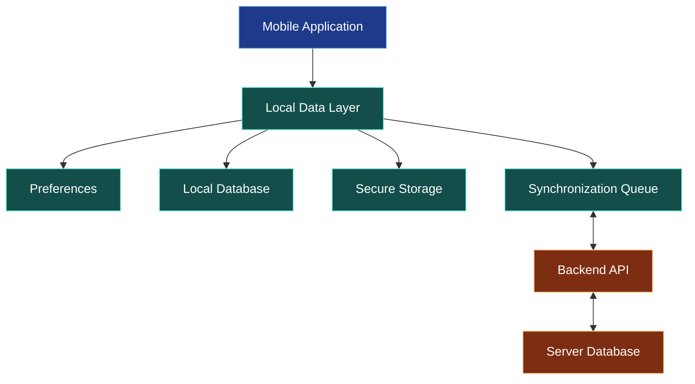
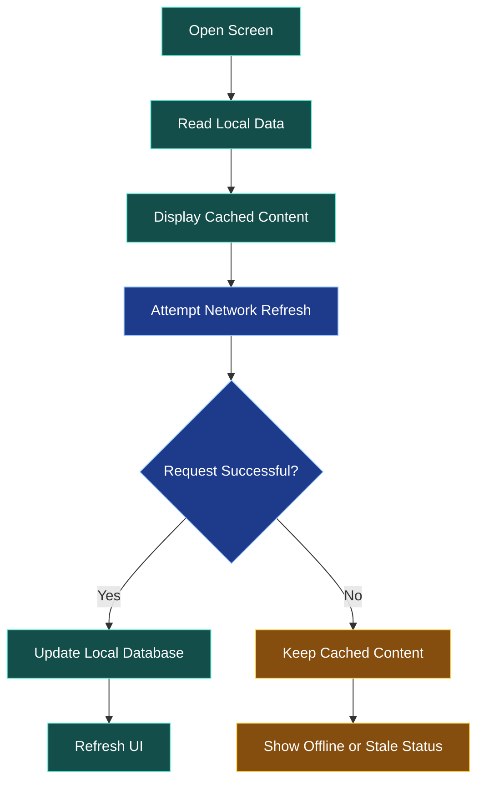
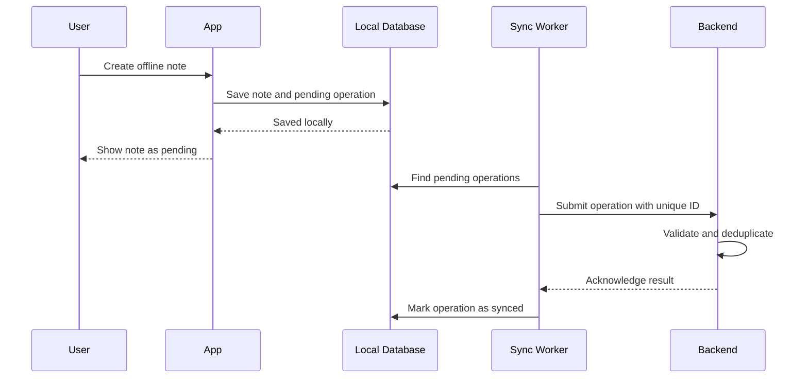
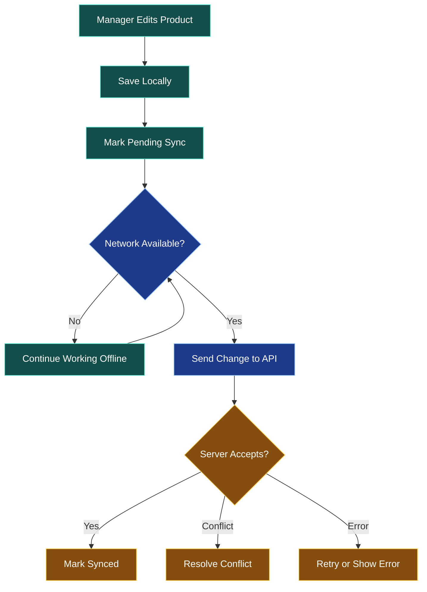

# 💾 Local Storage, Offline Support, and Synchronization

[⬅️ Previous](09-rest-apis-and-backend-integration.md) ·

> **AI Developer – App Development | Phase 3 · Topic 10**

Learn how to preserve application data on a device, build useful offline experiences, and synchronize local changes with a backend when connectivity returns.

---

## 🎯 Learning Objectives

By the end of this topic, you will be able to:

- Explain the difference between local storage, secure storage, and databases.
- Persist simple application preferences.
- Store structured records with SQLite.
- Build an offline-first user experience.
- Model pending operations and synchronization states.
- Understand conflict resolution and duplicate requests.
- Handle storage failures and stale data.
- Design a practical offline-capable application.

## 1. 📦 Why Local Storage Matters

Mobile applications cannot assume that a network connection is always available. Users may travel through areas with poor reception, switch networks, or reopen an app while offline.

Local storage allows the app to retain appropriate data between sessions.

Examples include:

- Theme and display preferences.
- Recently viewed products.
- Draft forms.
- Cached catalog records.
- Offline notes and task lists.
- Pending edits that still need to reach the server.

### Data flow



Different data belongs in different storage systems. A user preference is not the same as an authentication token, and neither should automatically be stored in a general-purpose local database.

## 2. 🧰 Choose the Right Storage Tool

| Storage option | Suitable use | Important consideration |
|---|---|---|
| React state | Temporary UI values | Lost when state is discarded |
| AsyncStorage | Small, non-sensitive persisted key-value data | Not encrypted by default |
| Expo SecureStore | Small sensitive values such as tokens | Platform-specific size and lifecycle limitations |
| SQLite | Structured records and queries | Requires schema and migration management |
| File system | Documents, images, and downloaded files | Manage permissions, storage, and cleanup |
| Backend database | Authoritative shared records | Requires network access or a sync strategy |

**Rule:** never store passwords or private API keys in ordinary local storage. Secure token storage also does not eliminate the need for short token lifetimes, revocation, and backend authorization.

## 3. ⚙️ Persist a Preference with AsyncStorage

Install the package:

```bash
npx expo install @react-native-async-storage/async-storage
```

Example:

```tsx
import AsyncStorage from "@react-native-async-storage/async-storage";
import { useEffect, useState } from "react";
import { Switch, Text, View } from "react-native";

const THEME_KEY = "preferred-theme";

export default function ThemePreference() {
  const [darkMode, setDarkMode] = useState(false);
  const [loaded, setLoaded] = useState(false);

  useEffect(() => {
    let active = true;

    async function loadPreference() {
      try {
        const saved = await AsyncStorage.getItem(THEME_KEY);

        if (active) {
          setDarkMode(saved === "dark");
        }
      } catch {
        // A production app should surface or log a safe diagnostic.
      } finally {
        if (active) setLoaded(true);
      }
    }

    void loadPreference();

    return () => {
      active = false;
    };
  }, []);

  async function savePreference(value: boolean) {
    setDarkMode(value);

    try {
      await AsyncStorage.setItem(
        THEME_KEY,
        value ? "dark" : "light"
      );
    } catch {
      // Consider restoring the previous value or informing the user.
    }
  }

  if (!loaded) {
    return <Text>Loading preferences...</Text>;
  }

  return (
    <View style={{ padding: 24, flexDirection: "row", gap: 12 }}>
      <Text>Dark mode</Text>
      <Switch value={darkMode} onValueChange={savePreference} />
    </View>
  );
}
```

This example persists a simple preference. In a complete theme system, changing the preference should update the application's theme provider rather than only the switch state.

## 4. 🗃️ Store Structured Records with SQLite

SQLite is useful when data has fields, relationships, filters, and queries.

Install Expo SQLite:

```bash
npx expo install expo-sqlite
```

A basic database module:

```tsx
// src/storage/database.ts
import * as SQLite from "expo-sqlite";

export const databasePromise = SQLite.openDatabaseAsync("app.db");

export async function initializeDatabase() {
  const db = await databasePromise;

  await db.execAsync(`
    PRAGMA journal_mode = WAL;

    CREATE TABLE IF NOT EXISTS products (
      id TEXT PRIMARY KEY NOT NULL,
      name TEXT NOT NULL,
      price REAL NOT NULL,
      updated_at TEXT NOT NULL
    );
  `);
}
```

Insert or update a cached product:

```tsx
import { databasePromise } from "./database";

type CachedProduct = {
  id: string;
  name: string;
  price: number;
  updatedAt: string;
};

export async function saveProduct(product: CachedProduct) {
  const db = await databasePromise;

  await db.runAsync(
    `INSERT INTO products (id, name, price, updated_at)
     VALUES (?, ?, ?, ?)
     ON CONFLICT(id) DO UPDATE SET
       name = excluded.name,
       price = excluded.price,
       updated_at = excluded.updated_at`,
    product.id,
    product.name,
    product.price,
    product.updatedAt
  );
}
```

Use parameterized SQL statements instead of building queries by concatenating user input. This protects against SQL injection and quoting problems.

### Query cached records

```tsx
import { databasePromise } from "./database";

export async function getCachedProducts() {
  const db = await databasePromise;

  return db.getAllAsync<{
    id: string;
    name: string;
    price: number;
    updated_at: string;
  }>(
    "SELECT id, name, price, updated_at FROM products ORDER BY name"
  );
}
```

Initialize the database before calling functions that depend on its tables. A production application should also manage schema versions and database migrations.

## 5. 📡 Design an Offline-First Experience

An offline-first application treats local data as an important part of the user experience instead of requiring a successful network request before displaying anything.



A sensible sequence is:

1. Load the latest locally available records.
2. Display them promptly.
3. Attempt a network refresh.
4. Save valid server responses locally.
5. Update the screen.
6. If refresh fails, retain cached content and communicate its freshness.

The UI should distinguish between “no records exist” and “records could not be refreshed.”

## 6. 📝 Queue Changes for Later Synchronization

Suppose a field technician creates a note while offline. The app can save the note locally and mark it as pending synchronization.

A simple conceptual schema:

```sql
CREATE TABLE IF NOT EXISTS pending_operations (
  id TEXT PRIMARY KEY NOT NULL,
  operation_type TEXT NOT NULL,
  payload TEXT NOT NULL,
  created_at TEXT NOT NULL,
  status TEXT NOT NULL
);
```

Possible statuses:

- `pending` — waiting to be sent.
- `syncing` — currently being processed.
- `synced` — acknowledged by the server.
- `failed` — requires a retry or user attention.

The queue should survive application restarts. Use unique operation IDs, record retry attempts, and define a policy for permanent failures.

### Synchronization workflow



Do not assume that a request was never processed simply because the client did not receive its response. The server may have completed the operation before the connection failed. Use server-supported idempotency keys or operation IDs for operations that must not be applied twice.

## 7. 🔄 Conflict Resolution

Conflicts happen when local and remote copies change independently.

Example: a user edits a delivery address on two devices before either device synchronizes.

Common strategies:

| Strategy | How it works | Suitable use |
|---|---|---|
| Last-write-wins | Select the latest timestamp or version according to a defined rule | Some low-risk preferences |
| Server-wins | Prefer the authoritative server value | Certain centrally controlled records |
| Client-wins | Prefer a local update | Narrow, explicitly chosen use cases |
| Field-level merge | Merge independent field changes | Some collaborative records |
| Manual resolution | Ask the user to choose | Important conflicting edits |

A timestamp alone can be unreliable when device clocks differ. Use server-managed versions, revision numbers, or ETags where appropriate.

For inventory, financial transactions, bookings, and orders, do not resolve conflicts by blindly overwriting the latest value. The backend must enforce business invariants.

## 8. 🛡️ Data Integrity and Privacy

- Store only data that the app needs.
- Protect sensitive values using suitable secure storage.
- Avoid logging personal data or tokens.
- Define cache expiration and deletion rules.
- Use parameterized database statements.
- Validate data before saving it.
- Keep migrations tested and reversible where feasible.
- Provide appropriate logout and account-deletion cleanup.
- Consider device backup behavior and data-retention requirements.
- Treat local data as potentially stale and client-controlled.

## 9. 🌍 Real-World Scenario: Offline Boutique Inventory

A manager visits a location with weak connectivity and updates a product description.



For real inventory changes, the server must still validate permissions and business rules. A local change is not confirmed as authoritative until synchronization succeeds.

## 10. ⚠️ Common Mistakes

| Mistake | Better approach |
|---|---|
| Treating AsyncStorage as encrypted | Use secure storage for appropriate secrets |
| Assuming local data is always current | Display freshness and sync status |
| Retrying every operation blindly | Use bounded retries and idempotency |
| Replacing all local data after a failed request | Keep usable cached data |
| Concatenating user input into SQL | Use parameterized queries |
| Overwriting conflicting records silently | Define a conflict policy |
| Storing a queue only in memory | Persist pending operations |
| Assuming an offline edit has reached the server | Show pending/synced status clearly |

### ⭐ Key Takeaways

- Local storage improves persistence and offline usability.
- AsyncStorage, SecureStore, SQLite, and file storage serve different purposes.
- Offline-first applications display cached data and synchronize deliberately.
- Pending operations need durable IDs, retry rules, and server acknowledgement.
- Conflict resolution must match the importance and ownership of the data.

