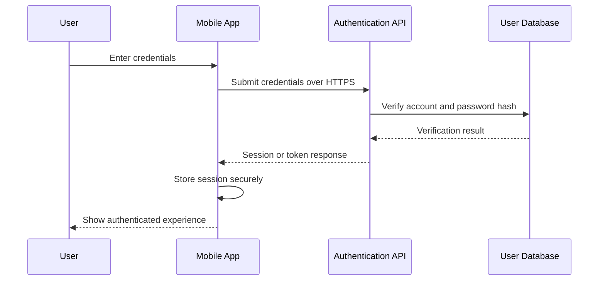
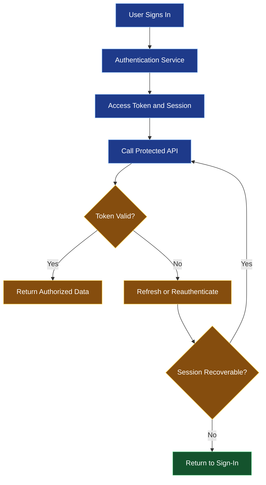
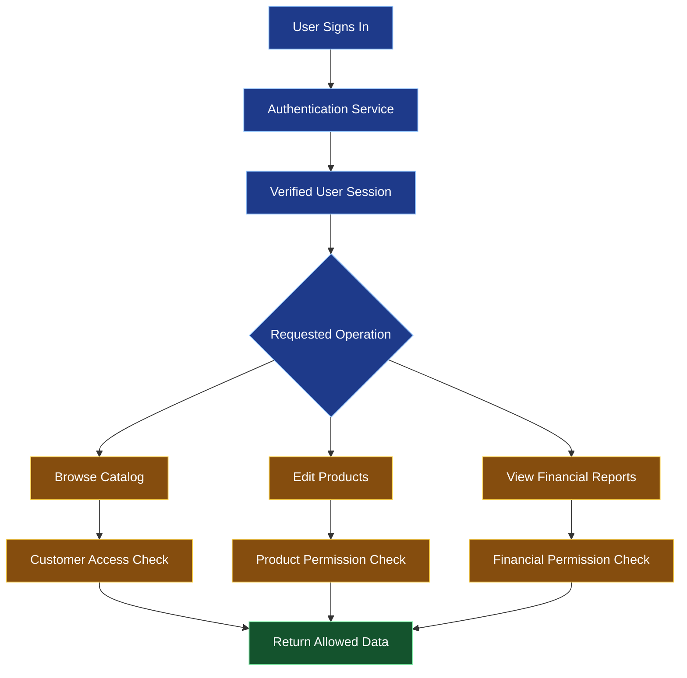

# 🔐 Authentication, Authorization, and Secure Data

[⬅️ Previous](10-local-storage-offline-support-and-synchronization.md) ·

> **AI Developer – App Development | Phase 3 · Topic 11**

Learn how to identify users, control access to protected resources, manage authentication sessions, and protect sensitive information in React Native and Expo applications.

---

## 🎯 Learning Objectives

By the end of this topic, you will be able to:

- Explain authentication and authorization.
- Understand sessions, access tokens, and refresh tokens.
- Build a basic login interface and connect it to a backend.
- Store sensitive session credentials using secure storage.
- Protect screens and API requests.
- Understand role-based and resource-based authorization.
- Handle logout, token expiry, and authentication failures.
- Avoid common mobile security mistakes.

## 1. 🪪 Authentication vs Authorization

Authentication answers: **Who is the user?**

Authorization answers: **What is this user allowed to do?**

| Concept | Example |
|---|---|
| Authentication | A customer signs in successfully |
| Authorization | A customer can view their own orders |
| Role-based access | A manager can edit product listings |
| Resource-based access | A customer can view an order only if it belongs to them |
| Session management | The app determines whether a user's session remains valid |

A user may be authenticated but still lack permission to perform a particular operation.

### Authentication workflow



In production, use a reputable identity provider or a well-designed backend authentication system. Never store plaintext passwords or embed private authentication secrets in the application bundle.

## 2. 🔑 Common Authentication Methods

### Email and password

The user provides credentials that the backend verifies. The backend should use a suitable password-hashing algorithm and protect against brute-force attempts.

### OAuth 2.0 and OpenID Connect

These standards support delegated authorization and identity flows. For mobile applications, use the system browser or an appropriate authentication session instead of collecting a third-party account's password directly.

Use authorization code flow with PKCE for public mobile clients where supported by the identity provider.

### Passkeys and biometrics

Passkeys provide a phishing-resistant authentication option when supported by the service. Biometrics can also be used locally to unlock a device-bound secret or reauthorize a sensitive action, but a local biometric success is not automatically proof to your backend that the user is authorized.

## 3. 🧾 Access Tokens and Refresh Tokens

A token is a credential used to represent an authenticated session or authorize requests.

- **Access token:** sent with requests to protected endpoints; often short-lived.
- **Refresh token:** used to obtain a new access token when supported by the authentication system.
- **Session cookie:** another mechanism a backend may use to manage a session.

The exact flow depends on your identity provider or backend.



Do not assume that every token is a JWT or that decoding a token proves it is valid. The resource server must verify credentials according to its authentication protocol.

## 4. 📦 Install Secure Storage

For an Expo app, install SecureStore:

```bash
npx expo install expo-secure-store
```

SecureStore uses platform-provided secure storage mechanisms for small sensitive values. It is suitable for many token-storage scenarios, but it has platform and lifecycle limitations. Do not treat it as a general database or assume stored values can never be lost.

Create `src/services/sessionStorage.ts`:

```tsx
import * as SecureStore from "expo-secure-store";

const ACCESS_TOKEN_KEY = "access_token";

export async function saveAccessToken(token: string) {
  await SecureStore.setItemAsync(ACCESS_TOKEN_KEY, token);
}

export async function getAccessToken() {
  return SecureStore.getItemAsync(ACCESS_TOKEN_KEY);
}

export async function clearSession() {
  await SecureStore.deleteItemAsync(ACCESS_TOKEN_KEY);
}
```

The example demonstrates secure local storage. A real session implementation must also consider token expiration, refresh behavior, revocation, and the authentication service's requirements.

Never place a private server API key or a database password in the mobile app, even if you store it using SecureStore. Client-side secrets can ultimately be extracted or abused.

## 5. 🔒 Build a Login Screen

Create a simple form that collects credentials and submits them to the backend.

```tsx
import { useState } from "react";
import {
  ActivityIndicator,
  Alert,
  Pressable,
  StyleSheet,
  Text,
  TextInput,
  View,
} from "react-native";

import { saveAccessToken } from "../src/services/sessionStorage";

const API_URL = process.env.EXPO_PUBLIC_API_URL;

export default function LoginScreen() {
  const [email, setEmail] = useState("");
  const [password, setPassword] = useState("");
  const [loading, setLoading] = useState(false);

  async function handleLogin() {
    if (loading) return;

    if (!email.trim() || !password) {
      Alert.alert("Missing details", "Enter your email and password.");
      return;
    }

    if (!API_URL) {
      Alert.alert("Configuration error", "The API URL is missing.");
      return;
    }

    setLoading(true);

    try {
      const response = await fetch(`${API_URL}/auth/login`, {
        method: "POST",
        headers: { "Content-Type": "application/json" },
        body: JSON.stringify({
          email: email.trim(),
          password,
        }),
      });

      if (!response.ok) {
        throw new Error("Sign-in failed.");
      }

      const data: { accessToken: string } = await response.json();

      if (
        typeof data.accessToken !== "string" ||
        !data.accessToken
      ) {
        throw new Error("The authentication response was invalid.");
      }

      await saveAccessToken(data.accessToken);

      // Update your app's session state here.
      // Navigate to the authenticated area only after
      // the session state has been updated successfully.
    } catch {
      Alert.alert(
        "Unable to sign in",
        "Check your details or connection and try again."
      );
    } finally {
      setLoading(false);
    }
  }

  return (
    <View style={styles.container}>
      <Text style={styles.heading}>Welcome back</Text>

      <TextInput
        value={email}
        onChangeText={setEmail}
        placeholder="Email address"
        keyboardType="email-address"
        autoCapitalize="none"
        autoCorrect={false}
        accessibilityLabel="Email address"
        style={styles.input}
      />

      <TextInput
        value={password}
        onChangeText={setPassword}
        placeholder="Password"
        secureTextEntry
        autoCapitalize="none"
        accessibilityLabel="Password"
        style={styles.input}
      />

      <Pressable
        accessibilityRole="button"
        disabled={loading}
        onPress={handleLogin}
        style={styles.button}
      >
        {loading ? (
          <ActivityIndicator color="#FFFFFF" />
        ) : (
          <Text style={styles.buttonText}>Sign In</Text>
        )}
      </Pressable>
    </View>
  );
}

const styles = StyleSheet.create({
  container: {
    flex: 1,
    justifyContent: "center",
    padding: 24,
    gap: 16,
    backgroundColor: "#F8FAFC",
  },
  heading: {
    fontSize: 28,
    fontWeight: "700",
    marginBottom: 12,
  },
  input: {
    padding: 14,
    borderRadius: 10,
    borderWidth: 1,
    borderColor: "#CBD5E1",
    backgroundColor: "#FFFFFF",
  },
  button: {
    minHeight: 50,
    borderRadius: 10,
    justifyContent: "center",
    alignItems: "center",
    backgroundColor: "#2563EB",
  },
  buttonText: {
    color: "#FFFFFF",
    fontWeight: "700",
  },
});
```

The example assumes that the backend returns an `accessToken` field. Adapt the response contract to your authentication service.

**Important:** this screen does not implement a complete session manager. After login, your app must update shared authentication state, protect the authenticated routes, attach credentials to protected API requests, handle expiry, and support logout. Avoid logging credentials or returning detailed account-existence errors to unauthenticated users.

## 6. 🛡️ Protect API Requests

A protected request typically includes the access token in the `Authorization` header.

```tsx
import { getAccessToken } from "./sessionStorage";

const API_URL = process.env.EXPO_PUBLIC_API_URL;

export async function authenticatedRequest<T>(
  path: string
): Promise<T> {
  if (!API_URL) {
    throw new Error("API URL is not configured.");
  }

  const token = await getAccessToken();

  if (!token) {
    throw new Error("Sign-in is required.");
  }

  const response = await fetch(`${API_URL}${path}`, {
    headers: {
      Accept: "application/json",
      Authorization: `Bearer ${token}`,
    },
  });

  if (response.status === 401) {
    // Update session state and perform the appropriate
    // refresh or reauthentication flow.
    throw new Error("Your session has expired.");
  }

  if (!response.ok) {
    throw new Error("Unable to retrieve protected data.");
  }

  return response.json() as Promise<T>;
}
```

This helper illustrates access-token attachment. A production client needs a coordinated refresh strategy, structured errors, runtime response validation, and protection against concurrent refresh attempts. The backend must validate the token and authorize the requested resource on every protected operation.

## 7. 👥 Role-Based Authorization

A boutique application might have customers, managers, and owners.

| Role | Typical permissions |
|---|---|
| Customer | Browse products and access their own orders |
| Manager | Manage permitted catalog operations |
| Owner | Access authorized financial reports and business settings |

The backend should enforce the permission model. Client-side routing can improve usability, but it is not a security boundary.

For example:

```tsx
// Illustrative server-side authorization pseudocode.
function canEditProduct(user: User, product: Product) {
  return (
    user.permissions.includes("products:write") &&
    product.storeId === user.storeId
  );
}
```

This checks both the permission and the resource's store. The actual implementation belongs in the backend, where `user` must come from verified authentication and the product must be retrieved from trusted data.

Never rely on a role sent by the client, a route parameter, or a locally stored flag as proof of permission.

## 8. 🚪 Logout and Session Expiry

A complete logout should:

1. Revoke the server session or refresh token where the protocol supports it.
2. Clear locally stored session credentials.
3. Reset in-memory authentication and user-specific state.
4. Return the user to the unauthenticated navigation flow.
5. Ensure protected requests cannot continue using stale credentials.

Example local cleanup:

```tsx
import { clearSession } from "./sessionStorage";

export async function logout() {
  try {
    // Call the backend's logout or revocation endpoint
    // here when required by the authentication protocol.
  } finally {
    await clearSession();

    // Clear shared session state and private cached data.
    // Navigate to the sign-in flow from your session provider.
  }
}
```

The local cleanup must run even if the network is unavailable. A backend revocation may need to be retried or handled according to the session protocol.

## 9. 🧱 Security Best Practices

- Use HTTPS for authentication and all sensitive API requests.
- Use a reputable identity provider or established authentication libraries where appropriate.
- Never store passwords in the app.
- Never ship private backend credentials in the mobile bundle.
- Use secure storage for suitable session secrets.
- Prefer short-lived access tokens and secure refresh mechanisms.
- Validate authorization on every protected backend operation.
- Apply rate limiting and abuse protection to login and recovery endpoints.
- Protect password-reset and account-recovery workflows.
- Avoid logging tokens, passwords, and sensitive profile data.
- Keep dependencies and native packages updated.
- Test account switching, logout, token expiry, and device restoration.

## 10. 🌍 Real-World Scenario: Role-Based Boutique App



A customer should not gain access to financial reports merely by changing a screen URL. Each backend endpoint must enforce the permissions appropriate to its data.

## 11. ⚠️ Common Mistakes

| Mistake | Better approach |
|---|---|
| Confusing authentication with authorization | Verify identity and check permissions separately |
| Storing tokens in plain preferences | Use suitable secure storage |
| Trusting a client-provided role | Derive permissions from verified server-side identity |
| Assuming JWT decoding validates a token | Verify credentials on the server |
| Keeping stale credentials after logout | Clear session state and revoke where supported |
| Exposing detailed login failure information | Use safe, generic user-facing errors |
| Treating a hidden screen as protected | Enforce access at the backend |

### ⭐ Key Takeaways

- Authentication identifies users; authorization determines what they can access.
- Session tokens must be handled carefully and stored appropriately.
- The backend remains the authority for permissions and protected data.
- Logout requires both local cleanup and any protocol-required server actions.
- Secure mobile applications combine safe storage, trusted identity flows, backend authorization, and good error handling.
