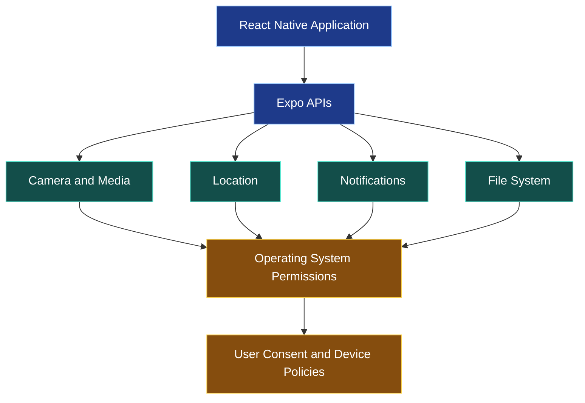
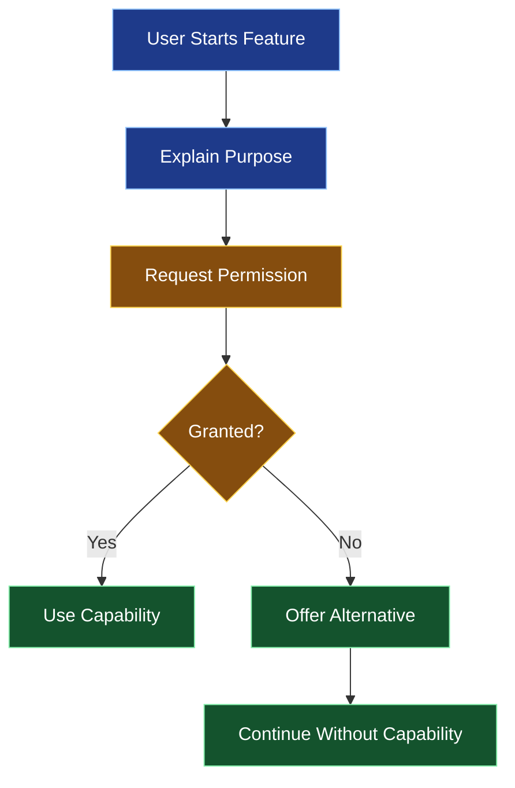
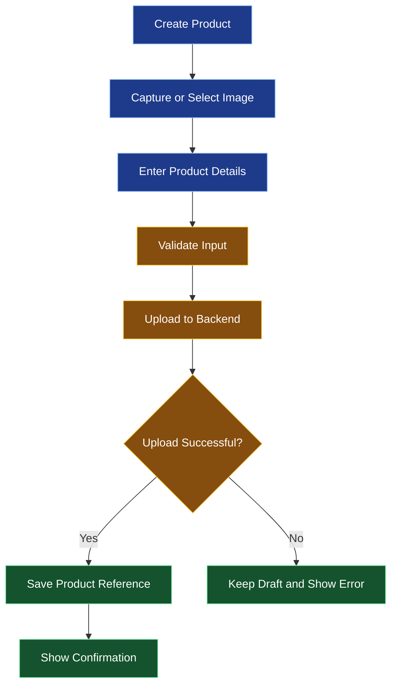

# 📸 Device Features: Camera, Location, Notifications, and Files

[⬅️ Previous](11-authentication-authorization-and-secure-data.md) ·

> **AI Developer – App Development | Phase 3 · Topic 12**

Learn how to integrate device hardware and operating-system capabilities into React Native applications using Expo APIs, permissions, and safe handling of media and files.

---

## 🎯 Learning Objectives

By the end of this topic, you will be able to:

- Explain permissions and privacy requirements for device capabilities.
- Capture or select images.
- Request and retrieve location information.
- Schedule or receive push notifications.
- Select documents and work with file URIs.
- Handle permission denial, cancellation, and device limitations.
- Avoid unnecessary collection of sensitive data.
- Build a practical media and location-enabled mobile feature.

## 1. 📱 What Are Device Capabilities?

A mobile application can interact with hardware and operating-system services through platform APIs.

Examples:

- Camera: scan QR codes or capture product photos.
- Photo library: select images for upload.
- Location: show nearby services or delivery areas.
- Notifications: remind users about important events.
- Files: import documents or export reports.
- Biometrics: unlock a supported local experience.
- Haptics: provide tactile feedback.



Device APIs do not bypass operating-system privacy controls. Some capabilities require explicit permission, device hardware, native configuration, or a development build.

## 2. 🔐 Permissions and Privacy

Request permissions when the user understands why a capability is needed.

Good examples:

- Ask for camera access when the user taps “Take Photo.”
- Ask for location access when the user selects “Find Nearby Stores.”
- Ask for notification permission after explaining the benefit of notifications.

Avoid requesting every possible permission when the application first opens.

### Permission flow



Permissions can be denied, limited, or later revoked in device settings. Always design a useful fallback.

## 3. 📷 Camera and Image Selection

For many applications, selecting an existing image is simpler than building a live camera interface.

Install Expo ImagePicker:

```bash
npx expo install expo-image-picker
```

Example:

```tsx
import { useState } from "react";
import {
  Alert,
  Button,
  Image,
  View,
} from "react-native";
import * as ImagePicker from "expo-image-picker";

export default function ProductImagePicker() {
  const [imageUri, setImageUri] = useState<string | null>(null);

  async function chooseImage() {
    try {
      const result = await ImagePicker.launchImageLibraryAsync({
        mediaTypes: ["images"],
        allowsEditing: true,
        quality: 0.8,
      });

      if (result.canceled) return;

      const asset = result.assets[0];

      if (asset) {
        setImageUri(asset.uri);
      }
    } catch {
      Alert.alert("Unable to select image", "Please try again.");
    }
  }

  return (
    <View style={{ padding: 24, gap: 16 }}>
      <Button title="Choose Product Image" onPress={chooseImage} />

      {imageUri ? (
        <Image
          source={{ uri: imageUri }}
          style={{ width: "100%", height: 240, borderRadius: 12 }}
          resizeMode="cover"
          accessibilityLabel="Selected product image"
        />
      ) : null}
    </View>
  );
}
```

The operating system may provide a system photo picker that does not require broad photo-library access. Behavior varies by platform and API version.

### Uploading a selected image

The URI returned by an image picker refers to a local resource. It is not automatically a public URL and is not automatically uploaded to your server.

A production upload flow should:

1. Verify the selected file's type and size.
2. Request or obtain an authorized upload destination.
3. Upload using the API's expected format.
4. Handle network failure and retries.
5. Store the resulting server-side reference.
6. Avoid assuming a local URI remains valid indefinitely.

## 4. 🎥 Use the Camera Directly

If your application needs a live preview or capture controls, use `expo-camera`.

Install it:

```bash
npx expo install expo-camera
```

A minimal camera screen:

```tsx
import { useRef, useState } from "react";
import {
  Alert,
  Button,
  Image,
  Text,
  View,
} from "react-native";
import {
  CameraView,
  useCameraPermissions,
} from "expo-camera";

export default function CameraScreen() {
  const [permission, requestPermission] = useCameraPermissions();
  const [capturedUri, setCapturedUri] = useState<string | null>(null);
  const cameraRef = useRef<CameraView>(null);

  if (!permission) {
    return <Text>Checking camera permission...</Text>;
  }

  if (!permission.granted) {
    return (
      <View style={{ padding: 24, gap: 12 }}>
        <Text>Camera access is needed to take a product photo.</Text>
        <Button title="Allow Camera" onPress={requestPermission} />
      </View>
    );
  }

  async function takePhoto() {
    try {
      const photo = await cameraRef.current?.takePictureAsync();

      if (photo?.uri) {
        setCapturedUri(photo.uri);
      }
    } catch {
      Alert.alert("Camera error", "Unable to capture a photo.");
    }
  }

  return (
    <View style={{ flex: 1, padding: 16, gap: 12 }}>
      <View style={{ height: 360, overflow: "hidden", borderRadius: 16 }}>
        <CameraView ref={cameraRef} style={{ flex: 1 }} />
      </View>

      <Button title="Take Photo" onPress={takePhoto} />

      {capturedUri ? (
        <Image
          source={{ uri: capturedUri }}
          style={{ height: 160, borderRadius: 12 }}
        />
      ) : null}
    </View>
  );
}
```

Check the installed Expo Camera version for its exact API. Camera behavior may differ on simulators, devices without a camera, and platforms with restricted permissions. Test on a real device where possible.

## 5. 📍 Access Location Responsibly

Location can power nearby-store discovery, delivery estimates, navigation, and location-aware reminders.

Install Expo Location:

```bash
npx expo install expo-location
```

Example of retrieving foreground location:

```tsx
import { useState } from "react";
import {
  Alert,
  Button,
  Text,
  View,
} from "react-native";
import * as Location from "expo-location";

type Coordinates = {
  latitude: number;
  longitude: number;
};

export default function LocationScreen() {
  const [coordinates, setCoordinates] =
    useState<Coordinates | null>(null);

  async function findLocation() {
    try {
      const permission =
        await Location.requestForegroundPermissionsAsync();

      if (!permission.granted) {
        Alert.alert(
          "Location unavailable",
          "Allow location access or enter your location manually."
        );
        return;
      }

      const result = await Location.getCurrentPositionAsync({
        accuracy: Location.Accuracy.Balanced,
      });

      setCoordinates({
        latitude: result.coords.latitude,
        longitude: result.coords.longitude,
      });
    } catch {
      Alert.alert(
        "Unable to retrieve location",
        "Try again or enter your location manually."
      );
    }
  }

  return (
    <View style={{ padding: 24, gap: 12 }}>
      <Button title="Find Nearby Stores" onPress={findLocation} />

      {coordinates ? (
        <Text>
          Latitude: {coordinates.latitude.toFixed(4)}
          {"\n"}
          Longitude: {coordinates.longitude.toFixed(4)}
        </Text>
      ) : (
        <Text>Location has not been retrieved.</Text>
      )}
    </View>
  );
}
```

### Location privacy rules

- Request foreground location unless background tracking is genuinely required.
- Explain how location will be used.
- Offer manual location entry when practical.
- Do not collect location continuously without a clear need.
- Avoid logging precise coordinates unnecessarily.
- Consider the accuracy needed for the feature; approximate location may be enough.
- Follow applicable privacy and platform policies.

Coordinates alone do not identify a street address. Reverse geocoding, if needed, requires an appropriate service and careful handling of location data.

## 6. 🔔 Local and Push Notifications

Notifications can remind users about saved items, appointments, order updates, or other events.

Install Expo Notifications:

```bash
npx expo install expo-notifications
```

### Schedule a local notification

```tsx
import { Alert, Button, View } from "react-native";
import * as Notifications from "expo-notifications";

export default function ReminderScreen() {
  async function scheduleReminder() {
    try {
      const permission =
        await Notifications.requestPermissionsAsync();

      if (!permission.granted) {
        Alert.alert(
          "Notifications disabled",
          "You can enable notifications in system settings."
        );
        return;
      }

      await Notifications.scheduleNotificationAsync({
        content: {
          title: "Your saved collection",
          body: "Take a look at your favorite products.",
          data: { screen: "/favorites" },
        },
        trigger: {
          type: Notifications.SchedulableTriggerInputTypes.TIME_INTERVAL,
          seconds: 60,
        },
      });

      Alert.alert("Reminder scheduled", "You will be reminded later.");
    } catch {
      Alert.alert("Unable to schedule", "Please try again.");
    }
  }

  return (
    <View style={{ padding: 24 }}>
      <Button
        title="Schedule Reminder"
        onPress={scheduleReminder}
      />
    </View>
  );
}
```

This example schedules a local notification using the current Expo Notifications API shape. Verify the API for your installed Expo SDK. Notification presentation and scheduling behavior depend on platform and permission settings.

### Local vs push notifications

| Type | How it works | Example |
|---|---|---|
| Local notification | Scheduled by the app on the device | A reminder after one hour |
| Push notification | Sent through a push notification service | An order shipped notification |

Push notifications typically require a server to associate a device push token with an account and send notifications through an appropriate provider. Test push notifications on a physical device and follow Expo's current setup guidance for the target platforms.

Do not put notification-provider secrets in the mobile application.

## 7. 📄 Select Documents and Files

Applications may need to import invoices, attach documents, or select files for processing.

Install Expo DocumentPicker:

```bash
npx expo install expo-document-picker
```

Example:

```tsx
import { useState } from "react";
import {
  Alert,
  Button,
  Text,
  View,
} from "react-native";
import * as DocumentPicker from "expo-document-picker";

type SelectedDocument = {
  name: string;
  uri: string;
  size?: number;
  mimeType?: string;
};

export default function DocumentUploadScreen() {
  const [document, setDocument] =
    useState<SelectedDocument | null>(null);

  async function selectDocument() {
    try {
      const result = await DocumentPicker.getDocumentAsync({
        type: ["application/pdf", "image/*"],
        copyToCacheDirectory: true,
      });

      if (result.canceled) return;

      const file = result.assets[0];

      if (!file) return;

      const maxSize = 10 * 1024 * 1024;

      if (file.size !== undefined && file.size > maxSize) {
        Alert.alert("File too large", "Choose a file smaller than 10 MB.");
        return;
      }

      setDocument({
        name: file.name,
        uri: file.uri,
        size: file.size,
        mimeType: file.mimeType,
      });
    } catch {
      Alert.alert("Unable to select file", "Please try again.");
    }
  }

  return (
    <View style={{ padding: 24, gap: 12 }}>
      <Button title="Choose Document" onPress={selectDocument} />

      {document ? (
        <Text>
          File: {document.name}
          {"\n"}
          Type: {document.mimeType ?? "Unknown"}
          {"\n"}
          Size: {document.size ?? "Unknown"} bytes
        </Text>
      ) : null}
    </View>
  );
}
```

This selects a file but does not upload it. A production application should validate file content on the server, enforce upload limits, and avoid trusting file names or MIME types supplied by the client.

### Working with file URIs

A local URI may point to a temporary cache location or another platform-managed resource. If a file must remain available, copy it into an appropriate app-managed location using the file-system API supported by your Expo version.

Do not assume a URI can be accessed by a remote server. Upload the file's bytes or use a documented upload mechanism.

## 8. 🧩 Combine Device Features into a User Workflow

Consider a boutique manager adding a new product:

1. Capture a photo or select one from the gallery.
2. Enter the product details.
3. Optionally attach a specification document.
4. Submit the product to the backend.
5. Display a confirmation after the backend accepts the upload.
6. Send an authorized notification to relevant users if needed.



The backend should validate file content, user permissions, product fields, and any business rules before accepting the new product.

## 9. ⚠️ Common Mistakes

| Mistake | Better approach |
|---|---|
| Requesting every permission at launch | Ask when the user starts the relevant feature |
| Assuming a permission stays granted | Handle denial and revocation |
| Treating a local file URI as a web URL | Upload or manage the file explicitly |
| Assuming image selection uploads the image | Implement an upload workflow |
| Using precise location unnecessarily | Request only the accuracy required |
| Putting push-service credentials in the app | Send pushes from a trusted backend |
| Assuming notifications always appear | Account for permission and system settings |
| Trusting the file name or MIME type | Validate file content on the backend |

### ⭐ Key Takeaways

- Device features require platform APIs and thoughtful permission handling.
- Image selection, camera capture, and file upload are separate operations.
- Location should be collected only when necessary and with appropriate consent.
- Notifications can be local or push-based.
- Local URIs and device data must be handled with privacy, lifecycle, and security in mind.