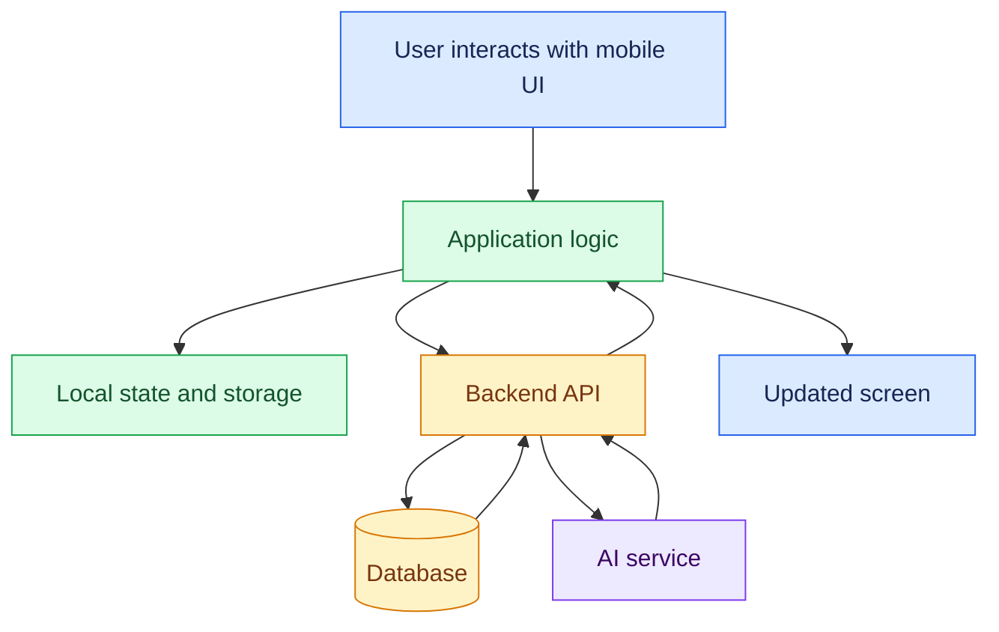
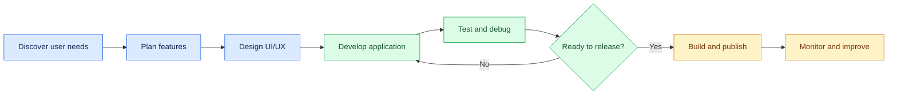
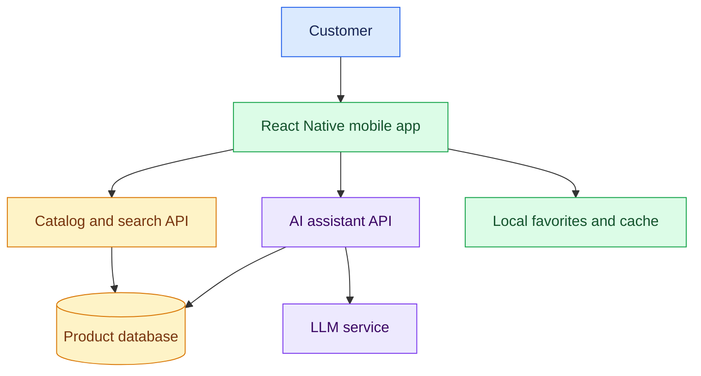

# 01. Introduction to AI-Powered App Development

[⬅️ Back to Learning Modules](../README.md) · 

> 📱 AI Developer — App Development | Phase 1: App Development Foundations

## 🎯 Learning Objectives

By the end of this topic, you will be able to:

- Understand mobile applications and their major categories.
- Explain the mobile application development lifecycle.
- Compare native, cross-platform, and web-based applications.
- Understand how AI can assist application development and power app features.
- Identify the main components of a mobile application architecture.
- Explore a practical AI-powered application scenario.

## 1. 🌍 What Is App Development?

App development is the process of designing, building, testing, deploying, and maintaining software applications that users interact with through mobile devices, tablets, desktops, or other platforms.

Mobile app development focuses on applications designed for mobile operating systems such as Android and iOS.

Examples include:

- 🛍️ Shopping and e-commerce applications.
- 💬 Messaging and communication apps.
- 🏦 Banking and finance applications.
- 📚 Educational and learning applications.
- 🏥 Healthcare and wellness applications.
- 🤖 AI-powered assistants and productivity tools.

A successful application combines useful functionality, intuitive design, reliable data handling, security, and good performance.

## 2. 📲 Types of Mobile Applications

### Native applications

Native apps are developed using platform-specific technologies.

- Android: Kotlin or Java with Android development tools.
- iOS: Swift with Apple's development tools.

**Advantages:** Deep access to platform capabilities, native UI behavior, and platform-specific optimization.

**Trade-offs:** Separate platform implementations may require more development and maintenance effort.

### Cross-platform applications

Cross-platform frameworks allow developers to share much of their code across Android and iOS.

Examples include React Native and Flutter.

**Advantages:** Shared business logic, reusable UI patterns, and faster development for many projects.

**Trade-offs:** Some platform-specific features still require native configuration or code, and performance must be evaluated for the intended workload.

### Progressive Web Apps (PWAs)

PWAs are web applications that use web technologies and can offer installable experiences in supported browsers.

**Advantages:** A shared web codebase, straightforward web deployment, and broad browser access.

**Trade-offs:** Device API access and behavior vary by platform and browser, so a PWA may not replace a native or cross-platform app for every use case.

### Comparison

| Approach | Main technologies | Best suited for |
|---|---|---|
| Native | Kotlin, Swift | Deep platform integration or specialized native requirements |
| Cross-platform | React Native, Flutter | Shared mobile application development |
| PWA | HTML, CSS, JavaScript | Installable web experiences and browser-first products |

For this masterclass, React Native with Expo is the primary practical path.

## 3. 🧠 What Makes an Application AI-Powered?

An AI-powered application uses machine learning or generative AI to provide capabilities beyond conventional rules and interfaces.

Examples include:

- Conversational assistants that answer questions.
- Image recognition and visual search.
- Speech-to-text and voice interaction.
- Personalized recommendations.
- Document summarization.
- Intelligent search over a knowledge base.
- Workflow automation with controlled tool use.

AI is not required in every part of an application. A good design uses AI where it adds value and ordinary deterministic code where predictable behavior is preferable.

### Traditional vs. AI-Powered Apps

| Traditional app | AI-powered app |
|---|---|
| Often follows predefined business rules | May generate predictions or responses |
| Uses forms, filters, and conventional search | Can support natural-language interaction |
| Usually produces predictable outputs for fixed inputs | May produce variable outputs |
| Can run much of its logic locally | May use cloud AI services or on-device models |

AI outputs can be inaccurate or inconsistent. Important operations—especially payments, account changes, and access control—must remain governed by trusted application logic.

## 4. 🏗️ How a Mobile Application Works

A mobile app commonly contains several connected layers:

The UI collects user input. Application logic decides what should happen. Data may be stored locally or sent to a backend, which can interact with a database or AI service.

Not every app needs all these components. A simple offline utility may not need a backend, while a multi-user application generally needs a trusted server for shared data and protected operations.

## 5. 🔄 The Mobile App Development Lifecycle

The development lifecycle is iterative. Testing may reveal a design issue, user feedback may change requirements, and production monitoring may identify a problem that needs a new release.

## 6. 🧰 Technologies Used in This Masterclass

### Frontend

- React Native for cross-platform UI.
- Expo for development tooling and native application workflows.
- TypeScript for type safety.
- Expo Router for file-based navigation.

### Backend and data

- REST APIs for communication.
- Node.js and Express for backend examples.
- PostgreSQL for relational data.
- Local storage for suitable device-side data.

### AI

- LLM APIs for chat and text generation.
- Multimodal APIs for image and audio workflows.
- Speech services for voice experiences.
- On-device inference tools where supported.

### Testing and release

- Component and integration testing.
- Android and iOS device testing.
- Build and distribution workflows.
- Crash reporting, logging, and performance monitoring.

Tools and services should be chosen based on application requirements rather than added simply because they are available.

## 7. 💡 Real-World Scenario: AI-Powered Boutique Assistant

Imagine a shopping application that helps customers discover clothing and understand product details.

### Core features

1. Browse and search products.
2. Filter by category, price, and availability.
3. Save favorite items.
4. Ask an AI assistant questions about the catalog.
5. View product images and descriptions.
6. Sign in to manage a shopping list or order history.

### Architecture

The AI assistant should answer from trusted catalog information where possible. The backend must enforce user permissions, and the app should not expose private AI service credentials.

## 8. 🤖 How AI Can Assist App Development

AI can help developers:

- Generate starter components and boilerplate.
- Explain unfamiliar code.
- Suggest UI layouts and design variations.
- Draft tests and sample data.
- Diagnose errors from logs.
- Refactor repetitive code.
- Generate documentation.
- Brainstorm accessibility improvements.

However, AI-generated code must be reviewed, tested, and checked against the framework's current APIs. Do not paste credentials, private customer information, or confidential source code into AI tools unless your organization's policies and the tool's data handling arrangements permit it.

## 9. 🛡️ Foundational Security Principles

Security should be considered from the beginning.

- Never embed private backend or AI provider keys in the mobile bundle.
- Authenticate users before accessing protected resources.
- Enforce authorization on the server.
- Use HTTPS for network communication.
- Validate data on the backend.
- Store sensitive credentials using suitable platform-backed secure storage.
- Request device permissions only when needed.
- Minimize collection of personal information.
- Avoid logging tokens, passwords, or sensitive user data.

A mobile app can be inspected or modified by a determined user. Client-side checks alone cannot protect sensitive operations.

## 10. ⚠️ Common Mistakes

- Starting development without identifying the intended users.
- Adding AI before defining the problem it should solve.
- Treating generated code as automatically correct.
- Storing secrets in frontend or mobile application code.
- Ignoring offline behavior and slow networks.
- Testing only on one screen size or device.
- Overcomplicating a first project with too many services.
- Forgetting accessibility, error states, and loading indicators.

## 🔑 Key Takeaways

- App development includes planning, design, implementation, testing, release, and maintenance.
- Native, cross-platform, and web-based approaches have different trade-offs.
- React Native and Expo provide the main development path for this curriculum.
- AI can power useful features, but its outputs require validation and suitable controls.
- Security, accessibility, and performance are foundational requirements, not final-stage additions.