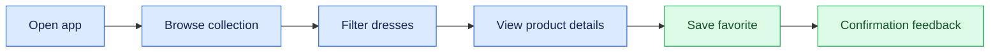
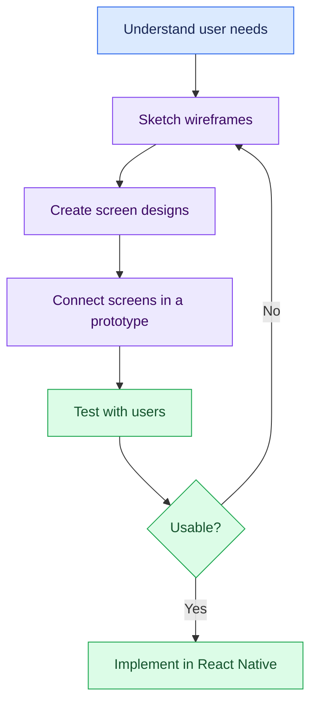

# 02. Mobile UI/UX Design and App Prototyping

[⬅️ Previous](01-introduction-to-ai-powered-app-development.md) ·

> 🎨 AI Developer — App Development | Phase 1: App Development Foundations

## 🎯 Learning Objectives

By the end of this topic, you will be able to:

- Explain the difference between UI and UX.
- Design mobile screens using visual hierarchy, spacing, typography, and color.
- Understand navigation patterns and platform conventions.
- Create wireframes and interactive prototypes.
- Apply mobile accessibility and touch-target guidelines.
- Use AI tools responsibly during design exploration.
- Plan a consistent design system for a mobile application.

## 1. 🎨 What Are UI and UX?

**User Interface (UI)** is the visual and interactive layer of an application: buttons, text fields, icons, cards, colors, and screen layouts.

**User Experience (UX)** is the overall experience of using the application: how easily people find information, complete tasks, understand feedback, and recover from errors.

For example, a boutique shopping app may have attractive product cards, but if customers cannot find the cart or understand whether an order was placed, its UX is poor.

| UI design | UX design |
|---|---|
| Focuses on appearance and interaction elements | Focuses on user goals and task completion |
| Defines colors, typography, and component styles | Defines workflows, navigation, and usability |
| Uses visual mockups and design systems | Uses user research, journey maps, and usability testing |
| Helps the interface feel clear and consistent | Helps the application solve the right problem |

Good mobile applications need both.

## 2. 🧭 Understand the User Journey

Before designing screens, identify the task the user wants to complete.

Example: a customer wants to discover and save a dress.



For each step, ask:

- What does the user want to accomplish?
- What information do they need?
- What action should be most visible?
- What happens if the request fails?
- How can the user go back or change their decision?

Design around tasks rather than adding screens without a clear purpose.

## 3. 📐 Mobile Layout Fundamentals

Mobile screens have limited space, so prioritize important content and actions.

### Visual hierarchy

Use size, weight, spacing, and placement to distinguish:

- Primary headings.
- Supporting descriptions.
- Main actions.
- Secondary actions.
- Status messages and error information.

### Spacing

Use a consistent spacing scale instead of choosing arbitrary values for every component.

Example scale:

| Token | Example value | Typical use |
|---|---:|---|
| `space-1` | 4 | Small icon gap |
| `space-2` | 8 | Compact spacing |
| `space-3` | 12 | Input and label spacing |
| `space-4` | 16 | Standard screen padding |
| `space-6` | 24 | Section spacing |
| `space-8` | 32 | Large section separation |

These are illustrative values. Adjust them to the design and platform requirements.

### Typography

Use a limited type scale with clear roles:

- Screen title.
- Section heading.
- Body text.
- Supporting text.
- Button label.

Avoid making all text the same size or using tiny fonts to fit too much information on one screen. Support system font scaling where possible.

## 4. 🎨 Build a Simple Design System

A design system provides reusable colors, typography, spacing, and component rules.

Example design tokens:

```typescript
export const colors = {
  background: "#F8FAFC",
  surface: "#FFFFFF",
  primary: "#6D28D9",
  text: "#172033",
  mutedText: "#64748B",
  border: "#E2E8F0",
  danger: "#B91C1C",
  success: "#15803D"
} as const;

export const spacing = {
  xs: 4,
  sm: 8,
  md: 16,
  lg: 24,
  xl: 32
} as const;

export const radius = {
  card: 16,
  input: 10,
  button: 12
} as const;
```

Store tokens in a shared module and reuse them throughout the application. This makes theme changes and UI maintenance easier.

Check text and component contrast against the chosen backgrounds rather than relying on color appearance alone.

## 5. 🗺️ Wireframes and Prototypes

A **wireframe** is a simplified layout showing where content and controls belong.

A **prototype** simulates how screens connect and how users interact with controls. It can be created in a design tool or built as a lightweight interactive application.

A typical workflow is:



A prototype should cover important states, not only the ideal screen:

- Empty lists.
- Loading states.
- Network errors.
- Validation errors.
- Success feedback.
- Permission requests.
- Long text and small screens.

## 6. 🧩 Common Mobile Navigation Patterns

### Stack navigation

Pushes a detail screen above a previous screen. Useful for product lists leading to product details.

### Tab navigation

Provides access to a small number of major destinations, such as Home, Search, Favorites, and Profile.

### Drawer navigation

Displays a side menu, often for secondary or less frequently used destinations.

### Modal screens

Temporarily focus the user on a task, such as editing a profile or confirming an action.

Choose navigation based on the app's information architecture. Avoid too many top-level tabs or deeply nested menus.

## 7. 📱 Create an Interactive Screen in React Native

The following example uses basic React Native components and shared style tokens.

Create `src/screens/WelcomeScreen.tsx`:

```tsx
import { useState } from "react";
import {
  Pressable,
  SafeAreaView,
  StyleSheet,
  Text,
  View
} from "react-native";

const colors = {
  background: "#F8FAFC",
  surface: "#FFFFFF",
  primary: "#6D28D9",
  text: "#172033",
  muted: "#64748B"
};

export default function WelcomeScreen() {
  const [message, setMessage] = useState("");

  return (
    <SafeAreaView style={styles.screen}>
      <View style={styles.content}>
        <Text style={styles.eyebrow}>LUMIERE BOUTIQUE</Text>

        <Text style={styles.title}>
          Discover your next favorite look.
        </Text>

        <Text style={styles.description}>
          Explore thoughtfully selected styles for everyday wear
          and special occasions.
        </Text>

        <Pressable
          accessibilityRole="button"
          style={styles.button}
          onPress={() => setMessage("Your collection is ready to explore.")}
        >
          <Text style={styles.buttonText}>Explore Collection</Text>
        </Pressable>

        {message ? (
          <Text accessibilityLiveRegion="polite" style={styles.feedback}>
            {message}
          </Text>
        ) : null}
      </View>
    </SafeAreaView>
  );
}

const styles = StyleSheet.create({
  screen: {
    flex: 1,
    backgroundColor: colors.background
  },
  content: {
    flex: 1,
    justifyContent: "center",
    paddingHorizontal: 24,
    paddingVertical: 32
  },
  eyebrow: {
    color: colors.primary,
    fontSize: 12,
    fontWeight: "700",
    letterSpacing: 2,
    marginBottom: 16
  },
  title: {
    color: colors.text,
    fontSize: 32,
    lineHeight: 40,
    fontWeight: "700",
    marginBottom: 16
  },
  description: {
    color: colors.muted,
    fontSize: 16,
    lineHeight: 24,
    marginBottom: 28
  },
  button: {
    backgroundColor: colors.primary,
    borderRadius: 12,
    minHeight: 52,
    alignItems: "center",
    justifyContent: "center",
    paddingHorizontal: 20
  },
  buttonText: {
    color: "#FFFFFF",
    fontSize: 16,
    fontWeight: "600"
  },
  feedback: {
    color: colors.text,
    marginTop: 20,
    fontSize: 15
  }
});
```

The button demonstrates a basic interaction. In a complete app, connect it to actual navigation rather than only displaying a message.

If your Expo Router project already has an `app/` directory, place the screen in the appropriate route and render it from that route.

## 8. ♿ Accessibility in Mobile UI/UX

Accessible design helps people with different abilities use an application.

Key practices:

- Use sufficient color contrast.
- Give controls meaningful accessible labels.
- Ensure touch targets are comfortably large.
- Support system font scaling.
- Avoid communicating status through color alone.
- Provide useful focus and screen-reader behavior.
- Make error messages understandable.
- Keep navigation and interactions predictable.

Example:

```tsx
<Pressable
  accessibilityRole="button"
  accessibilityLabel="Add Floral Summer Dress to favorites"
  accessibilityState={{ selected: isFavorite }}
  onPress={toggleFavorite}
>
  <Text>{isFavorite ? "♥ Saved" : "♡ Save"}</Text>
</Pressable>
```

This assumes `isFavorite` and `toggleFavorite` are defined in the component. Ensure the selected state is communicated correctly by the platform's accessibility system and that the visible text is consistent with the action.

## 9. 🤖 Use AI During the Design Process

AI can assist with:

- Generating alternative screen-layout ideas.
- Drafting component code from a design description.
- Suggesting color palettes and spacing scales.
- Creating sample product data.
- Reviewing a screen for potential usability issues.
- Suggesting test cases for error and empty states.

A useful prompt should specify the target platform, users, purpose, screen content, visual style, and accessibility constraints.

For example:

> Design a React Native product catalog for a boutique shopping app. Use a clean mobile-first layout, accessible text contrast, product cards, category filters, search, loading and empty states, and a clear favorites interaction. Use reusable components and TypeScript.

Review the generated design against actual user needs, accessibility requirements, and platform behavior before implementation.

## 10. 🏪 Real-World Scenario

A customer opens a shopping app on a small phone and wants to find a dress quickly.

A good design provides:

1. A clear home screen with a visible search action.
2. Easy-to-reach category filters.
3. Readable product cards with consistent image dimensions.
4. A clearly identified price and availability status.
5. An accessible favorites button.
6. Useful feedback when loading fails or no products match.

This scenario demonstrates why layout, navigation, feedback, and accessibility must work together.

## 11. ⚠️ Common Mistakes

- Designing for one screen size only.
- Using inconsistent colors and spacing.
- Creating buttons that are too small or too close together.
- Using placeholders instead of labels.
- Ignoring loading, empty, and error states.
- Making navigation depend only on gestures that users may not discover.
- Overloading a screen with too much information.
- Treating an AI-generated mockup as a tested user experience.

## 🔑 Key Takeaways

- UI describes the interface; UX describes the user's overall experience.
- Design should begin with user needs and real tasks.
- Reusable design tokens make interfaces consistent and maintainable.
- Prototypes help validate workflows before expensive implementation.
- Accessibility must be considered throughout the design process.
- AI can accelerate design exploration, but usability still requires evaluation.
