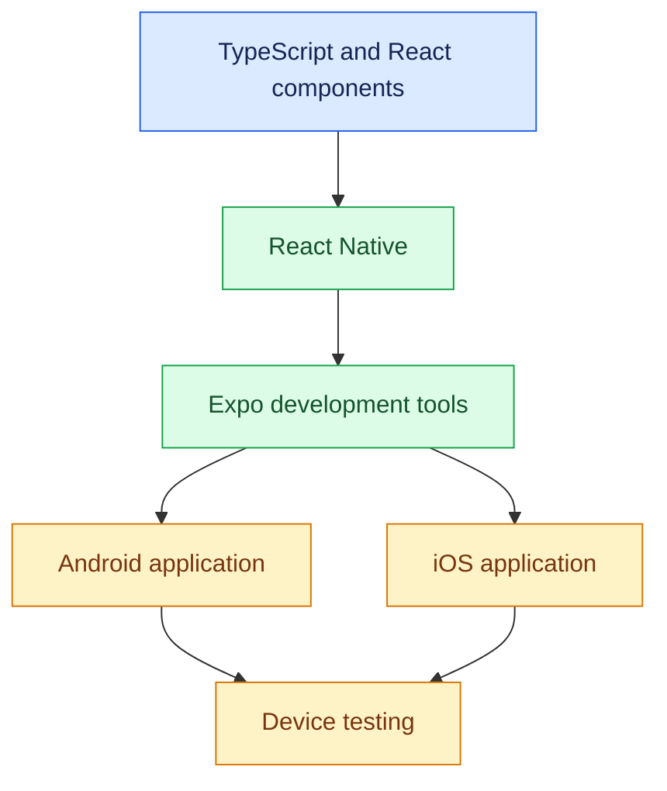

# 03. React Native, Expo, and TypeScript Setup

[⬅️ Previous](02-mobile-ui-ux-design-and-app-prototyping.md) ·

> ⚙️ AI Developer — App Development | Phase 1: App Development Foundations

## 🎯 Learning Objectives

By the end of this topic, you will be able to:

- Understand React Native, Expo, and TypeScript.
- Set up the development environment.
- Create and run your first mobile application.
- Understand the Expo project structure.
- Build a simple interactive screen.
- Use TypeScript to define component props and application data.
- Troubleshoot common development setup errors.

## 1. 🧰 Understand the Technology Stack

### React Native

React Native is a framework for building native mobile user interfaces with React and JavaScript or TypeScript. It renders platform UI components rather than simply displaying a traditional website inside a browser.

### Expo

Expo provides tools and services that simplify React Native development, including project creation, development workflows, device testing, and application builds.

### TypeScript

TypeScript adds static type checking to JavaScript. It helps detect many errors during development, such as passing the wrong value to a component or using a property that does not exist.

### How They Work Together



Expo supports multiple workflows. Expo Go is convenient for learning and rapid iteration, while development builds are needed for some native modules, custom native configuration, and production-like testing.

## 2. 💻 Install the Development Tools

You will need:

- A supported Node.js LTS release.
- npm, which is normally installed with Node.js.
- Visual Studio Code or another editor.
- Expo tooling through the project's supported commands.
- An Android device or emulator, an iOS device or simulator, or another supported testing setup.

Download Node.js from [nodejs.org](https://nodejs.org/en/download) and install your preferred editor from [Visual Studio Code](https://code.visualstudio.com/).

Verify the installation:

```bash
node --version
npm --version
```

If these commands are not recognized, reopen the terminal after installation and verify that Node.js is available on your system's PATH.

## 3. 🚀 Create an Expo Project

Use Expo's project creation command:

```bash
npx create-expo-app@latest app-development-starter
cd app-development-starter
```

Start the development server:

```bash
npx expo start
```

The terminal displays a QR code and development options.

You can test the application using a compatible Expo Go installation, an Android emulator, or an iOS simulator on supported macOS setups.

**Version note:** Expo's recommended defaults and template structure can change. Follow the generated project's instructions and the official [Expo documentation](https://docs.expo.dev/) if the starter files differ from the examples here.

## 4. 📂 Understand the Project Structure

A project created from an Expo Router template may resemble this:

```text
app-development-starter/
├── app/
│   ├── _layout.tsx
│   ├── index.tsx
│   └── explore.tsx
├── assets/
│   └── images/
├── components/
├── constants/
├── hooks/
├── app.json
├── package.json
├── tsconfig.json
└── node_modules/
```

The exact structure depends on the template you select.

- `app/` contains route files when Expo Router is configured.
- `_layout.tsx` defines layout or navigation shared by routes.
- `components/` contains reusable UI components.
- `assets/` stores local images, fonts, and other static resources.
- `constants/` stores shared configuration and design tokens.
- `hooks/` contains reusable React hooks.
- `app.json` contains Expo configuration.
- `package.json` defines scripts and dependencies.
- `tsconfig.json` configures TypeScript.

Do not delete files simply because their purpose is not yet familiar. Inspect the starter project's documentation and imports first.

## 5. 📱 Build Your First Screen

In an Expo Router project, edit `app/index.tsx`.

```tsx
import { useState } from "react";
import {
  SafeAreaView,
  StyleSheet,
  Text,
  Pressable,
  View
} from "react-native";

export default function HomeScreen() {
  const [count, setCount] = useState(0);

  return (
    <SafeAreaView style={styles.screen}>
      <View style={styles.card}>
        <Text style={styles.eyebrow}>MY FIRST MOBILE APP</Text>

        <Text style={styles.title}>
          Welcome to App Development!
        </Text>

        <Text style={styles.description}>
          Build cross-platform applications with React Native.
        </Text>

        <Text style={styles.counter}>
          Button taps: {count}
        </Text>

        <Pressable
          accessibilityRole="button"
          onPress={() => setCount((previous) => previous + 1)}
          style={styles.button}
        >
          <Text style={styles.buttonText}>Tap Me</Text>
        </Pressable>
      </View>
    </SafeAreaView>
  );
}

const styles = StyleSheet.create({
  screen: {
    flex: 1,
    backgroundColor: "#F1F5F9",
    justifyContent: "center",
    padding: 20
  },
  card: {
    backgroundColor: "#FFFFFF",
    padding: 24,
    borderRadius: 20
  },
  eyebrow: {
    color: "#6D28D9",
    fontSize: 12,
    fontWeight: "700",
    marginBottom: 12
  },
  title: {
    color: "#172033",
    fontSize: 28,
    lineHeight: 36,
    fontWeight: "700",
    marginBottom: 12
  },
  description: {
    color: "#64748B",
    fontSize: 16,
    lineHeight: 24
  },
  counter: {
    color: "#172033",
    fontSize: 18,
    marginTop: 24,
    marginBottom: 16
  },
  button: {
    backgroundColor: "#6D28D9",
    minHeight: 50,
    borderRadius: 12,
    justifyContent: "center",
    alignItems: "center"
  },
  buttonText: {
    color: "#FFFFFF",
    fontWeight: "600",
    fontSize: 16
  }
});
```

Save the file and inspect the app on your selected device or emulator. The counter should update each time you tap the button.

If your starter project uses a different entry point, put the screen in the appropriate file and connect it to the app's existing routing configuration.

## 6. 🧩 Understand the Main React Native Components

| Component | Purpose |
|---|---|
| `View` | Groups and lays out UI elements |
| `Text` | Displays text |
| `Pressable` | Creates a touch-interactive element |
| `TextInput` | Collects text input |
| `Image` | Displays images |
| `ScrollView` | Provides scrolling for a bounded content area |
| `FlatList` | Efficiently renders a large or changing list |
| `SafeAreaView` or safe-area utilities | Helps keep content clear of system interface areas, depending on setup |

React Native is not ordinary web HTML. Use React Native components and styling rules rather than assuming browser elements such as `div`, `p`, or `button` will work directly.

## 7. 🔤 TypeScript Fundamentals

TypeScript allows you to describe the data that your application expects.

Primitive types:

```typescript
const appName: string = "Boutique App";
const productCount: number = 24;
const isAvailable: boolean = true;
```

Define an object type:

```typescript
type Product = {
  id: string;
  name: string;
  price: number;
  category: string;
  inStock: boolean;
};

const product: Product = {
  id: "dress-01",
  name: "Floral Summer Dress",
  price: 2499,
  category: "Dresses",
  inStock: true
};
```

TypeScript helps detect missing properties and incompatible values during development. It does not automatically validate JSON received from an API at runtime.

## 8. 🧱 Create a Reusable Typed Component

Create `components/ProductCard.tsx`:

```tsx
import { StyleSheet, Text, View } from "react-native";

type ProductCardProps = {
  name: string;
  category: string;
  price: number;
};

export default function ProductCard({
  name,
  category,
  price
}: ProductCardProps) {
  return (
    <View style={styles.card}>
      <Text style={styles.name}>{name}</Text>
      <Text style={styles.category}>{category}</Text>
      <Text style={styles.price}>
        ₹{price.toLocaleString("en-IN")}
      </Text>
    </View>
  );
}

const styles = StyleSheet.create({
  card: {
    backgroundColor: "#FFFFFF",
    borderRadius: 16,
    padding: 16,
    marginVertical: 8
  },
  name: {
    fontSize: 17,
    fontWeight: "700",
    color: "#172033"
  },
  category: {
    fontSize: 14,
    color: "#64748B",
    marginTop: 6
  },
  price: {
    fontSize: 16,
    fontWeight: "600",
    color: "#6D28D9",
    marginTop: 12
  }
});
```

Use it in a screen:

```tsx
<ProductCard
  name="Floral Summer Dress"
  category="Dresses"
  price={2499}
/>
```

Reusable components make the UI more consistent and easier to test. Component props let each instance display different product data.

## 9. 🧪 Run and Debug Your App

A useful beginner workflow:

1. Start the development server.
2. Open the app on a device or emulator.
3. Make a small code change.
4. Verify that the app updates.
5. Inspect terminal and runtime errors.
6. Test the screen at different sizes.
7. Resolve warnings before adding more features.

For device-specific behavior, test on real hardware as well as emulators when possible. Network permissions, camera access, performance, keyboard behavior, and push notifications may differ between development environments.

## 10. 📦 Expo Go vs. Development Builds

### Expo Go

Useful for quickly learning React Native and trying supported native capabilities without configuring a full native project.

### Development builds

Useful when the application needs native modules, custom native configuration, or a more production-like environment.

### Production builds

Prepared for distribution through appropriate Android and iOS channels. Production builds require careful configuration of identifiers, permissions, signing, and application assets.

Expo does not remove all platform-specific requirements. Some capabilities require native configuration or additional development tools.

## 11. ⚠️ Common Setup Problems

- `node` or `npm` is not recognized: verify installation and PATH.
- Expo server fails to start: inspect dependency and Node.js compatibility.
- QR code cannot connect: check network access and try an appropriate Expo connection mode.
- A package is missing: install it through the project's package manager and follow its compatibility instructions.
- TypeScript reports a prop error: compare the component usage with its declared type.
- The app uses a different route file: inspect the generated project structure before replacing code.
- A native module does not work in Expo Go: check whether a development build is required.
- The application renders a blank screen: inspect the terminal, runtime logs, imports, and route configuration.

Use the project's installed dependency versions and the official Expo documentation when troubleshooting.

## 🔑 Key Takeaways

- React Native builds mobile interfaces using React concepts and native UI components.
- Expo simplifies development, device testing, and application build workflows.
- TypeScript makes data contracts and component props clearer.
- Reusable components reduce duplicated UI code.
- The development environment and starter structure may vary by template and version.
- Testing on real devices remains important.