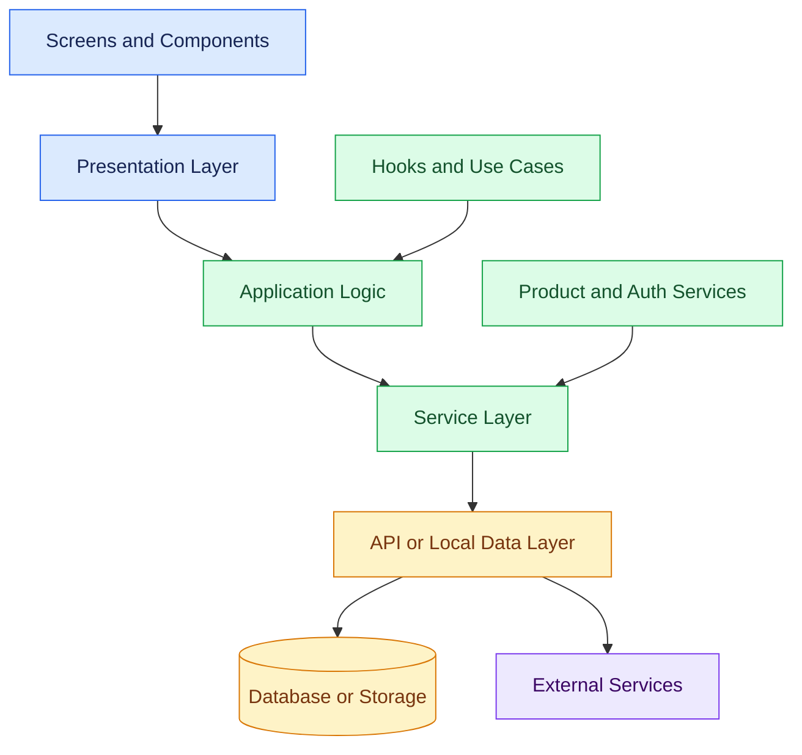
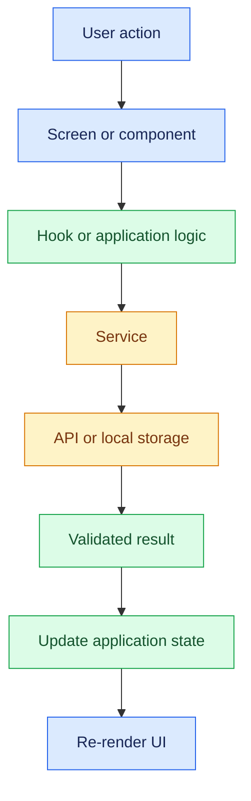
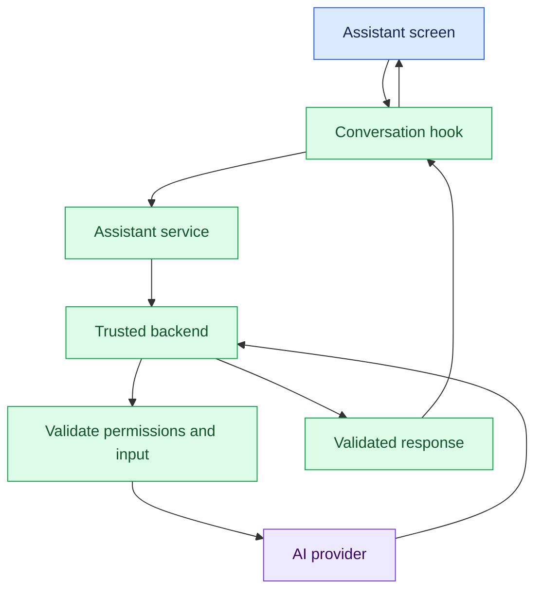

# 04. Mobile App Architecture and Component Design

[⬅️ Previous](03-react-native-expo-and-typescript-setup.md) ·

> 🏗️ AI Developer — App Development | Phase 1: App Development Foundations

## 🎯 Learning Objectives

By the end of this topic, you will be able to:

- Understand the major layers of a mobile application.
- Organize React Native projects into reusable components and modules.
- Separate UI, business logic, data access, and API communication.
- Use props, state, and custom hooks effectively.
- Understand service modules and repository patterns.
- Handle loading, success, empty, and error states.
- Design an architecture that can grow to support AI-powered features.

## 1. 🏗️ What Is Mobile App Architecture?

Mobile app architecture describes how an application is organized and how its components communicate.

A small prototype may fit into a single screen file. As the application grows, that approach can become difficult to maintain because UI rendering, data fetching, business rules, and error handling become tightly coupled.

A well-structured application separates responsibilities so that each part can be changed and tested independently.

For example, in a boutique application:

- The product screen displays the catalog.
- A reusable product card displays an individual item.
- A service module requests product data.
- A backend API validates requests.
- A database stores the catalog.

Each layer has a clear purpose.

## 2. 🧭 Understand the Main Architecture Layers



### Presentation layer

Contains screens, layouts, and reusable UI components. It should focus on displaying information and capturing user interactions.

### Application logic

Coordinates user actions and application behavior, such as searching products or deciding when to refresh data.

### Service layer

Encapsulates operations such as retrieving products, signing in, uploading images, or calling an AI endpoint.

### Data layer

Handles API communication, local persistence, caching, and other data sources.

### External services

Include backend APIs, databases accessed through trusted services, cloud storage, analytics, and AI providers.

Not every application needs a formal implementation of every layer. Start simple and introduce separation when it makes the code easier to understand, test, or change.

## 3. 📂 Organize the Project Structure

A possible structure for a growing Expo Router application is:

```text
app-development-starter/
├── app/
│   ├── _layout.tsx
│   ├── index.tsx
│   ├── products/
│   │   ├── index.tsx
│   │   └── [id].tsx
│   └── profile.tsx
├── src/
│   ├── components/
│   │   ├── ProductCard.tsx
│   │   ├── PrimaryButton.tsx
│   │   └── LoadingView.tsx
│   ├── features/
│   │   └── products/
│   │       ├── productTypes.ts
│   │       ├── productService.ts
│   │       └── useProducts.ts
│   ├── services/
│   │   └── apiClient.ts
│   ├── hooks/
│   ├── constants/
│   │   └── theme.ts
│   └── utils/
├── assets/
├── app.json
├── package.json
└── tsconfig.json
```

This is one possible structure, not a mandatory framework convention.

- `app/` contains route files for Expo Router.
- `components/` contains reusable UI.
- `features/` groups code by application feature.
- `services/` contains shared integrations and service utilities.
- `hooks/` contains reusable stateful logic.
- `constants/` contains shared tokens and configuration.
- `utils/` contains small reusable helper functions.

Avoid maintaining duplicate copies of the same component or defining multiple competing sources of truth for the same data.

## 4. 🧩 Build Reusable Components

A component should represent a useful, understandable unit of UI.

Example:

```tsx
import { Pressable, StyleSheet, Text } from "react-native";

type PrimaryButtonProps = {
  label: string;
  onPress: () => void;
  disabled?: boolean;
};

export default function PrimaryButton({
  label,
  onPress,
  disabled = false
}: PrimaryButtonProps) {
  return (
    <Pressable
      accessibilityRole="button"
      accessibilityState={{ disabled }}
      disabled={disabled}
      onPress={onPress}
      style={[
        styles.button,
        disabled && styles.disabled
      ]}
    >
      <Text style={styles.label}>{label}</Text>
    </Pressable>
  );
}

const styles = StyleSheet.create({
  button: {
    minHeight: 48,
    paddingHorizontal: 20,
    borderRadius: 12,
    justifyContent: "center",
    alignItems: "center",
    backgroundColor: "#6D28D9"
  },
  disabled: {
    opacity: 0.5
  },
  label: {
    color: "#FFFFFF",
    fontSize: 16,
    fontWeight: "600"
  }
});
```

The button can be reused across screens without duplicating its styling or interaction behavior.

Example usage:

```tsx
<PrimaryButton
  label="Continue"
  onPress={() => console.log("Continue pressed")}
/>
```

In a real application, connect the handler to a meaningful action rather than leaving a logging statement.

## 5. 🔄 Understand Props and State

**Props** are inputs passed from a parent component to a child.

**State** stores values that can change over time and cause a component to render again.

Example:

```tsx
import { useState } from "react";
import { Text, Pressable, View } from "react-native";

type FavoriteButtonProps = {
  productName: string;
};

export function FavoriteButton({
  productName
}: FavoriteButtonProps) {
  const [favorite, setFavorite] = useState(false);

  return (
    <View>
      <Text>{productName}</Text>

      <Pressable
        accessibilityRole="button"
        accessibilityState={{ selected: favorite }}
        onPress={() => setFavorite((current) => !current)}
      >
        <Text>{favorite ? "♥ Saved" : "♡ Add to favorites"}</Text>
      </Pressable>
    </View>
  );
}
```

The product name comes from props. The favorite status is local state.

If several screens need the same favorite list, storing the entire list in one individual button would be insufficient. Move the shared state into an appropriate parent, context, or state-management layer.

## 6. 🧠 Separate UI from Data Fetching

A screen should not need to know every detail of how the backend request is performed.

Define the data type in `src/features/products/productTypes.ts`:

```typescript
export type Product = {
  id: string;
  name: string;
  category: string;
  price: number;
  stock: number;
};
```

Create a shared API client in `src/services/apiClient.ts`:

```typescript
const API_BASE_URL = process.env.EXPO_PUBLIC_API_URL;

if (!API_BASE_URL) {
  throw new Error("EXPO_PUBLIC_API_URL is not configured");
}

export async function apiGet<T>(
  path: string,
  signal?: AbortSignal
): Promise<T> {
  const response = await fetch(`${API_BASE_URL}${path}`, {
    signal,
    headers: {
      Accept: "application/json"
    }
  });

  if (!response.ok) {
    throw new Error(`Request failed: ${response.status}`);
  }

  return response.json() as Promise<T>;
}
```

Configure a development environment variable such as:

```env
EXPO_PUBLIC_API_URL=https://api.example.com
```

Replace the example URL with your actual backend endpoint.

**Security note:** Variables with the `EXPO_PUBLIC_` prefix are available in client-side application code. Use this only for public configuration such as a base URL, never for private API keys or passwords.

The generic type improves TypeScript usability, but it does not validate the server's response at runtime. Validate untrusted response data before using it.

## 7. 📡 Create a Product Service

Create `src/features/products/productService.ts`:

```typescript
import { apiGet } from "../../services/apiClient";
import type { Product } from "./productTypes";

type ProductResponse = {
  products: Product[];
};

export async function getProducts(
  signal?: AbortSignal
): Promise<Product[]> {
  const data = await apiGet<ProductResponse>(
    "/api/products",
    signal
  );

  if (!Array.isArray(data.products)) {
    throw new Error("Invalid product response");
  }

  return data.products;
}
```

The service isolates endpoint details from the UI. If the backend endpoint changes, the service can be updated without rewriting every screen.

For production use, add runtime schema validation for individual products, consistent error handling, and any authentication headers or request configuration required by the API.

## 8. 🪝 Manage Loading, Success, Empty, and Error States

A useful screen must handle more than the successful response.

Create `src/features/products/useProducts.ts`:

```typescript
import { useEffect, useState } from "react";
import { getProducts } from "./productService";
import type { Product } from "./productTypes";

export function useProducts() {
  const [products, setProducts] = useState<Product[]>([]);
  const [loading, setLoading] = useState(true);
  const [error, setError] = useState("");

  useEffect(() => {
    const controller = new AbortController();

    async function load() {
      try {
        setLoading(true);
        setError("");

        const result = await getProducts(controller.signal);
        setProducts(result);
      } catch (err) {
        if (err instanceof Error && err.name !== "AbortError") {
          setError(err.message);
        }
      } finally {
        if (!controller.signal.aborted) {
          setLoading(false);
        }
      }
    }

    void load();

    return () => controller.abort();
  }, []);

  return { products, loading, error };
}
```

This custom hook manages the request lifecycle and returns the information the UI needs.

For a screen that must support manual retries, refreshing, pagination, or shared server-state caching, extend the hook or use a suitable data-fetching library.

## 9. 📱 Display the Data in a Screen

Create `app/products/index.tsx`:

```tsx
import { FlatList, Text, View } from "react-native";
import { useProducts } from "../../src/features/products/useProducts";
import ProductCard from "../../src/components/ProductCard";

export default function ProductsScreen() {
  const { products, loading, error } = useProducts();

  if (loading) {
    return <Text>Loading products...</Text>;
  }

  if (error) {
    return <Text accessibilityRole="alert">{error}</Text>;
  }

  if (products.length === 0) {
    return <Text>No products are available.</Text>;
  }

  return (
    <FlatList
      data={products}
      keyExtractor={(product) => product.id}
      contentContainerStyle={{ padding: 16 }}
      renderItem={({ item }) => (
        <ProductCard
          name={item.name}
          category={item.category}
          price={item.price}
        />
      )}
    />
  );
}
```

This assumes the reusable `ProductCard` component has the props shown earlier. Adjust the import path if your project stores components elsewhere.

A production screen should also provide a retry or refresh action, and it should avoid presenting technical error messages directly to customers.

## 10. 🔀 Understand Data Flow

A predictable data flow helps prevent UI bugs.



The screen initiates an action, the service performs the data operation, and validated results update state. The UI then renders the new state.

Avoid directly mutating state or allowing unrelated components to modify shared data without a clear ownership model.

## 11. 🧱 Choose an Appropriate State Management Strategy

| Approach | Appropriate use |
|---|---|
| Local `useState` | Form values, modal visibility, one component's selection |
| Lifted state | Shared values needed by nearby components |
| Context | App-wide values such as theme or current session |
| External state library | Complex shared client state across many features |
| Server-state library | Fetching, caching, refreshing, and synchronizing remote data |

Do not place every value into a global store. Local state is simpler when only one component needs the value.

Remote server data also has different concerns from local UI state. Server-state libraries can help manage caching, invalidation, retries, and request lifecycles as an application grows.

## 12. 🤖 Architecture for AI Features

An AI feature can use the same architectural separation.

For example, an AI assistant may contain:

- `AssistantScreen.tsx` — displays messages and user input.
- `useAssistant.ts` — manages conversation UI state and request status.
- `assistantService.ts` — sends requests to the backend.
- A backend AI endpoint — authenticates the request and applies access controls.
- An AI provider — generates the response.



This design prevents the mobile application from needing a private provider key. The backend can also enforce quotas, restrict tools, and validate the results before returning them to the app.

## 13. 🛡️ Architecture Best Practices

- Keep UI components focused and reusable.
- Use TypeScript types for data contracts and component props.
- Keep network requests outside purely presentational components where practical.
- Validate external data at runtime.
- Centralize shared API configuration and error handling.
- Separate development, test, and production configuration.
- Avoid storing secrets in the mobile bundle.
- Use appropriate secure storage for sensitive device-side credentials.
- Add tests for services, hooks, and important screen behavior.
- Avoid adding architectural layers that do not yet solve a real problem.

## 14. ⚠️ Common Mistakes

- Putting the entire application in one large screen file.
- Duplicating API requests across multiple components.
- Mixing presentation and complex business rules.
- Using global state for every small UI value.
- Mutating arrays or objects in state directly.
- Trusting TypeScript types as runtime API validation.
- Forgetting to handle loading and error states.
- Creating deeply nested components that are difficult to test.
- Exposing private service credentials in client-side code.

## 🔑 Key Takeaways

- Architecture determines how application responsibilities are separated.
- Reusable components improve consistency and maintainability.
- Hooks can encapsulate reusable stateful logic.
- Services isolate network and data operations from the UI.
- External data requires runtime validation.
- Good architecture supports future AI features without placing sensitive logic in the client.