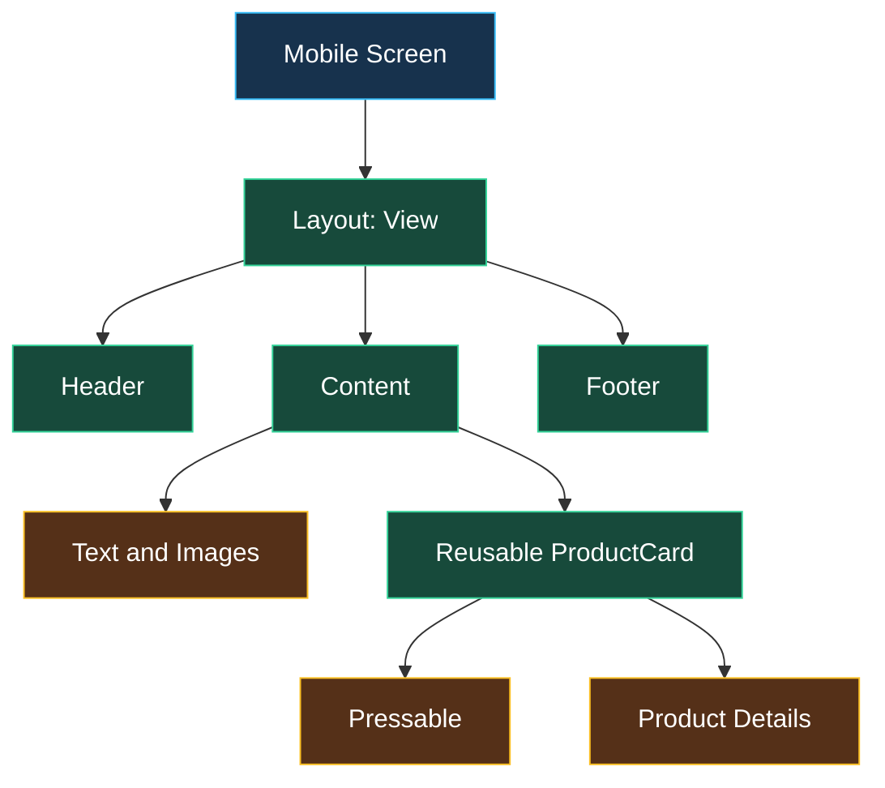
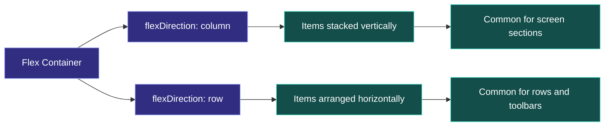
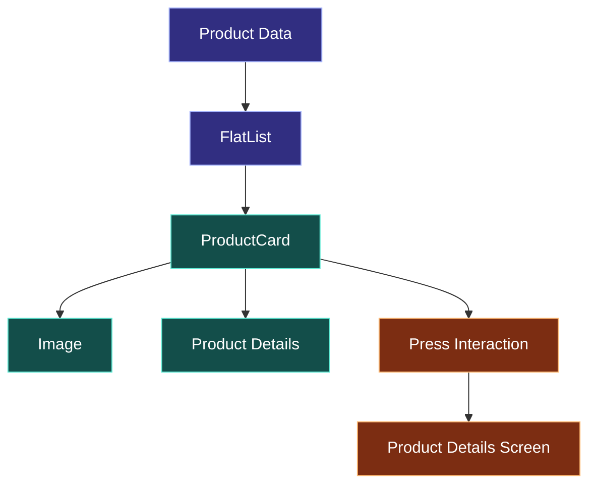

# 📱 React Native Components and Styling

[⬅️ Back to Learning Modules](../README.md) · 

> **AI Developer – App Development | Phase 2 · Topic 05**

Learn how to build reusable mobile interfaces using React Native components, TypeScript, Flexbox, StyleSheet, responsive layouts, and design systems.

---

## 🎯 Learning Objectives

By the end of this topic, you will be able to:

- Understand core React Native components and when to use them.
- Build reusable, type-safe UI components.
- Style mobile screens with `StyleSheet` and Flexbox.
- Create responsive layouts for different screen sizes.
- Display lists efficiently and handle empty states.
- Apply design tokens, accessibility, and consistent styling.
- Build a practical product catalog screen.

## 1. 🧩 Understanding React Native Components

React Native allows developers to build Android and iOS applications using JavaScript or TypeScript and React concepts. Instead of HTML elements, it provides native-backed components.

| Component | Purpose | Common use |
|---|---|---|
| `View` | Layout container | Grouping UI elements |
| `Text` | Display text | Labels, titles, descriptions |
| `Image` | Display images | Product photos, avatars |
| `ScrollView` | Scrollable content | Short, mixed-content screens |
| `FlatList` | Efficient lists | Products, messages, notifications |
| `Pressable` | Handle press interactions | Buttons, cards, list items |
| `TextInput` | Accept text input | Search, login, forms |
| `ActivityIndicator` | Show loading progress | API requests |
| `SafeAreaView` | Respect safe display areas when supported by the chosen API | Screens with notches and system bars |

### Component hierarchy



The screen is the parent component. Smaller components handle focused responsibilities, making the interface easier to test, reuse, and maintain.

## 2. 🛠️ Create a Reusable Component

A component should have one clear responsibility and accept configurable data through props.

Create `src/components/PrimaryButton.tsx`:

```tsx
import { Pressable, Text, StyleSheet } from "react-native";

type PrimaryButtonProps = {
  title: string;
  onPress: () => void;
  disabled?: boolean;
};

export default function PrimaryButton({
  title,
  onPress,
  disabled = false,
}: PrimaryButtonProps) {
  return (
    <Pressable
      accessibilityRole="button"
      accessibilityLabel={title}
      onPress={onPress}
      disabled={disabled}
      style={({ pressed }) => [
        styles.button,
        pressed && styles.pressed,
        disabled && styles.disabled,
      ]}
    >
      <Text style={styles.label}>{title}</Text>
    </Pressable>
  );
}

const styles = StyleSheet.create({
  button: {
    backgroundColor: "#2563EB",
    paddingVertical: 14,
    paddingHorizontal: 20,
    borderRadius: 12,
    alignItems: "center",
  },
  pressed: {
    opacity: 0.8,
  },
  disabled: {
    opacity: 0.45,
  },
  label: {
    color: "#FFFFFF",
    fontSize: 16,
    fontWeight: "600",
  },
});
```

Use it in a screen:

```tsx
import { Alert, View } from "react-native";
import PrimaryButton from "../src/components/PrimaryButton";

export default function HomeScreen() {
  return (
    <View style={{ padding: 24 }}>
      <PrimaryButton
        title="Explore Products"
        onPress={() => Alert.alert("Welcome", "Opening the catalog")}
      />
    </View>
  );
}
```

**Why this is useful:** one button component can be reused across login, checkout, product details, and settings. Changing the shared component updates every screen that uses it.

## 3. 🎨 Styling with StyleSheet

React Native uses JavaScript objects for styling. It does not use ordinary browser CSS files for native components.

```tsx
import { StyleSheet, Text, View } from "react-native";

export default function WelcomeCard() {
  return (
    <View style={styles.card}>
      <Text style={styles.title}>Welcome back!</Text>
      <Text style={styles.subtitle}>
        Discover something you'll love.
      </Text>
    </View>
  );
}

const styles = StyleSheet.create({
  card: {
    padding: 20,
    margin: 16,
    borderRadius: 16,
    backgroundColor: "#FFFFFF",
    borderWidth: 1,
    borderColor: "#E5E7EB",
  },
  title: {
    fontSize: 22,
    fontWeight: "700",
    color: "#111827",
    marginBottom: 8,
  },
  subtitle: {
    fontSize: 15,
    lineHeight: 23,
    color: "#6B7280",
  },
});
```

### Important differences from web CSS

- Use camelCase properties, such as `backgroundColor` and `marginTop`.
- Numeric dimensions generally represent density-independent units.
- Use arrays of styles to combine base and conditional styles.
- There is no direct browser DOM or standard CSS cascade.
- Flexbox is the primary layout system.
- Platform-specific behavior may require platform-aware styling.

## 4. 📐 Mastering Flexbox Layouts

Flexbox arranges components along a primary axis and a cross axis.



Common properties:

| Property | What it controls |
|---|---|
| `flexDirection` | Main-axis direction: `row` or `column` |
| `justifyContent` | Distribution along the main axis |
| `alignItems` | Alignment along the cross axis |
| `flex` | How available space is allocated |
| `flexWrap` | Whether items can wrap |
| `gap` | Space between children, where supported |

Example:

```tsx
import { StyleSheet, Text, View } from "react-native";

export default function SummaryRow() {
  return (
    <View style={styles.row}>
      <View style={styles.metric}>
        <Text style={styles.number}>24</Text>
        <Text>Products</Text>
      </View>

      <View style={styles.metric}>
        <Text style={styles.number}>8</Text>
        <Text>Favorites</Text>
      </View>
    </View>
  );
}

const styles = StyleSheet.create({
  row: {
    flexDirection: "row",
    gap: 12,
  },
  metric: {
    flex: 1,
    padding: 16,
    backgroundColor: "#F3F4F6",
    borderRadius: 12,
    alignItems: "center",
  },
  number: {
    fontSize: 24,
    fontWeight: "700",
  },
});
```

### Responsive design

Avoid assuming every phone has the same width or height.

- Use `flex: 1` for layouts that should occupy available space.
- Use `maxWidth` for readable content on larger screens.
- Let text wrap instead of forcing it into fixed-height containers.
- Use `useWindowDimensions()` when layout must adapt to window size.
- Test portrait, landscape, small screens, tablets, and larger font settings.

```tsx
import { useWindowDimensions, View, Text } from "react-native";

export default function ResponsivePanel() {
  const { width } = useWindowDimensions();
  const compact = width < 380;

  return (
    <View style={{ padding: compact ? 12 : 24 }}>
      <Text style={{ fontSize: compact ? 18 : 24, fontWeight: "700" }}>
        Responsive mobile interface
      </Text>
    </View>
  );
}
```

## 5. 🛍️ Building a Product Card

Define a reusable data model before building the UI.

```tsx
// src/features/products/types.ts
export type Product = {
  id: string;
  name: string;
  price: number;
  imageUrl: string;
  category: string;
};
```

Create `src/features/products/ProductCard.tsx`:

```tsx
import {
  Image,
  Pressable,
  StyleSheet,
  Text,
  View,
} from "react-native";
import type { Product } from "./types";

type ProductCardProps = {
  product: Product;
  onSelect: (product: Product) => void;
};

export default function ProductCard({
  product,
  onSelect,
}: ProductCardProps) {
  return (
    <Pressable
      accessibilityRole="button"
      accessibilityLabel={`View ${product.name}`}
      onPress={() => onSelect(product)}
      style={({ pressed }) => [
        styles.card,
        pressed && styles.pressed,
      ]}
    >
      <Image
        source={{ uri: product.imageUrl }}
        style={styles.image}
        resizeMode="cover"
        accessibilityLabel={product.name}
      />
      <View style={styles.details}>
        <Text style={styles.category}>{product.category}</Text>
        <Text style={styles.name}>{product.name}</Text>
        <Text style={styles.price}>₹{product.price.toFixed(2)}</Text>
      </View>
    </Pressable>
  );
}

const styles = StyleSheet.create({
  card: {
    flex: 1,
    backgroundColor: "#FFFFFF",
    borderRadius: 16,
    overflow: "hidden",
    borderWidth: 1,
    borderColor: "#E5E7EB",
    margin: 6,
  },
  image: {
    width: "100%",
    height: 180,
    backgroundColor: "#F3F4F6",
  },
  details: {
    padding: 12,
    gap: 6,
  },
  category: {
    color: "#6B7280",
    fontSize: 12,
  },
  name: {
    color: "#111827",
    fontSize: 16,
    fontWeight: "600",
  },
  price: {
    color: "#047857",
    fontSize: 16,
    fontWeight: "700",
  },
  pressed: {
    opacity: 0.8,
  },
});
```

## 6. 📋 Rendering Lists Efficiently

Use `FlatList` for long or dynamic lists. It renders items efficiently instead of creating every list item at once.

```tsx
import { FlatList, Text, View } from "react-native";
import ProductCard from "./ProductCard";
import type { Product } from "./types";

type ProductListProps = {
  products: Product[];
  onSelect: (product: Product) => void;
};

export default function ProductList({
  products,
  onSelect,
}: ProductListProps) {
  return (
    <FlatList
      data={products}
      numColumns={2}
      keyExtractor={(item) => item.id}
      renderItem={({ item }) => (
        <ProductCard product={item} onSelect={onSelect} />
      )}
      ListEmptyComponent={
        <View style={{ padding: 24 }}>
          <Text>No products found. Try another search.</Text>
        </View>
      }
      contentContainerStyle={{ padding: 10, flexGrow: 1 }}
    />
  );
}
```

**Important:** use stable, unique IDs as keys. Avoid using array indexes when list items can be added, removed, or reordered.

For searchable lists, keep the search query in state and filter the source data. For very large lists, consider pagination or server-side search.

## 7. 🧱 Create a Simple Design System

A design system keeps colors, spacing, typography, and shape consistent.

Create `src/theme/tokens.ts`:

```tsx
export const colors = {
  primary: "#2563EB",
  success: "#047857",
  danger: "#DC2626",
  background: "#F9FAFB",
  surface: "#FFFFFF",
  text: "#111827",
  muted: "#6B7280",
  border: "#E5E7EB",
};

export const spacing = {
  xs: 4,
  sm: 8,
  md: 16,
  lg: 24,
  xl: 32,
};

export const radius = {
  sm: 8,
  md: 12,
  lg: 20,
};
```

Reuse these values instead of inventing new colors and spacing for every component. This makes themes and future redesigns much easier.

## 8. ♿ Accessibility and Polish

A beautiful interface should also be usable.

- Provide meaningful accessibility labels for interactive controls.
- Use sufficient color contrast.
- Avoid communicating status through color alone.
- Make touch targets comfortably large.
- Ensure text can scale with device accessibility settings.
- Give loading, error, empty, and success states clear messages.
- Test with screen readers and real devices.
- Avoid nesting pressable elements in ways that make actions confusing.

## 9. 🌍 Real-World Scenario: Boutique Catalog

Imagine a fashion boutique app. Its catalog contains product images, names, prices, and category labels.



The component-based approach means the same product card can be reused in search results, category screens, recommendations, and favorites.

## 10. ⚠️ Common Mistakes

| Mistake | Better approach |
|---|---|
| Using `ScrollView` for huge lists | Prefer `FlatList` |
| Repeating the same style values | Use design tokens |
| Hardcoding screen dimensions | Use Flexbox and responsive measurements |
| Using array indexes as changing list keys | Use stable IDs |
| Building one giant screen component | Split by responsibility |
| Ignoring loading and empty states | Design all UI states |
| Adding inaccessible icon-only buttons | Provide accessible labels |

### ⭐ Key Takeaways

- React Native components form the building blocks of mobile applications.
- TypeScript props make reusable components safer and easier to maintain.
- Flexbox supports adaptable layouts across devices.
- `FlatList` is a strong default for dynamic lists.
- Design tokens and accessibility improve consistency and usability.
