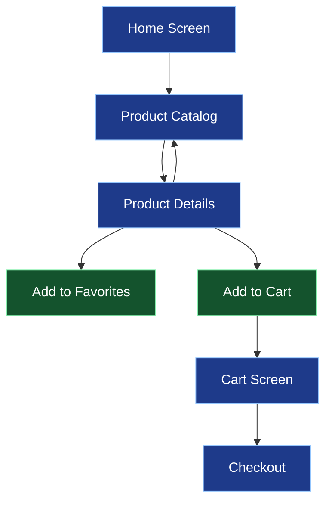
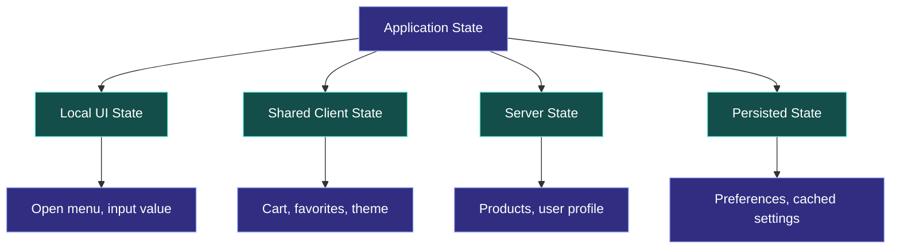
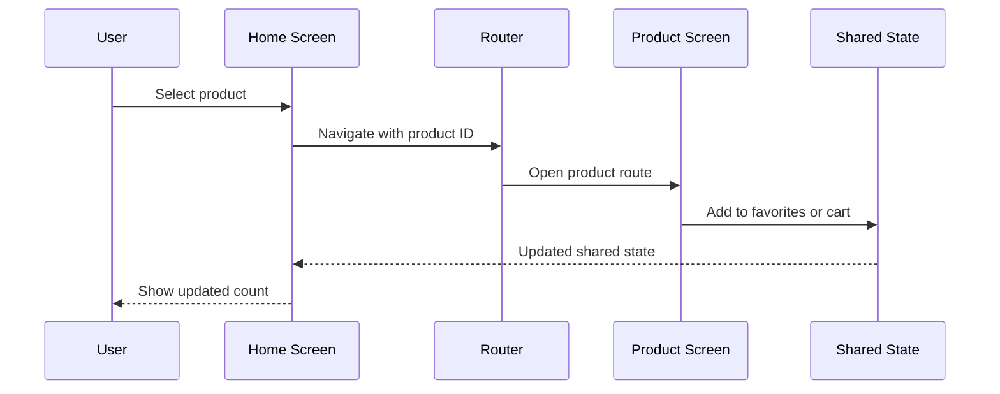

# 🧭 Navigation, State Management, and Hooks

[⬅️ Previous](05-react-native-components-and-styling.md) ·

> **AI Developer – App Development | Phase 2 · Topic 06**

Learn to move between screens, share information, manage application state, and use React hooks to build responsive and maintainable mobile applications.

---

## 🎯 Learning Objectives

By the end of this topic, you will be able to:

- Explain screen navigation and application state.
- Configure file-based navigation with Expo Router.
- Pass parameters between screens.
- Use `useState`, `useEffect`, `useMemo`, and custom hooks.
- Understand local, shared, server, and persisted state.
- Handle asynchronous requests and loading or error states.
- Avoid common state synchronization and lifecycle bugs.

## 1. 🗺️ Understanding Mobile Navigation

Navigation determines how users move between screens and how they return to earlier screens.

Common patterns include:

| Pattern | Purpose | Example |
|---|---|---|
| Stack navigation | Push and return between screens | Catalog → Product Details |
| Tabs | Switch between main areas | Home, Search, Favorites, Profile |
| Modal | Show a temporary task | Filter selection or confirmation |
| Nested navigation | Combine navigation patterns | Tabs containing individual stacks |

### Navigation flow



Navigation and state are related but different. Navigation decides which screen is visible; state determines what the screen displays.

## 2. 🚀 Configure Expo Router

Expo Router uses files and folders to define routes. In a new Expo project, file-based routing may already be configured.

A simple structure:

```text
app/
├── _layout.tsx
├── index.tsx
├── products/
│   ├── index.tsx
│   └── [id].tsx
└── favorites.tsx
```

The corresponding routes are:

- `app/index.tsx` → `/`
- `app/products/index.tsx` → `/products`
- `app/products/[id].tsx` → `/products/:id`
- `app/favorites.tsx` → `/favorites`

Create a root stack in `app/_layout.tsx`:

```tsx
import { Stack } from "expo-router";

export default function RootLayout() {
  return (
    <Stack>
      <Stack.Screen
        name="index"
        options={{ title: "Home" }}
      />
      <Stack.Screen
        name="products/index"
        options={{ title: "Products" }}
      />
      <Stack.Screen
        name="products/[id]"
        options={{ title: "Product Details" }}
      />
    </Stack>
  );
}
```

Navigate using the router:

```tsx
import { Link, router } from "expo-router";
import { Button, View } from "react-native";

export default function HomeScreen() {
  return (
    <View style={{ padding: 24, gap: 16 }}>
      <Button
        title="Browse Products"
        onPress={() => router.push("/products")}
      />

      <Link href="/favorites">View Favorites</Link>
    </View>
  );
}
```

Use `router.push()` to add a screen to the navigation history. Use `router.replace()` when replacing the current route is appropriate, such as after a successful sign-in. Use `router.back()` when returning to a previous screen is valid.

## 3. 📦 Pass Route Parameters

Dynamic routes allow a screen to display the selected record.

In `app/products/[id].tsx`:

```tsx
import { useLocalSearchParams } from "expo-router";
import { Text, View } from "react-native";

export default function ProductDetailsScreen() {
  const { id } = useLocalSearchParams<{ id: string }>();

  return (
    <View style={{ padding: 24 }}>
      <Text>Product ID: {id}</Text>
    </View>
  );
}
```

Navigate to a particular product:

```tsx
router.push({
  pathname: "/products/[id]",
  params: { id: product.id },
});
```

**Important:** route parameters are for identifying a record or representing navigation context. Validate them and retrieve the authoritative record from your data source. Do not treat a route parameter as proof that a user is authorized to access a resource.

## 4. 🔄 What Is Application State?

State is data that can change while an application runs and affects its behavior or UI.



Examples:

- Local state: whether a password is visible.
- Shared state: the cart count displayed on multiple screens.
- Server state: products loaded from an API.
- Persisted state: a saved display preference or cart snapshot.

Choose the simplest tool that meets the requirement. Do not add a global state library just to manage one local toggle.

## 5. 🪝 Essential React Hooks

### `useState`: store changing values

```tsx
import { useState } from "react";
import { Button, Text, View } from "react-native";

export default function CounterScreen() {
  const [count, setCount] = useState(0);

  return (
    <View style={{ padding: 24, gap: 12 }}>
      <Text>Selected items: {count}</Text>
      <Button
        title="Add item"
        onPress={() => setCount((previous) => previous + 1)}
      />
      <Button
        title="Reset"
        onPress={() => setCount(0)}
      />
    </View>
  );
}
```

Use the functional update form when the next value depends on the previous value.

### `useEffect`: synchronize with external systems

Use effects for tasks such as subscribing to events, synchronizing external services, or loading data. Avoid using an effect for calculations that can happen directly during rendering.

```tsx
import { useEffect, useState } from "react";
import { Text, View } from "react-native";

type User = {
  id: string;
  name: string;
};

export default function UserScreen() {
  const [user, setUser] = useState<User | null>(null);
  const [loading, setLoading] = useState(true);
  const [error, setError] = useState<string | null>(null);

  useEffect(() => {
    const controller = new AbortController();

    async function loadUser() {
      try {
        setLoading(true);
        setError(null);

        const response = await fetch(
          "https://jsonplaceholder.typicode.com/users/1",
          { signal: controller.signal }
        );

        if (!response.ok) {
          throw new Error("Unable to load the user.");
        }

        const data = (await response.json()) as User;
        setUser(data);
      } catch (err) {
        if (err instanceof Error && err.name !== "AbortError") {
          setError(err.message);
        }
      } finally {
        if (!controller.signal.aborted) {
          setLoading(false);
        }
      }
    }

    void loadUser();

    return () => controller.abort();
  }, []);

  if (loading) return <Text>Loading profile...</Text>;
  if (error) return <Text>{error}</Text>;
  if (!user) return <Text>No user found.</Text>;

  return (
    <View style={{ padding: 24 }}>
      <Text>Welcome, {user.name}</Text>
    </View>
  );
}
```

This example uses a public sample API for learning. Production apps should use a trusted backend and proper runtime validation for external data. TypeScript assertions alone do not validate incoming JSON.

### `useMemo`: cache expensive calculations

```tsx
import { useMemo, useState } from "react";
import { Text, TextInput, View } from "react-native";

const products = [
  "Blue Dress",
  "Black Jacket",
  "White Shirt",
  "Green Dress",
];

export default function SearchScreen() {
  const [query, setQuery] = useState("");

  const filteredProducts = useMemo(() => {
    const normalizedQuery = query.trim().toLowerCase();

    return products.filter((product) =>
      product.toLowerCase().includes(normalizedQuery)
    );
  }, [query]);

  return (
    <View style={{ padding: 24, gap: 12 }}>
      <TextInput
        value={query}
        onChangeText={setQuery}
        placeholder="Search products"
        style={{ borderWidth: 1, padding: 12, borderRadius: 8 }}
      />

      {filteredProducts.map((product) => (
        <Text key={product}>{product}</Text>
      ))}
    </View>
  );
}
```

For tiny lists, ordinary filtering may be sufficient. Use memoization when calculations are expensive or profiling indicates a benefit.

### `useCallback`: preserve a function reference when useful

`useCallback` is useful when function identity matters, such as when passing callbacks to memoized children. It is not necessary for every event handler.

```tsx
const handleSelect = useCallback((id: string) => {
  setSelectedId(id);
}, []);
```

## 6. 🧰 Build a Custom Hook

Custom hooks let you reuse stateful logic across screens.

Create `src/hooks/useToggle.ts`:

```tsx
import { useState } from "react";

export function useToggle(initialValue = false) {
  const [value, setValue] = useState(initialValue);

  const toggle = () => setValue((previous) => !previous);

  return { value, setValue, toggle };
}
```

Use it in a component:

```tsx
import { Button, Text, View } from "react-native";
import { useToggle } from "../src/hooks/useToggle";

export default function DetailsScreen() {
  const { value: isFavorite, toggle } = useToggle();

  return (
    <View style={{ padding: 24, gap: 12 }}>
      <Text>{isFavorite ? "Saved to favorites" : "Not saved"}</Text>
      <Button
        title={isFavorite ? "Remove Favorite" : "Add Favorite"}
        onPress={toggle}
      />
    </View>
  );
}
```

This example stores state only inside the mounted component. To share favorites between different screens, use a shared store or context, or synchronize the data through a backend.

## 7. 🛒 Shared State with Context

React Context can expose shared client state to many components without manually passing props through every level.

Example cart context:

```tsx
import {
  createContext,
  useContext,
  useState,
  type ReactNode,
} from "react";

type CartContextValue = {
  count: number;
  addItem: () => void;
};

const CartContext = createContext<CartContextValue | null>(null);

export function CartProvider({ children }: { children: ReactNode }) {
  const [count, setCount] = useState(0);

  const value = {
    count,
    addItem: () => setCount((previous) => previous + 1),
  };

  return (
    <CartContext.Provider value={value}>
      {children}
    </CartContext.Provider>
  );
}

export function useCart() {
  const context = useContext(CartContext);

  if (!context) {
    throw new Error("useCart must be used within CartProvider");
  }

  return context;
}
```

Wrap the application in `CartProvider`, for example in the root layout. Components beneath it can use `useCart()`.

For larger applications, consider splitting contexts by responsibility or using a dedicated state-management library if profiling and complexity justify it. Context is not a replacement for server-side authorization or a server-state caching strategy.

## 8. 💾 Persisting State

State stored with `useState` disappears when the component unmounts or the application restarts.

For persistence, choose storage based on the data:

- Small, non-sensitive preferences: AsyncStorage.
- Sensitive tokens or secrets: platform-backed secure storage, such as Expo SecureStore.
- Structured offline records: SQLite or another appropriate database.
- Authoritative business data: backend storage.

Never place private API secrets in client code. Values prefixed with `EXPO_PUBLIC_` are exposed to the application bundle.

## 9. ⚠️ Common State and Navigation Bugs

| Problem | Solution |
|---|---|
| Updating state based on an old value | Use functional state updates |
| Running a request after a screen no longer needs it | Abort or clean up the request |
| Missing effect dependencies | Include dependencies and review effect logic |
| Duplicating the same state in many components | Establish one source of truth |
| Treating navigation parameters as trusted | Validate IDs and authorize on the server |
| Persisting sensitive tokens in plain storage | Use secure storage |
| Adding global state for a single local toggle | Keep the state local |

## 10. 🌍 Real-World Scenario: Boutique Shopping App

A customer opens a catalog, views a dress, adds it to favorites, and visits the cart.



Use route parameters for navigation, local state for temporary UI, shared state for the cart, and backend APIs for authoritative products and orders.

### ⭐ Key Takeaways

- Expo Router provides file-based navigation.
- Hooks manage state and synchronize components with external systems.
- Context is useful for shared client state.
- Custom hooks keep reusable behavior organized.
- Persistence and security require choosing the correct storage layer.
