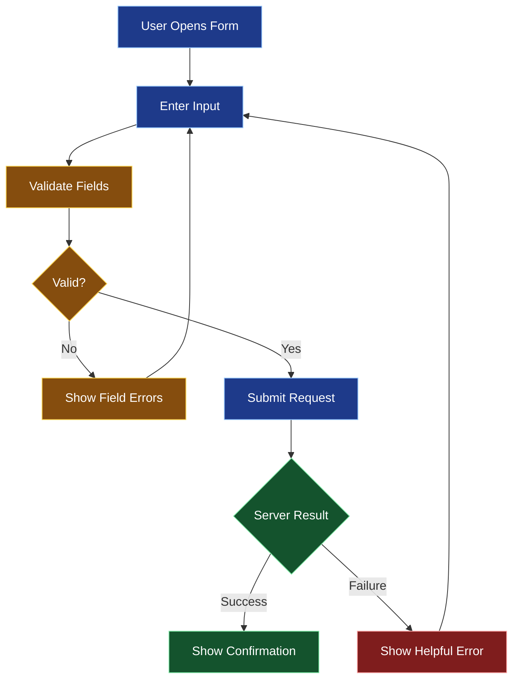
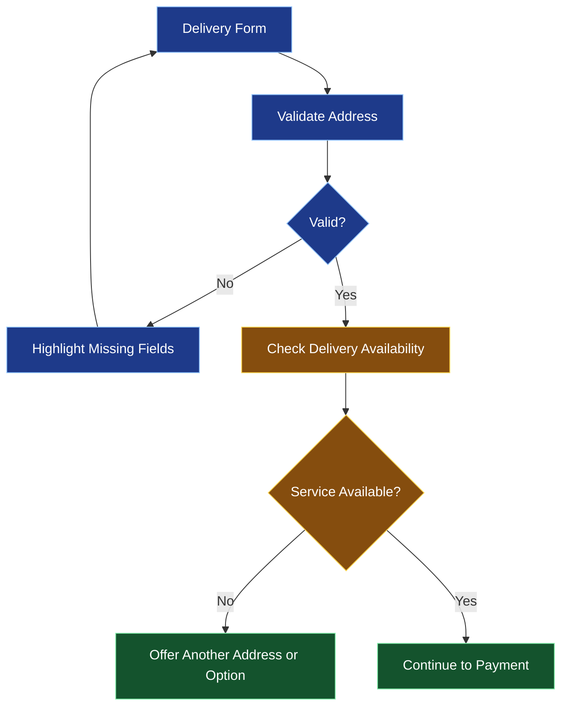

# 📝 Forms, Validation, and User Interaction

[⬅️ Previous](06-navigation-state-management-and-hooks.md) ·

> **AI Developer – App Development | Phase 2 · Topic 07**

Learn to collect user input, validate data, display useful error messages, manage form submission, and build reliable forms for mobile applications.

---

## 🎯 Learning Objectives

By the end of this topic, you will be able to:

- Build forms using React Native's `TextInput`, `Pressable`, and related components.
- Manage controlled inputs with React state.
- Validate required fields, email addresses, passwords, and numeric values.
- Display field-level and form-level errors.
- Handle loading, success, and failure states.
- Prevent accidental duplicate submissions.
- Understand client-side versus server-side validation.
- Build a practical registration form.

## 1. 🧾 Why Forms Matter

Forms connect a user's intentions with an application's data and services.

Examples include:

- Login and registration.
- Product search and filters.
- Booking and checkout.
- Feedback and support requests.
- Profile editing.
- Prompts submitted to AI assistants.

A reliable form should communicate what information is needed, identify invalid values, preserve user input when appropriate, and explain what happens after submission.

### Form lifecycle



## 2. 🧱 Build Your First Controlled Input

A controlled input gets its value from React state. When the user types, the change handler updates that state.

```tsx
import { useState } from "react";
import { StyleSheet, Text, TextInput, View } from "react-native";

export default function NameForm() {
  const [name, setName] = useState("");

  return (
    <View style={styles.container}>
      <Text style={styles.label}>Your name</Text>

      <TextInput
        value={name}
        onChangeText={setName}
        placeholder="Enter your name"
        autoCapitalize="words"
        autoCorrect={false}
        accessibilityLabel="Your name"
        style={styles.input}
      />

      <Text>Preview: {name || "Your name will appear here"}</Text>
    </View>
  );
}

const styles = StyleSheet.create({
  container: {
    padding: 24,
    gap: 12,
  },
  label: {
    fontSize: 16,
    fontWeight: "600",
  },
  input: {
    borderWidth: 1,
    borderColor: "#D1D5DB",
    borderRadius: 10,
    padding: 14,
    fontSize: 16,
  },
});
```

The state and input stay synchronized. This makes it possible to validate the value, display a preview, and submit it to a service.

## 3. 🔍 Understand Validation

Validation checks whether input meets defined rules.

| Validation type | Example |
|---|---|
| Required-field validation | Name cannot be blank |
| Format validation | Email has a reasonable email format |
| Length validation | Password meets minimum length requirements |
| Range validation | Quantity is greater than zero |
| Cross-field validation | Confirm password matches password |
| Business-rule validation | Requested appointment slot is available |
| Server validation | Email is already registered or user is unauthorized |

**Client-side validation improves usability, but it does not establish trust.** The backend must validate all important inputs independently.

### Reusable validation functions

```tsx
type RegistrationValues = {
  name: string;
  email: string;
  password: string;
};

type RegistrationErrors = Partial<
  Record<keyof RegistrationValues, string>
>;

export function validateRegistration(
  values: RegistrationValues
): RegistrationErrors {
  const errors: RegistrationErrors = {};

  if (!values.name.trim()) {
    errors.name = "Please enter your name.";
  }

  const email = values.email.trim();

  if (!email) {
    errors.email = "Email is required.";
  } else if (!/^[^\s@]+@[^\s@]+\.[^\s@]+$/.test(email)) {
    errors.email = "Enter a valid email address.";
  }

  if (!values.password) {
    errors.password = "Password is required.";
  } else if (values.password.length < 12) {
    errors.password = "Use at least 12 characters.";
  }

  return errors;
}
```

Email validation rules can vary, and a regular expression cannot prove that an address exists. Real applications should also verify email addresses where appropriate.

## 4. 🧑‍💻 Build a Complete Registration Form

Create `src/features/auth/RegistrationForm.tsx`:

```tsx
import { useState } from "react";
import {
  ActivityIndicator,
  Alert,
  Pressable,
  StyleSheet,
  Text,
  TextInput,
  View,
} from "react-native";
import { validateRegistration } from "./validation";

type Values = {
  name: string;
  email: string;
  password: string;
};

type Errors = Partial<Record<keyof Values, string>>;

export default function RegistrationForm() {
  const [values, setValues] = useState<Values>({
    name: "",
    email: "",
    password: "",
  });

  const [errors, setErrors] = useState<Errors>({});
  const [submitting, setSubmitting] = useState(false);
  const [showPassword, setShowPassword] = useState(false);

  function updateField(field: keyof Values, value: string) {
    setValues((previous) => ({ ...previous, [field]: value }));

    // Clear the edited field's existing error.
    setErrors((previous) => ({ ...previous, [field]: undefined }));
  }

  async function handleSubmit() {
    if (submitting) return;

    const validationErrors = validateRegistration(values);
    setErrors(validationErrors);

    if (Object.keys(validationErrors).length > 0) {
      return;
    }

    setSubmitting(true);

    try {
      // Replace this simulated operation with a real API call.
      await new Promise((resolve) => setTimeout(resolve, 800));

      Alert.alert("Success", "Your form passed validation.");
    } catch {
      Alert.alert("Error", "Unable to submit. Please try again.");
    } finally {
      setSubmitting(false);
    }
  }

  return (
    <View style={styles.container}>
      <Text style={styles.heading}>Create an account</Text>
      <Text style={styles.subtitle}>
        Enter your details to get started.
      </Text>

      <Text style={styles.label}>Full name</Text>
      <TextInput
        value={values.name}
        onChangeText={(value) => updateField("name", value)}
        placeholder="Your full name"
        autoCapitalize="words"
        accessibilityLabel="Full name"
        style={[styles.input, errors.name && styles.inputError]}
      />
      {errors.name ? (
        <Text accessibilityRole="alert" style={styles.error}>
          {errors.name}
        </Text>
      ) : null}

      <Text style={styles.label}>Email</Text>
      <TextInput
        value={values.email}
        onChangeText={(value) => updateField("email", value)}
        placeholder="you@example.com"
        keyboardType="email-address"
        autoCapitalize="none"
        autoCorrect={false}
        accessibilityLabel="Email address"
        style={[styles.input, errors.email && styles.inputError]}
      />
      {errors.email ? (
        <Text accessibilityRole="alert" style={styles.error}>
          {errors.email}
        </Text>
      ) : null}

      <Text style={styles.label}>Password</Text>
      <TextInput
        value={values.password}
        onChangeText={(value) => updateField("password", value)}
        placeholder="Create a password"
        secureTextEntry={!showPassword}
        autoCapitalize="none"
        accessibilityLabel="Password"
        style={[styles.input, errors.password && styles.inputError]}
      />

      <Pressable
        accessibilityRole="button"
        onPress={() => setShowPassword((previous) => !previous)}
      >
        <Text style={styles.toggle}>
          {showPassword ? "Hide password" : "Show password"}
        </Text>
      </Pressable>

      {errors.password ? (
        <Text accessibilityRole="alert" style={styles.error}>
          {errors.password}
        </Text>
      ) : null}

      <Pressable
        accessibilityRole="button"
        disabled={submitting}
        onPress={handleSubmit}
        style={[styles.button, submitting && styles.disabled]}
      >
        {submitting ? (
          <ActivityIndicator color="#FFFFFF" />
        ) : (
          <Text style={styles.buttonText}>Create Account</Text>
        )}
      </Pressable>
    </View>
  );
}

const styles = StyleSheet.create({
  container: {
    padding: 24,
    gap: 10,
  },
  heading: {
    fontSize: 26,
    fontWeight: "700",
    color: "#111827",
  },
  subtitle: {
    color: "#6B7280",
    marginBottom: 12,
  },
  label: {
    fontWeight: "600",
    marginTop: 6,
  },
  input: {
    borderWidth: 1,
    borderColor: "#D1D5DB",
    borderRadius: 10,
    padding: 13,
    fontSize: 16,
  },
  inputError: {
    borderColor: "#DC2626",
  },
  error: {
    color: "#B91C1C",
    fontSize: 13,
  },
  toggle: {
    color: "#2563EB",
    paddingVertical: 4,
  },
  button: {
    marginTop: 14,
    padding: 15,
    borderRadius: 10,
    backgroundColor: "#2563EB",
    alignItems: "center",
    minHeight: 52,
    justifyContent: "center",
  },
  buttonText: {
    color: "#FFFFFF",
    fontSize: 16,
    fontWeight: "700",
  },
  disabled: {
    opacity: 0.6,
  },
});
```

Create `src/features/auth/validation.ts` using the validation function from the previous section.

This example simulates a successful operation. It does **not** create a real account. A production form must call a backend endpoint over HTTPS, handle server validation, and avoid logging or unnecessarily retaining passwords.

## 5. 📡 Connect a Form to an API

A form should distinguish validation errors from network errors and server-side errors.

```tsx
type CreateAccountPayload = {
  name: string;
  email: string;
  password: string;
};

export async function createAccount(
  payload: CreateAccountPayload
) {
  const response = await fetch(
    `${process.env.EXPO_PUBLIC_API_URL}/accounts`,
    {
      method: "POST",
      headers: {
        "Content-Type": "application/json",
      },
      body: JSON.stringify(payload),
    }
  );

  if (!response.ok) {
    throw new Error("Unable to create account.");
  }

  return response.json();
}
```

The URL shown here is public configuration, not a secret. Keep private API keys on the server. Validate request bodies on the backend, hash passwords with an appropriate password-hashing algorithm, and use rate limiting and abuse protections for authentication endpoints.

When the request succeeds, navigate to the next screen or display confirmation. If it fails, preserve non-sensitive form values where useful and provide an actionable error message.

## 6. 🧠 Better Form Design

### Validate at the right time

- On change: useful for simple formatting or clearing an old error.
- On blur: useful for checking a field after the user leaves it.
- On submit: validate the whole form before making a request.
- On server response: display business-rule errors such as an already-registered email.

Avoid showing every error immediately when a user first opens a blank form.

### Choose appropriate keyboards

| Input | Suggested setting |
|---|---|
| Email | `keyboardType="email-address"` |
| Phone | `keyboardType="phone-pad"` |
| Numeric quantity | `keyboardType="numeric"` |
| Password | `secureTextEntry` |
| Name | `autoCapitalize="words"` |

These settings improve the typing experience but do not replace validation.

## 7. ♿ Accessibility and Error Messages

- Associate labels with the correct inputs.
- Use clear, specific error messages.
- Do not rely only on a red border to communicate an error.
- Make buttons large enough to tap comfortably.
- Support screen readers and font scaling.
- Move focus or direct attention to errors thoughtfully.
- Do not clear all fields after a network failure without a good reason.
- Avoid putting sensitive values into analytics, logs, or error reports.

## 8. 🌍 Real-World Scenario: Boutique Checkout

A customer selects products and enters delivery information.



Client-side checks can ensure that required fields are present. The server must still verify delivery coverage, inventory, pricing, and order eligibility before accepting the order.

## 9. ⚠️ Common Mistakes

| Mistake | Better approach |
|---|---|
| Validating only on the client | Validate again on the server |
| Showing vague errors | Explain the field and corrective action |
| Allowing repeated submissions | Disable the action while submitting and enforce server-side idempotency where needed |
| Clearing the form on every failure | Preserve safe values |
| Storing passwords in plain text | Never persist passwords in app storage |
| Assuming keyboard type guarantees valid input | Validate the actual value |
| Treating an HTTP response as always successful | Check `response.ok` and handle errors |

### ⭐ Key Takeaways

- Controlled inputs connect form values to application state.
- Validation should provide useful feedback at appropriate times.
- Client-side validation improves UX; backend validation protects data.
- Loading and failure states are part of the form design.
- Secure handling of credentials and personal information is essential.
