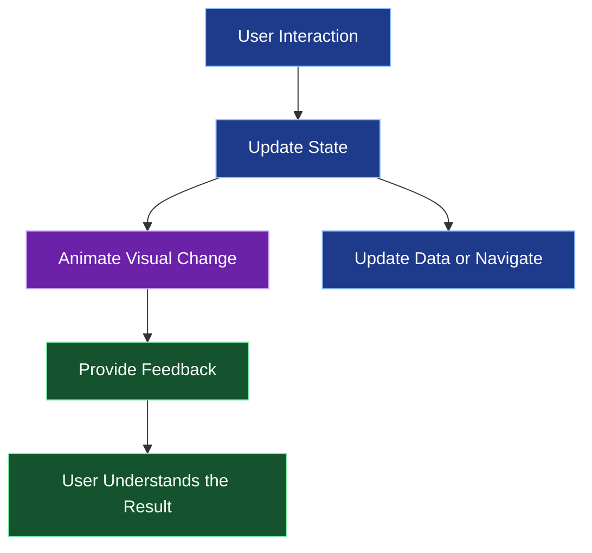
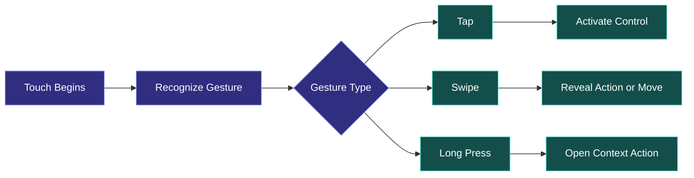
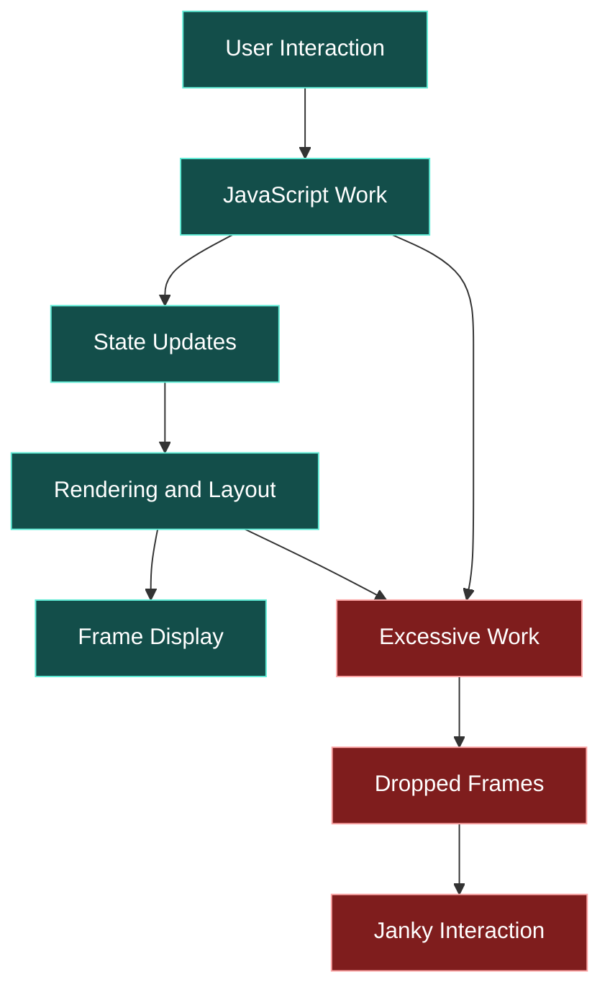
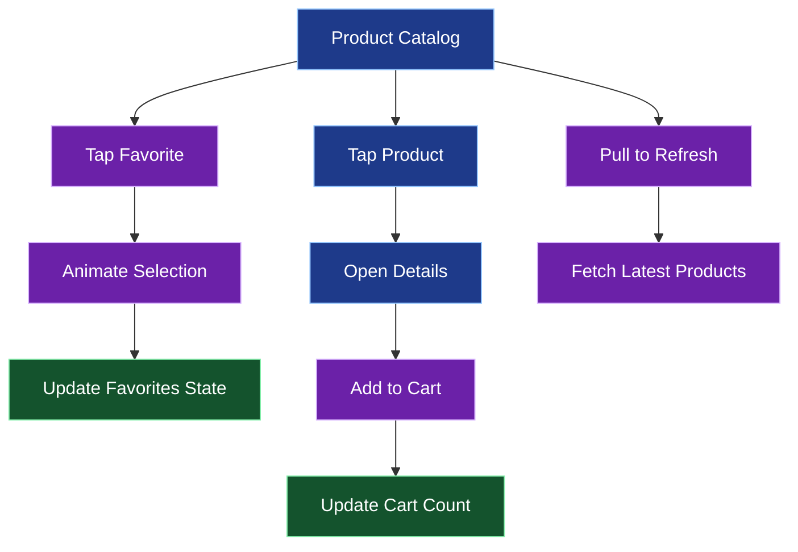

# ✨ Animations, Gestures, and Native UI Patterns

[⬅️ Previous](07-forms-validation-and-user-interaction.md) ·

> **AI Developer – App Development | Phase 2 · Topic 08**

Learn to make mobile applications feel polished and responsive through animations, touch gestures, transitions, feedback, and platform-aware interface patterns.

---

## 🎯 Learning Objectives

By the end of this topic, you will be able to:

- Explain why animation improves usability when applied thoughtfully.
- Create simple animations with React Native's `Animated` API.
- Use the Expo ecosystem for advanced animations and gestures.
- Build press feedback, expandable sections, and swipe interactions.
- Understand animation performance and native-thread considerations.
- Respect accessibility and reduced-motion preferences.
- Choose native UI patterns that feel familiar on Android and iOS.

## 1. 🎬 Why Animation Matters

Animations communicate cause and effect. They can show that an action was accepted, help users understand a layout change, and make transitions feel less abrupt.

Useful examples:

- A button responds when pressed.
- A favorite icon changes after saving a product.
- A card expands to reveal more information.
- A loading indicator signals that a request is running.
- A bottom sheet reveals filters without navigating away.
- A list item moves out of the way after being removed.

Animation should communicate meaningful change rather than distract users.

### Animation in a mobile interface



## 2. 🧰 Choose an Animation Tool

| Tool | Best for |
|---|---|
| React Native `Animated` | Basic opacity, transforms, and value-based animations |
| React Native `LayoutAnimation` | Animating certain layout changes |
| React Native Reanimated | Advanced, high-performance animations and shared values |
| React Native Gesture Handler | Gesture recognition and touch interactions |
| Expo Haptics | Optional tactile feedback on supported devices |

The right choice depends on the interaction. For simple effects, built-in animation APIs may be enough. For complex gestures and coordinated motion, Reanimated and Gesture Handler are commonly used in Expo applications.

Check the documentation for the versions installed in your project. Expo's `npx expo install` command can select compatible package versions.

## 3. 🌟 Create a Fade-In Animation

React Native's `Animated` API is suitable for simple opacity and transform effects.

```tsx
import { useEffect, useRef } from "react";
import {
  Animated,
  StyleSheet,
  Text,
  View,
} from "react-native";

export default function WelcomeAnimation() {
  const opacity = useRef(new Animated.Value(0)).current;

  useEffect(() => {
    const animation = Animated.timing(opacity, {
      toValue: 1,
      duration: 500,
      useNativeDriver: true,
    });

    animation.start();

    return () => animation.stop();
  }, [opacity]);

  return (
    <View style={styles.container}>
      <Animated.View style={{ opacity }}>
        <Text style={styles.title}>Welcome to your next favorite app</Text>
        <Text style={styles.subtitle}>
          A smooth introduction to your mobile experience.
        </Text>
      </Animated.View>
    </View>
  );
}

const styles = StyleSheet.create({
  container: {
    flex: 1,
    justifyContent: "center",
    padding: 24,
    backgroundColor: "#F8FAFC",
  },
  title: {
    fontSize: 28,
    fontWeight: "700",
    color: "#0F172A",
  },
  subtitle: {
    fontSize: 16,
    color: "#64748B",
    marginTop: 12,
  },
});
```

The animation starts at opacity `0` and finishes at `1`. With `useNativeDriver: true`, supported properties such as opacity and transforms can be animated without running every frame through the JavaScript thread.

The native driver does not support every style property. Layout properties such as height and width may require another approach.

## 4. 🪄 Add Press Feedback

Pressable components support different styles depending on whether the user is pressing them.

```tsx
import { Pressable, StyleSheet, Text } from "react-native";

export default function InteractiveCard() {
  return (
    <Pressable
      accessibilityRole="button"
      onPress={() => {
        // Perform the intended action.
      }}
      style={({ pressed }) => [
        styles.card,
        pressed && styles.pressed,
      ]}
    >
      <Text style={styles.title}>Explore Collection</Text>
      <Text style={styles.subtitle}>Discover the latest arrivals.</Text>
    </Pressable>
  );
}

const styles = StyleSheet.create({
  card: {
    padding: 20,
    borderRadius: 16,
    backgroundColor: "#FFFFFF",
    borderWidth: 1,
    borderColor: "#E2E8F0",
  },
  pressed: {
    opacity: 0.75,
    transform: [{ scale: 0.98 }],
  },
  title: {
    fontSize: 18,
    fontWeight: "700",
  },
  subtitle: {
    marginTop: 6,
    color: "#64748B",
  },
});
```

For many simple interactions, this is enough. The user receives immediate feedback without the overhead of a complex animation system.

## 5. ❤️ Animate a Favorite Button

A favorite button should provide a clear visual response when its state changes.

```tsx
import { useEffect, useRef, useState } from "react";
import {
  Animated,
  Pressable,
  Text,
  View,
} from "react-native";

export default function FavoriteButton() {
  const [favorite, setFavorite] = useState(false);
  const scale = useRef(new Animated.Value(1)).current;

  useEffect(() => {
    const animation = Animated.sequence([
      Animated.spring(scale, {
        toValue: 1.2,
        useNativeDriver: true,
      }),
      Animated.spring(scale, {
        toValue: 1,
        useNativeDriver: true,
      }),
    ]);

    if (favorite) {
      animation.start();
    }

    return () => animation.stop();
  }, [favorite, scale]);

  return (
    <View style={{ padding: 24 }}>
      <Pressable
        accessibilityRole="button"
        accessibilityLabel={
          favorite ? "Remove from favorites" : "Add to favorites"
        }
        accessibilityState={{ selected: favorite }}
        onPress={() => setFavorite((previous) => !previous)}
      >
        <Animated.Text
          style={{
            fontSize: 32,
            transform: [{ scale }],
          }}
        >
          {favorite ? "❤️" : "🤍"}
        </Animated.Text>
      </Pressable>

      <Text>{favorite ? "Saved to favorites" : "Not saved"}</Text>
    </View>
  );
}
```

This example demonstrates local interaction only. To preserve favorites across screens and application restarts, connect the action to shared state and, where appropriate, a backend.

## 6. 👆 Gestures and Advanced Animation

Mobile applications support gestures such as:

- Tap and double tap.
- Long press.
- Swipe and drag.
- Pinch to zoom.
- Pan to move an object.
- Pull to refresh.

React Native Gesture Handler supports gesture recognition, while Reanimated can coordinate animated values with gesture events. For advanced interactions, use current installation instructions from the Expo documentation and test on real devices.

### Gesture interaction model



### Example: swipe-to-refresh

For a list that loads data from an API, use the built-in `RefreshControl` integration through `FlatList` or `ScrollView`.

```tsx
import { useState } from "react";
import {
  FlatList,
  RefreshControl,
  Text,
  View,
} from "react-native";

const initialItems = ["New arrivals", "Popular products", "Recommended"];

export default function RefreshableList() {
  const [refreshing, setRefreshing] = useState(false);
  const [items, setItems] = useState(initialItems);

  async function refresh() {
    if (refreshing) return;

    setRefreshing(true);

    try {
      // Replace with an API request.
      await new Promise((resolve) => setTimeout(resolve, 700));
      setItems([...initialItems]);
    } finally {
      setRefreshing(false);
    }
  }

  return (
    <FlatList
      data={items}
      keyExtractor={(item) => item}
      renderItem={({ item }) => (
        <View style={{ padding: 20 }}>
          <Text>{item}</Text>
        </View>
      )}
      refreshControl={
        <RefreshControl
          refreshing={refreshing}
          onRefresh={refresh}
        />
      }
    />
  );
}
```

The example simulates refreshing. In a real application, update the data from the backend and display errors when refresh fails.

## 7. 📲 Native UI Patterns

Users bring expectations from the platform they use. A familiar interface often feels easier to understand.

| Pattern | Why it matters |
|---|---|
| Navigation headers | Show context and common actions |
| Bottom tabs | Provide quick access to major sections |
| Bottom sheets | Display filters or short actions without a full screen change |
| Pull to refresh | Familiar way to reload scrollable content |
| Confirmation dialogs | Prevent accidental destructive actions |
| Loading indicators | Explain that work is in progress |
| Toasts or banners | Provide brief status feedback |
| Platform-aware controls | Match user expectations where practical |

Use a platform's conventions when they improve usability. Consistency within your own app matters too: similar actions should behave similarly on every screen.

## 8. ⚡ Animation Performance

Animations can make an app feel smoother, but poorly implemented motion can cause dropped frames and slow interactions.

Best practices:

- Prefer opacity and transform animations when appropriate.
- Avoid triggering expensive calculations on every frame.
- Keep large lists efficient and use stable keys.
- Avoid unnecessary state updates during gesture movement.
- Test on lower-powered devices, not only a development computer.
- Use profiling tools when an animation feels slow.
- Stop animations or subscriptions when they are no longer needed.
- Avoid animating too many elements simultaneously.

### Where performance problems arise



For complex gestures, consider UI-thread or worklet-based animation approaches supported by your chosen animation library.

## 9. ♿ Accessibility and Reduced Motion

Animation should never be the only way to communicate information.

- Provide labels for icon-only controls.
- Preserve clear visual states for selected and unselected controls.
- Make gestures optional when an accessible button can provide the same action.
- Avoid flashing, excessive bouncing, or constant movement.
- Respect reduced-motion preferences where supported by the chosen APIs.
- Ensure text and important controls remain readable during transitions.
- Give destructive swipe actions a confirmation or recovery option when appropriate.

## 10. 🌍 Real-World Scenario: Interactive Boutique App

Consider a shopping app with product cards, a favorites list, filters, and a cart.



The important principle is that animations complement the actual application behavior. A favorite animation should correspond to a real state change, and a loading indicator should represent a real operation.

## 11. ⚠️ Common Mistakes

| Mistake | Better approach |
|---|---|
| Animating every element | Animate only meaningful changes |
| Using layout animations for every effect | Choose the simplest suitable API |
| Ignoring cleanup | Stop animations and remove subscriptions when needed |
| Making swipe the only way to act | Provide accessible alternative controls |
| Using animation as proof of success | Confirm the underlying operation succeeded |
| Ignoring slower devices | Profile and test across device capabilities |
| Blocking the interface with excessive motion | Keep animations short and purposeful |

### ⭐ Key Takeaways

- Animation communicates state changes and user feedback.
- React Native's `Animated` API is useful for basic effects.
- Gesture Handler and Reanimated support more advanced interactions.
- Native UI patterns improve familiarity and usability.
- Performance and accessibility must be considered from the beginning.
