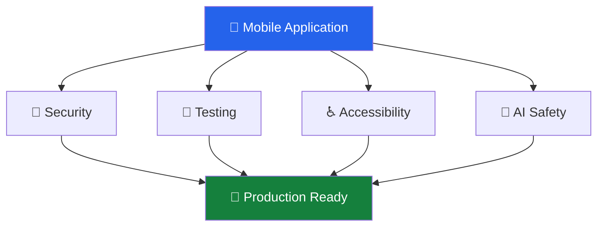
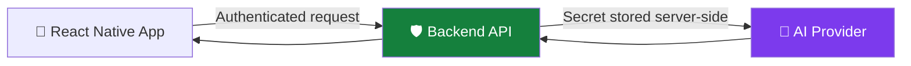
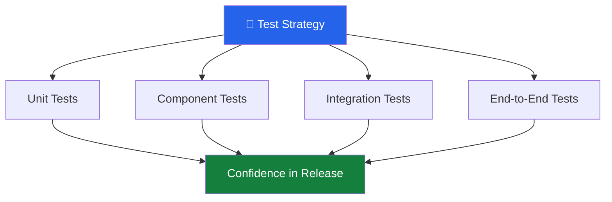

# 🔐 Mobile App Security, Testing, and Accessibility

[⬅️ Back to Learning Modules](../README.md) · 

> **Phase 5 — Testing and Release**  
> Build mobile applications that protect user data, behave reliably, and remain accessible to people with different abilities.

## 🎯 Learning Objectives

By the end of this topic, you will be able to:

- Identify common mobile application security risks.
- Protect API credentials, authentication tokens, and personal data.
- Understand unit, component, integration, and end-to-end testing.
- Write basic tests for React Native components and application logic.
- Improve accessibility using labels, roles, contrast, and touch targets.
- Test AI-powered features for reliability, privacy, and safe behavior.
- Prepare a mobile application for a production-quality review.

## 1. Introduction

A mobile application can look attractive and work correctly during development but still be unsuitable for real users.

For example, consider an AI-powered shopping assistant. It may recommend products successfully, but it could also:

- Expose an API key embedded in the application.
- Display another user's private conversation.
- Crash when the network connection disappears.
- Allow unauthorized access to account information.
- Display unreadable text to users with visual impairments.
- Produce unexpected results when an AI service returns malformed data.

Production readiness requires more than implementing features. It requires security, testing, accessibility, and responsible handling of data.



## 2. Mobile Application Security Fundamentals

Mobile applications communicate with remote services, store information locally, and access device capabilities. Each interaction can introduce security risks.

### 2.1 Protect API Keys and Secrets

Never embed private AI provider keys, database passwords, or backend secrets in a mobile application.

Mobile application bundles can be inspected. Environment variables used during the build do not automatically make a secret safe if its value is included in the client bundle.

**Unsafe approach:**

```tsx
// Do not put a private provider key in a mobile app.
const API_KEY = "sk-your-private-api-key";
```

**Safer architecture:**



The mobile application calls your backend. The backend authenticates the user, checks permissions, validates the request, and calls the AI provider using a server-side secret.

A simplified Express example:

```ts
import express from "express";
import OpenAI from "openai";

const app = express();
app.use(express.json({ limit: "20kb" }));

const apiKey = process.env.OPENAI_API_KEY;

if (!apiKey) {
  throw new Error("OPENAI_API_KEY is not configured");
}

const openai = new OpenAI({ apiKey });

app.post("/api/assistant", async (req, res) => {
  try {
    // Add real authentication and authorization middleware
    // before exposing this route to users.
    const message = req.body?.message;

    if (
      typeof message !== "string" ||
      message.trim().length === 0 ||
      message.length > 4000
    ) {
      return res.status(400).json({
        error: "Provide a message containing 1–4000 characters.",
      });
    }

    const result = await openai.responses.create({
      model: process.env.OPENAI_MODEL!,
      input: message,
    });

    res.json({ reply: result.output_text });
  } catch (error) {
    console.error("Assistant request failed");

    res.status(500).json({
      error: "The assistant is temporarily unavailable.",
    });
  }
});

app.listen(3000);
```

This is a teaching example, not a complete production service. Add authentication, per-user authorization, rate limiting, request timeouts, usage limits, and appropriate error handling before deployment.

### 2.2 Authentication and Authorization

These concepts solve different problems:

| Concept | Question | Example |
|---|---|---|
| Authentication | Who is the user? | Verify a session or access token |
| Authorization | What can the user do? | Determine whether they may view an order |
| Validation | Is the request acceptable? | Check required fields and data types |
| Auditing | What security-relevant action occurred? | Record an administrative change |

A successful login does not grant unrestricted access to every resource.

The backend must check permissions for every protected operation. Never trust a user ID supplied by the client without verifying that the authenticated user is permitted to access it.

### 2.3 Secure Local Storage

Mobile applications sometimes need to store preferences, cached content, and authentication credentials.

Use storage according to the sensitivity of the information.

| Information | Suitable approach |
|---|---|
| Theme preference | AsyncStorage or another ordinary local store |
| Non-sensitive cached data | AsyncStorage or SQLite |
| Structured offline records | SQLite with an appropriate protection strategy |
| Refresh tokens or sensitive credentials | SecureStore or platform-protected storage |
| Private provider API keys | Keep them on the backend |

Example using Expo SecureStore:

```tsx
import * as SecureStore from "expo-secure-store";

export async function saveSessionToken(token: string) {
  await SecureStore.setItemAsync("session_token", token);
}

export async function getSessionToken() {
  return SecureStore.getItemAsync("session_token");
}

export async function clearSessionToken() {
  await SecureStore.deleteItemAsync("session_token");
}
```

Use the exact storage library supported by your Expo SDK. Secure storage does not replace backend authorization, token expiration, or secure session management.

Avoid storing passwords in plain text. Do not log access tokens or sensitive user content.

### 2.4 Validate All Inputs

Client-side validation improves the user experience, but it is not a security boundary.

Validate requests on the backend as well.

```ts
type ProfileInput = {
  displayName: string;
  email: string;
};

function validateProfile(input: unknown): ProfileInput {
  if (!input || typeof input !== "object") {
    throw new Error("Invalid profile data");
  }

  const value = input as Record<string, unknown>;

  if (
    typeof value.displayName !== "string" ||
    value.displayName.trim().length < 2 ||
    value.displayName.length > 80
  ) {
    throw new Error("Display name must contain 2–80 characters");
  }

  if (
    typeof value.email !== "string" ||
    !/^[^\s@]+@[^\s@]+\.[^\s@]+$/.test(value.email)
  ) {
    throw new Error("A valid email address is required");
  }

  return {
    displayName: value.displayName.trim(),
    email: value.email.trim(),
  };
}
```

This example demonstrates basic validation. Real applications should use an established schema-validation library and enforce business rules on the server.

## 3. Common Mobile Security Risks

### 3.1 Threats and Mitigations

| Risk | Example | Mitigation |
|---|---|---|
| Exposed credentials | AI key inside a bundle | Server-side secret management |
| Broken authorization | User reads another user's records | Server-side ownership checks |
| Insecure transport | Sensitive requests over HTTP | HTTPS and correct certificate handling |
| Excessive permissions | App requests location without need | Request only necessary permissions |
| Sensitive logs | Tokens printed to console | Redact or remove sensitive logs |
| Insecure deep links | Untrusted URL triggers a privileged action | Validate routes and parameters |
| Dependency vulnerabilities | Outdated library contains a known flaw | Audit and update dependencies |
| Excessive API usage | Automated requests exhaust an AI quota | Rate limits and usage budgets |

Do not disable certificate validation to make a network request succeed. Do not assume that hiding a button or route in the UI prevents unauthorized access.

### 3.2 Privacy by Design

Before collecting data, answer four questions:

1. Why is the data required?
2. How long must it be retained?
3. Who can access it?
4. How can the user delete or export it when appropriate?

For AI features, consider whether a request contains names, photographs, location details, financial information, or private conversation history.

Send only the information required for the feature. Explain relevant processing to users and follow applicable privacy requirements and provider policies.

## 4. Testing Fundamentals

Testing helps identify defects before users encounter them.



### 4.1 Types of Tests

**Unit testing:** Checks a small function or unit of logic.

Examples:
- Validate a form field.
- Format a date.
- Calculate a cart total.

**Component testing:** Checks how a UI component renders and responds to user actions.

Examples:
- A button displays the expected label.
- A form displays a validation message.
- A loading indicator appears while data is being fetched.

**Integration testing:** Checks that multiple parts work together.

Examples:
- A screen calls an API service and displays its response.
- A repository writes and retrieves local data.

**End-to-end testing:** Simulates a user journey through the application.

Example:

```text
Launch app
   ↓
Sign in
   ↓
Open AI assistant
   ↓
Send a question
   ↓
Receive a response
   ↓
Sign out
```

Testing layers complement each other. A project does not need to use the same number of tests at every layer.

## 5. Set Up React Native Testing

For a React Native application created with Expo, use the testing configuration recommended for your Expo SDK. A typical setup includes Jest and React Native Testing Library.

Install compatible development dependencies:

```bash
npx expo install jest-expo jest @types/jest --dev
npm install --save-dev @testing-library/react-native
```

Add a test script to `package.json`:

```json
{
  "scripts": {
    "test": "jest"
  }
}
```

Configure Jest in `package.json`:

```json
{
  "jest": {
    "preset": "jest-expo"
  }
}
```

If your project already has a Jest configuration, integrate these settings instead of creating conflicting configurations. Follow the current Expo testing guidance for the SDK and library versions in your project.

### 5.1 Write a Unit Test

Create `src/utils/validateEmail.ts`:

```ts
export function isValidEmail(email: string): boolean {
  return /^[^\s@]+@[^\s@]+\.[^\s@]+$/.test(email);
}
```

Create `src/utils/validateEmail.test.ts`:

```ts
import { isValidEmail } from "./validateEmail";

describe("isValidEmail", () => {
  it("accepts a valid email", () => {
    expect(isValidEmail("user@example.com")).toBe(true);
  });

  it("rejects an email without a domain", () => {
    expect(isValidEmail("user@")).toBe(false);
  });

  it("rejects an empty value", () => {
    expect(isValidEmail("")).toBe(false);
  });
});
```

Run:

```bash
npm test
```

Expected behavior: the three tests pass if the function matches the examples.

The regular expression is a basic UI-level check, not proof that an email address exists or can receive messages.

### 5.2 Test a React Native Component

Create `src/components/WelcomeMessage.tsx`:

```tsx
import { Text, View } from "react-native";

type WelcomeMessageProps = {
  name: string;
};

export function WelcomeMessage({ name }: WelcomeMessageProps) {
  return (
    <View>
      <Text accessibilityRole="header">
        Welcome, {name}!
      </Text>
    </View>
  );
}
```

Create `src/components/WelcomeMessage.test.tsx`:

```tsx
import { render, screen } from "@testing-library/react-native";
import { WelcomeMessage } from "./WelcomeMessage";

describe("WelcomeMessage", () => {
  it("shows the user's name", () => {
    render(<WelcomeMessage name="Ram" />);

    expect(
      screen.getByText("Welcome, Ram!")
    ).toBeTruthy();
  });
});
```

Run the test suite:

```bash
npm test
```

The component test checks the rendered output without requiring a person to tap through the entire application.

### 5.3 Test Loading, Error, and Empty States

Do not test only the successful path.

For an API-powered screen, test:

- Loading indicator while a request is pending.
- Successful display of returned data.
- A useful message when the request fails.
- Empty results.
- Retry behavior.
- Unauthorized responses.
- Slow connections and interrupted requests.

These cases matter especially for AI features because model services can return errors, time out, or produce output that fails validation.

## 6. Accessibility in React Native

Accessibility helps people navigate and understand an application regardless of their abilities, input methods, or assistive technologies.

Important considerations include:

- Screen-reader labels and roles.
- Text that remains readable when enlarged.
- Sufficient color contrast.
- Adequate touch target sizes.
- Keyboard and switch-access support where applicable.
- Clear focus and error states.
- Avoiding color as the only indicator of meaning.
- Captions or text alternatives for relevant audio and visual content.

### 6.1 Accessible Buttons

```tsx
import { Pressable, Text, StyleSheet } from "react-native";

type SaveButtonProps = {
  onSave: () => void;
  disabled?: boolean;
};

export function SaveButton({
  onSave,
  disabled = false,
}: SaveButtonProps) {
  return (
    <Pressable
      accessibilityRole="button"
      accessibilityLabel="Save your changes"
      accessibilityHint="Stores the updated profile"
      disabled={disabled}
      onPress={onSave}
      style={({ pressed }) => [
        styles.button,
        pressed && styles.pressed,
        disabled && styles.disabled,
      ]}
    >
      <Text style={styles.label}>Save Changes</Text>
    </Pressable>
  );
}

const styles = StyleSheet.create({
  button: {
    minHeight: 48,
    minWidth: 48,
    paddingHorizontal: 20,
    paddingVertical: 12,
    justifyContent: "center",
    alignItems: "center",
    borderRadius: 10,
    backgroundColor: "#1D4ED8",
  },
  pressed: {
    opacity: 0.8,
  },
  disabled: {
    opacity: 0.5,
  },
  label: {
    color: "#FFFFFF",
    fontSize: 16,
    fontWeight: "600",
  },
});
```

The 48-point layout is a useful starting target, not a universal guarantee. Follow the platform's current accessibility guidance and test the actual hit area.

### 6.2 Accessible Form Fields

```tsx
import { Text, TextInput, View } from "react-native";

export function EmailField({
  value,
  onChangeText,
  error,
}: {
  value: string;
  onChangeText: (value: string) => void;
  error?: string;
}) {
  return (
    <View>
      <Text nativeID="email-label">Email address</Text>

      <TextInput
        accessibilityLabel="Email address"
        accessibilityHint="Enter the email address for your account"
        accessibilityLabelledBy="email-label"
        keyboardType="email-address"
        autoCapitalize="none"
        autoCorrect={false}
        value={value}
        onChangeText={onChangeText}
        placeholder="you@example.com"
      />

      {error ? (
        <Text accessibilityRole="alert">
          {error}
        </Text>
      ) : null}
    </View>
  );
}
```

Check support for specific accessibility props against the React Native version you use. On different platforms, some properties behave differently.

### 6.3 Accessibility Testing Checklist

- [ ] Every meaningful interactive control has an understandable accessible name.
- [ ] Screen-reader users can identify buttons, links, headings, and form fields.
- [ ] Error messages explain what needs to be corrected.
- [ ] Text remains usable with increased system font sizes.
- [ ] Color contrast is sufficient.
- [ ] Status changes are communicated without relying only on color.
- [ ] Touch targets are large enough and appropriately spaced.
- [ ] The app is usable with VoiceOver on iOS and TalkBack on Android.
- [ ] Motion and animations do not unnecessarily obstruct users.
- [ ] Important image content has suitable text alternatives.

## 7. Testing AI-Powered Features

AI applications require conventional software testing plus additional evaluation of model behavior.

### 7.1 AI-Specific Test Cases

| Test case | Expected behavior |
|---|---|
| Empty prompt | Validation message appears |
| Very long prompt | Request is limited or rejected |
| AI provider timeout | Retry option or fallback appears |
| Invalid structured output | Output is validated before use |
| Harmful or disallowed request | Appropriate safeguards are applied |
| Prompt injection attempt | Tool permissions and trusted data boundaries remain enforced |
| Repeated requests | Rate limits prevent excessive usage |
| Private user data | Access checks prevent cross-user disclosure |

AI output is not deterministic in the same way as a simple arithmetic function. Use a combination of fixed mock responses, schema validation, representative evaluation datasets, safety checks, and human review where appropriate.

### 7.2 Mock External Services in Tests

Do not make every unit test call a real AI provider. Real network calls are slower, may cost money, and can produce different responses.

Instead, mock the service:

```ts
type AssistantResult = {
  reply: string;
};

export async function askAssistant(
  message: string
): Promise<AssistantResult> {
  const response = await fetch(
    `${process.env.EXPO_PUBLIC_API_URL}/api/assistant`,
    {
      method: "POST",
      headers: { "Content-Type": "application/json" },
      body: JSON.stringify({ message }),
    }
  );

  if (!response.ok) {
    throw new Error("Assistant request failed");
  }

  return response.json();
}
```

In component tests, replace `askAssistant` with a controlled mock that resolves to a sample response or rejects with an error. Keep the real backend integration tests separate.

Remember that `EXPO_PUBLIC_` variables are public client configuration, not a place for private secrets.

## 8. Security and Release Review

Before releasing the application:

- [ ] Remove private keys from source code and client bundles.
- [ ] Require authentication for protected backend operations.
- [ ] Verify authorization for every user-specific resource.
- [ ] Use HTTPS for production API communication.
- [ ] Validate requests on the server.
- [ ] Limit request size, rate, and AI usage.
- [ ] Review permissions and remove unnecessary ones.
- [ ] Check dependencies for known vulnerabilities.
- [ ] Ensure logs do not expose credentials or private data.
- [ ] Test sign-out, expired sessions, and account deletion flows.
- [ ] Test screen readers and larger text sizes.
- [ ] Verify loading, error, offline, and empty states.
- [ ] Test on representative iOS and Android devices.
- [ ] Document known issues and rollback procedures.

## 9. Real-World Scenario: AI Shopping Assistant

Imagine an application where users upload a photograph and ask an AI assistant for clothing recommendations.

A production-ready test plan should cover:

1. **Security:** Users can access only their own saved photographs and recommendations.
2. **Privacy:** The application explains how images are processed and retained.
3. **Validation:** Unsupported image types and oversized uploads are rejected.
4. **Reliability:** A timeout displays a retry option instead of crashing the app.
5. **AI quality:** Recommendations follow the required output structure and are checked before display.
6. **Accessibility:** Upload controls and results are understandable to screen-reader users.
7. **Testing:** Core user journeys are verified on both Android and iOS.

## 10. Key Takeaways

- Security must be enforced on the backend, not only through UI restrictions.
- Private provider keys must not be shipped inside a mobile application.
- Unit, component, integration, and end-to-end tests serve different purposes.
- Accessibility should be part of design and implementation, not a last-minute patch.
- AI features require testing for failures, privacy, output validation, and safety.
- A production release should be supported by documented test results and a clear remediation plan.

