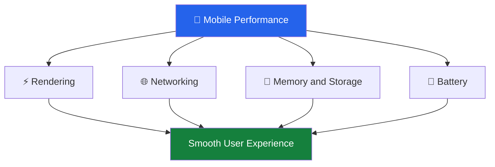
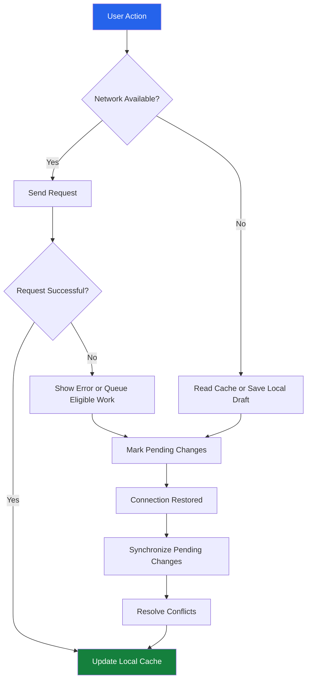

# ⚡ Mobile Performance, Offline Reliability, and Battery Optimization

[⬅️ Previous](17-mobile-app-security-testing-and-accessibility.md) ·

> **Phase 5 — Testing and Release**  
> Create responsive mobile applications that remain useful under slow networks, temporary disconnections, limited device resources, and changing battery conditions.

## 🎯 Learning Objectives

By the end of this topic, you will be able to:

- Identify common React Native performance bottlenecks.
- Reduce unnecessary component rendering and expensive computations.
- Optimize lists, images, network requests, and application startup.
- Design offline-first experiences with reliable synchronization.
- Handle request retries, timeouts, and conflicting updates.
- Reduce unnecessary battery, CPU, and network consumption.
- Measure performance using practical tools and repeatable tests.
- Improve the reliability of AI-powered mobile workflows.

## 1. Why Mobile Performance Matters

A mobile application runs on devices with different processors, memory capacities, screen sizes, battery levels, and network conditions.

A screen that feels fast on a developer's laptop may perform poorly on an older phone.

Common symptoms include:

- Slow application startup.
- Delayed button responses.
- Stuttering animations.
- Lists that scroll unevenly.
- Large images taking too long to appear.
- Repeated network requests.
- High battery consumption.
- Lost changes when a connection disappears.

Performance optimization should be guided by measurement rather than assumptions.



## 2. Measure Before Optimizing

Start by establishing a baseline.

Useful measurements include:

| Metric | What it indicates |
|---|---|
| Cold startup time | Time needed to launch from a stopped state |
| Screen transition time | Time needed to display a destination screen |
| Frame stability | Whether scrolling and animations remain smooth |
| API latency | Time between request initiation and response |
| Memory usage | Resources consumed while the app runs |
| Network volume | Amount of data transferred |
| Battery usage | Energy consumed during representative workflows |
| Crash rate | Frequency of application crashes |
| Offline recovery time | How quickly the app resumes after reconnection |

Use the React Native DevTools and the profiling tools recommended for your React Native and Expo versions. Use Android Studio profiling tools and Xcode Instruments when platform-level investigation is needed.

Measure production-like builds on physical devices. Development mode, debugging tools, and emulators can change performance characteristics.

## 3. Improve React Native Rendering

React Native uses components to represent the interface. When state or props change, React determines what needs to be updated.

Unnecessary rendering can increase work, especially when a component renders large collections or performs expensive calculations.

### 3.1 Keep State Close to Where It Is Used

Avoid storing unrelated state in a single high-level component when only a small part of the UI needs it.

For example, typing in a search field should not cause an entire dashboard to perform expensive calculations on every keystroke.

Prefer small, focused components and keep frequently changing state near the component that uses it.

### 3.2 Use `memo` When It Helps

```tsx
import { memo } from "react";
import { Pressable, Text, StyleSheet } from "react-native";

type ProductCardProps = {
  title: string;
  price: number;
  onSelect: () => void;
};

export const ProductCard = memo(function ProductCard({
  title,
  price,
  onSelect,
}: ProductCardProps) {
  return (
    <Pressable
      accessibilityRole="button"
      onPress={onSelect}
      style={styles.card}
    >
      <Text style={styles.title}>{title}</Text>
      <Text>₹{price.toFixed(2)}</Text>
    </Pressable>
  );
});

const styles = StyleSheet.create({
  card: {
    padding: 16,
    borderRadius: 12,
    marginBottom: 12,
    backgroundColor: "#FFFFFF",
  },
  title: {
    fontSize: 16,
    fontWeight: "600",
  },
});
```

`memo` can skip some re-renders when props remain unchanged. It is not a universal performance fix: new object and function references can defeat memoization, and memoization itself has a cost.

Profile the component before deciding whether to use it.

### 3.3 Use `useMemo` for Expensive Calculations

```tsx
import { useMemo, useState } from "react";

type Product = {
  id: string;
  name: string;
  price: number;
};

export function ProductSearch({
  products,
}: {
  products: Product[];
}) {
  const [query, setQuery] = useState("");

  const filteredProducts = useMemo(() => {
    const normalizedQuery = query.trim().toLowerCase();

    return products.filter((product) =>
      product.name.toLowerCase().includes(normalizedQuery)
    );
  }, [products, query]);

  // Render the search field and filteredProducts here.
  return null;
}
```

This example shows the calculation pattern. Replace the final `return null` with the actual search UI when integrating it into your screen.

For small arrays, a direct calculation may be simpler and just as fast. Use memoization when it addresses a measured issue.

## 4. Optimize Long Lists

Rendering hundreds or thousands of items simultaneously can consume excessive resources.

Use `FlatList` for large scrollable collections rather than rendering every item inside a `ScrollView`.

```tsx
import { FlatList, Text, View } from "react-native";

type Product = {
  id: string;
  name: string;
  price: number;
};

export function ProductList({
  products,
}: {
  products: Product[];
}) {
  return (
    <FlatList
      data={products}
      keyExtractor={(item) => item.id}
      renderItem={({ item }) => (
        <View style={{ padding: 12 }}>
          <Text>{item.name}</Text>
          <Text>₹{item.price.toFixed(2)}</Text>
        </View>
      )}
      initialNumToRender={10}
      windowSize={7}
    />
  );
}
```

Important practices:

- Use stable item identifiers.
- Keep row components lightweight.
- Avoid expensive work inside `renderItem`.
- Use appropriately sized images.
- Avoid changing every list item's props unnecessarily.
- Tune list settings only after measuring on representative devices.

Do not use an array index as a key when items can be inserted, removed, or reordered.

## 5. Optimize Images and Assets

Images can consume substantial memory and network bandwidth.

A mobile app that downloads full-resolution photographs for small thumbnails wastes resources.

### Recommended Practices

1. Generate thumbnail-sized assets for list views.
2. Use appropriate compression and image formats.
3. Request only the resolution needed for the current screen.
4. Cache images where suitable.
5. Avoid decoding many large images simultaneously.
6. Show placeholders while images load.
7. Avoid loading off-screen media unnecessarily.

For an AI image application, distinguish between the original image, the image sent for model processing, and the smaller preview shown in a list. These may require different resolutions.

Do not reduce image resolution blindly when the AI task depends on fine visual details. Choose the smallest input that preserves the required quality.

## 6. Optimize Network Requests

Mobile connections may be slow, expensive, or intermittent.

### 6.1 Avoid Duplicate Requests

A screen may issue repeated requests when components render, users navigate rapidly, or effects are not configured correctly.

Use appropriate request lifecycles, caching, and cancellation where supported.

Example with `AbortController`:

```tsx
import { useEffect, useState } from "react";

type Product = {
  id: string;
  name: string;
};

export function useProducts(apiUrl: string) {
  const [products, setProducts] = useState<Product[]>([]);
  const [loading, setLoading] = useState(true);
  const [error, setError] = useState<string | null>(null);

  useEffect(() => {
    const controller = new AbortController();

    async function loadProducts() {
      setLoading(true);
      setError(null);

      try {
        const response = await fetch(
          `${apiUrl}/products`,
          { signal: controller.signal }
        );

        if (!response.ok) {
          throw new Error("Could not load products");
        }

        const data: Product[] = await response.json();
        setProducts(data);
      } catch (err) {
        if (controller.signal.aborted) return;

        setError("Unable to load products. Try again.");
      } finally {
        if (!controller.signal.aborted) {
          setLoading(false);
        }
      }
    }

    void loadProducts();

    return () => controller.abort();
  }, [apiUrl]);

  return { products, loading, error };
}
```

This hook cancels an obsolete request when the effect is cleaned up. It is an illustrative pattern; production applications should also handle caching, retries, stale data, and concurrent requests according to their data-fetching architecture.

### 6.2 Use Pagination

Do not download an entire catalogue if the user only needs the first few results.

A typical request might be:

```http
GET /api/products?limit=20&cursor=next-page-token
```

The backend returns a page of results and, when more data is available, a cursor for the next page.

Cursor-based pagination is often more reliable than offset pagination for changing datasets, but the right choice depends on the API.

### 6.3 Add Request Timeouts

A network request should not leave the interface waiting indefinitely.

```ts
export async function fetchWithTimeout(
  url: string,
  timeoutMs = 10000
) {
  const controller = new AbortController();

  const timeout = setTimeout(
    () => controller.abort(),
    timeoutMs
  );

  try {
    return await fetch(url, {
      signal: controller.signal,
    });
  } finally {
    clearTimeout(timeout);
  }
}
```

The caller must still check the HTTP status, parse the response, and display a useful error. A timeout should not be interpreted as proof that the server did not process a request.

For operations that create payments, orders, or AI jobs, use server-supported idempotency or request identifiers where appropriate before retrying.

## 7. Offline-First Application Design

Offline support allows users to continue using appropriate features without an active internet connection.

Examples include:

- Reading previously downloaded content.
- Drafting notes.
- Browsing cached products.
- Viewing saved AI responses.
- Editing a form and synchronizing it later.

Not every operation can be performed offline. Authentication refresh, payment processing, and new AI inference may require a server connection.



## 8. Choose Appropriate Local Storage

| Storage option | Typical use |
|---|---|
| AsyncStorage | Preferences and simple non-sensitive values |
| SQLite | Structured records, local queries, and offline datasets |
| SecureStore | Small sensitive credentials and tokens |
| In-memory state | Temporary UI state that need not survive app restarts |

A local database is not automatically secure just because it is stored on the device. Sensitive offline data may require additional platform protections, encryption, access controls, or a decision not to store it locally.

### 8.1 Save a Draft Locally

A simplified example using AsyncStorage:

```tsx
import AsyncStorage from "@react-native-async-storage/async-storage";

const DRAFT_KEY = "assistant_draft";

export async function saveDraft(text: string) {
  await AsyncStorage.setItem(DRAFT_KEY, text);
}

export async function loadDraft() {
  return AsyncStorage.getItem(DRAFT_KEY);
}

export async function deleteDraft() {
  await AsyncStorage.removeItem(DRAFT_KEY);
}
```

Install the library if it is not already in your project:

```bash
npx expo install @react-native-async-storage/async-storage
```

Handle storage failures in the UI, especially when a user's work could otherwise be lost.

## 9. Reliable Synchronization

Saving data locally is only one part of offline support. The application must decide how and when to send pending changes to the backend.

### 9.1 Maintain a Pending-Changes Queue

A queue entry might contain:

```ts
type PendingChange = {
  id: string;
  entityId: string;
  operation: "create" | "update" | "delete";
  payload: unknown;
  createdAt: string;
  retryCount: number;
};
```

Persist queued changes in a local database for workflows that must survive app restarts.

A synchronization worker can then:

1. Check whether the device can attempt a network request.
2. Read pending operations.
3. Send an operation to the backend.
4. Record success or a recoverable failure.
5. Retry transient failures using bounded exponential backoff.
6. Resolve conflicts or request user input.
7. Remove acknowledged operations from the queue.

Network connectivity does not guarantee that the server is reachable. A request can still fail because of DNS, authentication, server errors, or a timeout.

### 9.2 Avoid Duplicate Operations

Suppose a user creates an order while offline. The application sends it when the connection returns, but the response is lost.

If the app retries without an idempotency strategy, the backend might create the order twice.

Use a stable operation identifier and have the backend recognize previously processed operations when the workflow requires exactly-once business effects.

A client-generated identifier alone does not guarantee exactly-once processing; the server must enforce the relevant behavior.

### 9.3 Resolve Data Conflicts

A conflict occurs when the same record changes in multiple places before synchronization.

Common strategies include:

- **Last-write-wins:** Use timestamps or version rules to select a winner.
- **Server-wins:** Accept the server's version.
- **Client-wins:** Accept the client's version where safe.
- **Field-level merge:** Merge compatible changes.
- **User resolution:** Ask the user to choose when the conflict matters.

For important records, use server versions, revision numbers, or conditional updates rather than trusting device clocks alone.

## 10. Retry Policies and Backoff

Immediate repeated retries can overload a failing service and drain the battery.

A simple exponential-backoff formula is:

\[
d_n = \min(d_{\max}, d_0 \times 2^n)
\]

Where:

- \(d_n\) is the delay before retry \(n\).
- \(d_0\) is the initial delay.
- \(d_{\max}\) is the maximum delay.

Add random jitter to avoid many clients retrying simultaneously. Respect server-provided retry instructions, such as `Retry-After`, where applicable.

Do not automatically retry every error:

- Network interruption: often retryable.
- HTTP 429: apply rate-limit guidance.
- HTTP 500–599: potentially retryable.
- HTTP 400: usually requires correcting the request.
- HTTP 401 or 403: requires handling authentication or permissions.
- Validation failure: should not be retried unchanged.

Only retry operations whose semantics make retries safe.

## 11. Battery Optimization

Battery consumption increases when applications repeatedly perform expensive work.

Common causes include:

- Continuous location tracking.
- Frequent background polling.
- Repeated network reconnections.
- Unnecessary animations.
- Reprocessing the same image.
- Running expensive AI inference repeatedly.
- Keeping large workloads active in the background.

### Recommended Practices

**Use event-driven updates:** Refresh data when the user requests it or when an appropriate lifecycle event occurs instead of polling continuously.

**Batch operations:** Group suitable requests to reduce repeated network activity.

**Cache expensive results:** Reuse valid responses rather than running the same operation again unnecessarily.

**Limit background work:** Use platform-supported background task APIs only when needed and follow their execution constraints.

**Respect reduced motion:** Adapt animations where platform support and user preferences allow.

**Optimize AI workloads:** Resize inputs appropriately, limit redundant requests, and avoid repeatedly running on-device models when cached results are valid.

**Use location responsibly:** Request the lowest precision and shortest tracking duration that meet the feature's requirements.

## 12. AI-Specific Performance Improvements

AI applications may introduce additional latency and resource costs.

### 12.1 Stream Long Responses

Streaming allows a chat interface to show partial output before the complete response arrives. It improves perceived responsiveness but does not necessarily reduce total generation time.

The UI should support:

- A visible generating state.
- Incremental text display.
- Cancellation where supported.
- Connection failure handling.
- A way to distinguish partial output from a completed response.

### 12.2 Limit Context Size

Sending an entire conversation for every message increases latency and cost.

Use a suitable context window, summarize older conversation history where appropriate, and retrieve only relevant information. Preserve important instructions and required context rather than truncating blindly.

### 12.3 Cache Carefully

Cache results only when the privacy and correctness implications are understood.

For example, a public product category description might be cacheable. A response containing private account information must be isolated by user and access policy.

Do not share cached personalized AI results between users.

## 13. Performance Testing Plan

| Test | What to observe |
|---|---|
| Cold launch | Time until the first usable screen |
| Large list | Scrolling smoothness and memory usage |
| Weak network | Loading states and request latency |
| Offline launch | Availability of cached content |
| Reconnection | Synchronization correctness |
| Long AI response | Responsiveness during streaming |
| Low battery | Background activity and energy consumption |
| Low-memory device | Crashes, rendering, and resource use |
| Repeated navigation | Leaked subscriptions or duplicated requests |

Use repeatable scenarios and compare measurements before and after changes.

## 14. Key Takeaways

- Measure performance before making optimizations.
- Use virtualized lists and appropriately sized images.
- Handle network requests with timeouts, cancellation, and useful error states.
- Offline reliability requires persistence, synchronization, and conflict handling.
- Retries must be bounded and safe for the operation being repeated.
- Reduce unnecessary background activity to protect battery life.
- AI streaming, caching, and context management can improve perceived responsiveness and resource usage.

