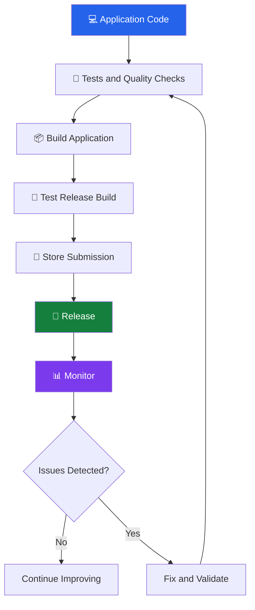
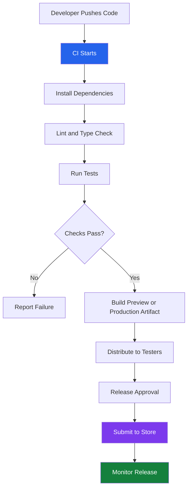

# 🚀 App Builds, CI/CD, Store Publishing, and Monitoring

[⬅️ Previous](18-mobile-performance-offline-reliability-and-battery-optimization.md) ·

> **Phase 5 — Testing and Release**  
> Learn how to turn a React Native application into a release-ready mobile product, automate builds and tests, publish to app stores, and monitor its health after launch.

## 🎯 Learning Objectives

By the end of this topic, you will be able to:

- Understand development, preview, and production builds.
- Configure an Expo application for release.
- Explain continuous integration and continuous delivery.
- Automate checks and builds using a CI/CD pipeline.
- Prepare Android and iOS applications for distribution.
- Understand app signing, versioning, and release channels.
- Plan app-store submissions and staged rollouts.
- Monitor crashes, API failures, performance, and AI usage.
- Establish a practical release and rollback process.

## 1. Introduction to Mobile App Deployment

Writing application code is only one part of delivering a mobile product. Real users need a packaged application that can be installed, updated, and monitored.

For a React Native application using Expo, the release process typically includes:

1. Completing and reviewing the code.
2. Running tests and quality checks.
3. Configuring application metadata.
4. Creating a platform-specific build.
5. Testing the build on physical devices.
6. Submitting it for distribution.
7. Releasing it to users.
8. Monitoring its behavior and resolving issues.



## 2. Understand Different Build Types

A build packages the application and its required resources for a target platform.

| Build type | Purpose | Typical audience |
|---|---|---|
| Development build | Supports development tools and debugging | Developers |
| Preview build | Validates a release-like application | Internal testers |
| Production build | Prepared for public distribution | End users |

The exact differences depend on the build configuration. A preview build can use a separate backend or test environment, while a production build should use production configuration.

### 2.1 Development Versus Production

During development, an app may rely on a local development server and debugging tools.

A production application should not depend on the developer's laptop or expose development credentials.

For example:

```text
Development API:
http://localhost:3000

Production API:
https://api.example.com
```

The first address works only in environments where that host is reachable. On a physical phone, `localhost` refers to the phone itself, not the developer's computer.

Use the correct development network address for testing and an HTTPS endpoint for production.

## 3. Prepare an Expo Application for Release

A typical project might use this structure:

```text
my-mobile-app/
├── app/
├── assets/
├── src/
│   ├── components/
│   ├── services/
│   └── utils/
├── app.json
├── package.json
├── tsconfig.json
├── eas.json
└── .gitignore
```

The exact structure depends on whether the project uses Expo Router and how its source code is organized.

### 3.1 Configure Application Metadata

A simplified `app.json` example:

```json
{
  "expo": {
    "name": "AI Assistant",
    "slug": "ai-assistant",
    "version": "1.0.0",
    "orientation": "portrait",
    "ios": {
      "bundleIdentifier": "com.example.aiassistant"
    },
    "android": {
      "package": "com.example.aiassistant"
    }
  }
}
```

Replace the example identifiers with identifiers that you control and that satisfy the target platform's requirements.

The configuration may also include:

- Application icon.
- Splash screen.
- Permissions.
- Platform-specific settings.
- Update configuration.
- Plugins.
- Build number and version code settings.

Follow the Expo documentation for your current SDK. Some native settings require configuration plugins or a new native build to take effect.

### 3.2 Check the Project Before Building

Run the checks appropriate for your project:

```bash
npm install
npx expo-doctor
npx tsc --noEmit
npm test
```

These commands respectively install dependencies, check common Expo configuration issues, check TypeScript types, and run the configured tests.

If your project uses a different package manager or test runner, use its equivalent commands.

A successful development launch does not guarantee that the production build will work. Verify that all dependencies and native modules are compatible with the selected Expo SDK and build configuration.

## 4. Configure EAS Build

Expo Application Services (EAS) provides cloud-based build and submission workflows for Expo and React Native applications.

Install the EAS CLI:

```bash
npm install --global eas-cli
```

Log in to your Expo account:

```bash
eas login
```

Configure the project:

```bash
eas build:configure
```

This setup typically creates or updates the `eas.json` configuration.

### 4.1 Example Build Profiles

A simplified `eas.json`:

```json
{
  "build": {
    "development": {
      "developmentClient": true,
      "distribution": "internal"
    },
    "preview": {
      "distribution": "internal"
    },
    "production": {
      "autoIncrement": true
    }
  }
}
```

This is an illustrative starting point. Adapt the profiles to your project's Expo SDK, native configuration, distribution needs, and platform requirements.

### 4.2 Build for Android

Create a preview build:

```bash
eas build --platform android --profile preview
```

Create a production build:

```bash
eas build --platform android --profile production
```

### 4.3 Build for iOS

Create a preview build:

```bash
eas build --platform ios --profile preview
```

Create a production build:

```bash
eas build --platform ios --profile production
```

EAS may require account configuration, signing credentials, and platform-specific settings. iOS distribution and testing can require Apple developer account access.

For store distribution, the resulting artifact is generally an Android App Bundle (`.aab`) for Google Play and an appropriate iOS archive/package processed for App Store distribution. The exact artifact depends on the selected workflow.

## 5. App Signing and Versioning

### 5.1 What Is App Signing?

App signing helps the platform verify the origin and integrity of an application package.

Signing configuration differs between Android and iOS.

- Android uses signing keys and platform-specific distribution requirements.
- iOS uses Apple signing identities and provisioning-related configuration.

Protect signing credentials. Restrict access to the people and automation systems that need them, and follow the platform's key backup and recovery procedures.

Never commit private signing keys, passwords, or service-account credentials to a public repository.

### 5.2 Version Numbers

Mobile applications typically have a user-visible version and a platform-specific build identifier.

For example:

```text
Version:       1.2.0
Build number:  15
```

A common semantic versioning convention is:

- `MAJOR`: incompatible or significant product changes.
- `MINOR`: backward-compatible features.
- `PATCH`: backward-compatible fixes.

Not every mobile store requires semantic versioning, but a consistent versioning strategy makes releases easier to manage.

Platform build numbers must follow the relevant store rules and generally need to advance for new uploads.

## 6. Continuous Integration and Continuous Delivery

CI/CD automates repeatable development and release tasks.

**Continuous Integration (CI)** checks changes as developers commit or open pull requests.

**Continuous Delivery (CD)** keeps validated changes ready for release.

**Continuous Deployment** automatically releases qualifying changes without a separate manual release decision.

For mobile applications, the final store release may still require approval, signing, or a human-controlled publishing step.



## 7. Create a GitHub Actions Workflow

A basic CI workflow can verify the project whenever code is pushed or a pull request is opened.

Create `.github/workflows/mobile-ci.yml`:

```yaml
name: Mobile App CI

on:
  push:
    branches: [main]
  pull_request:
    branches: [main]

jobs:
  checks:
    runs-on: ubuntu-latest

    steps:
      - name: Checkout repository
        uses: actions/checkout@v4

      - name: Set up Node.js
        uses: actions/setup-node@v4
        with:
          node-version: 22
          cache: npm

      - name: Install dependencies
        run: npm ci

      - name: Check TypeScript
        run: npx tsc --noEmit

      - name: Run tests
        run: npm test -- --runInBand
```

Use a Node.js version compatible with your selected Expo SDK and lockfile. The workflow assumes the project has a committed `package-lock.json`, a working TypeScript configuration, and a test script that accepts these arguments.

Add linting or other checks if the project has them.

### 7.1 Extend CI/CD Carefully

A more complete pipeline can add:

- Dependency vulnerability checks.
- Expo configuration validation.
- Automated unit and component tests.
- Build artifact generation.
- Preview distribution.
- End-to-end tests on suitable infrastructure.
- Production builds after approval.
- Automated store submission.

Cloud builds can consume account resources and may require signing credentials. Do not expose sensitive credentials to untrusted pull-request workflows.

## 8. Environment Configuration and Secrets

A mobile application may need a backend URL and other public configuration values.

Example:

```text
EXPO_PUBLIC_API_URL=https://api.example.com
```

Expo public environment variables are included in the client application and must be treated as public.

Never put private AI provider keys, database passwords, signing passwords, or backend service credentials in public environment variables.

Keep secrets in a secure backend environment or a CI/CD secret store, and expose them only to the workflows that need them.

A sensible environment strategy is:

| Environment | Purpose |
|---|---|
| Development | Local coding and debugging |
| Staging | Integration testing with non-production data |
| Production | Real users and production services |

Use separate credentials and appropriate data isolation for each environment.

## 9. Test Before Publishing

Before a store submission, validate the actual release build.

### Functional Tests

- Can a new user complete onboarding?
- Does authentication work?
- Are navigation and deep links correct?
- Are forms validated?
- Do API calls work against the intended environment?
- Does sign-out clear the expected session data?
- Does the application handle rejected requests?

### Device Tests

- Test on representative Android and iOS devices.
- Check different screen sizes.
- Verify permission prompts.
- Test application backgrounding and resuming.
- Verify keyboard behavior and screen insets.
- Test weak network and offline states.

### AI Feature Tests

- Verify that AI requests go to the intended backend.
- Confirm that private provider keys are not in the app bundle.
- Check timeout, rate-limit, and provider-error handling.
- Validate structured AI responses before rendering or acting on them.
- Confirm that sensitive conversation history is handled appropriately.

## 10. Google Play Store Publishing

The Google Play publishing process generally includes the following stages.

### Step 1: Prepare the Application

- Choose a unique Android application ID.
- Set the version and build identifiers.
- Configure icons, app name, and permissions.
- Generate the required Android App Bundle.

### Step 2: Configure the Store Listing

Prepare:

- Application name.
- Short and full descriptions.
- Screenshots.
- App icon and any required promotional assets.
- Support contact details.
- Privacy policy URL where required.

### Step 3: Complete Policy and Data Declarations

Review the applicable requirements for:

- Data collection and sharing.
- Sensitive permissions.
- Target audience and content rating.
- Privacy policy.
- Account deletion where applicable.
- AI-related functionality and relevant user disclosures.

The declarations must accurately describe the actual behavior of your application and its third-party services.

### Step 4: Test the Release

Use the available internal, closed, or other applicable testing tracks before public release.

Verify the uploaded artifact, installation, sign-in, backend communication, and critical user journeys.

### Step 5: Submit for Review

Upload the required artifacts and complete the applicable store forms. Google Play requirements and testing obligations may differ by account type, app category, and current policy.

### Step 6: Roll Out Gradually

Use a staged rollout when appropriate, and monitor crash reports, user feedback, and backend health as the release reaches more users.

## 11. Apple App Store Publishing

iOS distribution follows a similar process but uses Apple's signing and distribution workflow.

### Step 1: Configure the iOS App

- Set the bundle identifier.
- Configure signing and capabilities.
- Review permissions and usage descriptions.
- Prepare icons and other required assets.
- Set the version and build number.

### Step 2: Create a Release Build

Generate a suitable iOS distribution build using EAS or another supported toolchain.

### Step 3: Configure App Store Connect

Prepare:

- App name and description.
- Screenshots for required device sizes.
- Category and age rating information.
- Privacy disclosures.
- Review contact information.
- Required account or demo access for review, if applicable.

### Step 4: Test Through TestFlight

Distribute a build to internal or external testers as appropriate. Test the release build on physical devices and verify the primary workflows.

### Step 5: Submit for Review

Complete the required metadata and submit the build for Apple's review.

### Step 6: Release and Monitor

Choose an appropriate release option and monitor crashes, performance, user feedback, and backend errors after approval.

Store policies, privacy declarations, signing rules, and submission requirements can change. Check the current official platform guidance before a real submission.

## 12. Store Submission Checklist

### Application Quality

- [ ] App launches successfully from a clean installation.
- [ ] No development-only screens or test credentials are exposed.
- [ ] Core workflows have been tested on physical devices.
- [ ] Loading, error, and offline states are understandable.
- [ ] Accessibility checks have been completed.
- [ ] App permissions are necessary and clearly explained.

### Security and Privacy

- [ ] No private secrets are embedded in the application.
- [ ] Production API communication uses HTTPS.
- [ ] Backend authentication and authorization are enforced.
- [ ] Data collection matches the privacy disclosures.
- [ ] Account deletion and data-management requirements are addressed.
- [ ] Logs and crash reports avoid unnecessary personal data.

### Store Readiness

- [ ] Unique application identifiers are configured.
- [ ] Version and build numbers are correct.
- [ ] Signing credentials are protected.
- [ ] Icons and screenshots are prepared.
- [ ] Store descriptions are accurate.
- [ ] Privacy and content declarations are complete.
- [ ] Required testing tracks or review steps are complete.

## 13. Monitor the Application After Release

Publishing is the beginning of production operation, not the end.

Monitoring helps identify issues that do not appear during development or testing.

### 13.1 What to Monitor

| Area | Useful signals |
|---|---|
| Crashes | Crash-free sessions and crash frequency |
| Performance | Startup time, slow screens, and responsiveness |
| Backend | Error rates, latency, and availability |
| Network | Failed requests, timeouts, and retry frequency |
| Authentication | Expired sessions and failed sign-ins |
| AI usage | Request counts, latency, failures, and cost |
| User experience | Feedback, task completion, and recurring complaints |

Use tools appropriate to your architecture. Examples include platform crash reporting, error-tracking services, backend metrics, structured application logs, and analytics with suitable privacy controls.

### 13.2 Capture Useful Error Context

A useful production error record may include:

- Error category.
- Application version.
- Platform and operating system version.
- A correlation or request ID.
- Relevant timing information.
- A sanitized operation name.

Avoid collecting unnecessary personal information, passwords, tokens, full private conversations, or raw sensitive images.

A simplified backend logging pattern:

```ts
app.get("/api/example", async (req, res) => {
  const requestId = crypto.randomUUID();

  res.setHeader("X-Request-ID", requestId);

  try {
    // Execute the actual business operation here.
    return res.json({
      message: "Request completed",
      requestId,
    });
  } catch {
    console.error("Request failed", {
      requestId,
      route: "/api/example",
    });

    return res.status(500).json({
      error: "An unexpected error occurred",
      requestId,
    });
  }
});
```

In a real application, use the logging infrastructure and error middleware appropriate to the backend. Avoid logging raw request bodies by default.

### 13.3 Monitor AI Costs and Reliability

For AI-powered applications, monitor:

- Requests per user or account.
- Token or usage consumption where available.
- Model response latency.
- Provider rate limits.
- Failed and timed-out requests.
- Unexpected increases in request volume.
- Output-validation failures.

Apply backend rate limits and usage budgets. Do not rely on the mobile client to enforce spending limits.

## 14. Release Strategy and Rollback

A release can introduce a defect even when testing was successful.

Use a release strategy that allows problems to be detected and corrected safely.

### Recommended Strategy

1. Publish to an internal test group.
2. Validate the release artifact.
3. Release to a small percentage of users when supported.
4. Monitor crashes and backend errors.
5. Expand the rollout if health indicators remain acceptable.
6. Pause or halt the rollout if serious problems appear.
7. Ship a fix or use a supported recovery mechanism.

Mobile binary rollbacks are not always as simple as rolling back a website. App stores may impose versioning rules, and users may already have installed the affected version.

Plan for forward fixes, supported staged-rollout controls, and backend compatibility. Do not assume that an over-the-air JavaScript update can replace every native change or reverse every data migration.

## 15. Real-World Scenario: Releasing an AI Shopping App

Suppose you have completed a mobile application that lets users browse clothing, upload reference images, and receive AI-generated recommendations.

A suitable release plan could be:

**Stage 1 — Development**
- Build UI components and API integration.
- Use test accounts and a development backend.
- Mock AI responses in unit tests.

**Stage 2 — Integration**
- Connect to staging services.
- Test image uploads, authentication, and request failures.
- Measure AI latency and usage.

**Stage 3 — Preview**
- Build Android and iOS preview versions.
- Distribute them to a small testing group.
- Collect crash reports and feedback.

**Stage 4 — Production**
- Protect signing credentials.
- Complete store metadata and privacy disclosures.
- Create the production build.
- Submit it for review.

**Stage 5 — Monitoring**
- Track crashes, request errors, and AI costs.
- Review user feedback.
- Fix defects and release compatible updates.

## 16. Key Takeaways

- Development, preview, and production builds serve different purposes.
- EAS can simplify React Native build and submission workflows.
- CI/CD improves repeatability and catches defects earlier.
- Signing credentials and server-side secrets must be protected.
- Store submission requires accurate metadata, testing, and policy compliance.
- Monitoring should cover the mobile client, backend, and AI services.
- Staged releases and documented recovery procedures reduce deployment risk.
- Production readiness includes operational support, not just successful publication.
