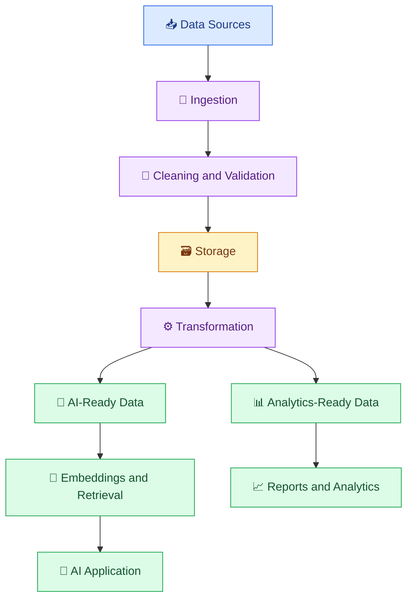

# 🚀 AI Developer – Data Engineering Learning Modules

> Venkata Bhattaram (c) 2026

A beginner-to-advanced **AI Developer – Data Engineering Learning Modules** covering the foundations of data engineering for modern AI applications — from data ingestion and transformation to data quality, AI-ready datasets, embeddings, RAG pipelines, orchestration, security, and production-ready data systems.

## 🌟 About This Learning Modules

AI applications are only as reliable as the data that supports them. Whether you are building a chatbot, a recommendation engine, an AI agent, or a retrieval-augmented generation (RAG) system, data must be collected, cleaned, validated, transformed, secured, and delivered in the right format.

This learning modules teaches you how to design those data workflows using practical examples, Python, SQL, API integrations, and AI-focused use cases.

## 🎯 Learning Objectives

By completing this Learning Modules, you will learn to:

- 🧠 Understand how data engineering supports AI development.
- 🐍 Build Python-based data processing pipelines.
- 🗃️ Query, clean, and transform structured data using SQL.
- 🔄 Design ETL and ELT workflows.
- 📂 Work with CSV, JSON, Parquet, and other data formats.
- 🧪 Validate data quality and handle incomplete or inconsistent records.
- 🤖 Prepare data for LLM applications, embeddings, and RAG.
- 🌊 Understand batch and streaming data processing.
- ⚙️ Automate workflows and handle pipeline failures.
- 🔐 Apply data security, privacy, and governance principles.
- 📊 Monitor and optimize data pipelines.
- 🏆 Build an end-to-end AI data engineering project.

## 🧭 Complete Learning Path

### 📘 Phase 1: Foundations

1. [Introduction to AI Data Engineering](foundations/01-introduction-to-ai-data-engineering.md)
2. [Data Engineering Fundamentals](foundations/02-data-engineering-fundamentals.md)
3. [Python for AI Data Pipelines](foundations/03-python-for-ai-data-pipelines.md)
4. [SQL and Data Transformation](foundations/04-sql-and-data-transformation.md)

### 📗 Phase 2: Building Reliable Data Pipelines

5. [Data Ingestion and ETL/ELT](building-reliable-data-pipelines/05-data-ingestion-and-etl-elt.md)
6. [Data Formats and Storage](building-reliable-data-pipelines/06-data-formats-and-storage.md)
7. [Data Quality and Validation](building-reliable-data-pipelines/07-data-quality-and-validation.md)
8. [Data Modeling and Analytics](building-reliable-data-pipelines/08-data-modeling-and-analytics.md)

### 📙 Phase 3: Preparing Data for AI

9. [Data Pipelines for AI and LLMs](data-for-ai/09-data-pipelines-for-ai-and-llms.md)
10. [Embeddings and Vector Data Pipelines](data-for-ai/10-embeddings-and-vector-data-pipelines.md)
11. [RAG Data Ingestion Pipelines](data-for-ai/11-rag-data-ingestion-pipelines.md)

### 📕 Phase 4: Advanced Data Workflows

12. [Batch and Streaming Data](advanced-data-workflows/12-batch-and-streaming-data.md)
13. [Data Orchestration and Automation](advanced-data-workflows/13-data-orchestration-and-automation.md)
14. [Data Security and Governance](advanced-data-workflows/14-data-security-and-governance.md)
15. [Monitoring and Optimizing Data Pipelines](advanced-data-workflows/15-monitoring-and-optimizing-data-pipelines.md)

## 🛠️ Technology Stack

| Area | Technologies |
|---|---|
| Programming | Python |
| Data querying | SQL |
| Data processing | Pandas, Python |
| Data formats | CSV, JSON, Parquet |
| Data ingestion | Files, REST APIs, databases |
| AI integration | LLM APIs, embeddings |
| Retrieval | Vector search concepts and RAG |
| Data quality | Validation, schema checks, testing |
| Automation | Python workflows and orchestration concepts |
| Version control | Git and GitHub |

Cloud-specific platforms and specialized technologies will be covered in their dedicated learning topics.

## 🏗️ Overall Architecture

***Learn the data. Build the pipeline. Power the AI.** 🚀