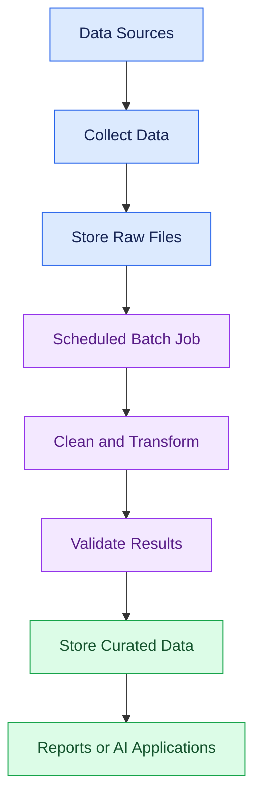

# ⚡12 Batch and Streaming Data

[⬅️ Back to Learning Modules](../README.md) · 

Learn how to process data at scheduled intervals and continuously as new events arrive. These patterns are essential for analytics platforms, AI applications, recommendation systems, fraud detection, and real-time monitoring.

## 🎯 Learning objectives

By the end of this topic, you will be able to:

- Explain batch processing and stream processing.
- Identify when to use each processing pattern.
- Build a simple batch data pipeline with Python and Pandas.
- Simulate a streaming pipeline that processes incoming events.
- Understand event time, late-arriving data, checkpoints, and duplicate events.
- Choose appropriate processing patterns for AI applications.

---

## 1. What is batch processing?

**Batch processing** collects data over a period and processes it as a group.

For example, a boutique might collect all orders throughout the day and calculate total sales every night.

Common examples include:

- Daily sales reports.
- Nightly database backups.
- Weekly customer analytics.
- Scheduled embedding generation for a document collection.
- Daily training-data preparation.

### Batch workflow



**Key idea:** batch jobs optimize for processing a defined collection of records, rather than reacting immediately to every event.

## 2. What is streaming data processing?

**Streaming processing** handles events as they arrive or in small, frequent groups.

Examples include:

- Tracking clicks on a shopping website.
- Detecting unusual payment activity.
- Monitoring application errors.
- Processing live sensor readings.
- Updating a dashboard as new orders arrive.


Real streaming platforms include Apache Kafka, Apache Flink, and Spark Structured Streaming. The example later in this topic simulates event-by-event processing without requiring those platforms.

## 3. Batch vs. streaming

| Feature | Batch | Streaming |
|---|---|---|
| Processing | Scheduled groups | Continuous or frequent events |
| Latency | Minutes to hours, sometimes longer | Often milliseconds to seconds |
| Typical use | Reports, historical analysis | Live alerts, activity feeds |
| Complexity | Often simpler to operate | More attention to state, ordering, and recovery |
| Example | Daily sales summary | Alert when an order fails |

Neither approach is universally better. Select the pattern based on how quickly the result must be available, the volume of data, operational cost, and recovery requirements.

## 4. Hands-on: build a batch pipeline

### Step 1: Install dependencies

```powershell
python -m pip install pandas
```

### Step 2: Create `orders.csv`

```csv
order_id,product,quantity,unit_price,status
101,Dress,2,1500,completed
102,Top,3,600,completed
103,Jeans,1,1200,pending
104,Skirt,2,900,completed
```

### Step 3: Create `batch_pipeline.py`

```python
from pathlib import Path
import pandas as pd

DATA_DIR = Path("data")
OUTPUT_DIR = Path("output")

DATA_DIR.mkdir(exist_ok=True)
OUTPUT_DIR.mkdir(exist_ok=True)

source = DATA_DIR / "orders.csv"

if not source.exists():
    raise FileNotFoundError(f"Missing input file: {source}")

orders = pd.read_csv(source)

required = {
    "order_id", "product", "quantity", "unit_price", "status"
}
missing = required - set(orders.columns)

if missing:
    raise ValueError(f"Missing columns: {sorted(missing)}")

orders["quantity"] = pd.to_numeric(
    orders["quantity"], errors="coerce"
)
orders["unit_price"] = pd.to_numeric(
    orders["unit_price"], errors="coerce"
)

valid = orders.dropna(
    subset=["order_id", "product", "quantity", "unit_price"]
).copy()

valid = valid[
    (valid["quantity"] > 0) & (valid["unit_price"] >= 0)
]

valid["revenue"] = valid["quantity"] * valid["unit_price"]

completed = valid[
    valid["status"].str.lower() == "completed"
].copy()

summary = (
    completed.groupby("product", as_index=False)
    .agg(
        units_sold=("quantity", "sum"),
        revenue=("revenue", "sum"),
    )
)

valid.to_csv(OUTPUT_DIR / "clean_orders.csv", index=False)
summary.to_csv(OUTPUT_DIR / "sales_summary.csv", index=False)

print(f"Input rows: {len(orders)}")
print(f"Valid rows: {len(valid)}")
print(f"Completed orders: {len(completed)}")
print(summary.to_string(index=False))
```

Run it from your project directory:

```powershell
python batch_pipeline.py
```

Expected completed-order summary:

| Product | Units sold | Revenue |
|---|---:|---:|
| Dress | 2 | 3000 |
| Top | 3 | 1800 |
| Skirt | 2 | 1800 |

The pending Jeans order is excluded from the completed-sales summary. It remains in the cleaned order dataset because it may still be useful for operational reporting.

## 5. Hands-on: simulate streaming events

A streaming system processes new events as they arrive. This example uses Python to demonstrate the core idea without a message broker.

Create `stream_processor.py`:

```python
from datetime import datetime, timezone

events = [
    {"event_id": "e1", "order_id": 201, "amount": 1200},
    {"event_id": "e2", "order_id": 202, "amount": 850},
    {"event_id": "e3", "order_id": 203, "amount": 2400},
    {"event_id": "e2", "order_id": 202, "amount": 850},
]

processed_ids = set()
running_total = 0.0

for event in events:
    event_id = event["event_id"]

    # Simple in-memory deduplication for this demonstration.
    if event_id in processed_ids:
        print(f"Duplicate skipped: {event_id}")
        continue

    amount = float(event["amount"])

    if amount < 0:
        print(f"Invalid amount for event {event_id}")
        continue

    processed_ids.add(event_id)
    running_total += amount

    timestamp = datetime.now(timezone.utc).isoformat()
    print(
        f"{timestamp} | event={event_id} "
        f"| amount={amount:.2f} "
        f"| running_total={running_total:.2f}"
    )
```

Run:

```powershell
python stream_processor.py
```

The duplicate event `e2` is skipped, so it is not counted twice.

**Important:** the in-memory set is only for learning. A production system needs durable deduplication state, usually stored in a database or managed by a streaming platform. Otherwise, restarting the program forgets which events were processed.

## 6. Concepts that matter in production

- **Event time:** when the event actually occurred.
- **Processing time:** when the pipeline handled the event.
- **Late-arriving data:** events that arrive after newer events.
- **Windowing:** grouping events by intervals, such as sales per five minutes.
- **Checkpointing:** recording enough processing state to recover after failure.
- **Idempotency:** making retries safe so that repeating a job does not incorrectly duplicate results.
- **Delivery guarantees:** at-most-once, at-least-once, or carefully designed exactly-once effects. The guarantee depends on the complete system, not just one component.

## 7. Batch and streaming for AI

| AI use case | Suitable starting pattern |
|---|---|
| Prepare historical training data | Batch |
| Generate embeddings for a large document library | Batch |
| Index a small number of newly uploaded documents | Event-driven or micro-batch |
| Monitor model errors as they happen | Streaming |
| Update recommendations from live activity | Streaming or micro-batch |
| Refresh a RAG knowledge base nightly | Batch |

A common architecture uses **both**: batch jobs prepare historical data, while streaming jobs process new events between scheduled refreshes.

## 8. Common mistakes

- Choosing streaming when a daily batch is sufficient.
- Assuming events always arrive in order.
- Ignoring duplicate events.
- Treating an in-memory simulation as a durable streaming system.
- Failing to recover from partially completed jobs.
- Processing invalid or sensitive events without validation.

## 9. Best practices

- Define acceptable data latency before choosing the architecture.
- Validate records before downstream processing.
- Use stable event IDs for deduplication.
- Track event time and processing time separately.
- Make batch jobs repeatable and safe to rerun.
- Plan checkpointing, replay, recovery, and monitoring.
- Keep raw data when retention policies and privacy requirements permit.

## ✅ Key takeaways

- Batch processing works on groups of records; streaming reacts to arriving events.
- The right pattern depends on latency, complexity, cost, and recovery requirements.
- Both approaches require validation, deduplication, and observability.
- AI data platforms often combine batch preparation with streaming updates.