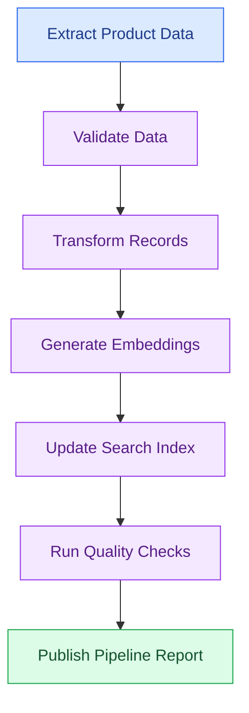

# 🧭 13 Data Orchestration and Automation

[⬅️ Previous](12-batch-and-streaming-data.md) ·

A data pipeline may contain many tasks: extract files, validate records, clean data, generate embeddings, update a database, and publish a report. **Orchestration** coordinates those tasks in the correct order and handles their execution.

## 🎯 Learning objectives

- Understand orchestration, scheduling, and task dependencies.
- Design a directed acyclic graph (DAG).
- Build a small dependency-aware workflow in Python.
- Learn the roles of Apache Airflow and Prefect.
- Understand retries, backfills, parameters, and failure handling.

## 1. What is orchestration?

Automation means that work runs without requiring someone to manually start each step. Orchestration coordinates multiple automated tasks and their dependencies.

Consider an AI-powered boutique assistant. Before its product catalog can be searched, the system must load the products, validate them, normalize their descriptions, generate embeddings, and update the search index.



The arrows indicate dependencies. For example, embedding generation should not start until the input records have passed validation.

## 2. What is a DAG?

A **directed acyclic graph (DAG)** is a collection of tasks connected by directed dependencies, with no circular dependency path.

- **Node:** an individual task.
- **Edge:** a dependency between tasks.
- **Execution order:** tasks run only when their dependencies are satisfied.
- **Parallelism:** independent tasks may run at the same time when the orchestration system supports it.

Example:

```mermaid
flowchart TD
    A[Extract Data] --> B[Validate Data]
    B --> C[Build Analytics Table]
    B --> D[Prepare AI Documents]
    C --> E[Publish Dashboard]
    D --> F[Build Search Index]
    classDef start fill:#DBEAFE,stroke:#2563EB,color:#1E3A8A
    classDef work fill:#F3E8FF,stroke:#9333EA,color:#581C87
    classDef end fill:#DCFCE7,stroke:#16A34A,color:#14532D
    class A start
    class B,C,D work
    class E,F end
```

After validation, the analytics and AI-document branches are independent. A capable orchestrator can run them concurrently.

## 3. Hands-on: create a simple Python orchestrator

This learning example uses the Python standard library. It demonstrates task dependencies, task status, and failure propagation. It is not a replacement for a production scheduler.

Create `simple_orchestrator.py`:

```python
from collections import defaultdict, deque

def extract():
    print("Extracting source records...")

def validate():
    print("Validating source records...")

def transform():
    print("Transforming records...")

def build_ai_dataset():
    print("Preparing AI-ready dataset...")

def publish_report():
    print("Publishing report...")

tasks = {
    "extract": {
        "run": extract,
        "depends_on": [],
    },
    "validate": {
        "run": validate,
        "depends_on": ["extract"],
    },
    "transform": {
        "run": transform,
        "depends_on": ["validate"],
    },
    "build_ai_dataset": {
        "run": build_ai_dataset,
        "depends_on": ["validate"],
    },
    "publish_report": {
        "run": publish_report,
        "depends_on": ["transform", "build_ai_dataset"],
    },
}

# Validate dependency names.
for name, task in tasks.items():
    for dependency in task["depends_on"]:
        if dependency not in tasks:
            raise ValueError(
                f"{name} depends on unknown task: {dependency}"
            )

# Topological ordering using Kahn's algorithm.
indegree = {
    name: len(task["depends_on"])
    for name, task in tasks.items()
}
dependents = defaultdict(list)

for name, task in tasks.items():
    for dependency in task["depends_on"]:
        dependents[dependency].append(name)

ready = deque(
    name for name, degree in indegree.items() if degree == 0
)
execution_order = []

while ready:
    current = ready.popleft()
    execution_order.append(current)

    for dependent in dependents[current]:
        indegree[dependent] -= 1
        if indegree[dependent] == 0:
            ready.append(dependent)

if len(execution_order) != len(tasks):
    raise ValueError("Circular dependency detected")

completed = set()

for name in execution_order:
    dependencies = tasks[name]["depends_on"]

    if not all(dep in completed for dep in dependencies):
        raise RuntimeError(f"Dependencies not complete for {name}")

    try:
        tasks[name]["run"]()
        completed.add(name)
    except Exception as exc:
        print(f"Task failed: {name}: {exc}")
        raise

print("Workflow completed successfully.")
```

Run:

```powershell
python simple_orchestrator.py
```

The program computes a valid execution order and stops if a task fails. The example's tasks only print messages, so they complete successfully.

**Production note:** real orchestrators also need persistent task states, scheduling, retries, logs, timeouts, alerts, access control, and recovery after the orchestrator itself restarts.

## 4. What production orchestrators provide

### Apache Airflow

Airflow is commonly used to define scheduled workflows as Python DAGs. It offers task dependencies, run history, scheduling, retries, and a user interface for observing runs.

### Prefect

Prefect provides a Python-oriented workflow model with task and flow abstractions, execution tracking, and orchestration capabilities.

The right choice depends on your deployment environment, workflow complexity, team familiarity, and operational requirements. Neither tool makes a poorly designed pipeline reliable automatically.

## 5. Scheduling, retries, and backfills

**Scheduling:** determines when a workflow should run—for example, every night or every hour.

**Retries:** rerun a failed task when the error may be temporary, such as a network timeout. Use a limited retry count and increasing delays.

**Backfills:** run a pipeline for historical dates or partitions that were missed or need recomputation.

**Timeouts:** prevent tasks from running indefinitely.

**Parameters:** let the same workflow run for different dates, regions, customers, or source locations.

**Idempotency:** makes rerunning a task safe. A retry should not create duplicate sales records or repeated billing actions.

## 6. Design a reliable workflow

For every task, define:

- Inputs and outputs.
- Preconditions and postconditions.
- Dependencies.
- Expected execution time.
- Retry policy.
- Failure behavior.
- Logging and metrics.
- Whether rerunning it is safe.

A useful design principle is to keep tasks focused. A task that extracts data should not also publish reports, send emails, and update unrelated databases.

## 7. Orchestration for AI and LLM pipelines

An AI data workflow might run these tasks:

1. Retrieve updated documents.
2. Validate file type, size, and access permissions.
3. Extract and normalize text.
4. Split documents into chunks.
5. Generate embeddings.
6. Update the vector index.
7. Evaluate retrieval quality.
8. Publish a pipeline summary.

If embedding generation fails, the workflow should preserve successful earlier work when safe and resume from an appropriate checkpoint. Avoid blindly repeating expensive API calls.

## 8. Common mistakes

- Creating circular task dependencies.
- Putting an entire workflow into one large task.
- Retrying permanent errors indefinitely.
- Scheduling tasks before their input data is available.
- Rerunning tasks that cause duplicate side effects.
- Hiding task failures or ignoring incomplete outputs.
- Embedding secrets directly in source code.

## 9. Best practices

- Make dependencies explicit.
- Design tasks to be repeatable and observable.
- Set timeouts and bounded retry policies.
- Store execution history and task logs.
- Alert on failed or delayed critical workflows.
- Separate development and production environments.
- Use backfills deliberately and validate their outputs.
- Version pipeline definitions and configuration.

## ✅ Key takeaways

- Orchestration coordinates tasks, dependencies, schedules, and failures.
- DAGs help make execution order explicit and expose independent work.
- Retries, backfills, timeouts, and idempotency are essential reliability features.
- A production orchestrator should make failures visible and recovery predictable.

