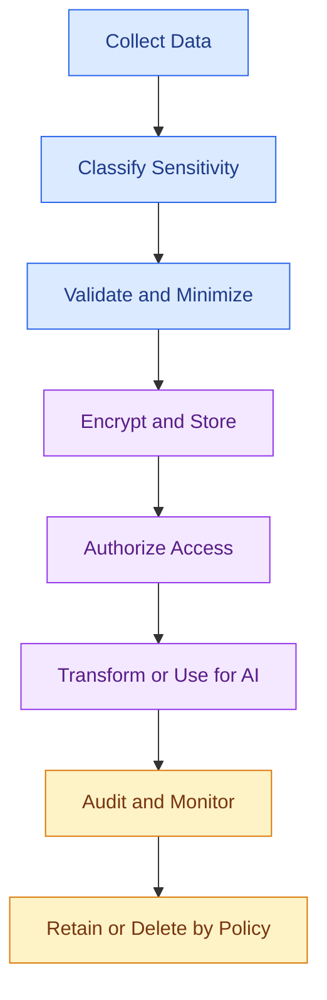

# 🔐14 Data Security and Governance

[⬅️ Previous](13-data-orchestration-and-automation.md) ·

Data pipelines can contain personal information, customer records, payment-related details, business data, and private documents used by AI applications. Data security protects that information, while data governance defines how it should be managed, accessed, documented, and retained.

## 🎯 Learning objectives

By the end of this topic, you will be able to:

- Distinguish data security from data governance.
- Recognize sensitive information in a data pipeline.
- Apply basic masking and validation with Python.
- Handle API keys through environment variables.
- Understand access control, encryption, retention, lineage, and audit logs.
- Identify security risks in RAG and LLM data pipelines.

## 1. Why data security matters

Imagine a boutique assistant that answers questions about products and customer orders. The application may process:

- Public product descriptions.
- Internal inventory records.
- Customer names and contact details.
- Order histories.
- Private supplier documents.
- API keys used to call AI services.

Not all these data types should be accessible to the same people or systems.

A secure pipeline must protect information throughout its lifecycle—from collection and storage to transformation, AI retrieval, sharing, and deletion.

## 2. Security vs. governance

| Concept | Main purpose | Example |
|---|---|---|
| Data security | Prevent unauthorized access and disclosure | Restrict access to customer records |
| Data governance | Establish rules, responsibilities, and acceptable use | Define who owns a dataset and how long it is retained |
| Data quality | Ensure data is fit for use | Reject invalid order quantities |
| Data privacy | Handle personal information appropriately | Avoid exposing unnecessary customer details |

These areas overlap but are not interchangeable. A dataset may be accurate yet insecure, or securely stored but poorly governed.

## 3. Data security lifecycle



Security is not a single step at the end of a pipeline. It must be designed into each stage.

## 4. Data classification

A useful starting point is to classify datasets according to their sensitivity.

- **Public:** approved product descriptions or public documentation.
- **Internal:** non-public business reports or inventory summaries.
- **Confidential:** supplier agreements, financial reports, or private business plans.
- **Restricted:** sensitive personal data, authentication secrets, or other data requiring strict controls.

These labels are illustrative. Organizations should define classifications based on their policies and applicable laws.

## 5. Hands-on: mask sensitive fields

Suppose an application needs to produce an operational report but does not need to display a customer's full email address.

Create `mask_customer_data.py`:

```python
import pandas as pd

customers = pd.DataFrame([
    {
        "customer_id": 101,
        "name": "Customer One",
        "email": "customer.one@example.com",
        "city": "Hyderabad",
    },
    {
        "customer_id": 102,
        "name": "Customer Two",
        "email": "customer.two@example.com",
        "city": "Secunderabad",
    },
])

def mask_email(email):
    if not isinstance(email, str) or "@" not in email:
        return "[INVALID EMAIL]"

    local, domain = email.rsplit("@", 1)

    if not local or not domain:
        return "[INVALID EMAIL]"

    return f"{local[0]}***@{domain}"

report = customers[
    ["customer_id", "name", "email", "city"]
].copy()

report["email"] = report["email"].map(mask_email)

print(report.to_string(index=False))
```

Run:

```powershell
python mask_customer_data.py
```

The output displays a masked email rather than the complete address.

**Important:** masking is not the same as anonymization. The original data may still be recoverable or linkable to an individual. Do not treat masking alone as a complete privacy or security solution.

For many analytics tasks, an even safer choice is to exclude email addresses entirely if they are not required.

## 6. Secrets management

Never commit API keys, passwords, access tokens, or database credentials to GitHub.

### Step 1: Install `python-dotenv`

```powershell
python -m pip install python-dotenv
```

### Step 2: Create a local `.env` file

```env
OPENAI_API_KEY=your_actual_api_key
DATABASE_URL=your_local_database_connection_string
```

Use real values only in your local environment, not in shared examples or public repositories.

### Step 3: Load the values

Create `load_secrets.py`:

```python
import os
from dotenv import load_dotenv

load_dotenv()

api_key = os.getenv("OPENAI_API_KEY")

if not api_key:
    raise RuntimeError("OPENAI_API_KEY is not configured")

# Do not print or log the secret.
print("AI API credential is configured.")
```

Run:

```powershell
python load_secrets.py
```

Add `.env` to `.gitignore`:

```gitignore
.env
.env.*
!.env.example
```

If needed, create a safe `.env.example` containing placeholder values only.

For production systems, prefer an approved secret manager or the deployment platform's secret configuration. If a key is exposed, revoke or rotate it; deleting the file alone may not remove it from Git history or previous copies.

## 7. Essential security controls

### Authentication and authorization

- **Authentication:** verifies who or what is connecting.
- **Authorization:** determines what that identity is permitted to do.

Apply least privilege: grant only the permissions required for a task. A reporting job should not automatically receive permission to delete source records.

### Encryption

- **In transit:** protect network communication with secure protocols such as HTTPS/TLS.
- **At rest:** use the storage platform's supported encryption controls for databases, object storage, backups, and other persisted data.

Encryption does not replace access control, safe key management, or application-level security.

### Audit logs

Record useful security events, such as:

- Which service accessed a dataset.
- When a permission change occurred.
- Whether a sensitive export was attempted.
- Which pipeline version processed a dataset.

Avoid recording passwords, API keys, full private documents, or unnecessary personal information in logs.

### Retention and deletion

Keep data only as long as needed and permitted by policy. Deletion requirements may include raw files, transformed datasets, caches, backups, embeddings, vector indexes, and downstream copies.

## 8. Security for RAG and LLM data pipelines

A document being available to the ingestion pipeline does not mean every user should be able to retrieve it.

Consider a company knowledge assistant containing public FAQs and confidential supplier contracts. If the system searches all documents and only filters the answer afterward, sensitive content may already have been exposed to an unauthorized component.

Apply controls such as:

1. Assign access metadata to documents and chunks.
2. Authenticate the requesting user or service.
3. Enforce authorization during retrieval.
4. Recheck permissions when documents change.
5. Avoid putting confidential information into prompts unless necessary and authorized.
6. Evaluate whether logs, caches, and model-provider settings comply with policy.
7. Remove or re-index content when access is revoked or retention expires.

Metadata filters are helpful, but they must be backed by trusted authorization logic rather than user-controlled filter values.

## 9. Data governance concepts

- **Data owner:** accountable for the dataset's appropriate use.
- **Data steward:** helps maintain definitions, quality, and documentation.
- **Data catalog:** records available datasets and their descriptions.
- **Data lineage:** records where data came from and how it was transformed.
- **Access policy:** defines who can access or modify information.
- **Retention policy:** defines how long data is kept and when it must be deleted.

Good governance improves trust in both analytics and AI-generated results.

## 10. Common mistakes

- Committing `.env` files to a public repository.
- Giving every pipeline full database permissions.
- Logging private data for debugging.
- Assuming masked data is completely anonymous.
- Building embeddings from documents without checking permissions.
- Keeping outdated copies after a deletion request.
- Treating governance as documentation only, without enforcing the rules.

## 11. Best practices

- Classify data before processing it.
- Collect and retain only what is necessary.
- Apply least-privilege access.
- Use managed secrets and encryption.
- Maintain auditable access and transformation history.
- Apply authorization before retrieving private AI context.
- Establish tested retention and deletion procedures.
- Review relevant organizational policies and applicable privacy laws.

## ✅ Key takeaways

- Security protects data; governance defines how data should be managed.
- Secrets should never be hardcoded or committed to version control.
- Least privilege, encryption, auditability, and retention controls are core safeguards.
- AI pipelines must enforce document-level authorization, not just clean and embed documents.
