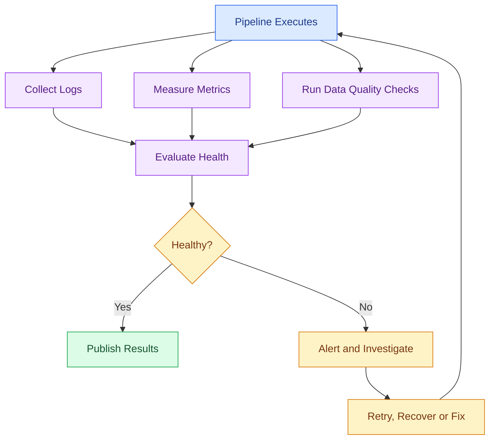

# 📊 15 Monitoring and Optimizing Data Pipelines

[⬅️ Previous](14-data-security-and-governance.md) ·

A pipeline can run without crashing and still produce incorrect, incomplete, delayed, or expensive results. Monitoring helps detect these problems, while optimization improves performance, reliability, and cost.

## 🎯 Learning objectives

By the end of this topic, you will be able to:

- Distinguish logging, monitoring, alerting, and observability.
- Track pipeline duration, throughput, failures, and data quality.
- Implement structured logs and basic metrics in Python.
- Detect missing or unexpectedly small input datasets.
- Apply practical performance optimization techniques.
- Monitor AI-specific pipeline costs and retrieval quality.

---

## 1. Why pipeline monitoring matters

Imagine that a nightly product-ingestion pipeline normally processes 20,000 records in three minutes. One morning, it finishes successfully but processes only 200 records.

The job's status is successful, but the output is incomplete. Without monitoring, the problem may go unnoticed until customers see missing products or the AI assistant starts returning incomplete answers.

Common pipeline problems include:

- Missing input files.
- API timeouts and rate limits.
- Unexpected schema changes.
- Invalid or duplicate records.
- Slow database queries.
- Failed embedding requests.
- Stale vector indexes.
- Excessive cloud or API costs.

## 2. Monitoring workflow



The goal is not merely to detect exceptions. A healthy pipeline should also produce trustworthy data within an acceptable time and cost.

## 3. Logging, metrics, monitoring, and alerting

| Concept | Purpose | Example |
|---|---|---|
| Logging | Records events and errors | `Input file loaded` |
| Metrics | Measures behavior numerically | 10,000 rows processed |
| Monitoring | Evaluates system health over time | Detecting an increasing failure rate |
| Alerting | Notifies someone when action is needed | Alert when a critical pipeline fails |
| Observability | Helps explain system behavior from available evidence | Tracing a slow task across multiple services |

### Important pipeline metrics

- **Duration:** total time taken by a pipeline or task.
- **Throughput:** records processed per second or minute.
- **Failure rate:** proportion of runs or records that fail.
- **Data freshness:** how recently the data was updated.
- **Completeness:** proportion of expected records or fields present.
- **Retry count:** how often a task needed another attempt.
- **Resource usage:** CPU, memory, storage, and network utilization.
- **Cost:** infrastructure, database, and model/API expenditure.

A metric becomes more useful when it has an expected range, a clear owner, and an action to take when it goes outside that range.

## 4. Hands-on: monitor a Python batch pipeline

This example records execution time, input and output row counts, and errors. It also detects an unexpectedly small input dataset.

### Step 1: Create a sample file

Create `orders.csv`:

```csv
order_id,product,quantity,unit_price
101,Dress,2,1500
102,Top,3,600
103,Jeans,1,1200
104,Skirt,2,900
```

### Step 2: Create `monitored_pipeline.py`

```python
import json
import logging
import time
from pathlib import Path

import pandas as pd

LOG_DIR = Path("logs")
OUTPUT_DIR = Path("output")

LOG_DIR.mkdir(exist_ok=True)
OUTPUT_DIR.mkdir(exist_ok=True)

logging.basicConfig(
    level=logging.INFO,
    format="%(asctime)s %(levelname)s %(message)s",
    handlers=[
        logging.FileHandler(LOG_DIR / "pipeline.log", encoding="utf-8"),
        logging.StreamHandler(),
    ],
)

logger = logging.getLogger("orders_pipeline")


def run_pipeline():
    started = time.perf_counter()
    metrics = {
        "pipeline": "orders_pipeline",
        "status": "failed",
        "input_rows": 0,
        "output_rows": 0,
    }

    try:
        input_path = Path("orders.csv")

        if not input_path.exists():
            raise FileNotFoundError(input_path)

        orders = pd.read_csv(input_path)
        metrics["input_rows"] = len(orders)

        if len(orders) < 3:
            raise ValueError(
                f"Unexpectedly small input: {len(orders)} rows"
            )

        required = {
            "order_id", "product", "quantity", "unit_price"
        }
        missing = required - set(orders.columns)

        if missing:
            raise ValueError(
                f"Missing required columns: {sorted(missing)}"
            )

        orders["quantity"] = pd.to_numeric(
            orders["quantity"], errors="coerce"
        )
        orders["unit_price"] = pd.to_numeric(
            orders["unit_price"], errors="coerce"
        )

        clean = orders.dropna(
            subset=["order_id", "product", "quantity", "unit_price"]
        ).copy()

        clean = clean[
            (clean["quantity"] > 0)
            & (clean["unit_price"] >= 0)
        ].copy()

        clean["revenue"] = clean["quantity"] * clean["unit_price"]

        if clean.empty:
            raise ValueError("No valid records remain after cleaning")

        clean.to_csv(OUTPUT_DIR / "clean_orders.csv", index=False)

        metrics["output_rows"] = len(clean)
        metrics["revenue_total"] = float(clean["revenue"].sum())
        metrics["status"] = "success"

        logger.info(
            "Pipeline completed: input_rows=%s output_rows=%s",
            metrics["input_rows"],
            metrics["output_rows"],
        )

    except Exception:
        logger.exception("Pipeline execution failed")
        raise

    finally:
        metrics["duration_seconds"] = round(
            time.perf_counter() - started, 4
        )

        with open(
            LOG_DIR / "latest_metrics.json",
            "w",
            encoding="utf-8",
        ) as file:
            json.dump(metrics, file, indent=2)

        logger.info(
            "Pipeline metrics: %s",
            json.dumps(metrics),
        )


if __name__ == "__main__":
    run_pipeline()
```

### Step 3: Install and execute

```powershell
python -m pip install pandas
python monitored_pipeline.py
```

Inspect the generated files:

```text
logs/
├── pipeline.log
└── latest_metrics.json

output/
└── clean_orders.csv
```

The metrics JSON records the status, input/output row counts, execution duration, and total revenue when successful.

**Important:** this sample intentionally fails when fewer than three input rows are available. In production, establish the threshold using real business expectations. If failure occurs, the metrics file records the failed status and duration before the exception is propagated.

## 5. Define service-level expectations

A pipeline needs clear expectations to distinguish normal variation from a problem.

Examples:

- The sales pipeline must finish before 7:00 AM.
- Product data must be no more than two hours old.
- At least 98% of required records must pass validation.
- A critical workflow must not silently publish an empty dataset.
- Model API spending must stay within an approved budget.

These are illustrative targets. Real thresholds should reflect business impact, data volume, historical performance, and recovery requirements.

### Useful measurements

Throughput:

\[
\text{Throughput} =
\frac{\text{Records processed}}{\text{Elapsed seconds}}
\]

Failure rate:

\[
\text{Failure rate} =
\frac{\text{Failed runs}}{\text{Total runs}} \times 100
\]

Data completeness:

\[
\text{Completeness} =
\frac{\text{Valid required values}}{\text{Expected required values}} \times 100
\]

Define the denominator carefully. For example, required-value completeness is different from the percentage of expected records that arrived.

## 6. Monitoring AI and LLM pipelines

AI data pipelines need traditional engineering metrics and AI-specific measurements.

| Pipeline stage | What to monitor |
|---|---|
| Document ingestion | File count, file size, extraction failures |
| Chunking | Chunks per document, empty chunks, chunk size distribution |
| Embeddings | API failures, token usage where applicable, latency, cost |
| Vector indexing | Indexed count, duplicate IDs, indexing delay |
| RAG retrieval | Retrieval latency, relevant results, missing sources |
| Generation | Request failures, latency, token usage, cost |
| Evaluation | Retrieval quality, groundedness, task-specific quality |

A successful embedding request does not prove that the resulting vector index is correct. Likewise, a successful LLM response does not prove that the answer is relevant or supported by the retrieved documents.

Use representative evaluation questions and expected source documents to test retrieval quality over time.

## 7. Practical optimization techniques

### A. Avoid unnecessary data processing

Read only the columns you need:

```python
import pandas as pd

orders = pd.read_csv(
    "orders.csv",
    usecols=["order_id", "quantity", "unit_price"],
)
```

This can reduce memory usage when the source contains many unnecessary columns.

### B. Prefer vectorized Pandas operations

Prefer:

```python
orders["revenue"] = (
    orders["quantity"] * orders["unit_price"]
)
```

over applying a Python function row by row for a simple multiplication. Vectorized operations are generally more efficient for this kind of work.

### C. Process large files in chunks

```python
import pandas as pd

total_rows = 0
total_revenue = 0.0

for chunk in pd.read_csv("large_orders.csv", chunksize=10_000):
    chunk["quantity"] = pd.to_numeric(
        chunk["quantity"], errors="coerce"
    )
    chunk["unit_price"] = pd.to_numeric(
        chunk["unit_price"], errors="coerce"
    )

    valid = chunk.dropna(
        subset=["quantity", "unit_price"]
    )
    valid = valid[
        (valid["quantity"] > 0)
        & (valid["unit_price"] >= 0)
    ]

    total_rows += len(valid)
    total_revenue += (
        valid["quantity"] * valid["unit_price"]
    ).sum()

print(f"Valid rows: {total_rows}")
print(f"Revenue: {total_revenue:.2f}")
```

Chunking reduces peak memory usage. However, the result must still account for global requirements such as duplicate detection across chunks or aggregations that need all records.

### D. Optimize database access

- Add appropriate indexes for frequently used filters and joins.
- Select only required columns.
- Avoid repeatedly fetching the same data.
- Inspect query plans before changing indexes.
- Use incremental extraction when the source supports reliable change tracking.

### E. Optimize embedding generation

- Cache embeddings when the exact input and model version are unchanged.
- Process documents in supported batches.
- Use bounded concurrency and respect provider rate limits.
- Track failed items separately for retry.
- Re-embed only changed content where appropriate.
- Evaluate the effect of model changes before rebuilding an index.

Do not cache sensitive content without considering access control, retention, and deletion requirements.

## 8. Troubleshooting workflow

When a pipeline slows down or fails:

1. Identify the failing task and affected time window.
2. Inspect logs and relevant metrics.
3. Compare input volume and schema with previous runs.
4. Check external dependencies, API errors, database performance, and resource usage.
5. Determine whether the problem is a data issue, application issue, infrastructure issue, or capacity issue.
6. Recover through a safe retry, replay, or backfill.
7. Validate the output before publishing it.
8. Record the root cause and prevention steps.

Avoid automatically retrying every error. A malformed input or missing required column usually needs correction, not repeated execution.

## 9. Common mistakes

- Monitoring only whether the job exited successfully.
- Ignoring stale data and unexpectedly low row counts.
- Logging secrets or complete sensitive records.
- Alerting on every minor event until alerts become noise.
- Optimizing code before measuring the actual bottleneck.
- Retrying permanent errors indefinitely.
- Rebuilding an entire vector index for every small document change.
- Publishing results before quality checks finish.

## 10. Best practices

- Record run IDs, timestamps, durations, counts, and statuses.
- Track data freshness and quality alongside execution metrics.
- Establish meaningful thresholds and alert owners.
- Use structured logs and avoid sensitive values.
- Profile before optimizing.
- Make retries bounded and recovery repeatable.
- Validate output datasets before publishing.
- Monitor infrastructure costs and AI-provider usage.
- Maintain dashboards and incident notes for critical pipelines.

## ✅ Key takeaways

- Successful execution does not guarantee correct or fresh data.
- Logs explain events; metrics measure behavior; alerts prompt action.
- Optimize based on measured bottlenecks rather than guesswork.
- AI pipelines also need retrieval-quality, embedding, latency, and cost monitoring.
- Reliable recovery and output validation are as important as speed.

