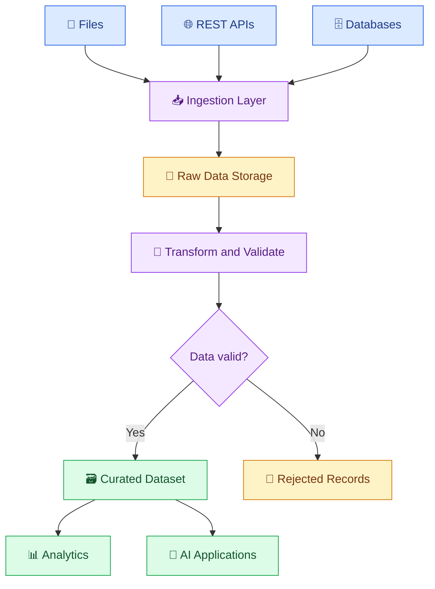

# 🔄 05. Data Ingestion and ETL/ELT

[⬅️ Back to Learning Modules](../README.md) · 

> 🎯 **Goal:** Learn how to collect data from files, APIs, and databases, and transform it into reliable datasets using ETL and ELT workflows.

## 📚 1. What Is Data Ingestion?

Data ingestion is the process of collecting data from one or more sources and moving it into a system where it can be stored, processed, analyzed, or used by an AI application.

Common data sources include:

- 📄 CSV, JSON, Excel, and Parquet files.
- 🌐 REST APIs and web services.
- 🗄️ Relational databases.
- 📨 Application events and message queues.
- 📚 Documents used by RAG applications.
- ☁️ Cloud storage and data platforms.

For example, an online boutique might collect product details from a spreadsheet, inventory updates from an API, and orders from a database. A data pipeline combines these inputs into a consistent dataset.

## 🏗️ 2. Data Ingestion Architecture



A well-designed pipeline keeps ingestion, transformation, validation, and output generation logically separate. This makes it easier to investigate failures and rerun individual stages.

## 🔄 3. ETL vs ELT

**ETL — Extract, Transform, Load**

1. Extract data from its source.
2. Transform the data before loading it into the target.
3. Load the prepared data into the destination.

**ELT — Extract, Load, Transform**

1. Extract data from its source.
2. Load the raw or minimally processed data into the destination.
3. Transform it inside the destination using its processing capabilities.

| Feature | ETL | ELT |
|---|---|---|
| Transformation | Before loading into the target | After loading into the target |
| Raw-data retention | Depends on the design | Commonly retained in the destination |
| Processing location | ETL engine or application | Often the warehouse or lakehouse |
| Typical fit | Strict preprocessing requirements | Scalable analytics and flexible transformations |

Neither pattern is universally better. The right approach depends on security requirements, data volume, processing capabilities, and the intended destination.

## 📥 4. Hands-On Example: Ingest a CSV File

Create `products.csv`:

```csv
product_id,name,price,stock
P101,Blue Kurti,799,12
P102,Red Kurti,899,8
P103,Green Dress,1299,5
```

Create `ingest_csv.py`:

```python
import pandas as pd
from pathlib import Path

source = Path("products.csv")
destination = Path("raw_products.csv")

if not source.exists():
    raise FileNotFoundError(f"Source file not found: {source}")

df = pd.read_csv(source)

if df.empty:
    raise ValueError("The source file contains no records.")

df["ingested_at"] = pd.Timestamp.now(tz="UTC")

df.to_csv(destination, index=False)

print(f"Ingested {len(df)} records.")
print(f"Saved data to {destination}")
```

Install and execute:

```powershell
python -m pip install pandas
python ingest_csv.py
```

This is a simple batch ingestion process. In a production system, you would also track source file identity, ingestion time, record counts, and whether the same file has already been processed.

## 🌐 5. Ingest Data from a REST API

An API can supply records without requiring a manually maintained file.

Install `requests`:

```powershell
python -m pip install requests
```

Create `ingest_api.py`:

```python
import json
from pathlib import Path

import requests

url = "https://jsonplaceholder.typicode.com/posts"

response = requests.get(url, timeout=15)
response.raise_for_status()

records = response.json()

if not isinstance(records, list):
    raise ValueError("Expected a list of records.")

output = Path("api_records.json")

output.write_text(
    json.dumps(records, indent=2),
    encoding="utf-8",
)

print(f"Ingested {len(records)} records.")
print(f"Saved data to {output}")
```

Run:

```powershell
python ingest_api.py
```

The example uses a public sample API. Real APIs may require credentials, pagination, rate-limit handling, schema validation, and incremental extraction.

## 🧹 6. Transform and Load the Data

Create `transform_products.py`:

```python
import pandas as pd

df = pd.read_csv("raw_products.csv")

required_columns = {
    "product_id",
    "name",
    "price",
    "stock",
}

missing = required_columns - set(df.columns)

if missing:
    raise ValueError(
        f"Missing columns: {sorted(missing)}"
    )

df["product_id"] = df["product_id"].astype("string").str.strip()
df["name"] = df["name"].astype("string").str.strip()
df["price"] = pd.to_numeric(df["price"], errors="coerce")
df["stock"] = pd.to_numeric(df["stock"], errors="coerce")

valid = (
    df["product_id"].notna()
    & df["product_id"].ne("")
    & df["name"].notna()
    & df["name"].ne("")
    & df["price"].notna()
    & df["stock"].notna()
    & df["price"].ge(0)
    & df["stock"].ge(0)
)

clean = df.loc[valid].copy()
rejected = df.loc[~valid].copy()

clean.to_csv("curated_products.csv", index=False)
rejected.to_csv("rejected_products.csv", index=False)

print("Accepted records:", len(clean))
print("Rejected records:", len(rejected))
```

This demonstrates a basic ETL-style process: read the source, transform and validate the records, and write the results.

The raw input is preserved separately. That is useful when you need to investigate a transformation error or reproduce a previous pipeline run.

## 🔁 7. Full Load vs Incremental Load

**Full load:** Reprocess the complete dataset each time.

**Incremental load:** Process only new or changed records since a previous successful run.

Incremental loading can reduce processing time for large datasets, but it requires a reliable way to identify changes.

Common approaches include:

- A trustworthy `updated_at` timestamp.
- A monotonically increasing ID.
- Change data capture (CDC).
- Source-system change logs.
- Version numbers or event sequence numbers.

A timestamp watermark should not be advanced before the associated data has been safely processed. Late-arriving records and source updates can otherwise be missed.

## 🧭 8. Common Ingestion Challenges

| Challenge | Possible approach |
|---|---|
| Duplicate records | Stable IDs and deduplication rules |
| API pagination | Fetch pages until completion |
| Rate limits | Respect provider limits and use bounded backoff |
| Partial failures | Track checkpoints and failed batches |
| Schema changes | Validate required fields and version contracts |
| Late-arriving records | Use a defined lookback or reconciliation strategy |
| Repeated file delivery | Track file identity and processing status |

## 🏪 9. Real-World Scenario: Boutique Inventory

Imagine an inventory API publishes product quantities every hour.

Your pipeline must:
1. Fetch the current product records.
2. Validate product identifiers and stock quantities.
3. Compare incoming data with existing records.
4. Apply updates without creating duplicates.
5. Record failed rows and ingestion time.
6. Make the curated inventory available to the website and AI assistant.

An AI assistant may explain product availability, but the application should retrieve current inventory from a trusted source rather than relying on a model's memory.

## ⚠️ 10. Common Mistakes

❌ Reprocessing data without considering duplicate effects.

❌ Ignoring API pagination or rate limits.

❌ Deleting raw data before verifying the transformed output.

❌ Treating a successful HTTP status as proof that the response has the correct schema.

❌ Advancing incremental-load checkpoints after a failed write.

❌ Retrying non-idempotent operations without a duplicate-prevention strategy.

## 🏆 11. Best Practices

- Define the input schema and output contract.
- Track pipeline run IDs, timestamps, and record counts.
- Keep raw and curated outputs separate when appropriate.
- Use incremental loading for large datasets when the source supports it.
- Apply timeouts and bounded retries to network calls.
- Validate before publishing data to downstream systems.
- Make reruns safe and document recovery procedures.
- Protect API credentials and sensitive records.

## 🎯 Key Takeaways

- Ingestion collects data from files, APIs, databases, and events.
- ETL transforms before loading; ELT transforms after loading.
- Incremental loads reduce repeated processing but need reliable change tracking.
- Robust pipelines validate data, track failures, and support safe reruns.
