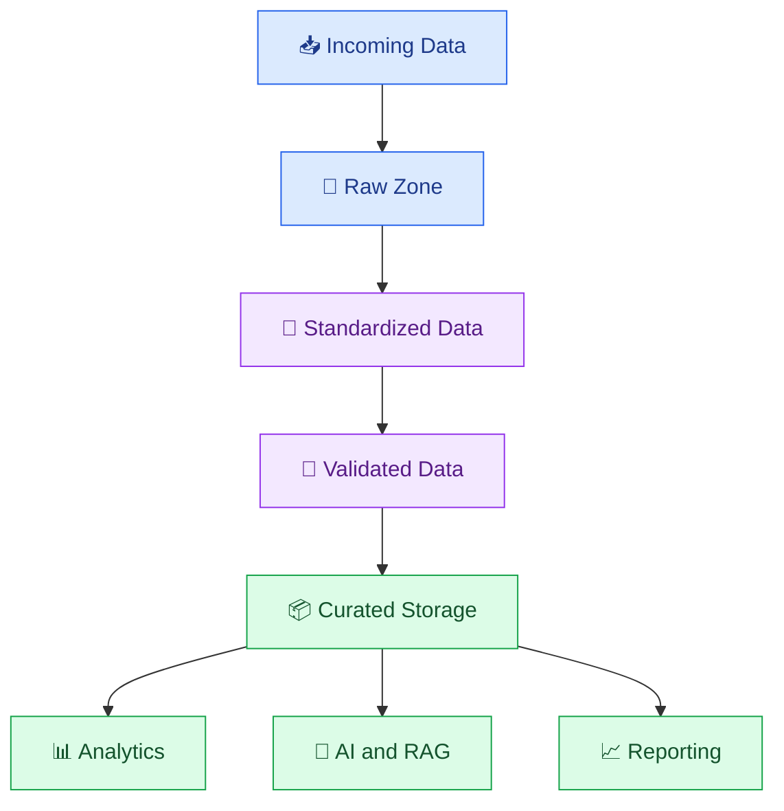
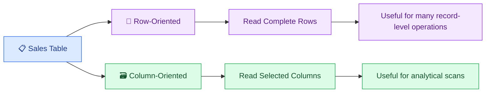

# 🗂️ 06. Data Formats and Storage

[⬅️ Previous](05-data-ingestion-and-etl-elt.md) ·

> 🎯 **Goal:** Understand common data formats, compare structured and semi-structured storage, and choose appropriate formats for analytics and AI pipelines.

## 📚 1. Why Data Formats Matter

A data format defines how information is represented and stored. The format you choose affects readability, storage size, processing speed, schema handling, and compatibility with downstream systems.

For example, a CSV file is convenient for sharing a small dataset, while Parquet is often more efficient for analytical workloads involving large tables.

## 🧩 2. Types of Data

### 📋 Structured data

Data organized into predictable rows and columns.

Examples:
- Customer records.
- Sales transactions.
- Inventory tables.

### 🧾 Semi-structured data

Data with identifiable fields but a flexible structure.

Examples:
- JSON API responses.
- XML documents.
- Application event records.

### 📚 Unstructured data

Data that does not naturally fit into a fixed tabular schema.

Examples:
- PDF documents.
- Images and audio.
- Videos and free-form text.

Unstructured data can still have useful metadata, such as a document ID, filename, timestamp, or access permissions.

## 📊 3. Common Data Formats

| Format | Characteristics | Typical use |
|---|---|---|
| CSV | Plain-text rows and columns | Simple exports and spreadsheets |
| JSON | Nested objects and arrays | REST APIs and application records |
| JSON Lines (JSONL) | One JSON value per line | Events, logs, and AI datasets |
| Parquet | Columnar binary format with schema information | Analytical datasets and large tables |
| Avro | Row-oriented serialization with schema support | Data exchange and event pipelines |
| XML | Hierarchical tagged data | Legacy integrations and structured documents |
| TXT / Markdown | Human-readable text | Knowledge bases and RAG |
| Images / audio / video | Media-specific binary formats | Multimodal AI pipelines |

No format is best for every task. Consider the structure, access pattern, volume, schema requirements, and tools that must read the data.

## 🏗️ 4. Storage Architecture



A common pattern is to retain source data in a raw zone and publish cleaned, validated data to a curated zone. This separation supports auditing and reprocessing, provided retention policies permit it.

## 🐍 5. Hands-On Example: CSV and JSON

Create `products.csv`:

```csv
product_id,name,price
P101,Blue Kurti,799
P102,Red Kurti,899
P103,Green Dress,1299
```

Create `convert_formats.py`:

```python
import json
import pandas as pd

df = pd.read_csv("products.csv")

# Export the table as JSON records.
df.to_json(
    "products.json",
    orient="records",
    indent=2,
)

# Read the JSON records back.
with open("products.json", encoding="utf-8") as file:
    records = json.load(file)

print("Record count:", len(records))
print("First record:", records[0])
```

Run:

```powershell
python -m pip install pandas
python convert_formats.py
```

The generated JSON file contains one object for each product. JSON is useful when records need to be exchanged with APIs or applications that use nested structures.

## ⚡ 6. Working with Parquet

Parquet stores data in columns, which can be beneficial when analytical queries read only a subset of the available columns.

Install the required libraries:

```powershell
python -m pip install pandas pyarrow
```

Create `parquet_demo.py`:

```python
import pandas as pd

df = pd.read_csv("products.csv")

df.to_parquet(
    "products.parquet",
    index=False,
)

# Read only the columns needed for an analysis.
prices = pd.read_parquet(
    "products.parquet",
    columns=["product_id", "price"],
)

print(prices)
```

Run:

```powershell
python parquet_demo.py
```

Parquet is especially useful for analytical workloads. It is not intended to be manually edited like a CSV file.

## 🧠 7. Row-Oriented vs Column-Oriented Storage

Imagine a table with one million sales records and 30 columns.

If a report needs only `product_id` and `revenue`, a columnar format can allow the processing engine to read fewer columns rather than scanning every field.



Actual performance depends on compression, partitioning, indexes, file sizes, the query engine, and access patterns.

## 🗄️ 8. Choosing a Storage System

| Storage system | Typical purpose |
|---|---|
| Relational database | Application transactions and structured queries |
| Object storage | Files, datasets, and media at scale |
| Data warehouse | Analytical queries and governed reporting |
| Data lake | Flexible storage for diverse datasets |
| Lakehouse table format | Managed tables on data-lake storage |
| Vector database or index | Similarity search over embeddings |
| Document store | Flexible application records and nested data |

A file format is not the same as a storage platform. For example, Parquet is a file format; object storage is a way to store and retrieve files. A lakehouse table format adds metadata and table-management capabilities on top of data files.

## 🧱 9. Partitioning and File Organization

Partitioning organizes data into logical groups, often by a field such as date or region.

Example:

```text
sales/
├── year=2026/
│   ├── month=09/
│   └── month=10/
└── year=2027/
    └── month=01/
```

Partitioning can help a query read only the relevant portion of a dataset.

However, excessive partitioning can create too many small files and increase metadata overhead. Select partition keys based on common filters and the size of the data.

## ⚠️ 10. Common Mistakes

❌ Choosing CSV for every large analytical dataset.

❌ Assuming JSON always has a consistent schema.

❌ Treating file storage and a database as interchangeable.

❌ Creating too many tiny files.

❌ Partitioning by a field that is rarely used in filters.

❌ Converting data formats without verifying data types, nulls, timestamps, and numeric precision.

## 🏆 11. Best Practices

- Choose formats based on the workload and consuming tools.
- Define schemas and validate them when reading data.
- Use Parquet for many analytical table workloads.
- Keep raw and curated datasets logically separated.
- Use sensible partitioning and file sizes.
- Document timestamp, timezone, and numeric conventions.
- Apply encryption, access controls, and retention policies.
- Test round-trip conversions to detect unintended changes.

## 🎯 Key Takeaways

- CSV, JSON, and Parquet solve different data representation problems.
- Columnar formats can improve analytical workloads.
- Storage architecture should match access patterns, scale, and governance requirements.
- Partitioning, schemas, and file organization influence reliability and performance.