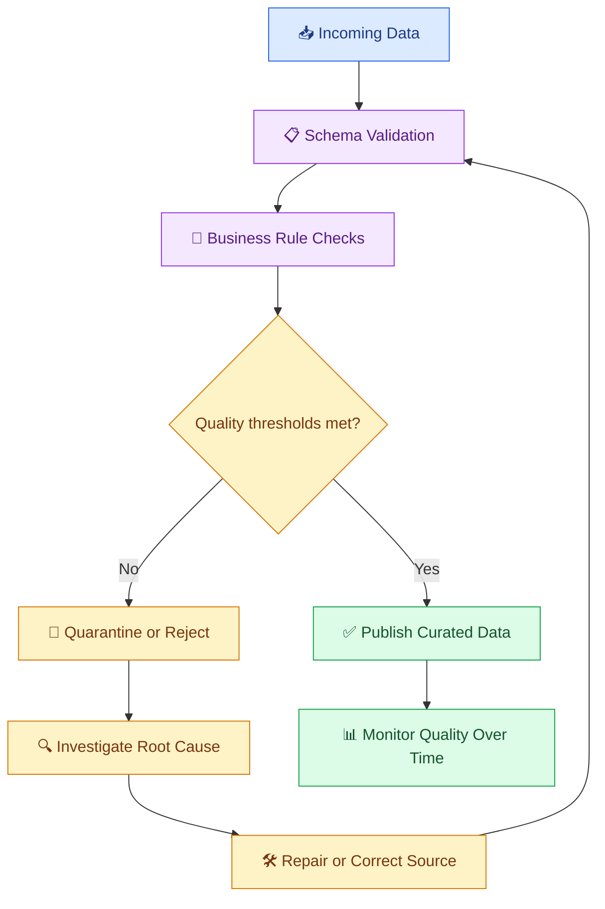

# 🧪 07. Data Quality and Validation

[⬅️ Previous](06-data-formats-and-storage.md) ·

> 🎯 **Goal:** Learn how to measure data quality, define validation rules, detect invalid records, and prevent unreliable data from reaching analytics and AI applications.

## 📚 1. What Is Data Quality?

Data quality describes how well a dataset meets the requirements of its intended use.

A dataset can contain millions of records and still be unsuitable for analysis if it has missing identifiers, duplicate transactions, incorrect timestamps, or inconsistent values.

For AI applications, poor data quality can lead to misleading summaries, incorrect recommendations, outdated answers, and unreliable retrieval results.

## 🧩 2. Dimensions of Data Quality

| Dimension | Meaning | Example check |
|---|---|---|
| Completeness | Required information is present | Product ID is not missing |
| Accuracy | Values represent reality correctly | Inventory matches the trusted source |
| Consistency | Values agree across systems | Currency uses the same convention |
| Validity | Values follow defined rules | Price is non-negative |
| Uniqueness | Records do not violate uniqueness rules | Order ID is unique |
| Timeliness | Data is sufficiently current | Inventory was refreshed recently |
| Referential integrity | Related records have valid references | Every order references an existing customer |

These dimensions are related but different. A record can be complete and valid while still being inaccurate.

## 🔄 3. Data Quality Workflow



Validation should happen at appropriate boundaries, such as when data enters the pipeline, after important transformations, and before data is published.

## 🐍 4. Hands-On Example: Validate a Product Dataset

Create `products.csv`:

```csv
product_id,name,price,stock
P101,Blue Kurti,799,12
P102,Red Kurti,899,8
P102,Red Kurti,899,8
,Green Dress,1299,5
P104,Yellow Top,-100,4
P105,Black Dress,1499,-2
```

Install Pandas:

```powershell
python -m pip install pandas
```

Create `validate_products.py`:

```python
import pandas as pd

df = pd.read_csv("products.csv")

required_columns = {
    "product_id",
    "name",
    "price",
    "stock",
}

missing_columns = required_columns - set(df.columns)

if missing_columns:
    raise ValueError(
        f"Missing columns: {sorted(missing_columns)}"
    )

df["product_id"] = df["product_id"].astype("string").str.strip()
df["name"] = df["name"].astype("string").str.strip()
df["price"] = pd.to_numeric(df["price"], errors="coerce")
df["stock"] = pd.to_numeric(df["stock"], errors="coerce")

issues = pd.DataFrame(index=df.index)

issues["missing_product_id"] = (
    df["product_id"].isna() | df["product_id"].eq("")
)
issues["missing_name"] = (
    df["name"].isna() | df["name"].eq("")
)
issues["invalid_price"] = (
    df["price"].isna() | df["price"].lt(0)
)
issues["invalid_stock"] = (
    df["stock"].isna() | df["stock"].lt(0)
)

# Report every row that violates at least one rule.
invalid_mask = issues.any(axis=1)

rejected = df.loc[invalid_mask].copy()
rejected["validation_errors"] = issues.loc[
    invalid_mask
].apply(
    lambda row: ", ".join(
        row.index[row].tolist()
    ),
    axis=1,
)

valid = df.loc[~invalid_mask].copy()

# Apply a business-specific duplicate rule.
duplicate_mask = valid["product_id"].duplicated(
    keep="first"
)

duplicate_records = valid.loc[duplicate_mask].copy()
valid = valid.loc[~duplicate_mask].copy()

rejected.to_csv("rejected_products.csv", index=False)
duplicate_records.to_csv(
    "duplicate_products.csv",
    index=False,
)
valid.to_csv("valid_products.csv", index=False)

print("Input rows:", len(df))
print("Valid unique rows:", len(valid))
print("Rows with validation errors:", len(rejected))
print("Duplicate rows:", len(duplicate_records))
```

Run:

```powershell
python validate_products.py
```

Expected result for the sample:
- Input rows: 6
- Valid unique rows: 2
- Rows with validation errors: 3
- Duplicate rows: 1

**Important:** Deduplication is a business rule, not simply a technical operation. This example treats repeated product IDs as duplicates and keeps the first valid record. In a real inventory system, multiple rows for one product may be legitimate if they represent different sizes, warehouses, or variants.

## 📏 5. Define Data Quality Rules

Quality rules should be explicit and testable.

Examples:

```python
QUALITY_RULES = {
    "product_id_required": True,
    "price_minimum": 0,
    "stock_minimum": 0,
    "product_id_unique": True,
}
```

In a real pipeline, encode these rules in validation functions, a schema library, or a data-quality framework. Avoid keeping important business rules only in documentation.

## 🧮 6. Useful Data Quality Metrics

### Completeness rate

\[
\text{Completeness} =
\frac{\text{Non-missing required values}}
{\text{Total required values}} \times 100
\]

### Duplicate rate

\[
\text{Duplicate rate} =
\frac{\text{Duplicate records}}
{\text{Total records}} \times 100
\]

### Validation failure rate

\[
\text{Failure rate} =
\frac{\text{Records failing validation}}
{\text{Records evaluated}} \times 100
\]

These metrics should be calculated using clearly defined rules. A duplicate count can mean duplicate rows, duplicate keys, or records beyond the first occurrence; state which definition you use.

## 🏪 7. Real-World Scenario: Inventory and AI Recommendations

Imagine an AI shopping assistant that uses product inventory to recommend items.

If stock values are stale, the assistant may recommend unavailable products. If prices are incorrectly formatted, it may show misleading amounts.

A robust pipeline should:
1. Validate product IDs, prices, stock, and variant identifiers.
2. Check source timestamps and freshness.
3. Compare the incoming records with the previous inventory snapshot.
4. Quarantine invalid data.
5. Publish validated records.
6. Monitor quality failures and inventory discrepancies.

The assistant should use current, authorized product data and should not invent missing stock or pricing information.

## ⚠️ 8. Common Mistakes

❌ Dropping every row with a missing value without checking business meaning.

❌ Automatically replacing invalid prices with zero.

❌ Deleting duplicates without defining the correct business key.

❌ Checking only column types and ignoring business rules.

❌ Publishing data before validation finishes.

❌ Treating a passing validation report as proof that all values are accurate.

## 🏆 9. Best Practices

- Define quality rules with domain experts.
- Validate schemas and business rules separately.
- Preserve rejected records and useful error reasons.
- Establish thresholds for when a pipeline should stop.
- Track quality metrics over time.
- Test validation logic with known good and bad records.
- Document exceptions and approved overrides.
- Protect sensitive data in validation reports.
- Check freshness and source reliability as well as content.

## 📝 10. Practice Challenge

Create a dataset containing 100 product records, including missing IDs, duplicate keys, negative prices, and invalid stock values.

Build a validation pipeline that produces:
- A clean dataset.
- A rejected-record report.
- A duplicate-record report.
- A quality summary with percentages.
- A clear failure condition when a required quality threshold is not met.

## 🎯 Key Takeaways

- Data quality includes completeness, validity, consistency, accuracy, uniqueness, and timeliness.
- Validation rules should reflect the business purpose of the data.
- Invalid and duplicate records need explicit handling.
- Monitoring quality over time helps identify source problems before they affect AI outputs.