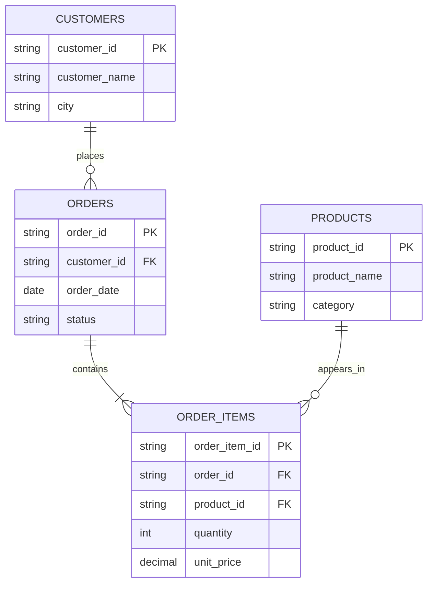
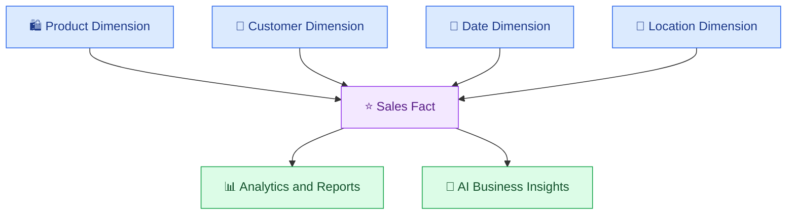

# 📊 08. Data Modeling and Analytics

[⬅️ Previous](07-data-quality-and-validation.md) ·

> 🎯 **Goal:** Learn how to organize data into meaningful structures, design analytical tables, calculate business metrics, and prepare trustworthy datasets for analytics and AI applications.

## 📚 1. What Is Data Modeling?

Data modeling is the process of defining how data is organized, connected, and represented.

Instead of storing every business detail in one large, confusing table, data modeling separates entities such as customers, products, orders, and payments into structures that match how the business operates.

A good data model helps prevent duplicated information, inconsistent updates, incorrect calculations, and confusing reports.

## 🧩 2. Important Data Modeling Concepts

- **Entity:** A business object, such as a customer, product, or order.
- **Attribute:** A property of an entity, such as a customer's city.
- **Primary key:** A field or combination of fields that uniquely identifies a record.
- **Foreign key:** A field that references a record in another table.
- **Relationship:** A connection between entities.
- **Fact table:** A table that records measurable business events.
- **Dimension table:** A table that describes the context of those events.

## 🏗️ 3. Example: Online Boutique Data Model

An online boutique may maintain customers, products, orders, and order items.



This model avoids repeating the customer's name and city in every order item. The application can retrieve those details through relationships when required.

The diagram describes a possible model. A production design may need additional tables for product variants, payments, returns, shipments, and inventory locations.

## 🧱 4. OLTP vs OLAP

**OLTP — Online Transaction Processing**

Supports day-to-day business operations, such as placing orders, updating inventory, and recording payments.

**OLAP — Online Analytical Processing**

Supports analysis across many records, such as calculating monthly revenue, identifying trends, and comparing product categories.

| Feature | OLTP | OLAP |
|---|---|---|
| Main purpose | Run business transactions | Analyze business data |
| Typical operations | Insert, update, retrieve individual records | Aggregate and analyze many records |
| Data focus | Current operational state | Historical and analytical views |
| Example | Record a customer order | Compare quarterly sales |
| Design emphasis | Transaction correctness | Analytical query efficiency |

The systems can be integrated, but analytical workloads are often separated from operational systems to reduce interference and support historical analysis.

## 📐 5. Normalization and Denormalization

### Normalization

Normalization organizes data to reduce unnecessary duplication and update anomalies.

For example, customer details should usually be stored in a customer table rather than repeated independently across every order.

### Denormalization

Denormalization deliberately combines or duplicates information to simplify queries or improve analytical performance.

For example, an analytics table might contain the product category alongside each sales record so reports can aggregate revenue without repeatedly joining several tables.

Neither approach should be applied blindly. Transactional systems often favor normalized designs, while analytical models may use denormalized structures for usability and performance.

## ⭐ 6. Star Schema for Analytics

A star schema is a common analytical model consisting of a central fact table connected to descriptive dimension tables.



### Example sales fact table

| order_id | product_id | date_key | quantity | revenue |
|---|---|---|---:|---:|
| O101 | P101 | 20261001 | 2 | 1598 |
| O102 | P102 | 20261001 | 1 | 899 |
| O103 | P101 | 20261002 | 3 | 2397 |

The fact table records sales activity. Product and date dimensions provide descriptive information for grouping and filtering the results.

Before building a fact table, define its **grain**: what exactly does one row represent? In this example, one row represents a sales line for a product on an order date. Clear grain prevents accidental double-counting.

## 🐍 7. Hands-On Example: Build an Analytical Summary

Create `sales.csv`:

```csv
order_id,product,category,quantity,unit_price
O101,Blue Kurti,Clothing,2,799
O102,Red Kurti,Clothing,1,899
O103,Backpack,Accessories,3,1200
O104,Notebook,Stationery,5,100
```

Create `sales_analytics.py`:

```python
import pandas as pd

df = pd.read_csv("sales.csv")

required = {
    "order_id",
    "product",
    "category",
    "quantity",
    "unit_price",
}

missing = required - set(df.columns)

if missing:
    raise ValueError(
        f"Missing columns: {sorted(missing)}"
    )

if df["order_id"].isna().any():
    raise ValueError("Order IDs cannot be missing.")

if df["order_id"].duplicated().any():
    raise ValueError("Duplicate order IDs found.")

df["quantity"] = pd.to_numeric(
    df["quantity"],
    errors="raise",
)
df["unit_price"] = pd.to_numeric(
    df["unit_price"],
    errors="raise",
)

if (df["quantity"] < 0).any():
    raise ValueError("Quantity cannot be negative.")

if (df["unit_price"] < 0).any():
    raise ValueError("Unit price cannot be negative.")

df["revenue"] = df["quantity"] * df["unit_price"]

category_summary = (
    df.groupby("category", as_index=False)
      .agg(
          total_units=("quantity", "sum"),
          total_revenue=("revenue", "sum"),
      )
      .sort_values("total_revenue", ascending=False)
)

product_summary = (
    df.groupby("product", as_index=False)
      .agg(
          total_units=("quantity", "sum"),
          total_revenue=("revenue", "sum"),
      )
      .sort_values("total_revenue", ascending=False)
)

category_summary.to_csv(
    "category_summary.csv",
    index=False,
)
product_summary.to_csv(
    "product_summary.csv",
    index=False,
)

print("Total revenue:", df["revenue"].sum())
print("\nRevenue by category:")
print(category_summary)
print("\nRevenue by product:")
print(product_summary)
```

Run:

```powershell
python -m pip install pandas
python sales_analytics.py
```

Expected total revenue: **7,294**.

The category and product summaries provide a cleaner view of business performance than the raw transaction file.

## 📈 8. Common Analytical Metrics

### Total revenue

\[
\text{Revenue} = \sum(\text{Quantity} \times \text{Unit Price})
\]

### Average order value

\[
\text{Average Order Value} =
\frac{\text{Total Revenue}}{\text{Number of Orders}}
\]

### Product sales contribution

\[
\text{Sales Contribution} =
\frac{\text{Product Revenue}}{\text{Total Revenue}}
\times 100
\]

Define each metric carefully. For example, average order value should use distinct orders rather than counting individual order-item rows as separate orders.

## 🤖 9. Why Data Modeling Matters for AI

A well-designed analytical dataset allows an AI application to work with meaningful information instead of ambiguous raw records.

Examples:
- A sales assistant summarizes revenue by category.
- A recommendation system uses product and customer features.
- A reporting assistant answers questions about monthly performance.
- A business chatbot retrieves verified product and policy information.

For numerical questions, calculate results using SQL or Python and provide the verified result to the model. Do not rely on an LLM to perform critical financial calculations from an unstructured collection of transaction records.

## ⚠️ 10. Common Mistakes

❌ Building reports without defining the grain of a fact table.

❌ Joining tables with non-unique keys and accidentally multiplying totals.

❌ Mixing order-level and order-item-level measures.

❌ Calculating average order value using the number of item rows.

❌ Duplicating dimensions without an update strategy.

❌ Treating an analytical summary as a substitute for current operational data.

## 🏆 11. Best Practices

- Identify the business entities and their relationships.
- Define primary keys and foreign-key relationships.
- Document the grain of every fact table.
- Separate facts from descriptive dimensions where appropriate.
- Validate row counts and totals after joins.
- Define business metrics precisely and consistently.
- Keep historical and current-state requirements clear.
- Give AI applications structured, verified results rather than ambiguous raw data.

## 🎯 Key Takeaways

- Data modeling organizes business entities and relationships.
- Normalization reduces duplication; denormalization can simplify analytical queries.
- Star schemas connect measurable facts to descriptive dimensions.
- Clear table grain and validated joins prevent incorrect analytics.
- Well-modeled data supports more reliable AI-generated business insights.
