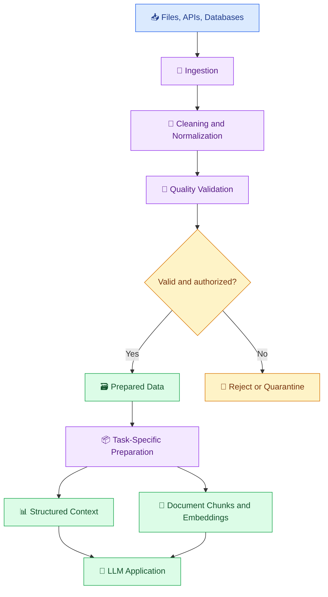

# 🤖 09. Data Pipelines for AI and LLMs

[⬅️ Back to Learning Modules](../README.md) · 

> 🎯 **Goal:** Learn how to prepare structured data, documents, and API responses for large language models (LLMs) and AI-powered applications.

## 📚 1. What Is an AI Data Pipeline?

An AI data pipeline is a workflow that collects, validates, transforms, and delivers data to an AI application in a usable format.

Traditional data pipelines often prepare data for dashboards, reports, and analytical queries. AI data pipelines may additionally prepare documents for retrieval, assemble model context, generate embeddings, or supply structured records to an LLM.

For example, a customer-support assistant may need product details, return policies, and support articles. A data pipeline makes that information available, current, and consistent before the assistant uses it.

## 🧩 2. Types of Data Used by AI Applications

| Data type | Example | Possible preparation |
|---|---|---|
| Structured | Product tables, sales records | Validate columns, types, and business rules |
| Semi-structured | JSON API responses | Normalize fields and handle nested values |
| Text documents | PDFs, Markdown, support articles | Extract text, clean content, preserve metadata |
| Images | Product photos, scanned pages | Extract metadata or use OCR when appropriate |
| Audio and video | Meetings, lectures, recordings | Transcribe, segment, and preserve timestamps |
| Event data | User actions and application logs | Filter, aggregate, and validate event records |

The right preparation depends on the model's capabilities and the task. Not every dataset needs embeddings, and not every AI application needs RAG.

## 🏗️ 3. AI Data Pipeline Architecture



## 🔄 4. How AI Data Preparation Differs from Traditional ETL

Traditional ETL may produce a clean sales table with consistent numeric values. An AI workflow may need more steps, depending on the use case:

- Extract text from documents.
- Preserve document titles and source identifiers.
- Split long documents into manageable chunks.
- Remove irrelevant navigation or repeated boilerplate.
- Generate embeddings for semantic retrieval.
- Apply access-control metadata.
- Assemble only the relevant information into a model request.

The goal is not to transform all data into one universal AI format. It is to prepare each dataset for the task that will consume it.

## 🐍 5. Hands-On Example: Prepare FAQ Data

Create `faqs.json`:

```json
[
  {
    "id": "FAQ-001",
    "question": "When does the library close?",
    "answer": "The sample library schedule lists closing at 6 PM on weekdays."
  },
  {
    "id": "FAQ-002",
    "question": "How can students access the campus portal?",
    "answer": "Students should use the official campus portal and contact IT support if access fails."
  },
  {
    "id": "FAQ-003",
    "question": "Where are examination dates published?",
    "answer": "Students should consult official examination notifications."
  }
]
```

Create `prepare_faqs.py`:

```python
import json
from pathlib import Path

source = Path("faqs.json")
destination = Path("prepared_faqs.json")

with source.open(encoding="utf-8") as file:
    records = json.load(file)

if not isinstance(records, list):
    raise ValueError("Expected a list of FAQ records.")

prepared = []
seen_ids = set()

for record in records:
    record_id = str(record.get("id", "")).strip()
    question = str(record.get("question", "")).strip()
    answer = str(record.get("answer", "")).strip()

    if not record_id or not question or not answer:
        continue

    if record_id in seen_ids:
        raise ValueError(f"Duplicate FAQ ID: {record_id}")

    seen_ids.add(record_id)

    prepared.append({
        "id": record_id,
        "question": question,
        "answer": answer,
        "text_for_retrieval": f"{question}\n{answer}",
        "source_type": "faq",
    })

destination.write_text(
    json.dumps(prepared, indent=2, ensure_ascii=False),
    encoding="utf-8",
)

print("Input records:", len(records))
print("Prepared records:", len(prepared))
print("Output:", destination)
```

Run:

```powershell
python prepare_faqs.py
```

This example validates and normalizes FAQ records before they enter a retrieval workflow. A production pipeline should also track source versions, update timestamps, access permissions, and rejected records.

## 🧠 6. Structured Context vs Document Retrieval

There are two common ways to provide information to an LLM.

### 📊 Structured context

Use this when the required data is already available in a structured form.

Example: a Python function retrieves verified sales totals and provides the result to an LLM for explanation.

```python
sales_summary = {
    "month": "October",
    "total_orders": 125,
    "total_revenue": 185000,
}
```

The application should calculate and validate these values before asking the model to describe them.

### 📚 Document retrieval

Use this when answers depend on unstructured or semi-structured sources such as manuals, policies, or support articles.

The application retrieves relevant passages and provides them to the model as context. Embeddings and vector search are common techniques for this workflow.

## 🧾 7. Metadata and Data Lineage

AI-ready records should preserve useful metadata.

Example:

```json
{
  "document_id": "POLICY-001",
  "title": "Library Policy",
  "source": "official_library_policy.pdf",
  "version": "2026-01",
  "updated_at": "2026-10-01",
  "access_level": "public",
  "text": "The library schedule is listed in the official policy."
}
```

Metadata helps the system identify where information came from, determine whether it is current, apply access rules, and return source references.

Only use source versions and timestamps that your pipeline can verify. Do not assign a recent date simply because a document was ingested recently.

## 🔐 8. Prepare Data Safely

Before making data available to an AI application:

- Remove unnecessary personal or confidential information.
- Validate source permissions and access rules.
- Treat document contents as untrusted input.
- Avoid placing secrets in model prompts.
- Preserve provenance and source identifiers.
- Define a retention and deletion strategy.
- Ensure retrieved data is authorized for the requesting user.

Cleaning text does not automatically make it safe. A document can contain malicious instructions even when its formatting is perfectly valid.

## 🏪 9. Real-World Scenario: AI Support Assistant

An online boutique has product catalogs, delivery FAQs, and return policies in separate files.

The pipeline:
1. Ingests authorized files.
2. Extracts and normalizes text.
3. Validates required fields and source versions.
4. Removes irrelevant repeated content.
5. Stores prepared documents and metadata.
6. Makes them available for retrieval.
7. Supplies relevant information to the AI application.
8. Returns an answer with source references where possible.

When a policy changes, the pipeline should update or remove the old version rather than continuing to retrieve outdated information.

## ⚠️ 10. Common Mistakes

❌ Sending entire document collections to the model for every question.

❌ Losing source IDs during text extraction.

❌ Using stale data without a refresh strategy.

❌ Assuming every structured dataset requires embeddings.

❌ Treating the latest-ingested document as the most authoritative document.

❌ Removing metadata that is needed for permissions or citations.

## 🏆 11. Best Practices

- Prepare data according to the task.
- Keep raw inputs separate from prepared outputs.
- Preserve stable IDs, source information, and version metadata.
- Validate schemas before publishing data.
- Design repeatable ingestion and update workflows.
- Measure retrieval quality separately from answer quality.
- Protect private data throughout the pipeline.
- Reprocess affected records when source content changes.

## 🎯 Key Takeaways

- AI data pipelines prepare structured records and documents for downstream AI tasks.
- Data quality, metadata, provenance, and freshness affect AI reliability.
- Structured context and document retrieval serve different use cases.
- Security and access control must remain part of the data pipeline.

**Next:** Learn how embeddings and vector indexes support semantic search.