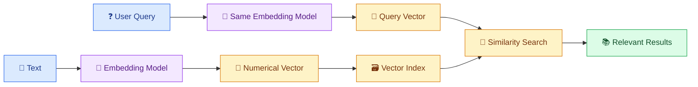
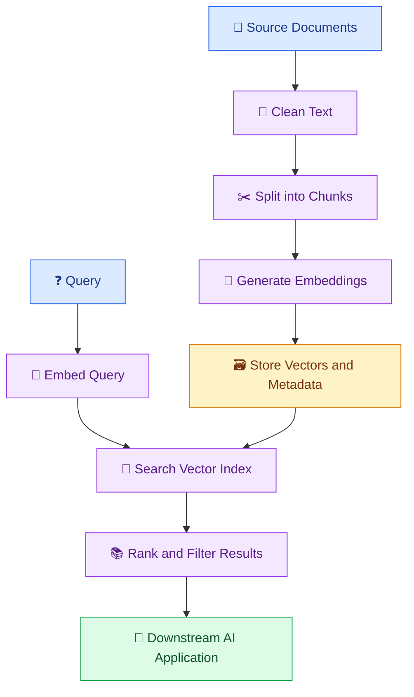

# 🧠 10. Embeddings and Vector Data Pipelines

[⬅️ Previous](09-data-pipelines-for-ai-and-llms.md) ·

> 🎯 **Goal:** Understand embeddings, vector representations, semantic similarity, and how to build a pipeline that prepares text for semantic search and AI applications.

## 📚 1. What Are Embeddings?

An embedding is a numerical representation of information, such as text or an image, that captures useful patterns in its content.

For text, an embedding model converts a sentence or passage into a vector — a list of numbers.

For example, these sentences have related meanings:

- "How can I reset my password?"
- "I cannot sign in to my account."
- "What is the capital of France?"

An embedding model may represent the first two sentences as more similar than either is to the third. This depends on the model and its training; embeddings do not guarantee that two texts with similar vectors are factually equivalent.

## 🔢 2. From Text to Vectors



The same embedding model and compatible preprocessing should generally be used for documents and queries within an index. If you change the embedding model, you may need to regenerate the stored vectors.

## 🆚 3. Keyword Search vs Semantic Search

| Keyword search | Semantic search |
|---|---|
| Matches words and terms | Compares vector representations |
| Works well for exact IDs and names | Can find conceptually related wording |
| May miss synonyms | May retrieve related but irrelevant passages |
| Often uses inverted indexes | Often uses vector indexes or vector databases |

Many real systems combine both approaches. Hybrid retrieval can use exact keyword matches for identifiers and semantic similarity for natural-language questions.

## 📐 4. How Similarity Is Measured

One common measure is cosine similarity:

\[
\operatorname{cosine}(A,B)=
\frac{A\cdot B}{\|A\|\|B\|}
\]

It compares the direction of two vectors. Higher similarity often indicates a closer semantic match for a suitable embedding model, but it is not a probability that an answer is correct.

The most useful metric and score threshold depend on the model, data, and retrieval task. Do not assume that a universal similarity threshold works for every dataset.

## 🗃️ 5. What Is a Vector Database?

A vector database or vector index stores embeddings and helps find vectors similar to a query vector.

Common options include:

- **FAISS:** A library for efficient vector similarity search.
- **Chroma:** A vector database commonly used in AI prototypes and applications.
- **pgvector:** Vector search capabilities for PostgreSQL.
- **Pinecone:** A managed vector database service.

These tools differ in deployment, filtering, persistence, scaling, and operational capabilities. Choose based on your workload and requirements.

A stored vector normally needs associated metadata such as:

```json
{
  "chunk_id": "DOC-001-CHUNK-02",
  "document_id": "DOC-001",
  "text": "Students should check official examination notifications.",
  "source": "exam_guide.md",
  "version": "2026-10"
}
```

The vector helps retrieve a chunk, while metadata identifies the source and enables filtering.

## 🐍 6. Hands-On Example: Generate Text Embeddings

Install the dependencies:

```powershell
python -m pip install openai numpy python-dotenv
```

Create `.env`:

```env
OPENAI_API_KEY=your_actual_api_key
```

Create `generate_embeddings.py`:

```python
import os

import numpy as np
from dotenv import load_dotenv
from openai import OpenAI

load_dotenv()

api_key = os.getenv("OPENAI_API_KEY")

if not api_key:
    raise RuntimeError("OPENAI_API_KEY is not configured.")

client = OpenAI(api_key=api_key)

texts = [
    "How do I reset my account password?",
    "I cannot sign in to my account.",
    "The capital of France is Paris.",
]

response = client.embeddings.create(
    model="text-embedding-3-small",
    input=texts,
)

vectors = [
    np.array(item.embedding, dtype=np.float32)
    for item in response.data
]

print("Number of vectors:", len(vectors))
print("Vector dimensions:", len(vectors[0]))


def cosine_similarity(a, b):
    denominator = np.linalg.norm(a) * np.linalg.norm(b)

    if denominator == 0:
        return 0.0

    return float(np.dot(a, b) / denominator)


for i in range(len(texts)):
    for j in range(i + 1, len(texts)):
        score = cosine_similarity(vectors[i], vectors[j])

        print(f"\nSimilarity: {score:.4f}")
        print("Text A:", texts[i])
        print("Text B:", texts[j])
```

Run:

```powershell
python generate_embeddings.py
```

The script generates vectors and compares the text pairs. The exact scores depend on the embedding model. The example requires API access and may incur usage charges.

## 🗂️ 7. Build a Small Persistent Vector Dataset

The following example stores embeddings and metadata in a JSON file. It is suitable for learning and a small demonstration, not a replacement for a production vector database.

Create `build_vector_dataset.py`:

```python
import json
import os
from pathlib import Path

import numpy as np
from dotenv import load_dotenv
from openai import OpenAI

load_dotenv()

api_key = os.getenv("OPENAI_API_KEY")

if not api_key:
    raise RuntimeError("OPENAI_API_KEY is not configured.")

client = OpenAI(api_key=api_key)

documents = [
    {
        "id": "DOC-001",
        "text": "The library closes at 6 PM on weekdays.",
        "source": "library_policy.md",
    },
    {
        "id": "DOC-002",
        "text": "Students should consult official exam notifications.",
        "source": "exam_guide.md",
    },
    {
        "id": "DOC-003",
        "text": "Contact IT support for campus portal access issues.",
        "source": "it_support.md",
    },
]

response = client.embeddings.create(
    model="text-embedding-3-small",
    input=[document["text"] for document in documents],
)

records = []

for document, item in zip(documents, response.data):
    records.append({
        **document,
        "embedding": item.embedding,
    })

output = Path("vector_dataset.json")

output.write_text(
    json.dumps(records, indent=2),
    encoding="utf-8",
)

print("Saved records:", len(records))
print("Output:", output)
```

Create `search_vector_dataset.py`:

```python
import json
import os
from pathlib import Path

import numpy as np
from dotenv import load_dotenv
from openai import OpenAI

load_dotenv()

api_key = os.getenv("OPENAI_API_KEY")

if not api_key:
    raise RuntimeError("OPENAI_API_KEY is not configured.")

client = OpenAI(api_key=api_key)

dataset_path = Path("vector_dataset.json")

records = json.loads(
    dataset_path.read_text(encoding="utf-8")
)

question = input("Ask a question: ").strip()

if not question:
    raise ValueError("Question cannot be empty.")

response = client.embeddings.create(
    model="text-embedding-3-small",
    input=[question],
)

query_vector = np.array(
    response.data[0].embedding,
    dtype=np.float32,
)


def cosine_similarity(a, b):
    a = np.asarray(a, dtype=np.float32)
    b = np.asarray(b, dtype=np.float32)

    denominator = np.linalg.norm(a) * np.linalg.norm(b)

    if denominator == 0:
        return 0.0

    return float(np.dot(a, b) / denominator)


ranked = []

for record in records:
    score = cosine_similarity(
        query_vector,
        record["embedding"],
    )

    ranked.append((score, record))

ranked.sort(key=lambda item: item[0], reverse=True)

for score, record in ranked[:3]:
    print(f"\nSimilarity: {score:.4f}")
    print("Document:", record["id"])
    print("Source:", record["source"])
    print("Text:", record["text"])
```

Run the scripts in order:

```powershell
python build_vector_dataset.py
python search_vector_dataset.py
```

The search returns the three highest-scoring records from the small dataset. With only three documents, it is a teaching example. A real application should use an appropriate retrieval threshold, metadata filters, and evaluation to avoid presenting irrelevant matches as reliable evidence.

## 🔄 8. The Vector Data Pipeline Lifecycle



A robust pipeline should also support document updates, deletions, failed embedding requests, duplicate detection, and reindexing when the embedding model changes.

## ⚠️ 9. Common Mistakes

❌ Embedding an entire large document as one unit without considering retrieval needs.

❌ Using incompatible embedding models for stored documents and queries.

❌ Losing source metadata when saving vectors.

❌ Assuming a high similarity score guarantees factual correctness.

❌ Recomputing every embedding unnecessarily after each update.

❌ Ignoring document access permissions during retrieval.

## 🏆 10. Best Practices

- Select chunk sizes based on document structure and retrieval evaluation.
- Preserve source IDs, versions, and permissions.
- Reuse existing embeddings when the source content has not changed.
- Store model and preprocessing versions with the index.
- Use metadata filtering for relevant and authorized results.
- Evaluate retrieval precision and recall with representative queries.
- Use a persistent index or vector database when the workload outgrows a small local dataset.
- Establish a deletion and reindexing strategy.

## 🎯 Key Takeaways

- Embeddings represent information as numerical vectors.
- Similarity search helps retrieve semantically related content.
- Vector records need metadata and lifecycle management.
- Retrieval quality must be measured rather than assumed.
- Vector pipelines are a foundation for many RAG applications.

**Next:** Combine document extraction, chunking, embeddings, indexing, and metadata into a repeatable RAG ingestion pipeline.