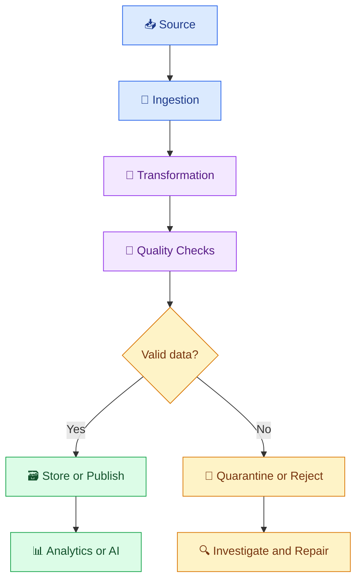
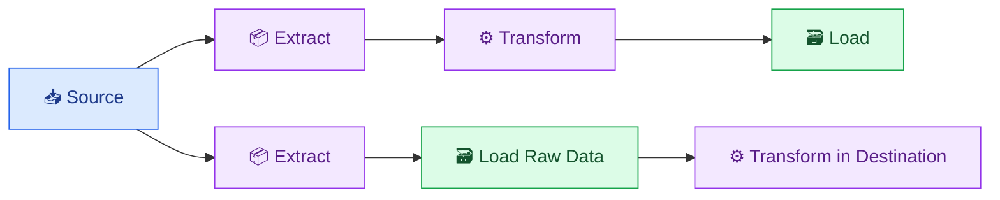

# 🏗️ 02. Data Engineering Fundamentals

[⬅️ Previous](01-introduction-to-ai-data-engineering.md) ·

> 🎯 **Goal:** Understand the core concepts of data sources, pipelines, batch processing, streaming, ETL/ELT, and data storage.

## 📚 1. What Is a Data Pipeline?

A data pipeline is a series of connected steps that moves data from a source to a destination, often transforming and validating it along the way.

For example, a sales pipeline may read order records, validate prices, calculate revenue, and publish a daily sales report.

## 🔄 2. Anatomy of a Data Pipeline



Every pipeline should define what data it accepts, what transformations it performs, how failures are handled, and how its output is verified.

## 📥 3. Common Data Sources

- 📄 Files: CSV, JSON, Parquet, Excel.
- 🗄️ Databases: PostgreSQL, MySQL, and other relational systems.
- 🌐 REST APIs: Product catalogs, weather services, payments, and business applications.
- 📨 Events: Application activity, transactions, and telemetry.
- 📚 Documents: PDF, Markdown, text, and knowledge articles.
- 🖼️ Media: Images, audio, and video used in multimodal AI systems.

Different sources may have different schemas, update frequencies, access permissions, and reliability characteristics.

## ⚖️ 4. Batch vs Streaming

### 📦 Batch processing

Batch processing handles a group of records together, often on a schedule.

Examples:
- Calculate daily sales totals.
- Import yesterday's transactions.
- Refresh a document index overnight.

### 🌊 Streaming processing

Streaming processes a continuing flow of events as they arrive, often with low latency.

Examples:
- Detect suspicious transactions.
- Update live inventory.
- Process application events.
- Monitor incoming IoT sensor data.

| Characteristic | Batch | Streaming |
|---|---|---|
| Input | Collected records | Continuous events |
| Timing | Scheduled or triggered | Continuous or near-real-time |
| Typical complexity | Often simpler to start | Requires careful event and state handling |
| Common use | Reports, bulk imports | Live alerts, event-driven systems |
| Freshness | Depends on schedule | Can be seconds or less, depending on design |

Not every workload needs streaming. Batch processing is often cheaper and simpler when immediate updates are unnecessary.

## 🔄 5. ETL vs ELT

**ETL** means Extract, Transform, Load.

1. Extract data from a source.
2. Transform it before loading it into the target.
3. Load the prepared result.

**ELT** means Extract, Load, Transform.

1. Extract data from a source.
2. Load it into the destination.
3. Transform it using the destination's processing capabilities.



ETL can be useful when data must be transformed before entering a target system. ELT is common when the destination has powerful storage and compute capabilities and retaining raw data is useful.

## 🗃️ 6. Data Lake vs Data Warehouse

A **data lake** stores data in many formats, often including raw files and semi-structured information.

A **data warehouse** is designed for structured, organized data and analytical queries.

A **lakehouse** combines data-lake storage with table management and analytical capabilities that support reliable data access and processing.

| System | Common strength |
|---|---|
| Database | Application transactions and structured records |
| Data lake | Flexible storage for diverse datasets |
| Data warehouse | Governed analytical queries and reporting |
| Lakehouse | Combining flexible storage with managed analytical tables |

These categories can overlap. Actual capabilities depend on the platform and architecture.

## 🧪 7. Hands-On Example: Build a Simple Pipeline

Create `orders.csv`:

```csv
order_id,product,quantity,unit_price
O101,Notebook,3,100
O102,Pen,10,20
O103,Backpack,2,1200
```

Create `sales_pipeline.py`:

```python
import pandas as pd

orders = pd.read_csv("orders.csv")

required = {
    "order_id",
    "product",
    "quantity",
    "unit_price",
}

missing = required - set(orders.columns)

if missing:
    raise ValueError(
        f"Missing required columns: {sorted(missing)}"
    )

if orders["order_id"].isna().any():
    raise ValueError("Order IDs cannot be missing.")

if orders["order_id"].duplicated().any():
    raise ValueError("Duplicate order IDs found.")

if (orders["quantity"] < 0).any():
    raise ValueError("Quantity cannot be negative.")

if (orders["unit_price"] < 0).any():
    raise ValueError("Unit price cannot be negative.")

orders["revenue"] = (
    orders["quantity"] * orders["unit_price"]
)

orders.to_csv("processed_orders.csv", index=False)

print("Total orders:", len(orders))
print("Total units:", int(orders["quantity"].sum()))
print("Total revenue:", orders["revenue"].sum())
print("Pipeline completed successfully.")
```

Install Pandas and run:

```powershell
python -m pip install pandas
python sales_pipeline.py
```

Expected output:

- Total orders: 3
- Total units: 15
- Total revenue: 3800

The example implements ingestion, validation, transformation, and output generation in one script. Larger systems usually separate these responsibilities into reusable modules.

## 🧠 8. Important Pipeline Concepts

### Idempotency

Running the same operation again should not unintentionally duplicate its effects. For example, rerunning a daily import should not create duplicate transactions.

### Schema

A schema defines the expected fields and data types, such as `order_id` as text and `quantity` as an integer.

### Data lineage

Lineage records where data came from and how it was transformed. It helps investigate incorrect reports and AI responses.

### Checkpointing

A checkpoint records progress so some workflows can resume after failure instead of starting from the beginning.

### Backfill

A backfill processes historical data again, often after a bug fix or a new transformation rule.

## ⚠️ 9. Common Mistakes

❌ Assuming every pipeline should run in real time.

❌ Loading data without validating its schema.

❌ Designing a pipeline that cannot safely be rerun.

❌ Ignoring late-arriving or duplicate events.

❌ Failing to document the source and meaning of fields.

❌ Treating a successful job status as proof of correct output.

## 🏆 10. Best Practices

- Define input and output contracts.
- Validate required fields and business rules.
- Use clear, modular pipeline stages.
- Make retries safe and bounded.
- Record run status, counts, and errors.
- Plan for schema changes and historical reprocessing.
- Keep sensitive information out of logs.
- Monitor both technical failures and data-quality failures.

## 📝 11. Practice Challenge

Extend the sales pipeline to process 100 or more sample orders.

Add:
- Duplicate detection.
- A report of rejected rows.
- A daily revenue summary.
- A repeatable execution process.
- A check that the generated revenue matches an independently calculated total.

## 🎯 Key Takeaways

- Data pipelines move and prepare information for downstream systems.
- Batch and streaming serve different freshness and complexity requirements.
- ETL transforms before loading; ELT loads before transforming.
- Reliable pipelines need validation, observability, and safe reruns.

**Next:** Use Python to turn these concepts into reusable data-processing workflows.