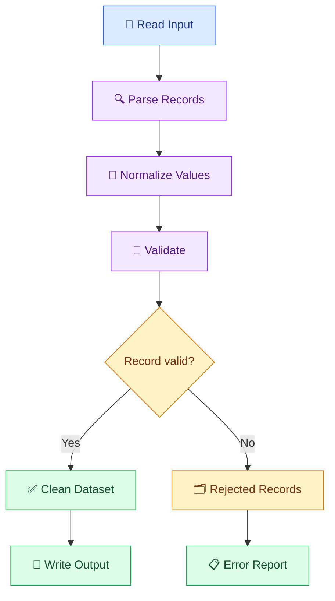

# 🐍 03. Python for AI Data Pipelines

[⬅️ Previous](02-data-engineering-fundamentals.md) ·

> 🎯 **Goal:** Learn to use Python to read data, clean records, validate inputs, transform datasets, and create reusable pipeline components.

## 📚 1. Why Python for Data Engineering?

Python is widely used for data processing because it provides readable syntax and libraries for working with files, APIs, databases, and AI services.

A typical pipeline might:
- Read a CSV file.
- Retrieve additional records from an API.
- Normalize field names and data types.
- Reject invalid records.
- Save the processed dataset.
- Send prepared data to an AI application.

## 🧩 2. Essential Python Concepts

| Concept | Data engineering use |
|---|---|
| Variables and data types | Store IDs, amounts, dates, and text |
| Lists and dictionaries | Represent collections of records |
| Functions | Reuse transformation logic |
| Loops | Process records one at a time |
| Exceptions | Handle missing files and invalid responses |
| Modules | Organize pipeline code |
| File handling | Read and write data |
| Type hints | Document expected inputs and outputs |

## 🔄 3. Python Pipeline Architecture



## 🐍 4. Hands-On Example: Transform Records

Create `raw_orders.json`:

```json
[
  {
    "order_id": " O101 ",
    "product": "Notebook",
    "quantity": "3",
    "price": "100"
  },
  {
    "order_id": "O102",
    "product": "Pen",
    "quantity": "10",
    "price": "20"
  },
  {
    "order_id": "",
    "product": "Unknown",
    "quantity": "invalid",
    "price": "50"
  }
]
```

Create `transform_orders.py`:

```python
import json
from pathlib import Path


def transform_order(record: dict) -> dict:
    order_id = str(record.get("order_id", "")).strip()
    product = str(record.get("product", "")).strip()

    if not order_id:
        raise ValueError("Missing order_id")

    if not product:
        raise ValueError("Missing product")

    try:
        quantity = int(record["quantity"])
        price = float(record["price"])
    except (KeyError, TypeError, ValueError) as exc:
        raise ValueError("Invalid quantity or price") from exc

    if quantity < 0 or price < 0:
        raise ValueError("Quantity and price must be non-negative")

    return {
        "order_id": order_id,
        "product": product,
        "quantity": quantity,
        "price": price,
        "revenue": quantity * price,
    }


def main():
    input_path = Path("raw_orders.json")

    with input_path.open(encoding="utf-8") as file:
        records = json.load(file)

    clean_records = []
    rejected_records = []

    for index, record in enumerate(records, start=1):
        try:
            clean_records.append(transform_order(record))
        except ValueError as exc:
            rejected_records.append({
                "record_number": index,
                "reason": str(exc),
            })

    Path("clean_orders.json").write_text(
        json.dumps(clean_records, indent=2),
        encoding="utf-8",
    )

    Path("rejected_orders.json").write_text(
        json.dumps(rejected_records, indent=2),
        encoding="utf-8",
    )

    print("Processed:", len(records))
    print("Accepted:", len(clean_records))
    print("Rejected:", len(rejected_records))


if __name__ == "__main__":
    main()
```

Run:

```powershell
python transform_orders.py
```

Expected result:

- Processed: 3
- Accepted: 2
- Rejected: 1

This approach preserves valid records while reporting rejected ones. In production, avoid silently discarding failures; capture enough safe metadata to investigate them.

## 📊 5. Working with Pandas

Pandas is useful when processing tabular data.

```python
import pandas as pd

df = pd.read_csv("orders.csv")

df["revenue"] = df["quantity"] * df["unit_price"]

summary = (
    df.groupby("product", as_index=False)
      .agg(
          total_units=("quantity", "sum"),
          total_revenue=("revenue", "sum"),
      )
)

summary.to_csv("product_summary.csv", index=False)

print(summary)
```

This creates a summary grouped by product.

Use ordinary Python for small, custom processing tasks and Pandas for many table-oriented workflows. Very large datasets may require distributed processing rather than loading everything into memory.

## 🌐 6. Reading Data from an API

An API may provide JSON records instead of a local file.

Install the package:

```powershell
python -m pip install requests
```

Example:

```python
import requests

url = "https://jsonplaceholder.typicode.com/posts"

response = requests.get(url, timeout=15)
response.raise_for_status()

records = response.json()

print("Number of records:", len(records))
print("First record:", records[0])
```

This public sample endpoint is suitable for learning. Real APIs may require authentication, pagination, rate-limit handling, and stricter validation.

## 🧱 7. Organize a Reusable Pipeline

As projects grow, split responsibilities into separate modules:

```text
data_pipeline/
├── main.py
├── extract.py
├── transform.py
├── validate.py
├── load.py
├── config.py
└── tests/
```

A clean design separates:

- **Extract:** Read data from the source.
- **Transform:** Standardize and enrich records.
- **Validate:** Check schemas and business rules.
- **Load:** Write results to the destination.
- **Orchestrate:** Run stages in the right order.

## ⚠️ 8. Common Mistakes

❌ Using broad exception handlers that hide failures.

❌ Assuming every JSON response has the expected structure.

❌ Loading enormous datasets into memory without considering scale.

❌ Mixing credentials into source code.

❌ Repeating the same transformation logic in several places.

❌ Losing rejected records without a trace.

## 🏆 9. Best Practices

- Use small, reusable functions.
- Add type hints and clear error messages.
- Validate inputs before transforming them.
- Set timeouts for network requests.
- Keep secrets in environment variables or a secret manager.
- Use tests for transformation rules.
- Log run metadata without exposing sensitive records.
- Make outputs reproducible and pipeline reruns safe.

## 📝 10. Practice Challenge

Build a Python pipeline that reads product records from a CSV file, validates each row, calculates inventory value, and writes clean and rejected records to separate outputs.

Add tests for missing product IDs, invalid prices, duplicate IDs, and empty input files.

## 🎯 Key Takeaways

- Python provides the building blocks for data ingestion and transformation.
- Functions and modules make pipelines easier to test and maintain.
- Validation and rejected-record reporting prevent silent data loss.
- Choose tools based on dataset size and operational requirements.

**Next:** Learn SQL techniques for querying and transforming structured data.