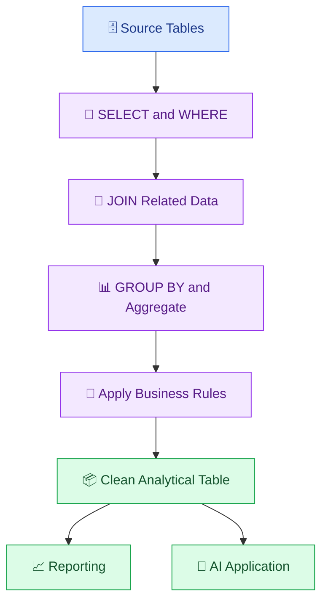

# 🗃️ 04. SQL and Data Transformation

[⬅️ Previous](03-python-for-ai-data-pipelines.md) ·

> 🎯 **Goal:** Learn how SQL retrieves, filters, joins, aggregates, and transforms structured data for analytics and AI applications.

## 📚 1. What Is SQL?

SQL stands for Structured Query Language. It is used to work with data stored in relational database systems.

Data engineers use SQL to:
- Extract records from databases.
- Filter and combine datasets.
- Calculate business metrics.
- Validate relationships between tables.
- Build clean tables for reporting and AI workflows.

## 🧱 2. A Simple Data Model

Consider two tables: `customers` and `orders`.

**customers**

| customer_id | customer_name | city |
|---|---|---|
| C101 | Anika | Hyderabad |
| C102 | Ravi | Chennai |
| C103 | Meera | Hyderabad |

**orders**

| order_id | customer_id | amount |
|---|---|---:|
| O101 | C101 | 1200 |
| O102 | C102 | 800 |
| O103 | C101 | 500 |

The `customer_id` column connects orders to their customers.

## 🔄 3. SQL Transformation Workflow



## 🔍 4. Basic SQL Queries

### Select records

```sql
SELECT customer_id, customer_name, city
FROM customers;
```

### Filter records

```sql
SELECT order_id, customer_id, amount
FROM orders
WHERE amount >= 1000;
```

### Sort records

```sql
SELECT order_id, amount
FROM orders
ORDER BY amount DESC;
```

### Aggregate records

```sql
SELECT
    customer_id,
    COUNT(*) AS order_count,
    SUM(amount) AS total_spend
FROM orders
GROUP BY customer_id;
```

Aggregations turn transaction-level data into useful summaries.

## 🔗 5. Join Related Tables

To show customer names alongside their orders:

```sql
SELECT
    o.order_id,
    c.customer_name,
    c.city,
    o.amount
FROM orders AS o
INNER JOIN customers AS c
    ON o.customer_id = c.customer_id;
```

An `INNER JOIN` returns records with matching values in both tables.

A `LEFT JOIN` keeps every record from the left table and adds matching values from the right table where available.

Example: find customers who have not placed any orders.

```sql
SELECT
    c.customer_id,
    c.customer_name
FROM customers AS c
LEFT JOIN orders AS o
    ON c.customer_id = o.customer_id
WHERE o.order_id IS NULL;
```

## 🧮 6. Create a Clean Analytical Dataset

A common data engineering task is preparing a table that combines raw transactions with customer information.

```sql
SELECT
    c.customer_id,
    c.customer_name,
    c.city,
    COUNT(o.order_id) AS order_count,
    COALESCE(SUM(o.amount), 0) AS total_spend
FROM customers AS c
LEFT JOIN orders AS o
    ON c.customer_id = o.customer_id
GROUP BY
    c.customer_id,
    c.customer_name,
    c.city;
```

`COALESCE` replaces a `NULL` result with the supplied fallback value.

This query creates one summary row per customer, which can be used for reporting or as a source for a carefully designed AI feature.

## 🪟 7. Window Functions

Window functions calculate values across related rows without collapsing the result to one row per group.

For example, rank orders by amount:

```sql
SELECT
    order_id,
    customer_id,
    amount,
    RANK() OVER (
        PARTITION BY customer_id
        ORDER BY amount DESC
    ) AS customer_order_rank
FROM orders;
```

Common window functions include:
- `ROW_NUMBER()` — assigns a sequential number to rows.
- `RANK()` — ranks rows, allowing ties.
- `LAG()` — retrieves a value from an earlier row.
- `SUM() OVER (...)` — calculates a running or group-level total.

These functions are useful for trend analysis, deduplication, and time-based calculations.

## 🧪 8. Data Quality Checks with SQL

### Find duplicate order IDs

```sql
SELECT
    order_id,
    COUNT(*) AS record_count
FROM orders
GROUP BY order_id
HAVING COUNT(*) > 1;
```

### Find invalid amounts

```sql
SELECT *
FROM orders
WHERE amount < 0
   OR amount IS NULL;
```

### Find orders without a matching customer

```sql
SELECT o.*
FROM orders AS o
LEFT JOIN customers AS c
    ON o.customer_id = c.customer_id
WHERE c.customer_id IS NULL;
```

These queries can become part of automated data pipeline checks.

## 🤖 9. Why SQL Matters for AI

AI applications often require structured data before generating an answer or making a prediction.

Examples include:
- Retrieving eligible products before generating recommendations.
- Calculating sales summaries before asking an LLM to explain trends.
- Selecting permitted customer records before an AI assistant uses them.
- Filtering documents or events by date and category before downstream processing.

**Important:** Use SQL and backend authorization to control which records are accessible. Do not rely on an AI model to enforce database permissions.

## ⚠️ 10. Common Mistakes

❌ Joining tables on the wrong key.

❌ Ignoring duplicate records before calculating totals.

❌ Using `COUNT(*)` when the intended count should exclude missing values in a particular column.

❌ Forgetting that SQL comparisons with `NULL` require `IS NULL` or `IS NOT NULL`.

❌ Aggregating after an unintended one-to-many join, which can inflate totals.

❌ Using unrestricted SQL generated by an AI model against production databases.

## 🏆 11. Best Practices

- Use explicit column names instead of `SELECT *` in production transformations.
- Choose the correct join type.
- Check key uniqueness and relationships.
- Validate aggregate results against known totals.
- Use parameterized queries when application values are supplied.
- Restrict database permissions.
- Test transformations with representative datasets.
- Document important business definitions.

## 🎯 Key Takeaways

- SQL is essential for querying and transforming structured data.
- Joins and aggregations combine raw records into useful datasets.
- Window functions support ranking and analytical calculations.
- SQL-based quality checks help detect duplicates, invalid values, and broken relationships.
- Secure data access must be enforced by the application and database.

**Next:** Learn how to ingest data from files, databases, and APIs and organize the process using ETL and ELT patterns.