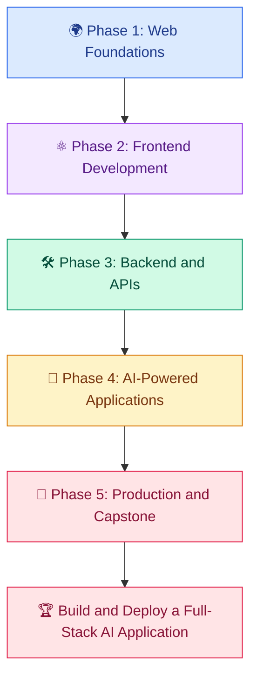

# 🌐 AI Developer – Web Development Learning Modules

> Venkata Bhattaram (c) 2026

An extensive, beginner-to-advanced **AI Developer – Web Development Learning Modules** with hands-on projects and practical code examples — from understanding HTML, CSS, JavaScript, and TypeScript to building modern React and Next.js applications, developing backend APIs, integrating AI models, implementing secure authentication, and deploying production-ready AI-powered web applications.

This Learning Modules combines the foundations of modern web development with the practical skills required to build intelligent, interactive, scalable, and user-friendly applications.

---

## 🎯 What You Will Learn

- 🌍 Understand how the web, browsers, servers, HTTP, and APIs work.
- 🎨 Build responsive, accessible, and visually engaging user interfaces.
- ⚡ Develop interactive applications using JavaScript, TypeScript, and React.
- 🧩 Build full-stack applications using Next.js and Node.js.
- 🔌 Design REST APIs and integrate external services.
- 🗄️ Work with databases, authentication, authorization, and file storage.
- 🤖 Integrate large language models and AI APIs into web applications.
- 💬 Build AI chatbots, streaming interfaces, semantic search, and RAG applications.
- 🔐 Apply security, testing, accessibility, and performance best practices.
- 🚀 Deploy, monitor, and maintain production-ready web applications.
- 🏗️ Complete a full-stack capstone that combines web development and AI.

---

## 🧰 Technology Stack

| Category | Technologies |
|---|---|
| Web foundations | HTML5, CSS3, JavaScript |
| Type safety | TypeScript |
| Frontend | React |
| Full-stack framework | Next.js |
| Styling | Tailwind CSS, CSS Modules |
| Backend | Node.js, Express.js |
| APIs | REST, JSON, HTTP |
| Databases | PostgreSQL, SQL |
| AI integration | LLM APIs, embeddings, tool calling, RAG |
| Authentication | Sessions, tokens, OAuth concepts |
| Testing | Unit, integration, and end-to-end testing |
| Development tools | Git, GitHub, VS Code, npm |
| Deployment | Cloud hosting, environment configuration, CI/CD |
| Monitoring | Logs, metrics, error tracking, performance analysis |

Tools and libraries will be introduced when they are needed. You do not need to master the entire stack before starting.

---

## 🗺️ Curriculum Roadmap

---

# 📚 Phase 1: Web Development Foundations

Learn how websites work and develop the core skills required to build modern web interfaces.

1. [Introduction to AI-Powered Web Development](foundations/01-introduction-to-ai-powered-web-development.md)
2. [HTML, CSS, and Modern JavaScript](foundations/02-html-css-and-modern-javascript.md)
3. [Responsive Web Design and UI Fundamentals](foundations/03-responsive-web-design-and-ui-fundamentals.md)
4. [TypeScript and Modern Frontend Development](foundations/04-typescript-and-modern-frontend-development.md)

# ⚛️ Phase 2: Frontend Application Development

Build reusable components, interactive interfaces, and complete frontend applications.

5. [React Fundamentals and Components](frontend-application-development/05-react-fundamentals-and-components.md)
6. [State Management, Hooks, and Forms](frontend-application-development/06-state-management-hooks-and-forms.md)
7. [Next.js and Full-Stack Web Applications](frontend-application-development/07-nextjs-and-full-stack-web-applications.md)
8. [UI Libraries, Design Systems, and Interactive Dashboards](frontend-application-development/08-ui-libraries-design-systems-and-interactive-dashboards.md)

# 🛠️ Phase 3: Backend and Web APIs

Develop server-side logic, integrate services, manage data, and implement file handling.

9. [Backend Development with Node.js](topics/09-backend-development-with-nodejs.md)
10. [REST APIs and API Integration](topics/10-rest-apis-and-api-integration.md)
11. [Databases, Authentication, and Authorization](topics/11-databases-authentication-and-authorization.md)
12. [File Uploads, Media Processing, and Cloud Storage](topics/12-file-uploads-media-processing-and-cloud-storage.md)

# 🤖 Phase 4: AI-Powered Web Applications

Connect modern web interfaces with AI models, conversational systems, semantic search, and intelligent workflows.

13. [Integrating LLMs into Web Applications](topics/13-integrating-llms-into-web-applications.md)
14. [AI Chatbots, Streaming Responses, and Tool Calling](topics/14-ai-chatbots-streaming-responses-and-tool-calling.md)
15. [AI Search, RAG, and Knowledge-Based Web Apps](topics/15-ai-search-rag-and-knowledge-based-web-apps.md)
16. [AI-Powered UI Generation and Intelligent Workflows](topics/16-ai-powered-ui-generation-and-intelligent-workflows.md)

# 🚀 Phase 5: Production and Capstone

Prepare applications for real users through security, testing, optimization, deployment, and monitoring.

17. [Web Security, Testing, and Accessibility](topics/17-web-security-testing-and-accessibility.md)
18. [Performance Optimization and SEO](topics/18-performance-optimization-and-seo.md)
19. [Deployment, CI/CD, and Production Monitoring](topics/19-deployment-ci-cd-and-production-monitoring.md)
20. [AI-Powered Full-Stack Web Development Capstone](topics/20-ai-powered-full-stack-web-development-capstone.md)
