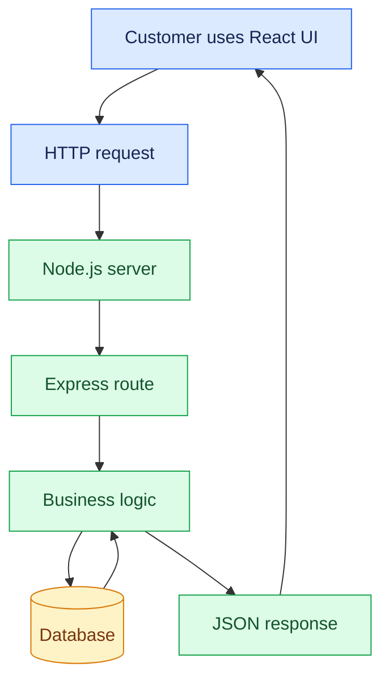
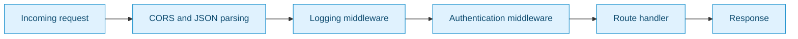

# 09. Backend Development with Node.js

[⬅️ Back to Learning Modules](../README.md) ·

> 🌐 AI Developer — Web Development 
## 🎯 Learning Objectives

By the end of this topic, you will be able to:

- Understand backend development and the role of Node.js.
- Explain how frontend applications communicate with a backend.
- Create an HTTP server using Node.js and Express.
- Design routes, middleware, and controllers.
- Validate incoming data and handle errors.
- Build a simple product API for a boutique application.
- Understand environment variables and backend security fundamentals.

## 1. 🌍 What Is Backend Development?

Backend development focuses on the server-side logic that powers a web application. It manages incoming requests, applies business rules, communicates with databases, and sends responses to the frontend.

For example, in a boutique application, the frontend displays clothing products, while the backend retrieves product information, validates product updates, checks permissions, and stores changes.

### Frontend vs. Backend

| Frontend | Backend |
|---|---|
| Runs primarily in the browser | Runs on a server or serverless platform |
| Displays UI and handles interactions | Implements business rules |
| Uses React, HTML, CSS, and JavaScript | Uses Node.js, Express, Python, and other server technologies |
| Sends API requests | Processes requests and returns responses |
| Should not contain private secrets | Can access protected configuration and services |

## 2. 🟢 Introduction to Node.js

**Node.js** is a JavaScript runtime that allows JavaScript to execute outside a browser. It is commonly used to build APIs, web servers, command-line tools, and real-time applications.

Node.js uses an event-driven architecture and non-blocking I/O, making it useful for applications that handle many network and database operations.

### How Node.js Fits into a Web Application



The browser sends a request, the server processes it, and the server returns a response. The response may contain JSON data, an error message, or other content.

## 3. ⚙️ Install and Set Up Node.js

Install a current supported Node.js LTS release from the official website:

- [Node.js Downloads](https://nodejs.org/en/download)

Verify your installation:

```bash
node --version
npm --version
```

Create a backend project:

```bash
mkdir boutique-backend
cd boutique-backend
npm init -y
npm install express cors dotenv
npm install --save-dev nodemon
```

Update the `scripts` section of `package.json`:

```json
{
  "scripts": {
    "start": "node src/server.js",
    "dev": "nodemon src/server.js"
  }
}
```

Create the following structure:

```text
boutique-backend/
├── src/
│   ├── server.js
│   ├── routes/
│   │   └── productRoutes.js
│   └── controllers/
│       └── productController.js
├── .env
├── .gitignore
└── package.json
```

Create a `.gitignore` file:

```gitignore
node_modules/
.env
uploads/
```

Never commit secret environment variables or private credentials to Git.

## 4. 🚀 Create Your First Express Server

Express is a lightweight Node.js framework that simplifies routing, middleware, and HTTP request handling.

Create `src/server.js`:

```javascript
require("dotenv").config();

const express = require("express");
const cors = require("cors");

const app = express();

app.use(cors({
  origin: process.env.CLIENT_ORIGIN || "http://localhost:5173"
}));

app.use(express.json());

app.get("/", (req, res) => {
  res.json({
    message: "Boutique backend is running",
    status: "success"
  });
});

app.get("/api/health", (req, res) => {
  res.json({
    status: "healthy",
    service: "boutique-api"
  });
});

const PORT = process.env.PORT || 3000;

app.listen(PORT, () => {
  console.log(`Server running at http://localhost:${PORT}`);
});
```

Create `.env`:

```env
PORT=3000
CLIENT_ORIGIN=http://localhost:5173
```

Run the server:

```bash
npm run dev
```

Open `http://localhost:3000/api/health` in a browser. You should receive a JSON response indicating that the API is healthy.

## 5. 🧭 Understand Routes, Requests, and Responses

A route defines how the server responds to a particular HTTP method and URL.

```javascript
app.get("/api/products", (req, res) => {
  res.json({ message: "List products" });
});

app.post("/api/products", (req, res) => {
  res.status(201).json({ message: "Product created" });
});

app.put("/api/products/1", (req, res) => {
  res.json({ message: "Product replaced or updated" });
});

app.delete("/api/products/1", (req, res) => {
  res.status(204).end();
});
```

Common request properties:

- `req.params` — values from route parameters, such as `/api/products/42`.
- `req.query` — query-string values, such as `?category=dresses`.
- `req.body` — request data parsed from JSON.
- `res.status()` — sets the HTTP status code.
- `res.json()` — sends a JSON response.

### Important HTTP Status Codes

| Code | Meaning | Example |
|---|---|---|
| `200` | OK | Products retrieved |
| `201` | Created | New product created |
| `204` | No Content | Product deleted |
| `400` | Bad Request | Invalid product data |
| `401` | Unauthorized | Login required |
| `403` | Forbidden | Insufficient permissions |
| `404` | Not Found | Product does not exist |
| `500` | Internal Server Error | Unexpected server failure |

## 6. 🛍️ Build a Product API

This example uses an in-memory array to teach backend fundamentals. Data will reset when the server restarts. A later topic will replace it with a persistent database.

Create `src/controllers/productController.js`:

```javascript
let products = [
  {
    id: 1,
    name: "Floral Summer Dress",
    category: "Dresses",
    price: 2499,
    stock: 12
  },
  {
    id: 2,
    name: "Classic White Shirt",
    category: "Tops",
    price: 1299,
    stock: 20
  }
];

function getProducts(req, res) {
  const { category, search } = req.query;

  let result = [...products];

  if (category) {
    result = result.filter(
      (product) =>
        product.category.toLowerCase() === category.toLowerCase()
    );
  }

  if (search) {
    result = result.filter(
      (product) =>
        product.name.toLowerCase().includes(search.toLowerCase())
    );
  }

  res.json({
    count: result.length,
    products: result
  });
}

function getProductById(req, res) {
  const id = Number(req.params.id);

  if (!Number.isInteger(id) || id <= 0) {
    return res.status(400).json({ error: "Invalid product ID" });
  }

  const product = products.find((item) => item.id === id);

  if (!product) {
    return res.status(404).json({ error: "Product not found" });
  }

  res.json(product);
}

function createProduct(req, res) {
  const { name, category, price, stock } = req.body;

  if (
    typeof name !== "string" ||
    !name.trim() ||
    typeof category !== "string" ||
    !category.trim() ||
    !Number.isFinite(price) ||
    price <= 0 ||
    !Number.isInteger(stock) ||
    stock < 0
  ) {
    return res.status(400).json({
      error: "Provide a name, category, positive price, and non-negative integer stock"
    });
  }

  const product = {
    id: Math.max(0, ...products.map((item) => item.id)) + 1,
    name: name.trim(),
    category: category.trim(),
    price,
    stock
  };

  products.push(product);

  res.status(201).json(product);
}

function deleteProduct(req, res) {
  const id = Number(req.params.id);
  const existingProduct = products.some((item) => item.id === id);

  if (!existingProduct) {
    return res.status(404).json({ error: "Product not found" });
  }

  products = products.filter((item) => item.id !== id);

  res.status(204).end();
}

module.exports = {
  getProducts,
  getProductById,
  createProduct,
  deleteProduct
};
```

Create `src/routes/productRoutes.js`:

```javascript
const express = require("express");

const {
  getProducts,
  getProductById,
  createProduct,
  deleteProduct
} = require("../controllers/productController");

const router = express.Router();

router.get("/", getProducts);
router.get("/:id", getProductById);
router.post("/", createProduct);
router.delete("/:id", deleteProduct);

module.exports = router;
```

Update `src/server.js` to register the routes:

```javascript
const productRoutes = require("./routes/productRoutes");

app.use("/api/products", productRoutes);
```

Keep the `require` statements at the top of `server.js`, before route registration. The complete server should retain the JSON parser, CORS configuration, health endpoint, and `app.listen()` call from the earlier example.

### Test the API

Use Postman, an equivalent API client, or `curl`.

Retrieve all products:

```bash
curl http://localhost:3000/api/products
```

Filter products:

```bash
curl "http://localhost:3000/api/products?category=Dresses"
```

Create a product:

```bash
curl -X POST http://localhost:3000/api/products \
  -H "Content-Type: application/json" \
  -d "{\"name\":\"Silk Saree\",\"category\":\"Ethnic Wear\",\"price\":4999,\"stock\":8}"
```

Delete product 1:

```bash
curl -X DELETE http://localhost:3000/api/products/1
```

The Windows PowerShell terminal may handle quoting differently. If a `curl` command fails due to shell syntax, use Postman or PowerShell's `Invoke-RestMethod`.

## 7. 🧩 Middleware and Request Processing

Middleware functions execute during the request-response lifecycle. They can log requests, validate data, check authentication, and handle errors.



A simple logging middleware:

```javascript
function requestLogger(req, res, next) {
  console.log(`${new Date().toISOString()} ${req.method} ${req.url}`);
  next();
}

app.use(requestLogger);
```

Call `next()` when the middleware intends to continue processing. If middleware neither sends a response nor calls `next()`, the request may hang.

## 8. 🛡️ Error Handling and Security

Centralized error middleware helps return consistent responses.

Register this after your routes:

```javascript
app.use((err, req, res, next) => {
  console.error(err);

  if (res.headersSent) {
    return next(err);
  }

  res.status(500).json({
    error: "An unexpected server error occurred"
  });
});
```

Production applications should also consider:

- Validating every input on the server.
- Restricting CORS to trusted frontend origins.
- Adding request-size limits and rate limiting.
- Using HTTPS in production.
- Keeping secrets in environment variables or a secrets manager.
- Avoiding stack traces and sensitive information in public error responses.
- Using maintained dependencies and updating them regularly.
- Adding authentication and authorization before protecting write operations.

**Important:** CORS is not authentication. It controls which browser origins may read responses; it does not prevent all other clients from calling the API.

## 9. 🏪 Real-World Scenario: Boutique Inventory

A manager adds a new dress through the React dashboard.

1. The frontend sends a `POST /api/products` request.
2. Express parses the JSON request body.
3. Validation checks the name, category, price, and stock.
4. The backend creates a product record.
5. The API returns `201 Created`.
6. The frontend updates its product list.

In a real application, step 4 would save the product to a database, and the server would verify that the logged-in user has manager permissions.

## 10. ⚠️ Common Mistakes

- Forgetting `express.json()` and receiving an empty `req.body`.
- Defining routes but never registering them with `app.use()`.
- Sending a response more than once.
- Forgetting to return after sending an error response.
- Assuming in-memory data persists after restarting Node.js.
- Exposing API keys in frontend code.
- Treating frontend validation as sufficient.
- Allowing every origin in production without evaluating the security implications.

## 11. ✅ Best Practices

- Separate routes, controllers, business logic, and database operations as the project grows.
- Use meaningful HTTP methods and status codes.
- Validate all external input.
- Keep configuration outside source code.
- Use centralized error handling.
- Add automated tests for successful and unsuccessful requests.
- Document API endpoints and expected response formats.
- Avoid logging passwords, tokens, or sensitive personal information.

## 🔑 Key Takeaways

- Node.js runs JavaScript on the server.
- Express provides routing and middleware for building HTTP APIs.
- Request validation and consistent error handling are essential.
- Real applications need persistent storage, authentication, and authorization.
- The backend must never blindly trust data received from the frontend.