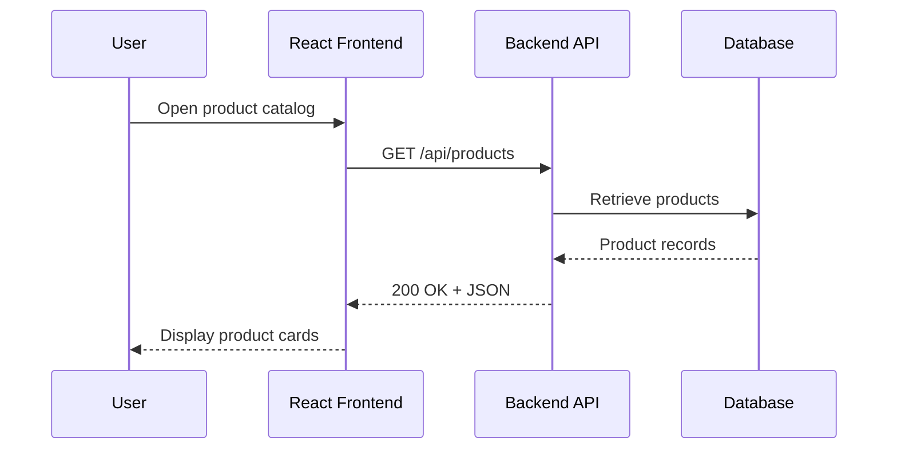
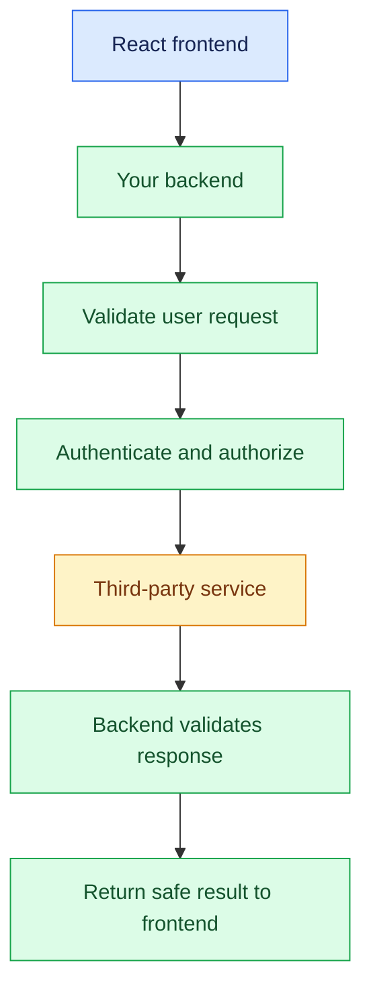

# 10. REST APIs and API Integration

[⬅️ Previous:](09-backend-development-with-nodejs.md) ·

> 🔌 AI Developer — Web Development 

## 🎯 Learning Objectives

By the end of this topic, you will be able to:

- Understand APIs, REST principles, endpoints, and HTTP methods.
- Design consistent REST API routes.
- Integrate a backend API with a React frontend.
- Send and receive JSON data using `fetch()`.
- Handle loading states, errors, query parameters, and timeouts.
- Understand API keys, external service integration, and rate limits.
- Build an end-to-end product catalog that communicates with a Node.js backend.

## 1. 🌐 What Is an API?

An **Application Programming Interface (API)** defines how software components communicate with one another.

For example, a React storefront needs product information. Instead of directly accessing the server's internal data structures, it sends an HTTP request to an API endpoint. The backend processes the request and returns a response.

### How an API Works



An API creates a clear boundary between the frontend and backend. The frontend does not need to know how the backend stores or processes its data.

## 2. 🧭 What Is REST?

**REST** stands for Representational State Transfer. It is an architectural style used to design networked APIs around resources.

Common REST design principles include:

- Resources are identified by URLs.
- Standard HTTP methods describe the intended operation.
- Requests contain the information needed to process them.
- Representations, commonly JSON, communicate resource data.
- Stateless requests do not depend on hidden server-side conversational state.

REST does not require JSON specifically, but JSON is common in web applications.

### Example REST Endpoints

| Method | Endpoint | Purpose |
|---|---|---|
| `GET` | `/api/products` | Retrieve products |
| `GET` | `/api/products/42` | Retrieve one product |
| `POST` | `/api/products` | Create a product |
| `PUT` | `/api/products/42` | Replace a product |
| `PATCH` | `/api/products/42` | Partially update a product |
| `DELETE` | `/api/products/42` | Delete a product |

Use nouns for resource paths rather than action-oriented routes such as `/getProducts` or `/deleteProduct`.

## 3. 📦 Understand JSON Requests and Responses

JSON is a text format for exchanging structured data.

Example product response:

```json
{
  "id": 42,
  "name": "Floral Summer Dress",
  "category": "Dresses",
  "price": 2499,
  "inStock": true
}
```

A typical successful response contains a status code and a body. An error response should also communicate the problem clearly.

```json
{
  "error": {
    "code": "PRODUCT_NOT_FOUND",
    "message": "The requested product could not be found."
  }
}
```

Do not expose database passwords, internal stack traces, or confidential business information in API responses.

## 4. 🔍 Query Parameters and Pagination

Query parameters help clients filter, sort, and paginate resources.

Example:

```text
GET /api/products?category=Dresses&search=floral&page=1&limit=10
```

In Express:

```javascript
app.get("/api/products", (req, res) => {
  const {
    category,
    search,
    page = "1",
    limit = "10"
  } = req.query;

  const pageNumber = Number(page);
  const pageSize = Number(limit);

  if (
    !Number.isInteger(pageNumber) ||
    pageNumber < 1 ||
    !Number.isInteger(pageSize) ||
    pageSize < 1 ||
    pageSize > 100
  ) {
    return res.status(400).json({
      error: "Invalid pagination parameters"
    });
  }

  // In a database-backed API, apply category and search filters
  // before counting and retrieving the requested page.

  res.json({
    category: category || null,
    search: search || null,
    page: pageNumber,
    limit: pageSize,
    products: []
  });
});
```

This example illustrates parameter validation and response shape. The empty array is a placeholder; a production endpoint must retrieve the matching records and calculate the total count.

A paginated response might look like:

```json
{
  "page": 1,
  "limit": 10,
  "total": 34,
  "products": []
}
```

## 5. 🔄 Integrate an API with JavaScript

The browser's `fetch()` function sends HTTP requests and returns a Promise.

```javascript
async function loadProducts() {
  const response = await fetch("http://localhost:3000/api/products");

  if (!response.ok) {
    throw new Error(`Request failed: ${response.status}`);
  }

  return response.json();
}

loadProducts()
  .then((data) => console.log(data))
  .catch((error) => console.error(error.message));
```

**Important:** `fetch()` does not automatically reject its Promise for HTTP errors such as `404` or `500`. Check `response.ok` or `response.status` before treating the request as successful.

### Sending a POST Request

```javascript
async function createProduct(product) {
  const response = await fetch("http://localhost:3000/api/products", {
    method: "POST",
    headers: {
      "Content-Type": "application/json"
    },
    body: JSON.stringify(product)
  });

  const data = await response.json().catch(() => null);

  if (!response.ok) {
    throw new Error(data?.error || `Request failed: ${response.status}`);
  }

  return data;
}

createProduct({
  name: "Silk Saree",
  category: "Ethnic Wear",
  price: 4999,
  stock: 8
})
  .then((product) => console.log("Created:", product))
  .catch((error) => console.error(error.message));
```

Only send the fields the server expects. The server must validate them independently.

## 6. ⚛️ Build a React Product Catalog

The following component fetches products from the backend and displays loading, error, empty, and success states.

Create `ProductCatalog.tsx` in a React TypeScript project:

```tsx
import { useEffect, useState } from "react";

type Product = {
  id: number;
  name: string;
  category: string;
  price: number;
  stock: number;
};

const API_URL = "http://localhost:3000/api/products";

export default function ProductCatalog() {
  const [products, setProducts] = useState<Product[]>([]);
  const [loading, setLoading] = useState(true);
  const [error, setError] = useState("");

  useEffect(() => {
    const controller = new AbortController();

    async function loadProducts() {
      try {
        setLoading(true);
        setError("");

        const response = await fetch(API_URL, {
          signal: controller.signal
        });

        if (!response.ok) {
          throw new Error(`Could not load products (${response.status})`);
        }

        const data = await response.json();

        // This assumes the API returns { products: Product[] }.
        // Runtime validation should be added for untrusted API data.
        if (!Array.isArray(data.products)) {
          throw new Error("Unexpected API response format");
        }

        setProducts(data.products);
      } catch (err) {
        if (err instanceof Error && err.name !== "AbortError") {
          setError(err.message);
        }
      } finally {
        if (!controller.signal.aborted) {
          setLoading(false);
        }
      }
    }

    void loadProducts();

    return () => controller.abort();
  }, []);

  if (loading) return <p>Loading products...</p>;

  if (error) {
    return (
      <div role="alert">
        <p>{error}</p>
        <button onClick={() => window.location.reload()}>
          Reload page
        </button>
      </div>
    );
  }

  if (products.length === 0) {
    return <p>No products found.</p>;
  }

  return (
    <section>
      <h1>Boutique Collection</h1>

      <div className="product-grid">
        {products.map((product) => (
          <article key={product.id} className="product-card">
            <h2>{product.name}</h2>
            <p>{product.category}</p>
            <p>₹{product.price.toLocaleString("en-IN")}</p>
            <p>{product.stock > 0 ? "In stock" : "Out of stock"}</p>
          </article>
        ))}
      </div>
    </section>
  );
}
```

Use the component in your application:

```tsx
import ProductCatalog from "./ProductCatalog";

export default function App() {
  return <ProductCatalog />;
}
```

If the frontend runs on port `5173` and the backend runs on port `3000`, configure the backend's CORS policy to allow the frontend origin. If your API returns an array directly rather than `{ "products": [...] }`, adjust the frontend response parsing to match the actual contract.

For a better user experience, implement a retry button that repeats the failed request instead of reloading the entire page.

## 7. 🧰 Centralize API Calls

As a project grows, avoid repeating raw `fetch()` calls across every component.

Create `src/services/api.ts`:

```typescript
const API_BASE_URL =
  import.meta.env.VITE_API_BASE_URL ?? "http://localhost:3000/api";

export async function apiGet<T>(
  path: string,
  signal?: AbortSignal
): Promise<T> {
  const response = await fetch(`${API_BASE_URL}${path}`, {
    signal,
    headers: {
      Accept: "application/json"
    }
  });

  if (!response.ok) {
    throw new Error(`API request failed: ${response.status}`);
  }

  return response.json() as Promise<T>;
}
```

Configure a frontend `.env` file:

```env
VITE_API_BASE_URL=http://localhost:3000/api
```

Restart the Vite development server after changing environment variables. Variables prefixed with `VITE_` are exposed to browser code, so **never store private API keys or server secrets in them**.

The generic type in `apiGet<T>()` improves TypeScript usability, but it does not validate the JSON at runtime. For external or untrusted responses, validate the data with a runtime schema library or explicit checks.

## 8. 🌎 Integrating External Services

Web applications often communicate with third-party APIs, such as:

- Payment providers.
- Shipping and delivery services.
- Email notification platforms.
- AI text-generation services.
- Image optimization and cloud storage providers.

A secure integration usually follows this pattern:



If a third-party service requires a private API key, keep that key on the backend. The backend can apply access controls, enforce quotas, validate inputs, and limit what information is returned to the client.

### Example: Calling an External Service from Node.js

```javascript
async function requestExternalService(input) {
  const apiKey = process.env.EXTERNAL_SERVICE_API_KEY;

  if (!apiKey) {
    throw new Error("External service is not configured");
  }

  const response = await fetch(
    process.env.EXTERNAL_SERVICE_URL,
    {
      method: "POST",
      headers: {
        Authorization: `Bearer ${apiKey}`,
        "Content-Type": "application/json"
      },
      body: JSON.stringify(input),
      signal: AbortSignal.timeout(10000)
    }
  );

  if (!response.ok) {
    throw new Error(`External service returned ${response.status}`);
  }

  return response.json();
}
```

Set `EXTERNAL_SERVICE_URL` and `EXTERNAL_SERVICE_API_KEY` in the server's environment. The URL must point to the documented endpoint for the specific provider. This is a reusable pattern, not a complete integration for any particular vendor.

## 9. ⏱️ Timeouts, Rate Limits, and Reliability

External services may be slow, temporarily unavailable, or rate-limited.

Good API integrations should consider:

- **Timeouts:** Stop waiting indefinitely for a response.
- **Retries:** Retry only suitable failures, using a bounded policy and exponential backoff.
- **Rate limits:** Respect provider limits and handle `429 Too Many Requests`.
- **Idempotency:** Use provider-supported idempotency keys for operations such as payment creation when available.
- **Observability:** Record request duration, status, and correlation IDs without logging secrets.
- **Graceful failure:** Return a clear error or fallback response when a dependency is unavailable.

Do not automatically retry every failed POST request. The original operation may have succeeded even if the response was lost.

## 10. 🏪 Real-World Scenario

A customer searches for dresses priced below ₹3,000.

1. React sends `GET /api/products?category=Dresses&maxPrice=3000`.
2. The backend validates the query parameters.
3. The backend queries the product database.
4. Matching products are returned as JSON.
5. React displays the results and updates the result count.

For a large catalog, filtering and pagination should happen on the server or database rather than downloading the entire catalog to the browser.

## 11. ⚠️ Common Mistakes

- Forgetting to check `response.ok`.
- Assuming every response contains valid JSON.
- Hardcoding secrets in frontend code.
- Ignoring loading, error, and empty states.
- Sending inconsistent response formats across endpoints.
- Ignoring timeouts and provider rate limits.
- Trusting TypeScript types without validating incoming data.
- Allowing frontend-controlled prices or permissions to determine sensitive server operations.

## 🔑 Key Takeaways

- REST APIs expose resources through predictable endpoints and HTTP methods.
- JSON is a common format for exchanging data.
- `fetch()` needs explicit HTTP error handling.
- React and the backend should agree on request and response contracts.
- Secrets belong on the server, not in browser code.
- Reliable integrations need timeouts, error handling, and appropriate retry behavior.