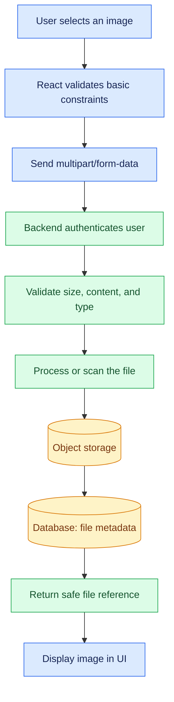
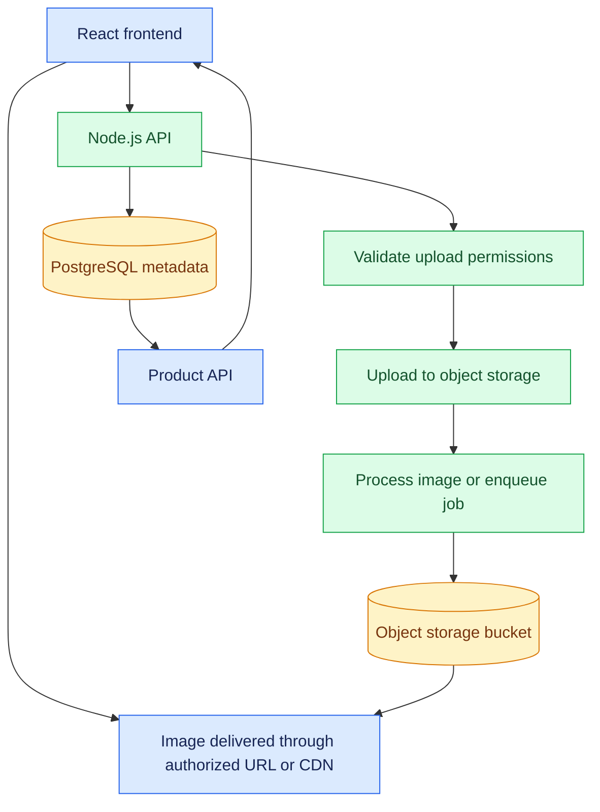

# 12. File Uploads, Media Processing, and Cloud Storage

[⬅️ Previous:](11-databases-authentication-and-authorization.md) ·

> 📁 AI Developer — Web Development 
## 🎯 Learning Objectives

By the end of this topic, you will be able to:

- Understand file uploads and multipart form data.
- Upload files from React to a Node.js backend.
- Validate uploaded files and enforce size limits.
- Process images and generate optimized versions.
- Understand local storage versus cloud object storage.
- Store file metadata in a database.
- Apply security practices for handling user-uploaded media.

## 1. 🖼️ Why Do Web Applications Need File Uploads?

Modern web applications frequently accept images, documents, videos, and other files.

In a boutique application, a manager may upload product photographs, update clothing catalogs, or replace an existing image. The application must transfer the file safely, validate it, store it, and make the resulting media available to authorized users.

Other examples include:

- Student portals accepting assignments.
- Healthcare applications accepting permitted medical documents.
- E-commerce platforms accepting product images.
- AI applications accepting images for analysis.
- Video platforms accepting recordings for processing.

File uploads are not simply frontend tasks. They require coordinated frontend, backend, storage, and security decisions.

## 2. 🔄 How File Uploads Work



The frontend provides a convenient user experience, but the backend must independently enforce file size, type, permissions, and storage rules.

## 3. 📦 Understand Multipart Form Data

Text-only API requests commonly use JSON. File uploads often use `multipart/form-data`, which can carry both files and ordinary form fields.

A browser `FormData` object builds the multipart request:

```javascript
const formData = new FormData();

formData.append("image", selectedFile);
formData.append("productName", "Floral Summer Dress");

const response = await fetch("http://localhost:3000/api/uploads", {
  method: "POST",
  body: formData
});
```

**Do not manually set the `Content-Type` header** when using browser `FormData`. The browser needs to add the correct multipart boundary automatically.

## 4. ⚛️ Create a React File Upload Component

Create `ImageUpload.tsx` in a React TypeScript application:

```tsx
import { useState } from "react";

export default function ImageUpload() {
  const [file, setFile] = useState<File | null>(null);
  const [previewUrl, setPreviewUrl] = useState("");
  const [message, setMessage] = useState("");
  const [uploading, setUploading] = useState(false);

  function handleFileChange(
    event: React.ChangeEvent<HTMLInputElement>
  ) {
    const selected = event.target.files?.[0];

    setMessage("");
    setFile(null);
    setPreviewUrl("");

    if (!selected) return;

    const allowedTypes = ["image/jpeg", "image/png", "image/webp"];
    const maxSize = 5 * 1024 * 1024;

    if (!allowedTypes.includes(selected.type)) {
      setMessage("Choose a JPEG, PNG, or WebP image.");
      event.target.value = "";
      return;
    }

    if (selected.size > maxSize) {
      setMessage("The image must be 5 MB or smaller.");
      event.target.value = "";
      return;
    }

    setFile(selected);
    setPreviewUrl(URL.createObjectURL(selected));
  }

  async function handleUpload() {
    if (!file) return;

    const formData = new FormData();
    formData.append("image", file);

    try {
      setUploading(true);
      setMessage("");

      const response = await fetch(
        "http://localhost:3000/api/uploads",
        {
          method: "POST",
          body: formData
        }
      );

      const data = await response.json().catch(() => null);

      if (!response.ok) {
        throw new Error(data?.error || "Upload failed");
      }

      setMessage("Image uploaded successfully.");
    } catch (error) {
      setMessage(
        error instanceof Error ? error.message : "Upload failed"
      );
    } finally {
      setUploading(false);
    }
  }

  return (
    <section>
      <h2>Upload Product Image</h2>

      <label htmlFor="product-image">Choose an image</label>
      <input
        id="product-image"
        type="file"
        accept="image/jpeg,image/png,image/webp"
        onChange={handleFileChange}
      />

      {previewUrl && (
        
      )}

      <button
        type="button"
        disabled={!file || uploading}
        onClick={handleUpload}
      >
        {uploading ? "Uploading..." : "Upload Image"}
      </button>

      {message && <p role="status">{message}</p>}
    </section>
  );
}
```

The file type and size checks here improve usability, but they are not a security boundary. The backend must perform its own validation.

For a complete component, also revoke old preview URLs with `URL.revokeObjectURL()` when replacing a file or unmounting the component.

## 5. 🟢 Build a Node.js Upload Endpoint

Install Express and Multer if they are not already installed:

```bash
npm install express multer
```

Multer parses `multipart/form-data` requests for Express. This example stores files temporarily on the server's local disk. It is intended for a controlled development environment and requires additional hardening before production use.

Create `src/routes/uploadRoutes.js`:

```javascript
const express = require("express");
const multer = require("multer");
const path = require("node:path");
const fs = require("node:fs");

const router = express.Router();

const uploadDirectory = path.resolve("uploads");

fs.mkdirSync(uploadDirectory, { recursive: true });

const allowedMimeTypes = new Set([
  "image/jpeg",
  "image/png",
  "image/webp"
]);

const storage = multer.diskStorage({
  destination: (req, file, callback) => {
    callback(null, uploadDirectory);
  },

  filename: (req, file, callback) => {
    const extensionMap = {
      "image/jpeg": ".jpg",
      "image/png": ".png",
      "image/webp": ".webp"
    };

    // Generate a server-controlled filename.
    const filename =
      `${Date.now()}-${require("node:crypto").randomUUID()}` +
      extensionMap[file.mimetype];

    callback(null, filename);
  }
});

const upload = multer({
  storage,
  limits: {
    fileSize: 5 * 1024 * 1024,
    files: 1,
    fields: 5,
    parts: 6
  },
  fileFilter: (req, file, callback) => {
    if (!allowedMimeTypes.has(file.mimetype)) {
      return callback(
        new Error("Only JPEG, PNG, and WebP images are allowed")
      );
    }

    callback(null, true);
  }
});

router.post("/", upload.single("image"), (req, res) => {
  if (!req.file) {
    return res.status(400).json({
      error: "An image file is required"
    });
  }

  res.status(201).json({
    message: "Upload received",
    file: {
      filename: req.file.filename,
      size: req.file.size
    }
  });
});

module.exports = router;
```

Register the route in `server.js`:

```javascript
const uploadRoutes = require("./routes/uploadRoutes");

app.use("/api/uploads", uploadRoutes);
```

The upload route must also be protected by authentication and authorization middleware before accepting files from privileged users. For example, only an authorized manager should be able to upload catalog images.

### ⚠️ Important Validation Limitation

The example checks the declared MIME type, which is supplied by the client and can be forged. A production upload pipeline should inspect file signatures, decode the image using a trusted image-processing library, enforce pixel dimensions, and reject malformed or unsupported files.

It should also handle Multer errors, remove incomplete files when processing fails, and prevent untrusted files from being served as executable content.

## 6. 🔍 Secure File Validation

A secure upload workflow should apply several independent checks:

1. **Authentication:** Identify the uploader.
2. **Authorization:** Confirm that the user is allowed to upload.
3. **Size limit:** Reject oversized requests and files.
4. **File count limit:** Prevent a user from sending excessive files.
5. **Extension allowlist:** Permit only the formats required by the application.
6. **Content verification:** Inspect the file's actual format instead of trusting its name or MIME type.
7. **Image decoding:** Ensure that supported images can be decoded.
8. **Dimension limits:** Reject extremely large pixel dimensions.
9. **Malware scanning:** Scan relevant uploads when the threat model requires it.
10. **Safe storage:** Store files outside executable application directories or in object storage.
11. **Safe delivery:** Apply access controls and appropriate response headers.

File validation should use defense in depth. No single extension, MIME type, or filename check is sufficient by itself.

## 7. 🧰 Image Processing with Sharp

Product images can be large. Resizing and converting them into efficient formats can reduce storage costs and improve page performance.

Install [Sharp](https://sharp.pixelplumbing.com/):

```bash
npm install sharp
```

Example processing function:

```javascript
const sharp = require("sharp");

async function createProductThumbnail(inputPath, outputPath) {
  await sharp(inputPath, {
    limitInputPixels: 40_000_000
  })
    .rotate()
    .resize(600, 600, {
      fit: "inside",
      withoutEnlargement: true
    })
    .webp({
      quality: 80
    })
    .toFile(outputPath);
}

module.exports = { createProductThumbnail };
```

This function creates a WebP image with a maximum width and height of 600 pixels while preserving the aspect ratio.

In a real upload pipeline:

- Verify the source file before processing.
- Decode and re-encode the image.
- Store the processed file under a generated name.
- Delete temporary source files according to your retention policy.
- Handle decoder failures and resource limits.
- Consider generating multiple image sizes for thumbnails and full-size product views.

Image processing can consume substantial CPU and memory. For high traffic, move expensive processing into a background job queue.

## 8. ☁️ Local Storage vs. Cloud Object Storage

### Local File Storage

Files are saved on the server's filesystem.

**Advantages**
- Simple development setup.
- Easy to inspect during local testing.
- No separate cloud-storage service required.

**Limitations**
- Files may be lost when a deployment replaces an ephemeral filesystem.
- Multiple application instances may not share files.
- Backups, scaling, and delivery require extra work.

### Cloud Object Storage

Services such as Amazon S3, Google Cloud Storage, and Azure Blob Storage store files as objects in buckets or containers.

**Advantages**
- Designed for durable object storage and scalable delivery.
- Separates media storage from application compute.
- Supports access policies, lifecycle rules, and integrations with content delivery networks.

**Limitations**
- Requires appropriate identity and access configuration.
- Introduces service costs and operational complexity.
- Public access must be configured carefully.

### Typical Cloud Architecture



For large files, a common architecture is to let the backend authorize an upload and issue a short-lived presigned URL. The browser then uploads directly to object storage. The backend should verify the resulting object before marking the upload as complete.

## 9. 🗃️ Store File Metadata in a Database

The database usually stores metadata and relationships, not the binary image itself.

Example schema:

```sql
CREATE TABLE product_images (
    id BIGINT GENERATED ALWAYS AS IDENTITY PRIMARY KEY,
    product_id BIGINT NOT NULL REFERENCES products(id),
    storage_key TEXT NOT NULL UNIQUE,
    content_type TEXT NOT NULL,
    file_size BIGINT NOT NULL CHECK (file_size > 0),
    created_at TIMESTAMPTZ NOT NULL DEFAULT NOW()
);
```

Example metadata:

```json
{
  "id": 21,
  "productId": 42,
  "storageKey": "products/42/8f2a7c.webp",
  "contentType": "image/webp",
  "fileSize": 184320
}
```

The `storageKey` identifies the object in storage. A backend can use it to construct or retrieve an authorized URL.

Avoid storing permanent public URLs as the only reference when files need to be moved, access-controlled, or served through different delivery systems.

## 10. 🔐 Protect Cloud Storage

Follow the principle of least privilege:

- Keep storage buckets private by default.
- Give the backend only the permissions it requires.
- Never put cloud access credentials in browser code.
- Use short-lived presigned URLs when appropriate.
- Limit permitted object keys and upload sizes.
- Avoid letting clients choose arbitrary storage paths.
- Apply lifecycle rules to temporary files.
- Enable suitable logging, monitoring, and backup controls.
- Prevent untrusted HTML or executable files from being served from the same origin as the main application.

For a private image, authorize the user before generating a signed download URL. A signed URL is a temporary bearer credential, so anyone possessing it may be able to use it until it expires.

## 11. 🎞️ Media Processing and Background Jobs

Image resizing is often quick enough to perform during an upload. Video transcoding, large document processing, and AI-based image analysis may take much longer.

A scalable design uses a job queue:


The API can respond with `202 Accepted` when processing has been queued but is not yet complete. The frontend can then poll a job-status endpoint or use a real-time notification mechanism.

Design jobs to handle retries safely, prevent duplicate processing where necessary, and record failures for investigation.

## 12. 🏪 Real-World Scenario: Upload a Boutique Catalog Image

A manager uploads a product photograph.

1. The frontend previews the selected image.
2. The API verifies the manager's permissions.
3. The backend checks the file's size, type, and actual content.
4. The image is processed into an optimized format.
5. The processed image is stored in private or appropriately controlled object storage.
6. The database stores the product relationship and object key.
7. The frontend displays the image using a suitable URL.

If processing fails, the application should report the failure, clean up temporary objects where appropriate, and avoid creating a broken product record.

## 13. ⚠️ Common Mistakes

- Trusting the file extension or browser MIME type alone.
- Accepting unlimited file sizes or file counts.
- Using the original filename as a storage path.
- Storing uploads in an ephemeral deployment directory without backups.
- Making an entire cloud bucket public unnecessarily.
- Putting storage credentials in React code.
- Saving a database record before ensuring the file was stored successfully.
- Forgetting to delete temporary files.
- Processing huge images without resource limits.
- Returning internal filesystem paths to the client.

## 14. ✅ Best Practices

- Enforce file limits on both the request and individual file.
- Authenticate and authorize uploads.
- Inspect file signatures and decode supported images.
- Generate safe, unique storage keys.
- Re-encode images and constrain dimensions.
- Store media in object storage for scalable deployments.
- Keep metadata in a database and binaries in object storage.
- Use short-lived signed URLs for controlled access.
- Add malware scanning when appropriate.
- Log processing status without exposing sensitive file contents.
- Test malformed, oversized, empty, and unsupported uploads.

## 🔑 Key Takeaways

- File uploads use multipart form data and require server-side validation.
- Browser validation improves usability but cannot establish trust.
- Image processing can improve performance and reduce storage usage.
- Cloud object storage separates media from application compute.
- Databases should store file metadata and relationships.
- Secure media handling requires access control, resource limits, safe storage, and controlled delivery.
