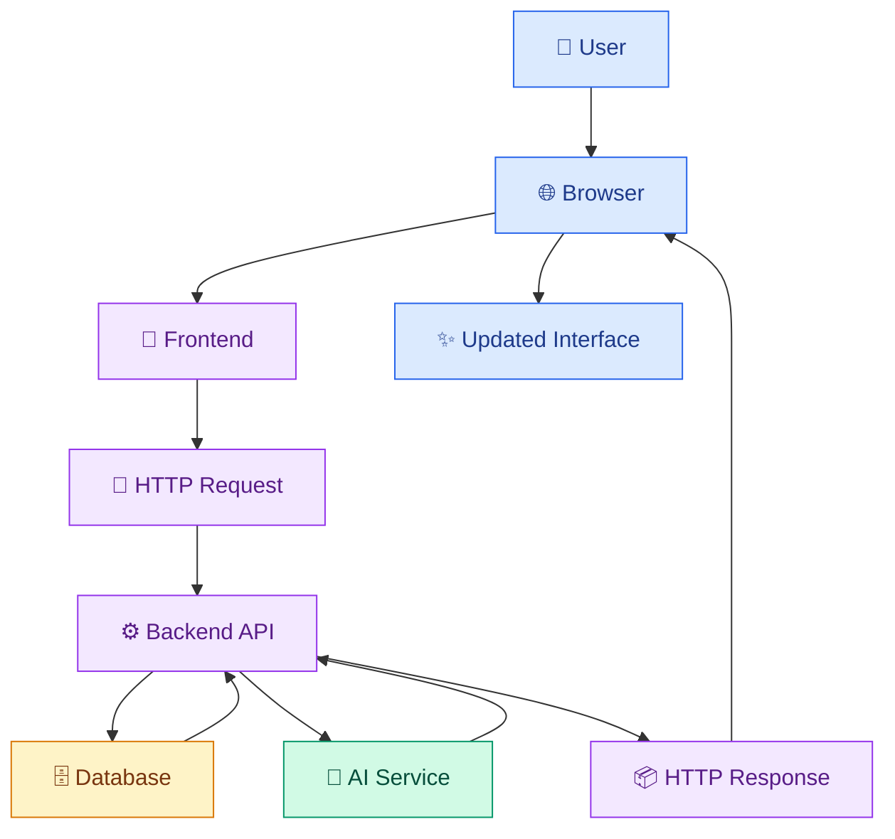
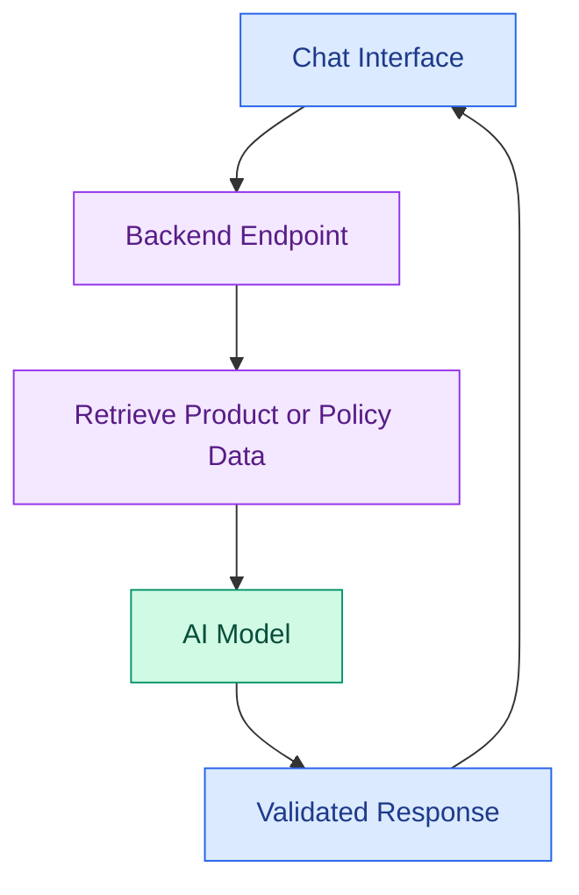

# 🌐 Introduction to AI-Powered Web Development

[⬅️ Back to Learning Modules](../README.md) ·

Welcome to the AI Developer – Web Development Masterclass! This topic introduces how websites work, how frontend and backend components communicate, and how artificial intelligence can enhance traditional web applications.

## 🎯 Learning Objectives

- Understand the fundamentals of web development.
- Distinguish frontend, backend, and full-stack development.
- Learn the roles of browsers, servers, APIs, and databases.
- Understand how AI is integrated into web applications.
- Build your first interactive web page.
- Explore the architecture of an AI-powered application.

## 1. What Is Web Development?

Web development is the process of building websites and web applications that users access through browsers.

Examples include e-commerce websites, online learning platforms, analytics dashboards, social networks, and AI assistants.

### The three main areas

| Area | Responsibility | Common technologies |
|---|---|---|
| Frontend | User interface and interactions | HTML, CSS, JavaScript, React |
| Backend | Business logic and APIs | Node.js, Express, Python |
| Database | Persistent application data | PostgreSQL, MySQL, document databases |

A full-stack application connects these layers to provide a complete user experience.

## 2. How a web application works



For example, when a customer searches for a dress, the frontend sends a request to the backend. The backend retrieves matching product records and returns the results to the browser.

## 3. Traditional vs. AI-powered web development

Traditional applications mainly use programmed rules and algorithms. AI-powered applications can additionally use language models or machine learning to interpret text, summarize information, generate content, or retrieve semantically relevant results.

Examples:

- Traditional: filter products by price.
- AI-powered: recommend products based on a natural-language description.
- Traditional: search for an exact keyword.
- AI-powered: retrieve documents based on the meaning of a question.
- Traditional: display a fixed FAQ.
- AI-powered: answer a question using approved FAQ content.

AI should complement conventional programming, not replace important business rules. Product prices, inventory, payments, and permissions should remain grounded in authoritative application data.

## 4. Essential web technologies

- **HTML:** defines page structure and content.
- **CSS:** controls colors, spacing, typography, and layout.
- **JavaScript:** adds interactive behavior.
- **TypeScript:** adds static type checking to JavaScript.
- **React:** builds interfaces using reusable components.
- **Next.js:** provides a framework for React applications.
- **Node.js:** runs JavaScript on the server.
- **REST APIs:** allow applications to exchange data using HTTP.

## 5. Your first interactive web page

Create a folder called `my-first-web-page` and add an `index.html` file.

```html
<!DOCTYPE html>
<html lang="en">
<head>
  <meta charset="UTF-8">
  <meta name="viewport" content="width=device-width, initial-scale=1.0">
  <title>My First Web Page</title>
  <style>
    body {
      font-family: Arial, sans-serif;
      max-width: 700px;
      margin: 60px auto;
      padding: 24px;
      background: #f3f4f6;
      color: #172033;
    }

    .card {
      padding: 28px;
      border-radius: 16px;
      background: white;
      box-shadow: 0 8px 24px #00000012;
    }

    button {
      padding: 12px 18px;
      border: 0;
      border-radius: 8px;
      background: #4f46e5;
      color: white;
      cursor: pointer;
    }
  </style>
</head>
<body>
  <main class="card">
    <h1>Welcome to Web Development! 🌐</h1>
    <p id="message">Click the button to get started.</p>
    <button id="actionButton" type="button">Click Me</button>
  </main>

  <script>
    const button = document.getElementById("actionButton");
    const message = document.getElementById("message");

    button.addEventListener("click", () => {
      message.textContent =
        "Congratulations! Your page is interactive. 🎉";
    });
  </script>
</body>
</html>
```

Open `index.html` in your browser. Click the button and observe how the message changes without a page reload.

### What happened?

1. HTML created the page structure.
2. CSS styled the page.
3. JavaScript listened for a click and updated the text.

## 6. How AI fits into a web application

Consider a boutique website with a product assistant.



A customer might ask, "How long does delivery take?" The backend can retrieve the approved delivery policy and provide it to the AI model as context.

**Security rule:** private API keys belong on the server, not in browser JavaScript. The backend should validate requests, enforce access rules, and avoid exposing sensitive information.

## 7. Common mistakes

- Learning frameworks without understanding basic HTML, CSS, and JavaScript.
- Putting API keys into frontend code.
- Trusting AI-generated prices or inventory information without checking the source.
- Ignoring mobile layouts and accessibility.
- Treating a successful API request as proof that its result is correct.

## ✅ Key Takeaways

- Web applications combine interfaces, backend logic, data, and network communication.
- HTML, CSS, and JavaScript form the foundation of frontend development.
- AI adds capabilities such as natural-language interaction and semantic search.
- Secure, reliable applications validate data and protect credentials.