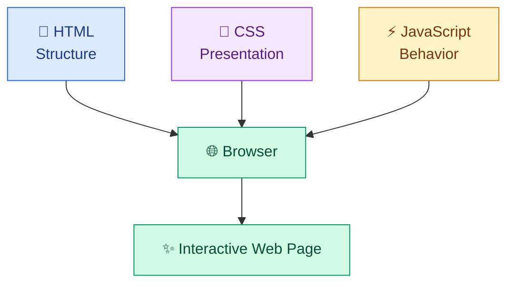
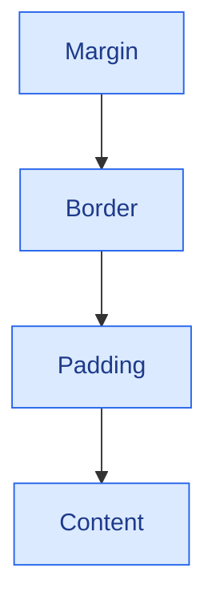

# 🎨 HTML, CSS, and Modern JavaScript

[⬅️ Previous:](01-introduction-to-ai-powered-web-development.md) ·

HTML, CSS, and JavaScript are the three core technologies used to create interactive websites. HTML defines the content, CSS controls its presentation, and JavaScript responds to user actions.

## 🎯 Learning Objectives

- Build semantic HTML pages.
- Style layouts using modern CSS.
- Understand the box model, Flexbox, and Grid.
- Use JavaScript variables, functions, arrays, objects, and events.
- Work with modern JavaScript features.
- Manipulate the DOM and fetch data from APIs.

## 1. How the three technologies work together



## 2. HTML: structure and content

HTML stands for HyperText Markup Language. It uses elements to represent headings, paragraphs, links, images, forms, and other page content.

### Common HTML elements

| Element | Purpose |
|---|---|
| `<header>` | Introductory or navigational content |
| `<nav>` | Navigation links |
| `<main>` | Primary page content |
| `<section>` | A related section of content |
| `<article>` | Self-contained content |
| `<footer>` | Footer information |
| `<form>` | Collects user input |
| `<button>` | Triggers an action |

Use semantic elements where appropriate. They help browsers, assistive technologies, and developers understand the page structure.

### Example: product card

```html
<article class="product-card">
  
  <h2>Floral Summer Dress</h2>
  <p>Lightweight dress for summer occasions.</p>
  <p><strong>₹2,499</strong></p>
  <button type="button">View Product</button>
</article>
```

The `alt` attribute provides alternative text for an image. Use meaningful text when the image conveys information; use empty alternative text for purely decorative images.

## 3. CSS: presentation and layout

CSS stands for Cascading Style Sheets. It controls colors, typography, spacing, borders, positioning, and responsive behavior.

### The CSS box model

Every element is laid out using content, padding, border, and margin.



Use `box-sizing: border-box` to make width calculations more predictable.

```css
* {
  box-sizing: border-box;
}

body {
  margin: 0;
  font-family: system-ui, sans-serif;
  line-height: 1.6;
}

.product-card {
  padding: 1.25rem;
  border: 1px solid #dbe2ea;
  border-radius: 1rem;
  background: white;
}
```

### Flexbox

Flexbox is useful for arranging items along one primary axis.

```css
.navigation {
  display: flex;
  align-items: center;
  justify-content: space-between;
  gap: 1rem;
}
```

### CSS Grid

Grid is useful for two-dimensional layouts, such as product catalogs.

```css
.product-grid {
  display: grid;
  grid-template-columns: repeat(3, minmax(0, 1fr));
  gap: 1.25rem;
}
```

Responsive changes will be introduced in Topic 03.

## 4. JavaScript fundamentals

JavaScript allows pages to react to user actions and update their content.

### Variables and data types

```javascript
const productName = "Floral Summer Dress";
const price = 2499;
const available = true;

let quantity = 1;

quantity += 1;

console.log(productName, price, available, quantity);
```

Use `const` by default and `let` when reassignment is needed. Avoid `var` in modern examples unless you specifically need to understand legacy code.

### Functions

```javascript
function calculateTotal(price, quantity) {
  return price * quantity;
}

const total = calculateTotal(2499, 2);

console.log(total); // 4998
```

### Arrays and objects

```javascript
const products = [
  { id: "P101", name: "Summer Dress", price: 2499 },
  { id: "P102", name: "White Top", price: 899 },
  { id: "P103", name: "Denim Jeans", price: 1599 },
];

const affordableProducts = products.filter(
  (product) => product.price < 2000
);

console.log(affordableProducts);
```

Here, `filter()` creates a new array containing products that satisfy the condition.

### Modern JavaScript features

**Arrow functions**

```javascript
const greet = (name) => `Hello, ${name}!`;
```

**Template literals**

```javascript
const name = "Akhila";
console.log(`Welcome, ${name}!`);
```

**Destructuring**

```javascript
const product = { name: "White Top", price: 899 };
const { name, price } = product;
```

**Spread syntax**

```javascript
const updatedProduct = { ...product, price: 799 };
```

These features make modern JavaScript concise and expressive.

## 5. DOM manipulation and events

The Document Object Model (DOM) represents the page as objects that JavaScript can inspect and modify.

Create an HTML page with:

```html
<h1 id="heading">Product Catalog</h1>
<input id="search" type="text" placeholder="Search products">
<p id="result"></p>
```

Add JavaScript:

```javascript
const search = document.getElementById("search");
const result = document.getElementById("result");

search.addEventListener("input", () => {
  const query = search.value.trim();

  result.textContent = query
    ? `Searching for: ${query}`
    : "Enter a product name to search.";
});
```

The `input` event runs as the user types. Using `textContent` is safer than inserting arbitrary user input as HTML.

## 6. Working with APIs using `fetch()`

JavaScript can request data from a server or public API.

```javascript
async function loadPosts() {
  try {
    const response = await fetch(
      "https://jsonplaceholder.typicode.com/posts?_limit=5"
    );

    if (!response.ok) {
      throw new Error(`HTTP error: ${response.status}`);
    }

    const posts = await response.json();

    console.log(posts);
  } catch (error) {
    console.error("Could not load posts:", error);
  }
}

loadPosts();
```

This example uses JSONPlaceholder, a public testing API. It demonstrates asynchronous requests, JSON parsing, and error handling.

Remember that `fetch()` does not automatically throw an exception for HTTP responses such as `404`; checking `response.ok` is important.

## 7. Complete hands-on project: interactive product catalog

Create three files: `index.html`, `style.css`, and `script.js`.

### `index.html`

```html
<!DOCTYPE html>
<html lang="en">
<head>
  <meta charset="UTF-8">
  <meta name="viewport" content="width=device-width, initial-scale=1.0">
  <title>Interactive Product Catalog</title>
  <link rel="stylesheet" href="style.css">
  <script src="script.js" defer></script>
</head>
<body>
  <main class="container">
    <h1>🛍️ Boutique Collection</h1>
    <p>Explore our sample products.</p>

    <label for="search">Search products</label>
    <input id="search" type="search" placeholder="Try 'dress'">

    <p id="result-count" aria-live="polite"></p>
    <section id="products" class="product-grid"></section>
  </main>
</body>
</html>
```

### `style.css`

```css
* {
  box-sizing: border-box;
}

body {
  margin: 0;
  padding: 2rem;
  font-family: system-ui, sans-serif;
  background: #f5f3ff;
  color: #241b35;
}

.container {
  max-width: 1000px;
  margin: 0 auto;
}

input {
  width: 100%;
  max-width: 480px;
  padding: 0.8rem;
  margin-top: 0.5rem;
  border: 1px solid #c4b5fd;
  border-radius: 0.6rem;
}

.product-grid {
  display: grid;
  grid-template-columns: repeat(3, minmax(0, 1fr));
  gap: 1rem;
  margin-top: 1.5rem;
}

.product-card {
  padding: 1.2rem;
  border-radius: 1rem;
  background: white;
  box-shadow: 0 6px 18px #241b3510;
}

.product-card h2 {
  font-size: 1.1rem;
}

.price {
  font-weight: 700;
  color: #6d28d9;
}

@media (max-width: 700px) {
  .product-grid {
    grid-template-columns: repeat(2, minmax(0, 1fr));
  }
}

@media (max-width: 450px) {
  body {
    padding: 1rem;
  }

  .product-grid {
    grid-template-columns: 1fr;
  }
}
```

### `script.js`

```javascript
const products = [
  { id: "P101", name: "Floral Summer Dress", price: 2499 },
  { id: "P102", name: "Classic White Top", price: 899 },
  { id: "P103", name: "Denim Jeans", price: 1599 },
  { id: "P104", name: "Party Wear Gown", price: 4999 },
  { id: "P105", name: "Casual Cotton Top", price: 699 },
];

const searchInput = document.getElementById("search");
const productContainer = document.getElementById("products");
const resultCount = document.getElementById("result-count");

function renderProducts(items) {
  productContainer.replaceChildren();

  for (const product of items) {
    const card = document.createElement("article");
    card.className = "product-card";

    const heading = document.createElement("h2");
    heading.textContent = product.name;

    const price = document.createElement("p");
    price.className = "price";
    price.textContent = `₹${product.price.toLocaleString("en-IN")}`;

    card.append(heading, price);
    productContainer.append(card);
  }

  resultCount.textContent = `${items.length} product(s) found.`;
}

function filterProducts() {
  const query = searchInput.value.trim().toLowerCase();

  const filtered = products.filter((product) =>
    product.name.toLowerCase().includes(query)
  );

  renderProducts(filtered);
}

searchInput.addEventListener("input", filterProducts);
renderProducts(products);
```

Open `index.html` in your browser and search for "dress", "top", or "jeans".

### What you learned

- Separated HTML, CSS, and JavaScript into files.
- Created reusable product data using JavaScript objects.
- Filtered data based on user input.
- Rendered dynamic elements safely using DOM methods.
- Added responsive grid layouts.

## 8. Common mistakes

- Forgetting to load the correct CSS or JavaScript file.
- Using `innerHTML` with untrusted input.
- Modifying DOM elements before they exist.
- Ignoring API errors or HTTP status codes.
- Writing repeated code instead of reusable functions.
- Using fixed widths that overflow on smaller screens.

## 9. Best practices

- Use semantic HTML and accessible labels.
- Separate structure, styling, and behavior.
- Prefer `const` and `let` over `var`.
- Use descriptive names and small functions.
- Handle asynchronous failures.
- Validate input and render untrusted text safely.
- Use Flexbox and Grid rather than excessive manual positioning.
- Test keyboard interactions and mobile layouts.

## ✅ Key Takeaways

- HTML defines structure, CSS controls presentation, and JavaScript adds behavior.
- Flexbox and Grid are core layout tools.
- Modern JavaScript provides reusable functions, data transformations, and asynchronous API calls.
- DOM updates should be safe, accessible, and predictable.