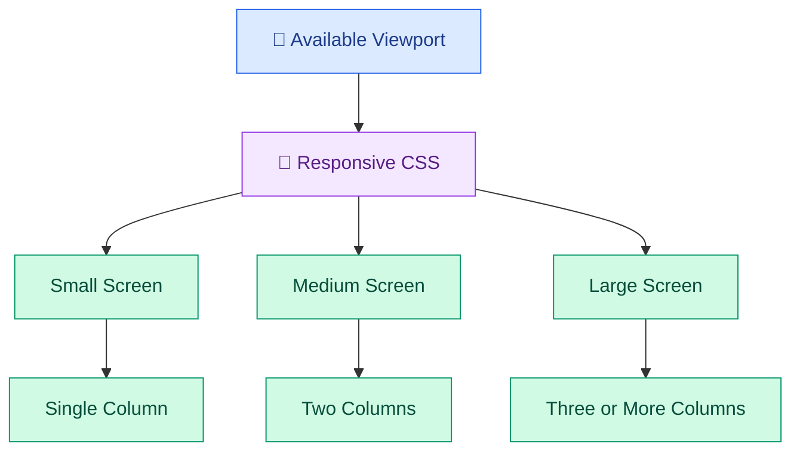

# 📱 Responsive Web Design and UI Fundamentals

[⬅️ Previous:](02-html-css-and-modern-javascript.md) ·

Modern applications must work well on phones, tablets, laptops, and large desktop screens. Responsive web design adapts a layout to different viewport sizes while keeping content readable, accessible, and easy to use.

## 🎯 Learning Objectives

- Understand responsive design and mobile-first development.
- Use CSS media queries, Flexbox, and Grid.
- Work with relative units and fluid layouts.
- Design reusable interface components.
- Understand typography, color, spacing, and visual hierarchy.
- Improve accessibility and usability.
- Build and test a responsive product dashboard.

## 1. What is responsive web design?

A responsive interface adjusts its layout to the available space rather than assuming every user has the same screen dimensions.

For example, a product catalog may show three columns on a desktop, two on a tablet, and one on a narrow mobile screen.



Responsive design includes more than rearranging columns. It also considers readable font sizes, comfortable touch targets, image scaling, navigation, content priority, and accessible interactions.

## 2. Mobile-first design

Mobile-first design starts with a layout suitable for small screens, then adds enhancements for larger screens.

```css
/* Default styles target smaller screens. */
.product-grid {
  display: grid;
  grid-template-columns: 1fr;
  gap: 1rem;
}

/* Add a second column when space permits. */
@media (min-width: 600px) {
  .product-grid {
    grid-template-columns: repeat(2, minmax(0, 1fr));
  }
}

/* Add a third column on wider screens. */
@media (min-width: 960px) {
  .product-grid {
    grid-template-columns: repeat(3, minmax(0, 1fr));
  }
}
```

The breakpoint values are examples, not universal standards. Choose breakpoints based on when the content or layout stops working well.

## 3. CSS units and fluid layouts

Different CSS units serve different purposes.

| Unit | Meaning | Common use |
|---|---|---|
| `px` | CSS pixels | Borders and precise small details |
| `%` | Relative to a containing dimension | Flexible widths |
| `rem` | Relative to the root font size | Typography and spacing |
| `em` | Relative to the element's font size in many contexts | Component-relative spacing |
| `vw` | Percentage of viewport width | Fluid sizing in suitable cases |
| `fr` | Fraction of available Grid space | Grid columns |

Prefer flexible constraints over forcing every element to have a fixed width.

```css
.page {
  width: min(100% - 2rem, 1200px);
  margin-inline: auto;
}

.hero-image {
  display: block;
  width: 100%;
  max-width: 100%;
  height: auto;
}
```

This lets the page grow on large screens while keeping reasonable side margins on smaller screens.

## 4. Flexbox and Grid in responsive layouts

Use **Flexbox** when arranging items primarily along one axis, such as navigation links or a row of action buttons.

Use **Grid** when arranging items in rows and columns, such as product cards or dashboard panels.

```css
.toolbar {
  display: flex;
  flex-wrap: wrap;
  align-items: center;
  gap: 0.75rem;
}

.dashboard-grid {
  display: grid;
  grid-template-columns: repeat(
    auto-fit,
    minmax(min(100%, 240px), 1fr)
  );
  gap: 1rem;
}
```

The `auto-fit` pattern allows Grid to fit as many columns as the available space permits, subject to the minimum width.

## 5. UI fundamentals: visual hierarchy

A useful interface helps users understand what matters first.

### Typography

Use a clear hierarchy for page titles, section headings, body text, and supporting labels. Body text should remain readable without zooming.

```css
:root {
  font-family: Inter, system-ui, sans-serif;
  color: #172033;
  background: #f5f7fb;
}

h1 {
  font-size: clamp(1.8rem, 4vw, 3rem);
  line-height: 1.15;
}

p {
  line-height: 1.65;
}
```

### Color and contrast

Use color consistently for actions, status, warnings, and decorative emphasis. Do not rely on color alone to communicate meaning; pair it with text or icons.

### Spacing

A consistent spacing scale makes interfaces feel organized.

```css
:root {
  --space-1: 0.25rem;
  --space-2: 0.5rem;
  --space-3: 0.75rem;
  --space-4: 1rem;
  --space-6: 1.5rem;
  --space-8: 2rem;
}
```

Use these variables consistently rather than choosing arbitrary spacing values for every component.

## 6. Hands-on project: responsive boutique dashboard

Create `index.html`:

```html
<!DOCTYPE html>
<html lang="en">
<head>
  <meta charset="UTF-8">
  <meta name="viewport" content="width=device-width, initial-scale=1.0">
  <title>Boutique Dashboard</title>
  <link rel="stylesheet" href="style.css">
</head>
<body>
  <header class="site-header">
    <a class="brand" href="#">Lumière Boutique</a>
    <nav aria-label="Main navigation">
      <a href="#overview">Overview</a>
      <a href="#products">Products</a>
      <a href="#insights">Insights</a>
    </nav>
  </header>

  <main class="page" id="overview">
    <section class="hero">
      <p class="eyebrow">STORE OVERVIEW</p>
      <h1>Your boutique at a glance</h1>
      <p>Track products and keep your daily operations organized.</p>
    </section>

    <section class="dashboard-grid" aria-label="Store metrics">
      <article class="metric-card">
        <p>Products</p>
        <h2>128</h2>
        <span>Across all categories</span>
      </article>

      <article class="metric-card">
        <p>Orders</p>
        <h2>36</h2>
        <span>Illustrative daily total</span>
      </article>

      <article class="metric-card">
        <p>Low Stock</p>
        <h2>7</h2>
        <span>Products to review</span>
      </article>
    </section>

    <section class="panel" id="products">
      <h2>Featured collection</h2>
      <p>Review new arrivals and popular styles.</p>
      <button type="button">Explore Products</button>
    </section>

    <section class="panel" id="insights">
      <h2>Store insights</h2>
      <p>Future versions can connect this panel to live analytics.</p>
    </section>
  </main>
</body>
</html>
```

Create `style.css`:

```css
* {
  box-sizing: border-box;
}

:root {
  color: #1f2937;
  background: #f4f6fb;
  font-family: system-ui, sans-serif;
}

body {
  margin: 0;
}

.site-header {
  display: flex;
  flex-wrap: wrap;
  align-items: center;
  justify-content: space-between;
  gap: 1rem;
  padding: 1rem clamp(1rem, 4vw, 3rem);
  background: #1f1740;
  color: white;
}

.brand {
  color: white;
  font-weight: 750;
  text-decoration: none;
}

nav {
  display: flex;
  flex-wrap: wrap;
  gap: 1rem;
}

nav a {
  color: #e9e5ff;
  text-decoration: none;
}

nav a:hover,
nav a:focus-visible {
  text-decoration: underline;
}

.page {
  width: min(100% - 2rem, 1100px);
  margin: 0 auto;
  padding-block: 2rem;
}

.hero {
  padding-block: 1rem 2rem;
}

.eyebrow {
  color: #6d28d9;
  font-size: 0.8rem;
  font-weight: 800;
  letter-spacing: 0.12em;
}

.hero h1 {
  max-width: 700px;
  font-size: clamp(2rem, 5vw, 3.5rem);
  line-height: 1.1;
}

.dashboard-grid {
  display: grid;
  grid-template-columns: repeat(
    auto-fit,
    minmax(min(100%, 220px), 1fr)
  );
  gap: 1rem;
}

.metric-card,
.panel {
  padding: 1.5rem;
  border: 1px solid #e2e8f0;
  border-radius: 1rem;
  background: white;
  box-shadow: 0 6px 24px #17203308;
}

.metric-card h2 {
  margin-block: 0.4rem;
  color: #6d28d9;
  font-size: 2rem;
}

.metric-card span {
  color: #64748b;
  font-size: 0.9rem;
}

.panel {
  margin-top: 1.25rem;
}

button {
  padding: 0.8rem 1.1rem;
  border: 0;
  border-radius: 0.6rem;
  background: #6d28d9;
  color: white;
  font: inherit;
  cursor: pointer;
}

button:focus-visible {
  outline: 3px solid #a78bfa;
  outline-offset: 3px;
}
```

Open `index.html` in your browser. Resize the browser window and observe how the metric cards rearrange automatically.

The displayed metrics are sample values, not live business data.

## 7. Accessibility and usability

A responsive interface should also be accessible.

- Use semantic HTML elements.
- Give form controls visible labels.
- Maintain sufficient text contrast.
- Support keyboard navigation.
- Use visible focus indicators.
- Provide meaningful alternative text for informative images.
- Respect reduced-motion preferences for nonessential animation.
- Ensure controls have usable touch areas.
- Test layouts at increased zoom and with long text.

Accessibility is not a final styling task; it is part of interface design.

## 8. Common mistakes

- Designing only for a single screen size.
- Using fixed widths that cause horizontal scrolling.
- Setting arbitrary breakpoints without testing content.
- Making body text too small.
- Removing focus outlines without an alternative.
- Using color as the only indicator of status.
- Adding too many decorative elements that compete with primary actions.

## 9. Best practices

- Start with a simple mobile layout.
- Add breakpoints when content requires them.
- Use Grid and Flexbox for flexible layouts.
- Keep spacing, typography, and color choices consistent.
- Optimize images and preserve their aspect ratios.
- Test with keyboard navigation and different viewport sizes.
- Prioritize clarity and usability over visual effects.

## ✅ Key Takeaways

- Responsive design adapts content to available screen space.
- Mobile-first development provides a strong foundation for smaller screens.
- Flexbox and Grid support flexible, maintainable layouts.
- Good UI design includes visual hierarchy, consistent spacing, accessibility, and usability.