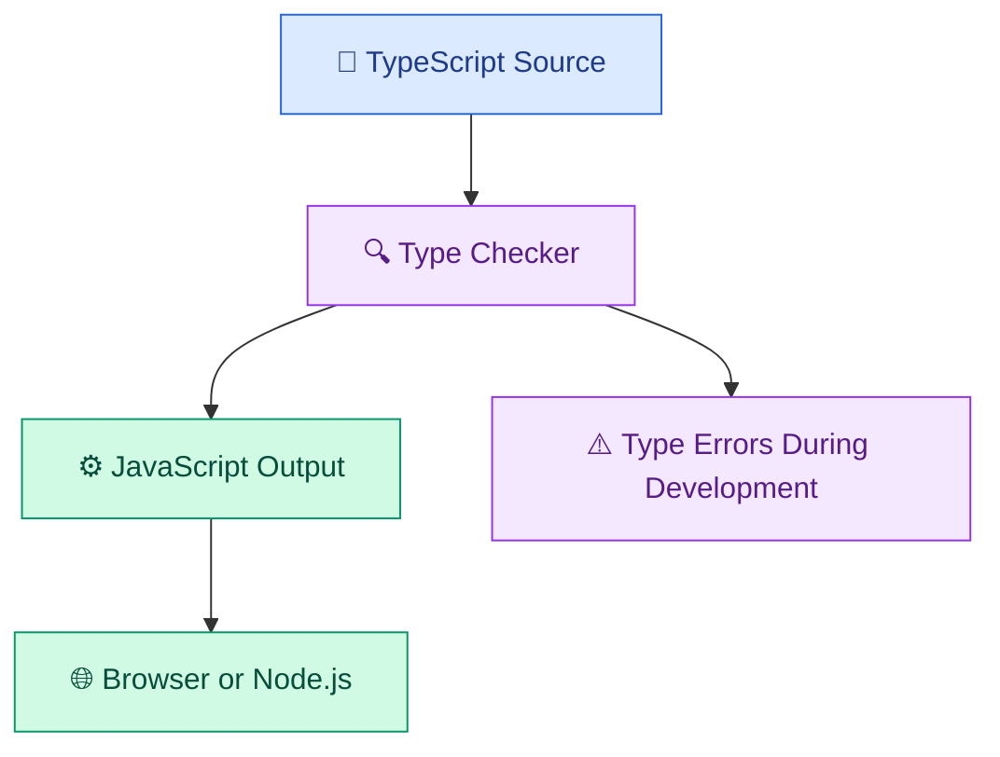

# 🔷 TypeScript and Modern Frontend Development

[⬅️ Previous:](03-responsive-web-design-and-ui-fundamentals.md) ·

TypeScript extends JavaScript with a static type system. It helps developers catch many mistakes during development, document data structures, and maintain larger applications more confidently.

TypeScript is especially useful when building React interfaces, consuming APIs, and working with complex application state.

## 🎯 Learning Objectives

- Understand TypeScript and its relationship to JavaScript.
- Use basic types, arrays, objects, and interfaces.
- Define unions, optional properties, and reusable types.
- Type functions and API responses.
- Understand generics and type narrowing.
- Compile TypeScript into JavaScript.
- Prepare for React and Next.js development.

## 1. What is TypeScript?

JavaScript is dynamically typed. A variable can hold values of different types at runtime.

TypeScript adds static type checking, which helps detect incompatible operations before the code runs.



TypeScript does not normally run directly in a browser as TypeScript source. It is compiled or transformed into JavaScript by the development toolchain.

### JavaScript example

```javascript
function add(a, b) {
  return a + b;
}

console.log(add(5, 10));
console.log(add("5", 10));
```

JavaScript permits the second call, which produces `"510"` through string concatenation.

### TypeScript example

```typescript
function add(a: number, b: number): number {
  return a + b;
}

console.log(add(5, 10));

// This call produces a type error:
// add("5", 10);
```

The types indicate that both arguments must be numbers and that the function returns a number.

## 2. Setting up TypeScript

Install Node.js and npm if they are not already available.

Check your versions:

```powershell
node --version
npm --version
```

Create a practice project:

```powershell
mkdir typescript-basics
cd typescript-basics

npm init -y
npm install --save-dev typescript
npx tsc --init
```

Create `src`:

```powershell
New-Item -ItemType Directory -Force src
```

Create `src/index.ts`:

```typescript
const message: string = "Hello from TypeScript!";
const learnerCount: number = 25;
const isLearning: boolean = true;

console.log(message);
console.log(learnerCount);
console.log(isLearning);
```

Compile it:

```powershell
npx tsc src/index.ts --outDir dist
node dist/index.js
```

Expected output:

```text
Hello from TypeScript!
25
true
```

This simple command-line setup demonstrates the compiler. A React application will usually use a build tool that handles TypeScript automatically.

## 3. Basic types

### Primitive types

```typescript
const productName: string = "Summer Dress";
const price: number = 2499;
const inStock: boolean = true;
```

TypeScript can infer these types from initial values, so explicit annotations are not always necessary.

### Arrays

```typescript
const categories: string[] = [
  "Dresses",
  "Tops",
  "Jeans",
];

const prices: number[] = [2499, 899, 1599];
```

### Objects

```typescript
const product: {
  id: string;
  name: string;
  price: number;
} = {
  id: "P101",
  name: "Summer Dress",
  price: 2499,
};
```

For repeated structures, interfaces or type aliases are usually clearer.

## 4. Interfaces and type aliases

An interface describes the expected shape of an object.

```typescript
interface Product {
  id: string;
  name: string;
  price: number;
  category: string;
  stock: number;
  description?: string;
}

const dress: Product = {
  id: "P101",
  name: "Summer Dress",
  price: 2499,
  category: "Dresses",
  stock: 12,
};
```

The `description?` property is optional.

A type alias can represent unions and other types:

```typescript
type OrderStatus =
  | "pending"
  | "confirmed"
  | "shipped"
  | "delivered"
  | "cancelled";

interface Order {
  id: string;
  status: OrderStatus;
  total: number;
}
```

The union prevents assigning an arbitrary string to `status` without an explicit type escape.

## 5. Functions and return types

```typescript
function calculateTotal(
  price: number,
  quantity: number,
): number {
  return price * quantity;
}

const total = calculateTotal(2499, 2);
console.log(total);
```

You can also type arrow functions:

```typescript
const formatPrice = (price: number): string => {
  return `₹${price.toLocaleString("en-IN")}`;
};
```

Use types to clarify inputs and outputs, especially at application boundaries.

## 6. Union types and type narrowing

A union allows a value to have one of several types.

```typescript
function displayProductId(id: string | number): string {
  if (typeof id === "number") {
    return `Product ${id}`;
  }

  return `Product ${id.toUpperCase()}`;
}

console.log(displayProductId("p101"));
console.log(displayProductId(101));
```

The `typeof` check narrows the value to a specific type inside each branch.

This is useful when working with user input or data that can arrive in different forms.

## 7. Generics

Generics let you build reusable functions and types that preserve information about the values they process.

```typescript
function firstItem<T>(items: T[]): T | undefined {
  return items[0];
}

const firstPrice = firstItem([899, 1599, 2499]);
const firstCategory = firstItem(["Dresses", "Tops"]);
```

The function works with different arrays while retaining the element type.

## 8. Working with API responses safely

A TypeScript interface describes the shape you expect, but it does not automatically validate untrusted JSON at runtime.

A safe approach is to parse the response as `unknown` and validate the fields.

```typescript
interface Product {
  id: string;
  name: string;
  price: number;
}

function isProduct(value: unknown): value is Product {
  if (typeof value !== "object" || value === null) {
    return false;
  }

  const item = value as Record<string, unknown>;

  return (
    typeof item.id === "string" &&
    typeof item.name === "string" &&
    typeof item.price === "number" &&
    Number.isFinite(item.price) &&
    item.price >= 0
  );
}

async function loadProduct(): Promise<Product> {
  const response = await fetch("/api/products/P101");

  if (!response.ok) {
    throw new Error(`Request failed: ${response.status}`);
  }

  const data: unknown = await response.json();

  if (!isProduct(data)) {
    throw new Error("Invalid product response");
  }

  return data;
}
```

The endpoint is illustrative and must exist in your application. Runtime validation is important because server responses can be missing fields or contain unexpected values even when TypeScript types look correct.

## 9. Build a typed product filtering utility

Create `src/products.ts`:

```typescript
interface Product {
  id: string;
  name: string;
  category: string;
  price: number;
  stock: number;
}

const products: Product[] = [
  {
    id: "P101",
    name: "Floral Summer Dress",
    category: "Dresses",
    price: 2499,
    stock: 12,
  },
  {
    id: "P102",
    name: "Classic White Top",
    category: "Tops",
    price: 899,
    stock: 20,
  },
  {
    id: "P103",
    name: "Denim Jeans",
    category: "Jeans",
    price: 1599,
    stock: 8,
  },
];

function filterProducts(
  items: Product[],
  query: string,
  maxPrice?: number,
): Product[] {
  const normalizedQuery = query.trim().toLowerCase();

  return items.filter((product) => {
    const matchesName = product.name
      .toLowerCase()
      .includes(normalizedQuery);

    const matchesPrice =
      maxPrice === undefined || product.price <= maxPrice;

    return matchesName && matchesPrice;
  });
}

console.log(filterProducts(products, "dress"));
console.log(filterProducts(products, "", 1600));
```

Compile and run:

```powershell
npx tsc src/products.ts --outDir dist
node dist/products.js
```

The optional `maxPrice` argument allows the same function to support both text search and price filtering.

## 10. TypeScript in React

TypeScript becomes especially valuable when a frontend contains many components and shared data structures.

A typed React component might look like this:

```tsx
import type { ReactNode } from "react";

interface ProductCardProps {
  name: string;
  price: number;
  children?: ReactNode;
}

export function ProductCard({
  name,
  price,
  children,
}: ProductCardProps) {
  return (
    <article className="product-card">
      <h2>{name}</h2>
      <p>{price.toLocaleString("en-IN")}</p>
      {children}
    </article>
  );
}
```

This component requires a product name and price, while `children` is optional.

When you start the React topic, you'll apply types to component props, events, state, API responses, and reusable UI components.

## 11. Common mistakes

- Using `any` everywhere instead of defining useful types.
- Assuming a TypeScript interface validates incoming JSON.
- Confusing compile-time checks with runtime checks.
- Using type assertions to hide errors instead of validating data.
- Making every property optional when it is actually required.
- Ignoring compiler errors rather than understanding them.

## 12. Best practices

- Enable strict type checking in application projects.
- Prefer inference for simple local variables.
- Define interfaces or type aliases for important data structures.
- Use union types for known finite states.
- Validate untrusted data at runtime.
- Keep types close to the modules that own the data.
- Use `unknown` rather than `any` when a value's type is not yet known.
- Keep frontend models aligned with backend API contracts.

## ✅ Key Takeaways

- TypeScript adds static type checking to JavaScript.
- Interfaces and type aliases help describe data structures.
- Generics support reusable, type-safe functions.
- Runtime validation is still necessary for untrusted API data.
- TypeScript provides a strong foundation for React and Next.js applications.
