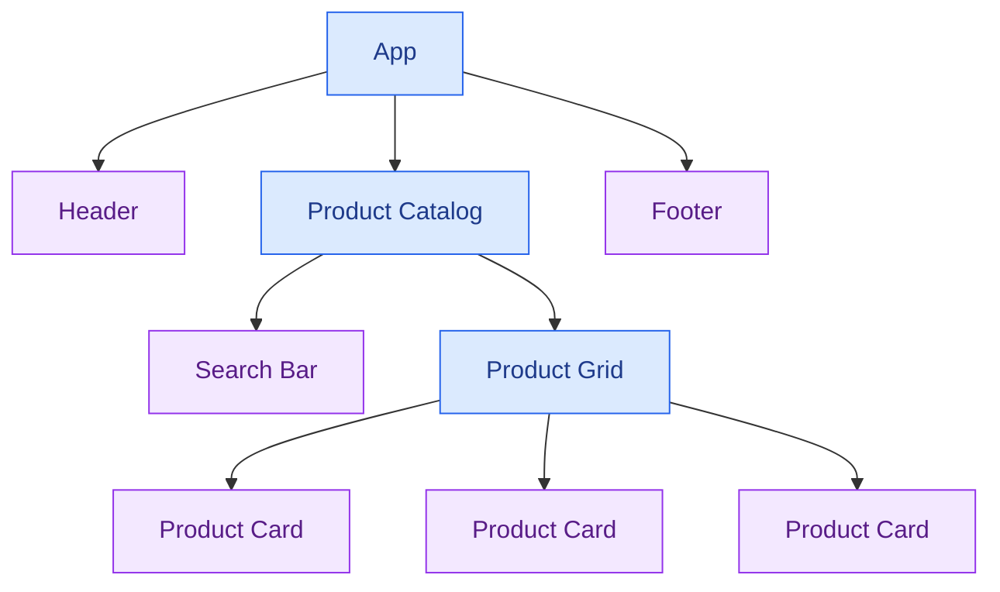

# ⚛️ React Fundamentals and Components

[⬅️ Back to Learning Modules](../README.md) · 

React is a JavaScript library for building user interfaces from reusable components. Instead of manually updating every part of a webpage, you describe what the interface should look like for the current data and state, and React updates the rendered interface when those values change.

## 🎯 Learning Objectives

- Understand React and component-based architecture.
- Create a React application with Vite.
- Build reusable functional components.
- Work with JSX, props, and event handlers.
- Render lists and handle conditional UI.
- Understand component composition and one-way data flow.
- Build a small interactive product catalog.

## 1. What is React?

React lets developers divide a complex interface into smaller, reusable components.

For example, a boutique application might contain a header, search bar, product card, product grid, and footer. Each component can be developed and maintained separately.



The same product card component can display different products by receiving different props.

## 2. Create a React application

Install a current supported version of Node.js if needed. Verify your installation:

```powershell
node --version
npm --version
```

Create a project with Vite:

```powershell
npm create vite@latest boutique-react -- --template react-ts
cd boutique-react
npm install
npm run dev
```

Open the local URL printed in your terminal. Vite provides a development server with fast updates while you work.

This example uses React with TypeScript. You can still use the same component concepts in a JavaScript React project.

## 3. JSX: describing the interface

JSX is a syntax extension that lets you write markup-like expressions inside JavaScript or TypeScript.

```tsx
function Welcome() {
  return (
    <section>
      <h1>Welcome to Lumière Boutique</h1>
      <p>Discover your next favorite style.</p>
    </section>
  );
}

export default Welcome;
```

Important JSX rules:

- Return one enclosing element, or use a fragment (`<>...</>`).
- Use `className` rather than HTML's `class` attribute.
- Close elements properly.
- Use `{}` to embed JavaScript expressions.
- Component names start with a capital letter.

## 4. Build reusable components

Create `src/components/ProductCard.tsx`:

```tsx
export interface Product {
  id: string;
  name: string;
  category: string;
  price: number;
  stock: number;
}

interface ProductCardProps {
  product: Product;
}

export default function ProductCard({
  product,
}: ProductCardProps) {
  return (
    <article className="product-card">
      <p className="product-category">{product.category}</p>
      <h2>{product.name}</h2>
      <p className="product-price">
        {product.price.toLocaleString("en-IN", {
          style: "currency",
          currency: "INR",
          maximumFractionDigits: 0,
        })}
      </p>
      <p>
        {product.stock > 0
          ? `${product.stock} available`
          : "Out of stock"}
      </p>
    </article>
  );
}
```

The `ProductCard` component receives a `product` prop and renders its data. It does not need to know where the product came from.

## 5. Props and one-way data flow

**Props** are inputs passed from a parent component to a child component.

```tsx
interface GreetingProps {
  name: string;
}

function Greeting({ name }: GreetingProps) {
  return <h2>Hello, {name}!</h2>;
}

export default function App() {
  return (
    <main>
      <Greeting name="Akhila" />
      <Greeting name="Guest" />
    </main>
  );
}
```

The parent provides the values. The child reads them and renders the interface.

Treat props as read-only. When data needs to change, use state in the appropriate component and pass event handlers to children when necessary.

## 6. Rendering lists

Create `src/App.tsx`:

```tsx
import ProductCard, {
  type Product,
} from "./components/ProductCard";

const products: Product[] = [
  {
    id: "P101",
    name: "Floral Summer Dress",
    category: "Dresses",
    price: 2499,
    stock: 12,
  },
  {
    id: "P102",
    name: "Classic White Top",
    category: "Tops",
    price: 899,
    stock: 20,
  },
  {
    id: "P103",
    name: "Denim Jeans",
    category: "Jeans",
    price: 1599,
    stock: 8,
  },
];

export default function App() {
  return (
    <main className="page">
      <h1>🛍️ Boutique Collection</h1>

      <section className="product-grid">
        {products.map((product) => (
          <ProductCard
            key={product.id}
            product={product}
          />
        ))}
      </section>
    </main>
  );
}
```

React uses `key` to track list items between renders. Use a stable identifier such as a product ID rather than the array index when items can be added, removed, or reordered.

## 7. Conditional rendering

Render different content depending on the data.

```tsx
interface StockStatusProps {
  stock: number;
}

function StockStatus({ stock }: StockStatusProps) {
  if (stock <= 0) {
    return <p role="status">Out of stock</p>;
  }

  if (stock <= 5) {
    return <p role="status">Low stock</p>;
  }

  return <p role="status">In stock</p>;
}
```

Conditional rendering is useful for loading states, empty results, error messages, permission-dependent controls, and inventory status.

## 8. Handle events

React event handlers respond to interactions such as clicks, changes, and form submissions.

```tsx
import { useState } from "react";

export default function FavoriteButton() {
  const [favorite, setFavorite] = useState(false);

  return (
    <button
      type="button"
      aria-pressed={favorite}
      onClick={() => setFavorite((previous) => !previous)}
    >
      {favorite ? "♥ Saved" : "♡ Add to favorites"}
    </button>
  );
}
```

The component stores whether the item is a favorite. When state changes, React renders the updated label.

## 9. Add basic styling

Create or replace `src/App.css`:

```css
* {
  box-sizing: border-box;
}

body {
  margin: 0;
  background: #f5f3ff;
  color: #241b35;
  font-family: system-ui, sans-serif;
}

.page {
  width: min(100% - 2rem, 1100px);
  margin: 0 auto;
  padding-block: 2rem;
}

.product-grid {
  display: grid;
  grid-template-columns: repeat(
    auto-fit,
    minmax(min(100%, 220px), 1fr)
  );
  gap: 1rem;
}

.product-card {
  padding: 1.25rem;
  border: 1px solid #e9d5ff;
  border-radius: 1rem;
  background: white;
  box-shadow: 0 8px 24px #241b350c;
}

.product-category {
  color: #7c3aed;
  font-size: 0.85rem;
  font-weight: 700;
}

.product-price {
  font-weight: 800;
  color: #5b21b6;
}
```

Import the stylesheet in `App.tsx`:

```tsx
import "./App.css";
```

## 10. Component composition

A component can contain other components to form a larger interface.

```tsx
function Header() {
  return (
    <header>
      <strong>Lumière Boutique</strong>
    </header>
  );
}

function Footer() {
  return <footer>© Lumière Boutique</footer>;
}

export default function App() {
  return (
    <>
      <Header />
      <main>
        <h1>Our Collection</h1>
      </main>
      <Footer />
    </>
  );
}
```

Composition keeps the application modular and encourages reuse without forcing every small piece of markup into a separate file.

## 11. Common mistakes

- Mutating props instead of treating them as read-only.
- Forgetting `key` when rendering lists.
- Defining components inside other components unnecessarily.
- Using array indexes as keys for changing lists.
- Placing all application logic in a single component.
- Using state for values that can be calculated from existing props or state.
- Ignoring loading, empty, and error states.

## 12. Best practices

- Keep components focused on a clear responsibility.
- Use meaningful component and prop names.
- Define TypeScript interfaces for important data structures.
- Extract reusable UI elements when duplication becomes meaningful.
- Use stable keys for rendered lists.
- Keep state as close as practical to the components that need it.
- Use semantic HTML and accessible controls.
- Separate data fetching, application logic, and presentation when complexity grows.

## ✅ Key Takeaways

- React builds interfaces from reusable components.
- JSX describes what the UI should render.
- Props pass data from parents to children.
- State and events enable interactive interfaces.
- Lists need stable keys, and components benefit from clear responsibilities.
