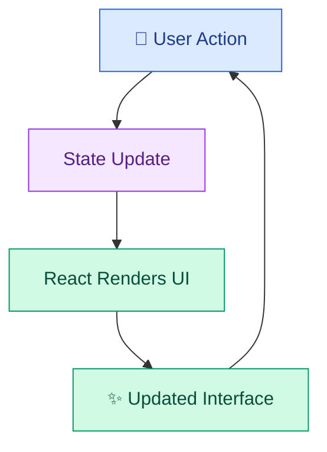
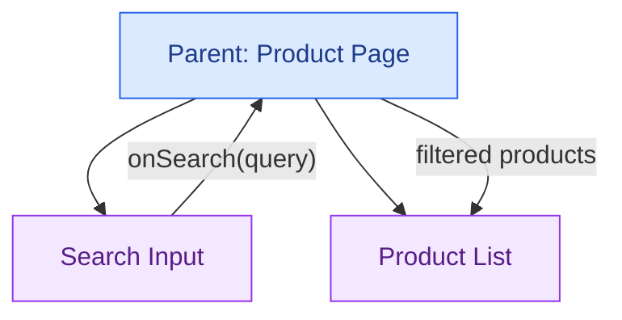

# 🔄 State Management, Hooks, and Forms

[⬅️ Previous](05-react-fundamentals-and-components.md) ·

Interactive applications need to remember information as users interact with them. React state stores changing UI data, hooks provide reusable behavior, and forms collect user input.

## 🎯 Learning Objectives

- Understand React state and component re-rendering.
- Use `useState` and `useEffect`.
- Create reusable custom hooks.
- Handle controlled inputs and form submission.
- Validate user input and display errors.
- Understand lifting state up and sharing state between components.
- Choose an appropriate state-management approach.

## 1. What is state?

**State** is data that can change over time and affect what a component displays.

Examples include:

- Search text.
- Selected product category.
- Shopping-cart items.
- Whether a modal is open.
- Form values and validation errors.
- Messages in an AI chat interface.

When React state changes, React can render the component again to reflect the new value.



## 2. The `useState` hook

`useState` adds a state variable to a function component.

```tsx
import { useState } from "react";

export default function Counter() {
  const [count, setCount] = useState(0);

  return (
    <section>
      <h2>Items selected: {count}</h2>

      <button
        type="button"
        onClick={() => setCount((current) => current + 1)}
      >
        Add
      </button>

      <button
        type="button"
        onClick={() => setCount((current) => Math.max(0, current - 1))}
      >
        Remove
      </button>
    </section>
  );
}
```

The hook returns the current state and a setter function. Calling the setter requests an update; React renders the component with the new state.

Use the functional update form when the next value depends on the previous value.

## 3. Updating objects and arrays immutably

Do not directly mutate state objects or arrays. Create a new value instead.

### Updating an object

```tsx
import { useState } from "react";

export default function ProfileForm() {
  const [profile, setProfile] = useState({
    name: "",
    city: "",
  });

  return (
    <form>
      <label>
        Name
        <input
          value={profile.name}
          onChange={(event) =>
            setProfile((previous) => ({
              ...previous,
              name: event.target.value,
            }))
          }
        />
      </label>

      <label>
        City
        <input
          value={profile.city}
          onChange={(event) =>
            setProfile((previous) => ({
              ...previous,
              city: event.target.value,
            }))
          }
        />
      </label>
    </form>
  );
}
```

The spread syntax preserves the other properties while replacing the updated field.

### Updating an array

```tsx
const [items, setItems] = useState<string[]>([]);

function addItem(item: string) {
  setItems((previous) => [...previous, item]);
}

function removeItem(item: string) {
  setItems((previous) =>
    previous.filter((existing) => existing !== item)
  );
}
```

## 4. The `useEffect` hook

`useEffect` synchronizes a component with an external system, such as a browser event listener, timer, or network connection.

It is not needed for every calculation. If a value can be derived from props or state during rendering, calculate it directly instead of storing a redundant copy.

### Example: updating the page title

```tsx
import { useEffect, useState } from "react";

export default function CartCounter() {
  const [count, setCount] = useState(0);

  useEffect(() => {
    document.title = `Cart (${count})`;
  }, [count]);

  return (
    <button
      type="button"
      onClick={() => setCount((current) => current + 1)}
    >
      Cart: {count}
    </button>
  );
}
```

The effect runs when `count` changes and synchronizes the browser tab title with the cart count.

### Fetching data with an effect

```tsx
import { useEffect, useState } from "react";

interface Post {
  id: number;
  title: string;
}

export default function PostList() {
  const [posts, setPosts] = useState<Post[]>([]);
  const [loading, setLoading] = useState(true);
  const [error, setError] = useState("");

  useEffect(() => {
    const controller = new AbortController();

    async function loadPosts() {
      try {
        setLoading(true);
        setError("");

        const response = await fetch(
          "https://jsonplaceholder.typicode.com/posts?_limit=5",
          { signal: controller.signal }
        );

        if (!response.ok) {
          throw new Error(`Request failed: ${response.status}`);
        }

        const data: unknown = await response.json();

        if (!Array.isArray(data)) {
          throw new Error("Unexpected response format");
        }

        setPosts(data as Post[]);
      } catch (err) {
        if (err instanceof Error && err.name !== "AbortError") {
          setError(err.message);
        }
      } finally {
        if (!controller.signal.aborted) {
          setLoading(false);
        }
      }
    }

    loadPosts();

    return () => controller.abort();
  }, []);

  if (loading) return <p>Loading posts...</p>;
  if (error) return <p role="alert">Error: {error}</p>;

  return (
    <ul>
      {posts.map((post) => (
        <li key={post.id}>{post.title}</li>
      ))}
    </ul>
  );
}
```

This example demonstrates cleanup and loading/error states. For production code, validate external JSON with a runtime schema rather than relying on a TypeScript assertion.

For larger applications, a framework's data-loading features or a dedicated data-fetching library may provide caching, retries, and request deduplication more effectively than manually writing effects.

## 5. Controlled forms

A controlled form stores its current field values in React state.

Create `src/components/ProductForm.tsx`:

```tsx
import { useState } from "react";

interface ProductFormValues {
  name: string;
  price: string;
  category: string;
}

export default function ProductForm() {
  const [form, setForm] = useState<ProductFormValues>({
    name: "",
    price: "",
    category: "Dresses",
  });

  const [error, setError] = useState("");
  const [success, setSuccess] = useState("");

  function updateField(
    field: keyof ProductFormValues,
    value: string
  ) {
    setForm((previous) => ({
      ...previous,
      [field]: value,
    }));

    setError("");
    setSuccess("");
  }

  function handleSubmit(
    event: React.FormEvent<HTMLFormElement>
  ) {
    event.preventDefault();

    const name = form.name.trim();
    const price = Number(form.price);

    if (!name) {
      setError("Enter a product name.");
      return;
    }

    if (!form.price.trim() || !Number.isFinite(price) || price <= 0) {
      setError("Enter a valid price greater than zero.");
      return;
    }

    setSuccess(
      `Validated ${name} in ${form.category} at ₹${price.toFixed(2)}.`
    );
  }

  return (
    <form onSubmit={handleSubmit}>
      <h2>Add a Product</h2>

      <label>
        Product name
        <input
          value={form.name}
          onChange={(event) =>
            updateField("name", event.target.value)
          }
          required
        />
      </label>

      <label>
        Price
        <input
          type="number"
          min="0.01"
          step="0.01"
          value={form.price}
          onChange={(event) =>
            updateField("price", event.target.value)
          }
          required
        />
      </label>

      <label>
        Category
        <select
          value={form.category}
          onChange={(event) =>
            updateField("category", event.target.value)
          }
        >
          <option value="Dresses">Dresses</option>
          <option value="Tops">Tops</option>
          <option value="Jeans">Jeans</option>
        </select>
      </label>

      <button type="submit">Validate Product</button>

      {error && <p role="alert">{error}</p>}
      {success && <p role="status">{success}</p>}
    </form>
  );
}
```

This example validates input in the browser but does not save a product to a database. A backend must independently validate submitted values before accepting them.

## 6. Form validation

A reliable form should provide feedback that helps users correct mistakes.

Validation may include:

- Required fields.
- Email formatting.
- Numeric ranges.
- Minimum or maximum lengths.
- Valid selections.
- Cross-field rules.
- Server-side business rules.

Use built-in HTML constraints such as `required`, `min`, `max`, and `type="email"` when appropriate. Client-side validation improves usability but cannot replace server-side validation.

## 7. Lifting state up

If two components need the same state, move it to their nearest common parent and pass values and callbacks through props.



For example, the search input updates a query stored in the parent, and the product list renders the filtered results.

## 8. When to use different state-management approaches

| Approach | Suitable use |
|---|---|
| Local `useState` | A toggle, input value, or open modal |
| Lifted state | Several related components need the same data |
| `useReducer` | Complex state transitions with multiple related actions |
| Context | Sharing values such as theme or authenticated-user information |
| External state library | Larger shared client state with specific coordination needs |
| Server-state library or framework data APIs | Fetching, caching, refreshing, and synchronizing server data |

Do not add a large state library simply because the application uses React. Start with the simplest approach that keeps the data flow understandable.

## 9. Custom hooks

A custom hook packages reusable stateful behavior.

```tsx
import { useState } from "react";

export function useToggle(initialValue = false) {
  const [value, setValue] = useState(initialValue);

  function toggle() {
    setValue((previous) => !previous);
  }

  return { value, toggle, setValue };
}
```

Use it in a component:

```tsx
import { useToggle } from "./useToggle";

export default function ThemeButton() {
  const { value: darkMode, toggle } = useToggle();

  return (
    <button type="button" onClick={toggle}>
      {darkMode ? "Switch to Light Mode" : "Switch to Dark Mode"}
    </button>
  );
}
```

This example changes the label. To change the whole application's theme, connect the value to a theme class or shared theme provider.

Custom hooks must follow React's hook rules: call them at the top level of a component or another custom hook, not inside loops or conditional branches.

## 10. Common mistakes

- Mutating arrays or objects in state.
- Using effects for values that can be calculated directly.
- Forgetting to clean up event listeners, timers, or requests.
- Using controlled inputs without an `onChange` handler.
- Validating a form only in the browser.
- Duplicating the same state in multiple components unnecessarily.
- Placing every value in global state.

## 11. Best practices

- Keep state close to the components that need it.
- Use functional updates when the next value depends on the previous value.
- Use controlled inputs when the UI needs immediate access to form values.
- Display useful loading, validation, and error messages.
- Clean up external subscriptions and requests.
- Use custom hooks for repeated stateful logic.
- Validate all important data on the backend.
- Choose state tools based on real application needs.

## ✅ Key Takeaways

- State represents changing UI data.
- Hooks provide reusable behavior in function components.
- Effects synchronize with external systems and require appropriate cleanup.
- Controlled forms make field values and validation easier to manage.
- State ownership and data flow should remain clear as applications grow.
