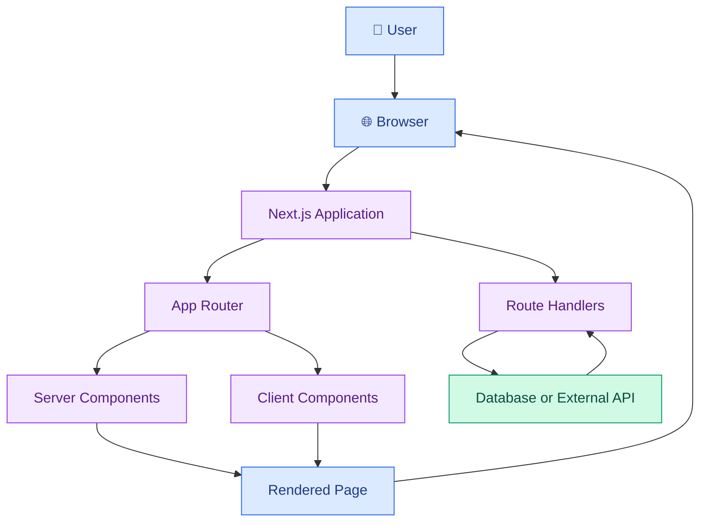

# ▲ Next.js and Full-Stack Web Applications

[⬅️ Previous](06-state-management-hooks-and-forms.md) ·

Next.js is a React framework for building web applications with routing, server rendering, data-loading patterns, and server-side capabilities. It helps developers organize frontend pages and, when appropriate, backend endpoints within one application.

## 🎯 Learning Objectives

- Understand the relationship between React and Next.js.
- Create a Next.js application.
- Use the App Router and file-based routing.
- Build layouts, pages, and reusable components.
- Understand Server Components and Client Components.
- Handle forms and server-side operations.
- Learn when Next.js API endpoints are appropriate.
- Build a small full-stack application structure.

## 1. What is Next.js?

React is a library for building user interfaces. Next.js builds on React and provides an application framework with routing, rendering strategies, and server-side capabilities.



The exact rendering and request flow depends on the page, configuration, and data-fetching strategy.

## 2. Create a Next.js project

Use a current supported Node.js version.

```powershell
npx create-next-app@latest boutique-next
cd boutique-next
npm run dev
```

During setup, choose TypeScript and the App Router. Tailwind CSS is useful for the styling examples in Topic 08, but the framework can also use regular CSS.

Open the local address printed in the terminal, typically `http://localhost:3000`.

## 3. Understand the App Router

Next.js uses folders and special files under `app/` to define routes.

```text
boutique-next/
├── app/
│   ├── layout.tsx
│   ├── page.tsx
│   ├── globals.css
│   ├── products/
│   │   └── page.tsx
│   ├── about/
│   │   └── page.tsx
│   └── api/
│       └── products/
│           └── route.ts
├── components/
│   └── ProductCard.tsx
├── public/
└── package.json
```

Examples:

- `app/page.tsx` defines `/`.
- `app/products/page.tsx` defines `/products`.
- `app/about/page.tsx` defines `/about`.
- `app/api/products/route.ts` can handle requests to `/api/products`.

These conventions are specific to the App Router. A Next.js project using the older Pages Router follows a different file structure.

## 4. Build a page and layout

Create `app/page.tsx`:

```tsx
import Link from "next/link";

export default function HomePage() {
  return (
    <main>
      <h1>Welcome to Lumière Boutique</h1>
      <p>Discover our latest collection.</p>

      <Link href="/products">Explore Products</Link>
    </main>
  );
}
```

Create `app/products/page.tsx`:

```tsx
const products = [
  { id: "P101", name: "Summer Dress", price: 2499 },
  { id: "P102", name: "Classic White Top", price: 899 },
  { id: "P103", name: "Denim Jeans", price: 1599 },
];

export default function ProductsPage() {
  return (
    <main>
      <h1>Our Products</h1>

      <ul>
        {products.map((product) => (
          <li key={product.id}>
            {product.name} — ₹{product.price.toLocaleString("en-IN")}
          </li>
        ))}
      </ul>
    </main>
  );
}
```

Create `app/layout.tsx` or adapt the layout generated by the project:

```tsx
import type { Metadata } from "next";
import "./globals.css";

export const metadata: Metadata = {
  title: "Lumière Boutique",
  description: "Explore a curated boutique collection.",
};

export default function RootLayout({
  children,
}: Readonly<{
  children: React.ReactNode;
}>) {
  return (
    <html lang="en">
      <body>{children}</body>
    </html>
  );
}
```

The root layout wraps pages and is a suitable place for shared HTML structure and metadata.

## 5. Server Components and Client Components

In the App Router, pages and layouts are Server Components by default.

**Server Components** are useful for:

- Reading data securely on the server.
- Rendering content without shipping component JavaScript for that component.
- Keeping server-only dependencies away from the browser bundle.
- Accessing server-side resources when appropriately configured.

**Client Components** are needed for interactive features such as React state, event handlers, and browser APIs.

Add `"use client"` at the top of a file when it needs client-side React features.

```tsx
"use client";

import { useState } from "react";

export default function FavoriteButton() {
  const [favorite, setFavorite] = useState(false);

  return (
    <button
      type="button"
      aria-pressed={favorite}
      onClick={() => setFavorite((current) => !current)}
    >
      {favorite ? "♥ Saved" : "♡ Add to favorites"}
    </button>
  );
}
```

Keep the client boundary as small as practical. A mostly static product page does not need to become an entire Client Component just because one button is interactive.

## 6. Fetch data on the server

A Server Component can fetch data directly without exposing private service credentials to the browser.

```tsx
interface Post {
  id: number;
  title: string;
}

export default async function PostsPage() {
  const response = await fetch(
    "https://jsonplaceholder.typicode.com/posts?_limit=5"
  );

  if (!response.ok) {
    throw new Error("Unable to load posts");
  }

  const posts: Post[] = await response.json();

  return (
    <main>
      <h1>Latest Posts</h1>
      <ul>
        {posts.map((post) => (
          <li key={post.id}>{post.title}</li>
        ))}
      </ul>
    </main>
  );
}
```

This uses a public demonstration API. In production, validate untrusted responses and choose caching or revalidation behavior deliberately. Next.js caching defaults and capabilities vary by version, so consult the documentation for the version used by your project.

## 7. Route handlers: build an API endpoint

Create `app/api/products/route.ts`:

```typescript
import { NextResponse } from "next/server";

const products = [
  { id: "P101", name: "Summer Dress", price: 2499 },
  { id: "P102", name: "White Top", price: 899 },
];

export async function GET() {
  return NextResponse.json({ products });
}
```

Run the application and open `/api/products` in your browser. The endpoint returns JSON.

A route handler can implement methods such as `GET`, `POST`, `PATCH`, and `DELETE`. For write operations, validate the request body, authenticate the caller when required, authorize the action, and apply appropriate rate limits.

## 8. Server Actions and forms

Server Actions can handle server-side mutations from React interfaces. They should be treated as externally reachable operations and protected with validation and authorization—not as automatically secure functions.

For example, a product creation operation should:

1. Validate the product fields.
2. Verify that the user is authorized to manage products.
3. Write the data using a trusted database client.
4. Return a controlled result.
5. Refresh or revalidate relevant data where needed.

For a small application, Server Actions can reduce boilerplate. For a separately deployed frontend and backend, a REST API may be a better boundary.

## 9. Build a reusable product card

Create `components/ProductCard.tsx`:

```tsx
interface ProductCardProps {
  name: string;
  price: number;
  category: string;
}

export default function ProductCard({
  name,
  price,
  category,
}: ProductCardProps) {
  return (
    <article className="product-card">
      <p>{category}</p>
      <h2>{name}</h2>
      <strong>
        {price.toLocaleString("en-IN", {
          style: "currency",
          currency: "INR",
          maximumFractionDigits: 0,
        })}
      </strong>
    </article>
  );
}
```

Use it from a page:

```tsx
import ProductCard from "@/components/ProductCard";

export default function ProductsPage() {
  return (
    <main>
      <h1>Our Collection</h1>

      <div className="product-grid">
        <ProductCard
          name="Summer Dress"
          price={2499}
          category="Dresses"
        />
        <ProductCard
          name="White Top"
          price={899}
          category="Tops"
        />
      </div>
    </main>
  );
}
```

If your project does not have the `@/` path alias configured, use a relative import instead.

## 10. When to choose Next.js

Next.js is a strong option when you need:

- File-based routing.
- Server-rendered pages.
- Server-side data access.
- Search-engine-friendly content.
- Integrated backend route handlers.
- A unified React application structure.

A Vite React application may be simpler for a client-heavy dashboard, prototype, or application that already uses a separate backend. The choice depends on requirements, deployment, and team familiarity.

## 11. Common mistakes

- Using browser hooks inside a Server Component.
- Adding `"use client"` to every component unnecessarily.
- Exposing private environment variables to the browser.
- Assuming route handlers automatically provide authentication.
- Failing to validate form data on the server.
- Ignoring caching and stale data.
- Using server-only libraries in client components.

## 12. Best practices

- Use Server Components for server-oriented work where appropriate.
- Keep interactive client components focused.
- Validate untrusted data at application boundaries.
- Protect mutations with authentication and authorization.
- Use clear loading and error states.
- Configure caching deliberately.
- Keep secrets in server-only configuration.
- Use reusable components and layouts to reduce duplication.

## ✅ Key Takeaways

- Next.js extends React with routing and server-side application capabilities.
- Server Components and Client Components serve different purposes.
- Route handlers can expose API endpoints.
- Server Actions and APIs require validation and authorization.
- Choose rendering, caching, and deployment strategies according to the application.
