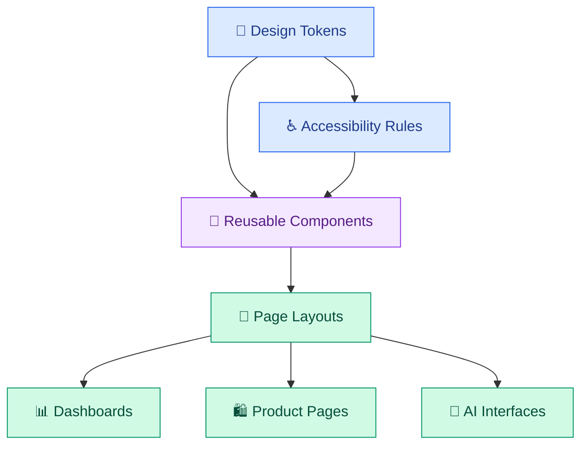
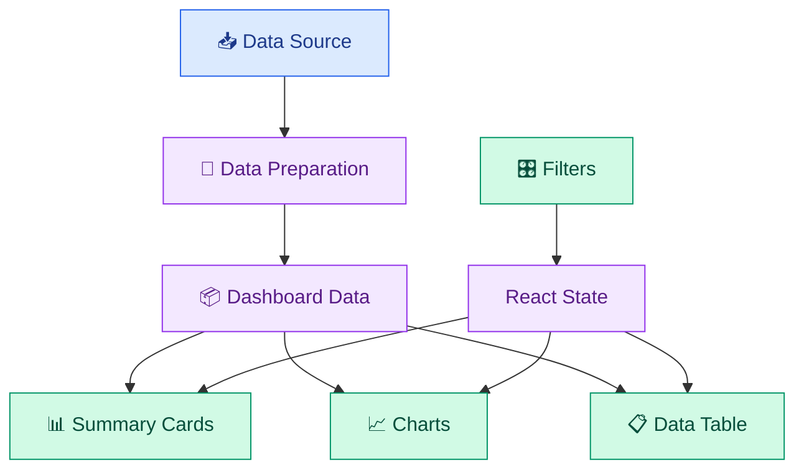

# 🎨 UI Libraries, Design Systems, and Interactive Dashboards

[⬅️ Previous](07-nextjs-and-full-stack-web-applications.md) ·

Modern applications need more than functional components. They also need consistent styling, reusable design patterns, interactive data visualizations, and interfaces that remain understandable as the application grows.

This topic explores UI libraries, design systems, component styling, dashboard architecture, and dynamic data visualization.

## 🎯 Learning Objectives

- Understand UI libraries and design systems.
- Build reusable components with consistent styles.
- Explore Tailwind CSS and component-library concepts.
- Understand dashboard layouts, cards, filters, tables, and charts.
- Connect React state to interactive visualizations.
- Build a working interactive analytics dashboard.
- Apply responsive design and accessibility principles.

## 1. What is a UI library?

A UI library provides reusable interface components, such as buttons, inputs, dropdowns, dialogs, tables, and navigation elements.

Examples include:

- **Material UI:** React components following Material Design principles.
- **Chakra UI:** React components with styling and composition features.
- **Ant Design:** components commonly used for business applications and admin dashboards.
- **shadcn/ui:** customizable component source code built around Radix UI and Tailwind CSS.
- **Tailwind CSS:** utility-first CSS framework for composing styles directly in markup.

These tools serve different purposes. Tailwind CSS is primarily a styling framework, while Material UI and Ant Design provide component systems. shadcn/ui gives developers customizable component code rather than functioning as a traditional prebuilt component package.

## 2. What is a design system?

A design system defines reusable visual rules, component patterns, and interaction conventions.

It commonly includes:

- Color tokens.
- Typography scales.
- Spacing rules.
- Border radii and shadows.
- Buttons and form controls.
- Navigation and layout patterns.
- Accessibility guidelines.
- Documentation and usage conventions.



A design system ensures that a button, card, or form behaves consistently across different pages.

## 3. Define design tokens with CSS variables

Create a shared foundation for your application.

```css
:root {
  --color-background: #f5f3ff;
  --color-surface: #ffffff;
  --color-text: #241b35;
  --color-muted: #6b6480;
  --color-primary: #6d28d9;
  --color-border: #e5def5;

  --radius-card: 1rem;
  --radius-control: 0.6rem;

  --space-1: 0.25rem;
  --space-2: 0.5rem;
  --space-3: 0.75rem;
  --space-4: 1rem;
  --space-6: 1.5rem;
  --space-8: 2rem;
}

body {
  margin: 0;
  background: var(--color-background);
  color: var(--color-text);
  font-family: system-ui, sans-serif;
}

.card {
  padding: var(--space-6);
  border: 1px solid var(--color-border);
  border-radius: var(--radius-card);
  background: var(--color-surface);
}
```

If you later change the primary color or card radius, you can update the design in one place rather than editing dozens of individual components.

## 4. Install a UI or styling library

For an existing Vite React TypeScript application, Tailwind CSS can be added using the setup instructions for the installed Tailwind version.

For example, in a project using a compatible Tailwind CSS Vite plugin:

```powershell
npm install tailwindcss @tailwindcss/vite
```

Configure the plugin in `vite.config.ts` according to the installed version and add the required Tailwind import to your CSS entry file.

For a React project that uses Material UI:

```powershell
npm install @mui/material @emotion/react @emotion/styled
```

Example:

```tsx
import Button from "@mui/material/Button";

export default function SaveButton() {
  return (
    <Button variant="contained" onClick={() => console.log("Saved")}>
      Save Changes
    </Button>
  );
}
```

For a Next.js project, follow the installation guide for that framework rather than copying Vite-specific configuration.

**Important:** avoid installing multiple component libraries without a reason. Choose a consistent styling approach and verify compatibility with your existing React, Vite, Next.js, and Tailwind versions.

## 5. What is an interactive dashboard?

A dashboard presents important information in a form that users can scan, compare, filter, and investigate.

A typical analytics dashboard may include:

- Summary cards.
- Time-period selectors.
- Search and filters.
- Tables of records.
- Charts showing trends.
- Loading and error states.
- Export or drill-down actions.



A useful dashboard connects user controls to the data displayed by its cards, charts, and tables.

## 6. Build a complete interactive analytics dashboard

This project uses React, TypeScript, and Recharts. It includes sample order data, date-independent category filtering, summary metrics, a chart, and a table.

### Step 1: Create a React application

```powershell
npm create vite@latest analytics-dashboard -- --template react-ts
cd analytics-dashboard
npm install
npm install recharts
npm run dev
```

### Step 2: Create `src/data.ts`

```typescript
export interface Order {
  id: string;
  product: string;
  category: string;
  quantity: number;
  revenue: number;
}

export const orders: Order[] = [
  {
    id: "O101",
    product: "Summer Dress",
    category: "Dresses",
    quantity: 2,
    revenue: 4998,
  },
  {
    id: "O102",
    product: "White Top",
    category: "Tops",
    quantity: 3,
    revenue: 2697,
  },
  {
    id: "O103",
    product: "Denim Jeans",
    category: "Jeans",
    quantity: 1,
    revenue: 1599,
  },
  {
    id: "O104",
    product: "Party Gown",
    category: "Dresses",
    quantity: 1,
    revenue: 4999,
  },
  {
    id: "O105",
    product: "Casual Top",
    category: "Tops",
    quantity: 4,
    revenue: 2796,
  },
];
```

These are illustrative records, not real business data.

### Step 3: Create `src/App.tsx`

```tsx
import { useMemo, useState } from "react";
import {
  Bar,
  BarChart,
  CartesianGrid,
  ResponsiveContainer,
  Tooltip,
  XAxis,
  YAxis,
} from "recharts";

import { orders } from "./data";
import "./App.css";

export default function App() {
  const [category, setCategory] = useState("All");
  const [query, setQuery] = useState("");

  const filteredOrders = useMemo(() => {
    const normalizedQuery = query.trim().toLowerCase();

    return orders.filter((order) => {
      const matchesCategory =
        category === "All" || order.category === category;

      const matchesQuery =
        order.product.toLowerCase().includes(normalizedQuery) ||
        order.id.toLowerCase().includes(normalizedQuery);

      return matchesCategory && matchesQuery;
    });
  }, [category, query]);

  const totalRevenue = filteredOrders.reduce(
    (total, order) => total + order.revenue,
    0
  );

  const totalUnits = filteredOrders.reduce(
    (total, order) => total + order.quantity,
    0
  );

  const chartData = useMemo(() => {
    const grouped = new Map<string, number>();

    for (const order of filteredOrders) {
      grouped.set(
        order.category,
        (grouped.get(order.category) ?? 0) + order.revenue
      );
    }

    return Array.from(grouped, ([name, revenue]) => ({
      name,
      revenue,
    }));
  }, [filteredOrders]);

  return (
    <main className="dashboard">
      <header className="dashboard-header">
        <div>
          <p className="eyebrow">ANALYTICS WORKSPACE</p>
          <h1>Boutique Dashboard</h1>
          <p>Explore sample sales and product performance.</p>
        </div>
      </header>

      <section className="metrics" aria-label="Summary metrics">
        <article className="metric">
          <span>Revenue</span>
          <strong>
            ₹{totalRevenue.toLocaleString("en-IN")}
          </strong>
        </article>

        <article className="metric">
          <span>Orders</span>
          <strong>{filteredOrders.length}</strong>
        </article>

        <article className="metric">
          <span>Units</span>
          <strong>{totalUnits}</strong>
        </article>
      </section>

      <section className="panel">
        <div className="filters">
          <label>
            Search orders
            <input
              value={query}
              onChange={(event) => setQuery(event.target.value)}
              placeholder="Search product or order ID"
            />
          </label>

          <label>
            Category
            <select
              value={category}
              onChange={(event) => setCategory(event.target.value)}
            >
              <option value="All">All categories</option>
              <option value="Dresses">Dresses</option>
              <option value="Tops">Tops</option>
              <option value="Jeans">Jeans</option>
            </select>
          </label>
        </div>
      </section>

      <section className="panel">
        <h2>Revenue by category</h2>

        {chartData.length === 0 ? (
          <p>No chart data matches your filters.</p>
        ) : (
          <div className="chart">
            <ResponsiveContainer width="100%" height="100%">
              <BarChart data={chartData}>
                <CartesianGrid strokeDasharray="3 3" />
                <XAxis dataKey="name" />
                <YAxis />
                <Tooltip
                  formatter={(value) =>
                    `₹${Number(value).toLocaleString("en-IN")}`
                  }
                />
                <Bar dataKey="revenue" name="Revenue" />
              </BarChart>
            </ResponsiveContainer>
          </div>
        )}
      </section>

      <section className="panel">
        <h2>Order details</h2>

        {filteredOrders.length === 0 ? (
          <p>No orders match your search.</p>
        ) : (
          <div className="table-wrapper">
            <table>
              <thead>
                <tr>
                  <th>Order ID</th>
                  <th>Product</th>
                  <th>Category</th>
                  <th>Units</th>
                  <th>Revenue</th>
                </tr>
              </thead>

              <tbody>
                {filteredOrders.map((order) => (
                  <tr key={order.id}>
                    <td>{order.id}</td>
                    <td>{order.product}</td>
                    <td>{order.category}</td>
                    <td>{order.quantity}</td>
                    <td>
                      ₹{order.revenue.toLocaleString("en-IN")}
                    </td>
                  </tr>
                ))}
              </tbody>
            </table>
          </div>
        )}
      </section>
    </main>
  );
}
```

### Step 4: Create `src/App.css`

```css
* {
  box-sizing: border-box;
}

:root {
  font-family: Inter, system-ui, sans-serif;
  color: #20203a;
  background: #f4f3fa;
}

body {
  margin: 0;
}

.dashboard {
  width: min(100% - 2rem, 1200px);
  margin: 0 auto;
  padding-block: 2rem;
}

.dashboard-header {
  margin-bottom: 1.5rem;
}

.eyebrow {
  color: #6d28d9;
  font-size: 0.75rem;
  font-weight: 800;
  letter-spacing: 0.14em;
}

h1 {
  margin-bottom: 0.5rem;
  font-size: clamp(1.8rem, 4vw, 2.8rem);
}

h2 {
  font-size: 1.15rem;
}

.metrics {
  display: grid;
  grid-template-columns: repeat(
    auto-fit,
    minmax(min(100%, 200px), 1fr)
  );
  gap: 1rem;
}

.metric,
.panel {
  padding: 1.25rem;
  border: 1px solid #e4e0f0;
  border-radius: 1rem;
  background: white;
  box-shadow: 0 8px 24px #20203a08;
}

.metric {
  display: flex;
  flex-direction: column;
  gap: 0.75rem;
}

.metric span {
  color: #716b85;
}

.metric strong {
  font-size: 1.8rem;
  color: #6d28d9;
  overflow-wrap: anywhere;
}

.panel {
  margin-top: 1rem;
}

.filters {
  display: grid;
  grid-template-columns: repeat(
    auto-fit,
    minmax(min(100%, 240px), 1fr)
  );
  gap: 1rem;
}

label {
  display: grid;
  gap: 0.5rem;
  font-weight: 600;
}

input,
select {
  width: 100%;
  min-width: 0;
  padding: 0.8rem;
  border: 1px solid #d8d2e8;
  border-radius: 0.6rem;
  background: white;
  color: inherit;
  font: inherit;
}

.chart {
  width: 100%;
  height: 300px;
}

.table-wrapper {
  width: 100%;
  overflow-x: auto;
}

table {
  width: 100%;
  border-collapse: collapse;
  text-align: left;
}

th,
td {
  padding: 0.9rem;
  border-bottom: 1px solid #ece8f4;
  white-space: nowrap;
}

th {
  color: #5b4b7a;
  font-size: 0.85rem;
}

input:focus-visible,
select:focus-visible {
  outline: 3px solid #c4b5fd;
  outline-offset: 2px;
}

@media (max-width: 500px) {
  .dashboard {
    width: min(100% - 1rem, 1200px);
    padding-block: 1rem;
  }

  .metric,
  .panel {
    padding: 1rem;
  }

  .chart {
    height: 250px;
  }
}
```

### Step 5: Run and explore

```powershell
npm run dev
```

Use the search field and category selector. The summary cards, chart, and table should update together because they derive their values from the same filtered order list.

Expected total revenue across all sample orders is **₹17,089**, with 5 orders and 11 units.

## 7. Design a dashboard that users can understand

An effective dashboard answers important questions quickly.

### Summary cards

Use them for a small set of high-value metrics. Explain units and comparison periods when relevant.

### Charts

Choose chart types according to the question:

- Bar charts for comparing categories.
- Line charts for trends over time.
- Scatter plots for relationships between numeric variables.
- Tables for exact values and detailed records.

Avoid choosing a chart only because it looks impressive.

### Filters

Filters should clearly affect the data users see. Keep selections visible and provide an empty state when nothing matches.

### Tables

Use readable column names, sensible alignment, and responsive overflow behavior. For larger datasets, consider sorting, pagination, and server-side filtering.

## 8. AI-powered dashboards

AI can make a dashboard easier to explore by allowing natural-language questions such as:

- "Which product category has the highest revenue?"
- "Summarize the recent sales pattern."
- "Explain why this metric changed."
- "Find unusual changes in the data."

A sensible architecture separates calculation from explanation:

1. The backend retrieves trusted data.
2. Deterministic code calculates metrics.
3. The application sends an appropriately limited summary to an AI model.
4. The model generates an explanation.
5. The interface displays the explanation with relevant evidence.

Do not ask an LLM to invent financial totals when the application can calculate them directly. Validate the figures and control access to sensitive data.

## 9. Common mistakes

- Using inconsistent colors, typography, and spacing across pages.
- Displaying too many metrics without clear priorities.
- Using a chart that does not fit the data.
- Forgetting empty, loading, and error states.
- Making tables unusable on mobile screens.
- Calculating metrics independently in multiple components, causing inconsistencies.
- Treating AI-generated explanations as verified facts.

## 10. Best practices

- Establish shared design tokens.
- Build reusable components with consistent behavior.
- Use responsive Grid and Flexbox layouts.
- Connect filters and charts to a clear data model.
- Label charts, tables, and controls accessibly.
- Keep calculations in reusable functions or a trusted backend.
- Validate API data and handle failures.
- Use realistic test datasets and verify calculated totals.
- Evaluate AI-generated insights against the underlying data.

## ✅ Key Takeaways

- UI libraries speed up development, while design systems maintain consistency.
- Dashboards should make data easy to scan and investigate.
- React state can coordinate filters, tables, and charts.
- AI can explain data, but calculations and authorization should remain grounded in trusted application logic.