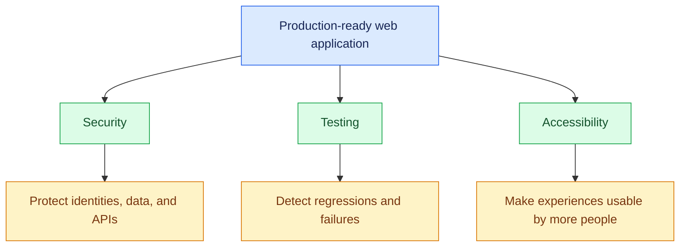
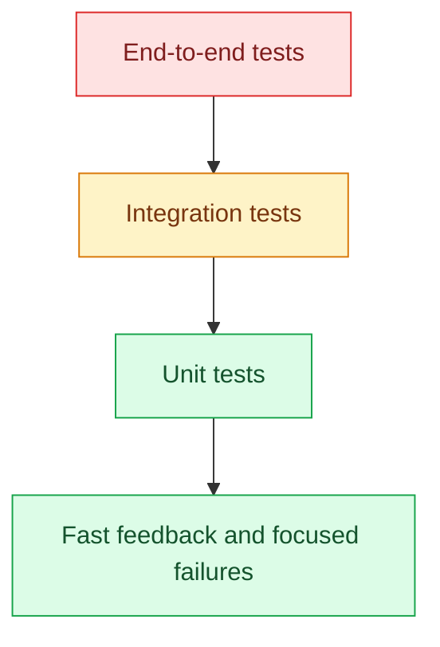

# 17. Web Security, Testing, and Accessibility

[⬅️ Back to Learning Modules](../README.md) · 

> 🛡️ AI Developer — Web Development 

## 🎯 Learning Objectives

By the end of this topic, you will be able to:

- Identify common web application security vulnerabilities.
- Protect APIs, user sessions, and sensitive business information.
- Write unit, integration, and end-to-end tests.
- Test React components and Node.js endpoints.
- Build accessible interfaces using semantic HTML, keyboard navigation, and ARIA where needed.
- Apply a practical security and accessibility checklist before release.

## 1. 🌐 Why Production Readiness Matters

An application that works on a developer's computer is not necessarily ready for real users. Production applications must protect data, handle unexpected failures, work across different devices, and support people with different abilities.

Consider a boutique management system:

- Customers can browse products and manage their own orders.
- Managers can update the catalog.
- Owners can access authorized financial information.
- Visitors may use keyboards, screen readers, mobile devices, or assistive technologies.

A production-ready application needs more than attractive UI components. It needs security controls, automated tests, and accessible interaction patterns.

### Three Pillars of Production Quality



## 2. 🔐 Essential Web Security Concepts

### Authentication and Authorization

Authentication establishes a user's identity. Authorization determines which operations that identity may perform.

For example, a manager might be allowed to edit product listings but not view the owner's financial reports.

**Important:** Hiding a button in React does not protect an API. Enforce authorization on the backend for every protected operation.

### SQL Injection

SQL injection occurs when untrusted input is incorporated into SQL in an unsafe way.

Unsafe:

```javascript
// Do not concatenate user input into SQL.
const query =
  `SELECT * FROM users WHERE email = '${req.query.email}'`;
```

Safer:

```javascript
const result = await pool.query(
  "SELECT id, email FROM users WHERE email = $1",
  [req.query.email]
);
```

Parameterized queries separate SQL instructions from input values.

### Cross-Site Scripting (XSS)

XSS occurs when an attacker can cause malicious script content to execute in another user's browser.

Mitigations include:

- Render untrusted text as text rather than HTML.
- Avoid unsafe HTML injection.
- Sanitize HTML when the product genuinely needs to display user-authored HTML.
- Apply an appropriate Content Security Policy (CSP).
- Keep dependencies updated.

React escapes ordinary text expressions by default, but unsafe HTML APIs, third-party libraries, and poorly designed URL handling can introduce risks.

### Cross-Site Request Forgery (CSRF)

CSRF can occur when a browser automatically attaches authentication cookies to a request an attacker has induced the browser to make.

For cookie-authenticated applications, use appropriate `SameSite` cookie settings and CSRF protections suited to the application's architecture. CORS alone is not a complete CSRF defense.

### Broken Access Control

Every endpoint that accesses protected information should verify both permissions and, where relevant, record ownership.

For example, checking that a customer is signed in is not sufficient to let them read any order ID they submit. The server must ensure the requested order belongs to that customer or that the user has a permitted administrative role.

## 3. 🛡️ Secure Express API Configuration

Install commonly used middleware:

```bash
npm install helmet express-rate-limit
```

Configure security headers and a login rate limit in your Express server:

```javascript
const helmet = require("helmet");
const rateLimit = require("express-rate-limit");

app.use(helmet());

const loginLimiter = rateLimit({
  windowMs: 15 * 60 * 1000,
  limit: 10,
  standardHeaders: "draft-8",
  legacyHeaders: false,
  message: {
    error: "Too many login attempts. Try again later."
  }
});

app.use("/api/auth/login", loginLimiter);
```

This is a starting point, not a complete security configuration. Tune rate limits for legitimate traffic, use a suitable shared store when running multiple instances, and consider reverse-proxy configuration when determining client IP addresses.

Additional controls should include:

- Restrictive CORS configuration.
- Request body size limits.
- Input validation and output shaping.
- Secure session or token management.
- HTTPS in production.
- Safe error responses.
- Audit logging for sensitive administrative operations.

Never return stack traces, password hashes, secret keys, or internal database details to ordinary API clients.

## 4. 🔑 Protect Secrets and User Data

Use environment variables or a secrets manager for backend credentials.

Example server configuration:

```env
DATABASE_URL=your-private-database-connection
SESSION_SECRET=your-long-random-session-secret
```

Add `.env` to `.gitignore`. Use separate credentials for development, testing, and production.

For frontend applications, remember that environment variables bundled into browser JavaScript are not secret. A variable named `VITE_API_KEY` can be visible to anyone who downloads the frontend assets.

Other important practices:

- Hash passwords with a suitable password-hashing algorithm.
- Avoid logging passwords, session cookies, authorization headers, and sensitive personal data.
- Limit database accounts to the permissions the application needs.
- Rotate credentials when they are exposed.
- Back up important data and test restoration.
- Apply data retention and deletion policies appropriate to the application.

## 5. 🧪 Types of Software Testing

Testing verifies that an application behaves as expected.

| Test type | What it verifies | Example |
|---|---|---|
| Unit test | One function or component | Product price formatting |
| Integration test | Multiple components working together | Express route with a test database |
| End-to-end test | A complete user workflow | Manager logs in and adds a product |
| Regression test | Previously working behavior remains correct | Catalog filtering still works after an update |
| Accessibility test | Accessibility rules and interaction behavior | Keyboard navigation and accessible labels |
| Security test | Resistance to identified threats | Customer cannot access owner reports |

### Testing Pyramid



A useful strategy is to have many fast, focused unit tests, a solid set of integration tests, and a smaller set of high-value end-to-end tests. The exact balance depends on the application.

## 6. ⚙️ Write a Unit Test

For a Vite React project, install Vitest and React Testing Library:

```bash
npm install --save-dev vitest jsdom @testing-library/react @testing-library/jest-dom @testing-library/user-event
```

Add a test script to `package.json`:

```json
{
  "scripts": {
    "test": "vitest",
    "test:run": "vitest run"
  }
}
```

Create a simple utility in `src/utils/formatPrice.ts`:

```typescript
export function formatPrice(price: number): string {
  return new Intl.NumberFormat("en-IN", {
    style: "currency",
    currency: "INR",
    maximumFractionDigits: 2
  }).format(price);
}
```

Create `src/utils/formatPrice.test.ts`:

```typescript
import { describe, expect, it } from "vitest";
import { formatPrice } from "./formatPrice";

describe("formatPrice", () => {
  it("formats a price in Indian rupees", () => {
    expect(formatPrice(2499)).toBe("₹2,499.00");
  });

  it("handles zero", () => {
    expect(formatPrice(0)).toBe("₹0.00");
  });
});
```

Run:

```bash
npm run test:run
```

Tests should verify behavior rather than merely repeat the implementation. Add cases for invalid input if the utility is expected to handle it.

## 7. ⚛️ Test React Components

Suppose a product card displays a name and price.

```tsx
type ProductCardProps = {
  name: string;
  price: number;
};

export function ProductCard({ name, price }: ProductCardProps) {
  return (
    <article>
      <h2>{name}</h2>
      <p>₹{price.toLocaleString("en-IN")}</p>
    </article>
  );
}
```

A component test can verify that the expected information is visible.

Create `ProductCard.test.tsx`:

```tsx
import { render, screen } from "@testing-library/react";
import { describe, expect, it } from "vitest";
import { ProductCard } from "./ProductCard";

describe("ProductCard", () => {
  it("displays the product name and price", () => {
    render(
      <ProductCard
        name="Floral Summer Dress"
        price={2499}
      />
    );

    expect(
      screen.getByRole("heading", {
        name: "Floral Summer Dress"
      })
    ).toBeTruthy();

    expect(screen.getByText("₹2,499")).toBeTruthy();
  });
});
```

Configure Vitest to use the `jsdom` environment when running DOM-based tests. For accessibility and interactions, prefer testing the component through its accessible roles, labels, and user-visible behavior rather than implementation details.

## 8. 🔌 Integration-Test an API

API integration tests should verify status codes, response bodies, validation, and permissions.

A common Node.js stack uses Vitest or Jest with Supertest:

```bash
npm install --save-dev supertest
```

For a testable Express application, export the configured `app` separately from the code that starts the server.

Example test for a route:

```javascript
const request = require("supertest");
const { describe, it, expect } = require("vitest");
const app = require("../src/app");

describe("Health endpoint", () => {
  it("returns a successful health response", async () => {
    const response = await request(app).get("/api/health");

    expect(response.status).toBe(200);
    expect(response.body.status).toBe("healthy");
  });
});
```

This assumes `src/app.js` exports the configured Express application and that `src/server.js` imports it and calls `app.listen()`. The test should use isolated test configuration and must not connect to production databases or external services unintentionally.

## 9. 🧭 Accessibility Fundamentals

Web accessibility helps people with disabilities use websites and applications. It also improves usability for people navigating by keyboard, using small screens, or working in challenging environments.

### Use Semantic HTML

Prefer meaningful HTML elements:

```html
<header>
  <nav aria-label="Main navigation">
    <a href="/">Home</a>
    <a href="/products">Products</a>
  </nav>
</header>

<main>
  <h1>Boutique Collection</h1>

  <button type="button">
    Add to cart
  </button>
</main>
```

Avoid replacing every element with a generic `div` when a native element already provides the needed semantics.

### Label Form Controls

```tsx
<label htmlFor="email">Email address</label>
<input
  id="email"
  name="email"
  type="email"
  autoComplete="email"
  required
/>
```

Placeholders are not substitutes for persistent labels.

### Provide Alternative Text

```html

```

Use descriptive alternative text when the image communicates useful information. Decorative images should generally use empty alternative text (`alt=""`) so screen readers can skip them.

### Keyboard Navigation

Users should be able to reach interactive controls using the keyboard and understand which control currently has focus.

- Use native buttons and links.
- Preserve visible focus indicators.
- Ensure dialogs manage focus correctly.
- Support Escape to close dialogs when appropriate.
- Avoid keyboard traps.
- Do not communicate state using color alone.

## 10. 🎨 Color Contrast and Accessible Forms

Text and interactive elements need sufficient contrast. WCAG 2.2 AA generally requires a contrast ratio of at least 4.5:1 for normal text and 3:1 for large text, with separate criteria for relevant non-text components.

Do not rely on a red border alone to communicate a validation error.

```tsx
<label htmlFor="product-name">Product name</label>
<input
  id="product-name"
  aria-invalid={hasError}
  aria-describedby={hasError ? "product-name-error" : undefined}
/>

{hasError && (
  <p id="product-name-error" role="alert">
    Enter a product name.
  </p>
)}
```

In this example, `hasError` is a boolean maintained by your component. Make sure the error is associated with the relevant input and that focus and announcement behavior make sense for the form.

## 11. 🧰 Accessibility Testing Tools

Use automated tools alongside manual testing:

- Browser developer tools.
- Lighthouse accessibility audits.
- axe DevTools or axe-core.
- Screen readers such as NVDA or VoiceOver.
- Keyboard-only navigation.
- Browser zoom and responsive layouts.

Automated scanners catch some problems but cannot reliably judge every label, instruction, interaction, or content decision.

Use the Web Content Accessibility Guidelines as a reference: [W3C WCAG](https://www.w3.org/WAI/standards-guidelines/wcag/).

## 12. 🏪 Real-World Scenario: Protect the Owner Dashboard

Before releasing the boutique application:

1. Verify that a customer cannot access the owner's financial endpoint.
2. Verify that a manager can edit products but cannot perform owner-only operations.
3. Test invalid login credentials and repeated login attempts.
4. Verify that errors do not reveal internal implementation details.
5. Navigate the dashboard using only a keyboard.
6. Check form labels, error messages, and contrast.
7. Run unit, integration, and end-to-end tests in the release pipeline.

## 13. ⚠️ Common Mistakes

- Testing only the happy path.
- Assuming a hidden frontend button is a security control.
- Testing against production data.
- Hardcoding credentials in test files.
- Ignoring keyboard navigation and focus states.
- Using placeholder text instead of labels.
- Relying on color alone to convey errors.
- Assuming an automated accessibility score proves full compliance.
- Logging sensitive data while debugging.

## 🔑 Key Takeaways

- Security must be enforced on the backend and across the full application.
- Unit, integration, and end-to-end tests cover different failure types.
- Accessibility requires semantic structure, keyboard support, clear labels, and appropriate contrast.
- Automated tools are valuable but do not replace manual testing.
- Security, testing, and accessibility should be integrated into everyday development.
