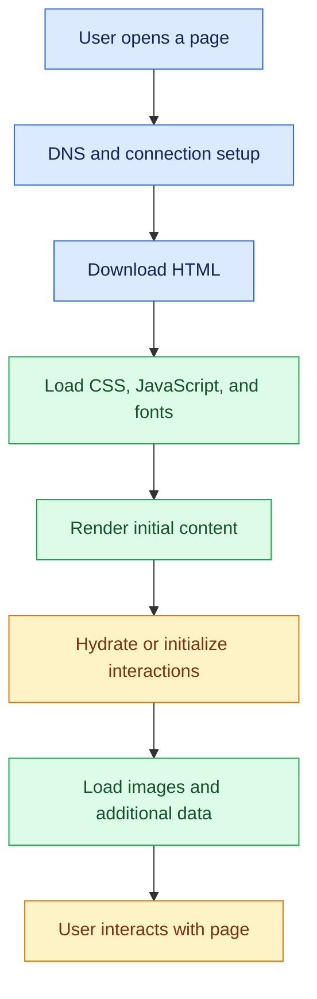

# 18. Performance Optimization and SEO

[⬅️ Previous](17-web-security-testing-and-accessibility.md) ·

> ⚡ AI Developer — Web Development 

## 🎯 Learning Objectives

By the end of this topic, you will be able to:

- Measure frontend performance and identify bottlenecks.
- Optimize JavaScript bundles, images, fonts, and network requests.
- Understand Core Web Vitals.
- Improve React rendering and loading performance.
- Apply caching and API optimization strategies.
- Implement technical SEO, metadata, and structured data.
- Build a practical performance and SEO checklist for production.

## 1. 🚀 Why Performance Matters

Performance affects how quickly users can view content, interact with controls, and complete tasks.

A slow boutique storefront may cause customers to abandon product searches or leave before checkout. Large images, excessive JavaScript, slow API responses, and layout shifts can all contribute to a poor experience.

Performance optimization is not simply about making a website score well in a tool. The goal is to make real user journeys fast, stable, and responsive.

## 2. 🧭 Understand the Performance Pipeline



Different problems occur at different stages:

- Large assets slow down downloads.
- Excessive JavaScript can delay rendering and interaction.
- Slow database queries increase API latency.
- Images without reserved dimensions can shift page content.
- Too many client-side components can increase hydration work.

Measure the bottleneck before deciding which optimization to apply.

## 3. 📊 Core Web Vitals

Core Web Vitals measure important aspects of the real-world user experience.

| Metric | Measures | Good target |
|---|---|---|
| LCP — Largest Contentful Paint | Loading performance | 2.5 seconds or less |
| INP — Interaction to Next Paint | Interaction responsiveness | 200 milliseconds or less |
| CLS — Cumulative Layout Shift | Visual stability | 0.1 or less |

These targets are generally evaluated at the 75th percentile of page visits, segmented by device type where appropriate.

- **LCP:** How quickly the main visible content appears.
- **INP:** How responsive the page is to user interactions throughout the visit.
- **CLS:** How much unexpected layout movement occurs.

Learn more from [web.dev — Core Web Vitals](https://web.dev/articles/vitals).

## 4. 🔍 Measure Before Optimizing

Use browser developer tools and Lighthouse to inspect:

- Network transfer size.
- JavaScript and CSS bundle size.
- Long-running main-thread tasks.
- Slow API requests.
- Image dimensions and formats.
- Layout shifts.
- Accessibility and SEO issues.

For real-user performance, use field data from the Chrome User Experience Report when available, plus real-user monitoring (RUM) in your application.

Laboratory results help reproduce problems. Field measurements show how real users experience the site across different networks, devices, and locations.

## 5. 🖼️ Optimize Images

Product photographs often account for a large portion of storefront downloads.

### Recommended Techniques

- Resize images to the largest size actually needed by the UI.
- Prefer efficient formats such as WebP or AVIF where supported.
- Compress images while preserving acceptable visual quality.
- Provide responsive image variants.
- Reserve image dimensions to reduce layout shifts.
- Lazy-load images that are below the fold.
- Prioritize the actual main image when it is the LCP element.

Example responsive image:

```html

```

The browser chooses an appropriate source based on the device and layout.

Do not lazy-load the primary above-the-fold image if doing so delays LCP. Reserve `loading="lazy"` for images that are not immediately needed.

## 6. 📦 Reduce JavaScript Bundle Size

Large JavaScript bundles can delay page initialization and interaction.

Useful strategies include:

- Remove unused dependencies.
- Use production builds.
- Split code by route.
- Lazy-load heavy components.
- Avoid importing entire libraries when smaller imports are available.
- Keep third-party scripts to a minimum.
- Analyze bundle size before and after changes.

Example with React lazy loading:

```tsx
import { Suspense, lazy } from "react";

const AnalyticsDashboard = lazy(
  () => import("./AnalyticsDashboard")
);

export default function App() {
  return (
    <Suspense fallback={<p>Loading dashboard...</p>}>
      <AnalyticsDashboard />
    </Suspense>
  );
}
```

This allows the dashboard code to be loaded separately when required. Add route-level splitting where your routing setup supports it.

## 7. ⚛️ Optimize React Rendering

React applications can become slow when large components re-render unnecessarily or perform expensive calculations on every render.

Useful techniques include:

- Keeping state as close as practical to the components that need it.
- Avoiding unnecessary state duplication.
- Using stable list keys.
- Paginating large datasets.
- Virtualizing very long lists.
- Using `useMemo` or `useCallback` only when measurement shows a benefit.
- Avoiding expensive synchronous calculations in interaction handlers.

Example:

```tsx
import { useMemo, useState } from "react";

type Product = {
  id: number;
  name: string;
  category: string;
  price: number;
};

export function ProductSearch({
  products
}: {
  products: Product[];
}) {
  const [search, setSearch] = useState("");

  const filteredProducts = useMemo(() => {
    const query = search.trim().toLowerCase();

    return products.filter((product) =>
      product.name.toLowerCase().includes(query)
    );
  }, [products, search]);

  return (
    <section>
      <label htmlFor="product-search">Search products</label>
      <input
        id="product-search"
        value={search}
        onChange={(event) => setSearch(event.target.value)}
      />

      <p>{filteredProducts.length} products found</p>
    </section>
  );
}
```

Memoization is most helpful for expensive calculations or stable values used by memoized children. For a small product array, ordinary filtering may be simpler and fast enough.

## 8. 🌐 Optimize Backend and API Performance

Frontend optimization alone cannot fix a slow backend.

Consider:

- Add indexes for frequently filtered or joined database columns.
- Avoid retrieving columns the frontend does not need.
- Use pagination for large datasets.
- Avoid N+1 database query patterns.
- Cache suitable public or repeatable responses.
- Use connection pools.
- Measure external service latency.
- Apply timeouts and bounded retries.
- Move expensive work to background jobs when appropriate.

Example paginated SQL query:

```javascript
const page = Math.max(1, Number(req.query.page) || 1);
const limit = Math.min(
  100,
  Math.max(1, Number(req.query.limit) || 20)
);

const offset = (page - 1) * limit;

const result = await pool.query(
  `SELECT id, name, category, price
   FROM products
   ORDER BY id
   LIMIT $1 OFFSET $2`,
  [limit, offset]
);

res.json({
  page,
  limit,
  products: result.rows
});
```

In a production endpoint, validate pagination values strictly rather than silently accepting every malformed input. For very large datasets, keyset pagination may perform better than large offsets.

## 9. 🗃️ Caching Strategies

Caching reduces repeated work when the underlying data can safely be reused.

Common layers include:

- **Browser cache:** Reuses previously downloaded static assets.
- **CDN cache:** Serves public assets from geographically distributed locations.
- **Application cache:** Stores computed or frequently accessed results.
- **Database cache:** Reuses data and query results internally.

For versioned static assets, long-lived caching can be effective:

```http
Cache-Control: public, max-age=31536000, immutable
```

Use this header only for content whose URL changes whenever the content changes, such as content-hashed JavaScript and CSS bundles.

For sensitive or personalized responses, use suitable private or no-store policies. Never accidentally cache one user's private dashboard and serve it to another user.

Caching requires an invalidation strategy. Product stock, prices, permissions, and financial information may need different freshness policies from product thumbnails.

## 10. 🔎 Search Engine Optimization (SEO)

SEO helps search engines understand and discover pages that should appear in search results.

### Technical SEO Fundamentals

- Use meaningful page titles and meta descriptions.
- Use semantic HTML and descriptive headings.
- Make important content accessible without relying entirely on client-side interactions.
- Provide descriptive URLs.
- Use canonical URLs when duplicate page variants exist.
- Generate a sitemap for relevant public pages.
- Configure `robots.txt` appropriately.
- Avoid indexing private dashboards and account pages.
- Ensure mobile layouts work well.
- Use descriptive internal links and image alternative text.

SEO does not guarantee rankings. Search engines consider many factors, and search appearance may change over time.

## 11. 📝 Add Metadata in HTML

For a standard HTML page:

```html
<head>
  <title>Women's Dresses | Lumiere Boutique</title>
  <meta
    name="description"
    content="Explore dresses for everyday wear, celebrations, and special occasions."
  />
  <link
    rel="canonical"
    href="https://example.com/products/dresses"
  />
</head>
```

Replace `example.com` with your actual production domain.

For a Next.js App Router project, use the Metadata API:

```tsx
import type { Metadata } from "next";

export const metadata: Metadata = {
  title: "Women's Dresses | Lumiere Boutique",
  description:
    "Explore dresses for everyday wear, celebrations, and special occasions.",
  alternates: {
    canonical: "/products/dresses"
  }
};

export default function DressesPage() {
  return (
    <main>
      <h1>Women's Dresses</h1>
      <p>Explore the latest collection.</p>
    </main>
  );
}
```

This metadata is associated with the route. Ensure the canonical URL resolves correctly against the configured production site URL.

## 12. 🧾 Structured Data

Structured data helps search engines interpret specific types of content. Product pages may use supported product markup to describe details such as a product's name, image, and price.

A simplified JSON-LD example:

```html
<script type="application/ld+json">
{
  "@context": "https://schema.org",
  "@type": "Product",
  "name": "Floral Summer Dress",
  "image": [
    "https://example.com/images/floral-dress.webp"
  ],
  "description": "Blue floral dress for everyday wear.",
  "offers": {
    "@type": "Offer",
    "priceCurrency": "INR",
    "price": "2499.00",
    "availability": "https://schema.org/InStock"
  }
}
</script>
```

Use real, current product data and a valid production URL. Structured data must accurately represent content visible on the page. Markup does not guarantee rich search results.

## 13. ⚡ Next.js and Rendering Strategies

Next.js offers different rendering strategies that can support performance and discoverability.

- **Static generation:** Build pages ahead of time when content can be generated in advance.
- **Server rendering:** Generate page content on the server for a request.
- **Client rendering:** Render or update interactive UI in the browser.
- **Incremental regeneration and revalidation:** Refresh eligible generated content according to the application's data freshness requirements.

A public product catalog may benefit from pre-rendering and revalidation. A private owner dashboard may rely on authenticated server-side data access and should never be exposed through a shared public cache.

Choose rendering based on data freshness, personalization, interaction requirements, and hosting capabilities.

## 14. 🏪 Real-World Scenario: Optimize the Boutique Storefront

A product listing page feels slow on mobile devices.

1. Use Lighthouse and browser developer tools to measure the page.
2. Identify oversized product images and reduce their dimensions.
3. Lazy-load below-the-fold images.
4. Split the analytics dashboard into a separate JavaScript chunk.
5. Paginate the product catalog and optimize database queries.
6. Add accurate page titles, descriptions, and product metadata.
7. Compare performance before and after changes.

Record the actual results. Do not claim that an optimization improved performance until measurements confirm the improvement.

## 15. ⚠️ Common Mistakes

- Optimizing without measuring.
- Lazy-loading the main image and worsening LCP.
- Applying long-lived caching to changing or personalized content.
- Using memoization everywhere without evidence.
- Loading all products and rendering thousands of DOM elements.
- Publishing duplicate or incorrect canonical URLs.
- Adding structured data that does not match visible content.
- Blocking important public content from search engine crawlers.
- Assuming a high Lighthouse score guarantees strong real-user performance.

## 🔑 Key Takeaways

- Measure real bottlenecks before optimizing.
- Core Web Vitals cover loading, responsiveness, and visual stability.
- Efficient images, JavaScript splitting, and API optimization can improve performance.
- Caching must account for freshness, personalization, and privacy.
- SEO requires accessible content, accurate metadata, crawlable routes, and sound technical structure.
- Structured data must reflect genuine page content.
