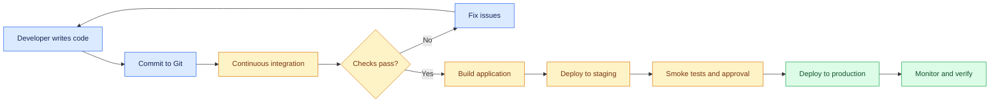
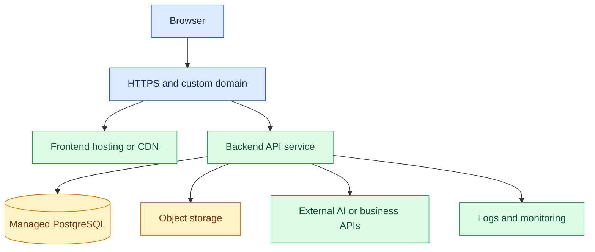

# 19. Deployment, CI/CD, and Production Monitoring

[⬅️ Previous](18-performance-optimization-and-seo.md) ·

> 🚀 AI Developer — Web Development 

## 🎯 Learning Objectives

By the end of this topic, you will be able to:

- Understand deployment environments and hosting options.
- Deploy a frontend and backend as separate services.
- Configure environment variables and production secrets.
- Build a continuous integration and continuous delivery pipeline.
- Run automated checks before deployment.
- Monitor application health, errors, performance, and availability.
- Plan safe releases, rollbacks, and database migrations.

## 1. 🌍 What Is Deployment?

Deployment is the process of making an application available in an environment where its intended users can access it.

A typical web application may have:

- A React or Next.js frontend.
- A Node.js backend API.
- A PostgreSQL database.
- Object storage for uploaded images.
- A domain name and HTTPS certificate.
- Monitoring and logging services.

Deploying the application involves configuring these components, connecting them securely, and verifying that the application works in its target environment.

### Development to Production



The goal is to make releases repeatable, testable, and recoverable rather than relying on manual commands that vary from one deployment to another.

## 2. 🧭 Understand Deployment Environments

| Environment | Purpose | Typical configuration |
|---|---|---|
| Development | Build and debug features | Local services and test data |
| Testing | Run automated checks | Isolated test services |
| Staging | Validate a release before production | Production-like configuration |
| Production | Serve real users | Protected credentials, monitoring, backups |

Use separate databases, credentials, and service configuration for different environments.

Do not copy production secrets into a development `.env` file. Test data should not contain real personal or financial information unless it is appropriately protected and explicitly required.

## 3. 🏗️ Choose a Hosting Architecture

A common architecture for a React and Node.js application is:



Common hosting choices include:

- Static frontend hosting or a CDN for built React applications.
- Managed application hosting or containers for Node.js services.
- Managed PostgreSQL for persistent relational data.
- Object storage for product images and uploaded media.
- A platform that supports Next.js server rendering if your app depends on server-side Next.js features.

Choose hosting based on runtime requirements, scaling, deployment workflow, budget, data residency, and operational needs.

## 4. 📦 Prepare a React Application for Deployment

For a Vite React application, install dependencies and create a production build:

```bash
npm ci
npm run build
```

The generated production files are typically placed in `dist/`.

Preview the build locally:

```bash
npm run preview
```

The preview server is useful for testing the generated files, but it is not a production hosting server.

Deploy the `dist/` output to a static hosting provider or CDN. Configure the provider's fallback behavior appropriately if the app uses client-side routes.

### Configure the API URL

Create a frontend `.env.production` file if your build process requires it:

```env
VITE_API_BASE_URL=https://api.example.com/api
```

Replace the example hostname with your actual API URL.

Build-time Vite variables are bundled into the client application, so they must not contain passwords, private API keys, or other secrets.

If the API URL changes between environments, use the hosting platform's supported build-time configuration or build a deliberate runtime-configuration mechanism.

## 5. 🟢 Prepare the Node.js Backend

Your Express application should listen on the port provided by its hosting environment.

```javascript
const express = require("express");

const app = express();

app.get("/api/health", (req, res) => {
  res.status(200).json({
    status: "healthy"
  });
});

const port = process.env.PORT || 3000;

app.listen(port, "0.0.0.0", () => {
  console.log(`API listening on port ${port}`);
});
```

The host may require a different binding or startup command; follow its documentation. Binding to `0.0.0.0` is commonly used when a container or platform must expose the application port.

A minimal production `package.json` might contain:

```json
{
  "scripts": {
    "start": "node src/server.js",
    "test": "vitest run"
  }
}
```

Ensure your real project has all required dependencies and scripts. Run tests and create the production build, if applicable, before deployment.

## 6. 🔐 Production Environment Variables

Configure sensitive values in your hosting platform's secret or environment-variable settings.

Typical server-side settings include:

```env
NODE_ENV=production
PORT=3000
DATABASE_URL=your-production-database-connection
SESSION_SECRET=your-long-random-session-secret
CLIENT_ORIGIN=https://example.com
```

These are examples, not credentials to copy literally.

Important rules:

- Never commit production secrets to Git.
- Restrict access to environment settings.
- Use least-privilege database accounts.
- Rotate credentials when necessary.
- Avoid printing environment variables into logs.
- Verify that production CORS allows only intended frontend origins.
- Use HTTPS and secure cookie settings.
- Keep development-only debug features disabled.

## 7. 🔄 What Is CI/CD?

**Continuous Integration (CI)** automatically checks code changes when developers commit or open a pull request.

**Continuous Delivery (CD)** keeps software ready for release through automated build, test, and deployment processes. **Continuous Deployment** goes further by automatically releasing qualifying changes to production.

A pipeline might perform these tasks:

1. Install dependencies.
2. Run linting and type checks.
3. Run unit and integration tests.
4. Build the frontend and backend.
5. Scan dependencies and build artifacts where appropriate.
6. Deploy to a staging environment.
7. Run smoke tests.
8. Require approval if the release policy calls for it.
9. Deploy to production.
10. Verify the release and monitor for regressions.

## 8. 🧪 Create a GitHub Actions Workflow

Create `.github/workflows/ci.yml` in a React TypeScript repository:

```yaml
name: Frontend CI

on:
  push:
    branches: [main]
  pull_request:
    branches: [main]

permissions:
  contents: read

jobs:
  build-and-test:
    runs-on: ubuntu-latest

    steps:
      - name: Checkout repository
        uses: actions/checkout@v4

      - name: Set up Node.js
        uses: actions/setup-node@v4
        with:
          node-version: 22
          cache: npm

      - name: Install dependencies
        run: npm ci

      - name: Run tests
        run: npm run test:run

      - name: Build frontend
        run: npm run build
```

This workflow assumes that the repository's `package.json` defines `test:run` and `build` scripts. It also assumes the application supports the selected Node.js version; use a currently supported Node.js LTS version compatible with your project and dependencies.

The example checks the frontend repository. A backend repository should have its own appropriate test and build steps, or the workflow should be extended to test both projects.

For stronger supply-chain security, pin third-party actions to reviewed full commit SHAs and update those pins through a controlled process.

## 9. 🚦 Deployment Strategies

Different applications use different release strategies.

| Strategy | Description | Main trade-off |
|---|---|---|
| Rolling deployment | Replace instances gradually | Old and new versions may run simultaneously |
| Blue-green deployment | Switch traffic between two environments | Requires capacity for both environments |
| Canary release | Send a small portion of traffic to a new version | Requires routing and monitoring controls |
| Manual release | Deploy after an explicit operator action | More control, but slower and easier to vary |

For a small project, a straightforward managed-platform deployment may be enough. Larger applications may benefit from canary releases, feature flags, and automated rollback conditions.

## 10. 🗃️ Database Migrations and Rollbacks

Production releases often change database schemas as well as application code.

For example, adding a new `image_url` column may require a migration. A safe release plan considers what happens if the new code and the old code run at the same time.

Useful practices include:

- Keep migrations in version control.
- Back up important data before risky changes.
- Prefer backward-compatible schema changes.
- Add new columns before requiring them.
- Deploy code that can handle old and new data formats during transitions.
- Remove obsolete columns only after all dependent code has been updated.
- Test migrations and rollback procedures on staging.

Rolling back application code does not automatically roll back a database migration. Some schema changes are difficult or unsafe to reverse after new data has been written.

## 11. 📡 Production Monitoring

Monitoring helps answer three questions:

- Is the application available?
- Is it performing well?
- Is something going wrong that requires action?

Useful signals include:

- **Availability:** Whether services respond to valid health checks.
- **Latency:** How long requests take.
- **Error rate:** The proportion of failed requests.
- **Traffic:** How many requests the system receives.
- **Resource usage:** CPU, memory, database connections, and storage.
- **Business metrics:** Successful orders, failed checkouts, and upload completion rates.

Logs explain individual events. Metrics show trends. Traces help connect activity across services. Together, these observability signals help diagnose failures.

## 12. 🩺 Health Checks and Error Logging

A health endpoint can indicate whether the application process is responding:

```javascript
app.get("/api/health", (req, res) => {
  res.status(200).json({
    status: "healthy",
    service: "boutique-api"
  });
});
```

A simple health endpoint does not prove that every dependency is working. For production, distinguish between:

- **Liveness:** Is the process alive and able to continue?
- **Readiness:** Is the instance ready to receive traffic, including required dependency checks?

Avoid having a temporary external-service outage cause a liveness probe to restart every healthy application instance repeatedly. Readiness checks should also have bounded timeouts.

For error logging:

```javascript
app.use((err, req, res, next) => {
  console.error({
    message: err.message,
    method: req.method,
    path: req.path,
    timestamp: new Date().toISOString()
  });

  if (res.headersSent) {
    return next(err);
  }

  res.status(500).json({
    error: "An unexpected server error occurred"
  });
});
```

This is a simple illustration. In production, use structured logging, appropriate redaction, a correlation or request ID, and controlled error classification. Do not log credentials, tokens, full request bodies containing sensitive data, or internal stack traces into public responses.

## 13. 🚨 Alerts and Incident Response

Monitoring is useful only when important failures lead to an appropriate response.

Examples of alert conditions:

- API error rate remains above an agreed threshold.
- Request latency exceeds the service target.
- Database connections approach the configured limit.
- Disk space is running low.
- Scheduled backups fail.
- A deployment causes a sudden rise in server errors.

Create alerts around user impact rather than every harmless warning. Define who receives alerts, how incidents are investigated, and how to roll back or mitigate a failed release.

## 14. 📈 Service-Level Indicators and Objectives

A **Service-Level Indicator (SLI)** is a measurement of service behavior, such as the percentage of successful requests.

A **Service-Level Objective (SLO)** is a target for that measurement over a defined period.

For example:

- SLI: Percentage of eligible API requests completed successfully.
- SLO: At least 99.9% of eligible requests succeed over a rolling 30-day window.

The target is an example, not a universal requirement. Choose realistic objectives based on the product's needs, costs, and architecture.

## 15. 🏪 Real-World Scenario: Release a Boutique Application

A new version adds product image uploads and manager-only catalog editing.

1. A developer opens a pull request.
2. CI runs tests, type checks, and builds.
3. Reviewers approve the change.
4. The application deploys to staging.
5. The team tests authentication, uploads, and database migrations.
6. The release deploys to production.
7. Smoke tests verify the API and storefront.
8. Monitoring checks latency, error rate, and upload failures.
9. If the release causes serious errors, the team rolls back or applies a controlled mitigation.

The release is complete only after the application has been verified in its real environment.

## 16. ⚠️ Common Mistakes

- Deploying without running tests.
- Forgetting to configure the production API URL.
- Committing secrets into Git.
- Assuming a successful build means the deployment works.
- Using local filesystem storage for files that must survive ephemeral deployments.
- Applying database migrations without a recovery plan.
- Exposing debug endpoints or verbose error responses.
- Ignoring monitoring after a deployment.
- Automatically rolling back application code without considering schema compatibility.
- Alerting on too many low-impact events.

## 17. ✅ Production Release Checklist

Before a release:

- [ ] Automated tests and production builds pass.
- [ ] Environment variables and secrets are configured securely.
- [ ] Database migrations have been reviewed and tested.
- [ ] Authentication and authorization work in the deployed environment.
- [ ] HTTPS and CORS settings are correct.
- [ ] File storage and backup policies are configured.
- [ ] Health checks and structured logging work.
- [ ] Error-rate and latency monitoring is available.
- [ ] A rollback or mitigation plan is documented.
- [ ] Smoke tests pass against the deployed release.

## 🔑 Key Takeaways

- Deployment moves a tested application into a real operating environment.
- CI/CD makes build, test, and release processes repeatable.
- Secrets and database access must be configured securely.
- Database migrations require compatibility and recovery planning.
- Logs, metrics, traces, and alerts help maintain production reliability.
- A release should be verified and monitored after deployment.
