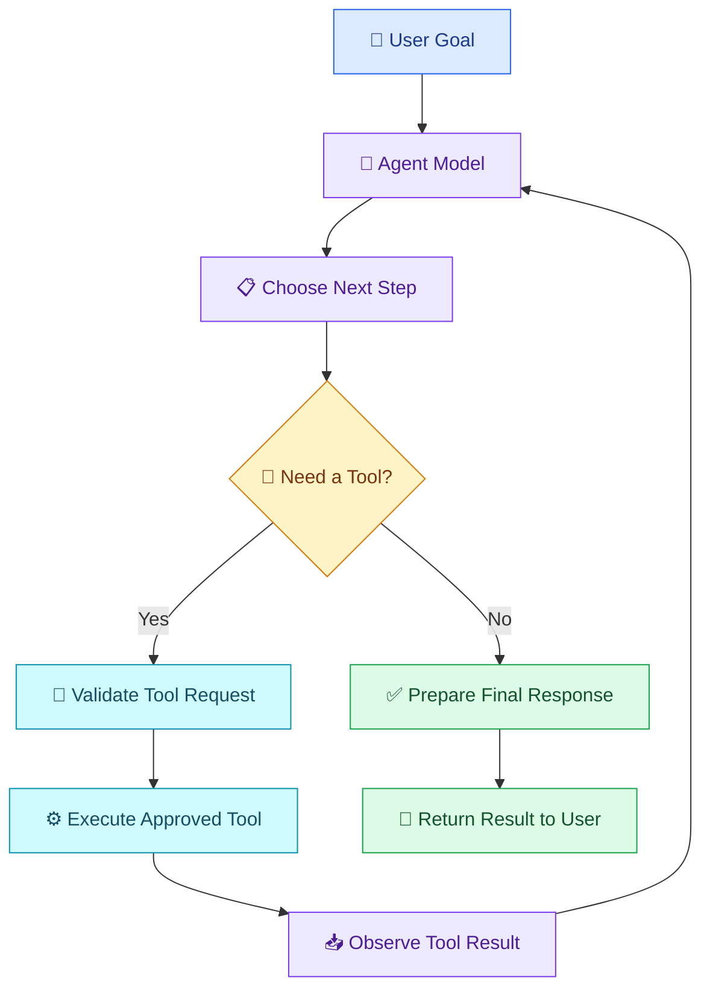

# 🤖 13 — AI Agents and Tool Use

[⬅️ Back to Learning Modules](../README.md) · 

> Venkata Bhattaram (c) 2026

## 🎯 Learning Objectives

- Understand what an AI agent is.
- Distinguish a chatbot from a tool-enabled AI agent.
- Learn how agents select and use tools.
- Understand agent instructions, state, observations, and stopping conditions.
- Explore practical agent use cases and safety requirements.

## 🌟 1. What Is an AI Agent?

An **AI agent** is a software system that uses an AI model to help decide what to do next, often interacting with tools, observing results, and continuing until a defined goal or stopping condition is reached.

A simple chatbot primarily responds to messages. An agent can also use approved tools to retrieve information or carry out permitted operations.

For example, a shopping assistant might retrieve a product's current stock, compare available products, and prepare a recommendation.

An agent does not need unlimited autonomy. Many reliable agents operate within a narrowly defined task, a small set of tools, and strict execution limits.

## ⚖️ 2. Chatbot vs AI Agent

| Feature | Basic chatbot | Tool-enabled AI agent |
|---|---|---|
| Main purpose | Respond to user messages | Help achieve a defined goal |
| External information | Usually needs information supplied to it | Can retrieve information through tools |
| Actions | Often generates text only | Can request approved operations |
| Workflow | Usually one response at a time | May use multiple steps |
| State | May maintain conversation history | May also track task state and observations |
| Safety needs | Input and output safeguards | Also requires tool permissions and action controls |

A chatbot can itself use tools, and an agent can be very simple. The distinction is about system behavior, not just the interface.

## 🏗️ 3. How an AI Agent Works



A typical agent cycle includes:

1. Receive a goal.
2. Examine the available context and tools.
3. Select a next step.
4. Request a tool operation if needed.
5. Validate and execute the permitted operation.
6. Inspect the result.
7. Continue or return a final response.

The application should enforce maximum steps, timeouts, and other stopping conditions to prevent endless loops or runaway costs.

## 🧰 4. What Are Tools?

Tools are functions or services that an agent can request the application to use.

| Tool | Example operation |
|---|---|
| Search tool | Search an approved knowledge collection |
| Database tool | Retrieve a customer's authorized order |
| Calculator | Calculate totals or percentages |
| Email tool | Prepare or send an email |
| Calendar tool | Check availability or create an event |
| File tool | Read an approved document |
| Business API | Retrieve current inventory or order status |

A tool should have a clear name, a defined input schema, a limited purpose, and a controlled result.

## 🌍 5. Real-World Scenario — AI Sales Assistant

Imagine a retailer wants an assistant that answers questions about sales performance.

A manager asks:

> Which product generated the highest revenue last month, and what should we investigate?

The agent may:

1. Retrieve the authorized sales data.
2. Ask a database tool for the relevant reporting period.
3. Calculate revenue using SQL or Python.
4. Review the verified result.
5. Ask the model to explain possible follow-up investigations.
6. Present the findings with the reporting period and data source.

The model should not invent sales figures. Exact calculations should be performed by trusted application logic.

## 💻 6. A Simple Tool-Enabled Agent Pattern

The following example demonstrates the decision process without requiring a live AI API. It uses a predefined request to illustrate how a controlled application can choose a tool.

```python
ORDERS = {
    "ORD-1001": {"status": "Shipped"},
    "ORD-1002": {"status": "Processing"},
}


def get_order_status(order_id: str) -> dict:
    order = ORDERS.get(order_id)

    if order is None:
        return {"found": False, "message": "Order not found."}

    return {
        "found": True,
        "order_id": order_id,
        "status": order["status"],
    }


def run_agent(order_id: str) -> str:
    # In a real agent, an AI model may request this tool.
    # The application still validates the request and permissions.
    if not isinstance(order_id, str):
        raise ValueError("Order ID must be text.")

    if order_id not in ORDERS:
        return "The requested order was not found or is unavailable."

    result = get_order_status(order_id)

    if not result["found"]:
        return result["message"]

    return (
        f"Order {result['order_id']} "
        f"is currently {result['status']}."
    )


if __name__ == "__main__":
    print(run_agent("ORD-1001"))
```

Expected output:

```text
Order ORD-1001 is currently Shipped.
```

This is a deterministic tool-use demonstration, not a complete autonomous AI agent. A model-enabled implementation would add a model decision step and a controlled tool-calling loop.

## 🔐 7. Agent Safety and Permissions

An agent's ability to use tools creates additional risks.

- **Least privilege:** Give each tool only the permissions it needs.
- **Authorization:** Check whether the current user can access the requested resource.
- **Input validation:** Validate tool arguments before execution.
- **Human approval:** Require confirmation for consequential actions.
- **Execution limits:** Bound the number of tool calls, runtime, and spending.
- **Auditability:** Record important actions without unnecessarily logging sensitive data.
- **Untrusted content:** Treat retrieved documents and external tool results as data, not trusted instructions.

For example, a model may request cancellation of an order, but the application must independently verify ownership, cancellation rules, and confirmation requirements.

## ⚠️ 8. Common Mistakes

- Giving an agent unrestricted access to tools.
- Assuming the model always chooses the correct tool.
- Allowing unlimited retries or execution loops.
- Treating tool output as automatically trustworthy.
- Letting a model make financial or account changes without authorization.
- Using an agent where a simple function or workflow would be more reliable.

## ✅ 9. Best Practices

- Start with a narrowly defined task.
- Register only necessary tools.
- Use explicit schemas and validate every argument.
- Keep business rules outside the model.
- Set step, time, and cost limits.
- Test tool failures and malicious or misleading inputs.
- Require human review for high-impact operations.
- Track task success, tool errors, and latency.

## 🔑 Key Takeaways

- Agents combine model-driven decisions with application tools and state.
- Tool calls are requests that the application must validate and execute.
- More autonomy increases the need for permissions, monitoring, and safeguards.
- Use conventional code for deterministic tasks and agents where flexible decisions add value.