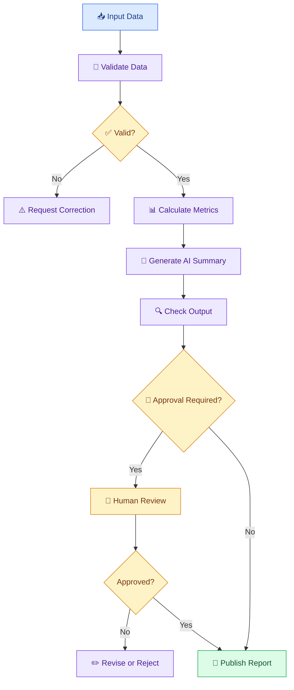

# 🔄 14 — Multi-Step AI Workflows and Orchestration

[⬅️ Previous](13-ai-agents-and-tools.md) .

> Venkata Bhattaram (c) 2026

## 🎯 Learning Objectives

- Understand multi-step AI workflows.
- Learn the difference between a workflow and an autonomous agent.
- Understand sequential, conditional, and parallel execution.
- Learn how to coordinate AI models, APIs, and conventional code.
- Design workflows with validation, retries, and human approval.

## 🌟 1. What Is an AI Workflow?

An **AI workflow** is a sequence of connected steps that processes information and produces a result. Some steps use AI models; others use normal programming, databases, or external APIs.

For example, an AI report generator might:

1. Load a sales report.
2. Validate the data.
3. Calculate key metrics.
4. Ask an AI model to summarize the verified results.
5. Validate the report structure.
6. Request approval.
7. Export the final report.

The workflow defines how these steps fit together.

## ⚖️ 2. Workflow vs Agent

| Feature | Workflow | AI agent |
|---|---|---|
| Execution | Usually follows a predefined process | May choose the next action dynamically |
| Control flow | Defined by the developer | May depend partly on model decisions |
| Predictability | Often easier to test and reproduce | Can be more variable |
| Best suited for | Repeatable, well-defined processes | Tasks requiring flexible tool selection |
| Safety | Enforced through step rules and permissions | Also requires controlling model-selected actions |

A workflow can contain agents, and an agent can operate inside a larger workflow. Many production systems combine both approaches.

## 🏗️ 3. Common Workflow Patterns

### A. Sequential workflow

Each step starts after the previous step finishes.

Example: Extract document → summarize → validate → export.

### B. Conditional workflow

A decision determines which path runs.

Example: If data validation fails, request correction; otherwise continue.

### C. Parallel workflow

Independent tasks run simultaneously.

Example: Analyze product reviews and support tickets at the same time.

### D. Human-in-the-loop workflow

A person reviews a result before the next important action.

Example: An AI drafts a customer email, but a staff member approves it before sending.



## 🌍 4. Real-World Scenario — Automated Weekly Sales Report

A retail manager wants a weekly report without manually combining several spreadsheets.

The workflow can:

1. Retrieve sales records for the selected week.
2. Validate dates, missing values, and numeric fields.
3. Calculate revenue and units sold using Python or SQL.
4. Ask an LLM to summarize verified trends.
5. Check that the response follows a report schema.
6. Display the report for review.
7. Export or send it after the required approval.

The workflow should stop if the input data is invalid. An AI summary should not hide missing records or turn correlation into an unsupported explanation of causation.

## 💻 5. Build a Simple AI Workflow

This example demonstrates the workflow structure with deterministic functions. It runs without an AI API so that you can understand orchestration first.

Create `sales_workflow.py`:

```python
from dataclasses import dataclass


@dataclass
class SalesSummary:
    total_revenue: float
    total_units: int
    top_product: str


def validate_sales(rows: list[dict]) -> None:
    if not rows:
        raise ValueError("Sales data cannot be empty.")

    required = {"product", "revenue", "units"}

    for row in rows:
        if not required.issubset(row):
            raise ValueError("A row is missing required fields.")

        if not isinstance(row["product"], str) or not row["product"].strip():
            raise ValueError("Product name must be non-empty.")

        if row["revenue"] < 0 or row["units"] < 0:
            raise ValueError("Sales values cannot be negative.")


def calculate_metrics(rows: list[dict]) -> SalesSummary:
    revenue_by_product = {}

    for row in rows:
        product = row["product"]
        revenue_by_product[product] = (
            revenue_by_product.get(product, 0) + row["revenue"]
        )

    total_revenue = sum(revenue_by_product.values())
    total_units = sum(row["units"] for row in rows)

    top_product = max(
        revenue_by_product,
        key=revenue_by_product.get,
    )

    return SalesSummary(
        total_revenue=total_revenue,
        total_units=total_units,
        top_product=top_product,
    )


def create_report(summary: SalesSummary) -> str:
    return (
        "Weekly Sales Report\n"
        f"Total revenue: {summary.total_revenue:.2f}\n"
        f"Total units sold: {summary.total_units}\n"
        f"Highest-revenue product: {summary.top_product}\n"
    )


def run_workflow(rows: list[dict]) -> str:
    validate_sales(rows)
    summary = calculate_metrics(rows)
    return create_report(summary)


if __name__ == "__main__":
    sales = [
        {"product": "Notebook", "revenue": 6000, "units": 120},
        {"product": "Pen", "revenue": 4000, "units": 200},
        {"product": "Backpack", "revenue": 14000, "units": 35},
    ]

    print(run_workflow(sales))
```

Run:

```powershell
python sales_workflow.py
```

Expected output:

```text
Weekly Sales Report
Total revenue: 24000.00
Total units sold: 355
Highest-revenue product: Backpack
```

This demonstrates a sequential workflow. To make it AI-powered, add a step that supplies the calculated metrics to an LLM and asks for a concise narrative. Keep the numeric calculations in Python.

## 🧠 6. Where Orchestration Frameworks Help

When a workflow becomes complex, a framework can help manage execution, state, branching, and recovery.

Examples include:

- **LangGraph:** Graph-based orchestration with stateful workflows and control over execution.
- **CrewAI:** Coordinates role-based agents and tasks, including multi-agent workflows.
- **Strands Agents:** Provides tools for building model-driven agents and tool-using applications.
- **AWS Step Functions:** Orchestrates distributed application steps and AWS services.
- **Ordinary Python:** Often sufficient for a small, straightforward pipeline.

These tools solve different problems. Choose based on workflow complexity, runtime requirements, integrations, and operational needs rather than adopting a framework by default.

## 🔁 7. Reliability and Error Handling

A robust workflow should define what happens when a step fails.

- **Retry:** Repeat a temporary failure within defined limits.
- **Fallback:** Use an alternative path when appropriate.
- **Timeout:** Stop a step that takes too long.
- **Checkpoint:** Save state so work can resume safely.
- **Idempotency:** Prevent a repeated operation from causing unintended duplicate effects.
- **Compensation:** Where possible, safely reverse or reconcile a completed step if a later step fails.
- **Human review:** Route uncertain or consequential results to an authorized person.

Do not automatically retry every operation. Repeating a payment or email action can cause duplicate side effects unless the operation is designed to be safe to repeat.

## ⚠️ 8. Common Mistakes

- Using an autonomous agent for a simple fixed process.
- Allowing steps to continue after failed validation.
- Repeating side-effecting operations without safeguards.
- Passing unvalidated model output to later steps.
- Failing to record workflow state and errors.
- Creating unnecessary dependencies between independent steps.
- Publishing AI-generated content without required approval.

## ✅ 9. Best Practices

- Define inputs, outputs, and failure behavior for each step.
- Keep deterministic business logic separate from AI generation.
- Use explicit branches and bounded execution.
- Add checkpoints for long-running workflows.
- Test normal, partial-failure, and recovery scenarios.
- Record traceable step results without exposing secrets.
- Require human approval where consequences justify it.

## 🔑 Key Takeaways

- Orchestration connects multiple tasks into a controlled process.
- Sequential, conditional, parallel, and human-reviewed workflows solve different problems.
- Agents can be incorporated into workflows without making the entire process autonomous.
- Reliability requires validation, observability, and well-defined recovery behavior.